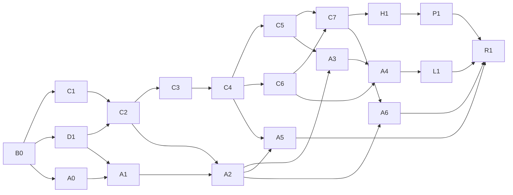

# Afterglow: Imjin 1593 (codename Tieqi)

Afterglow: Imjin 1593 (Traditional Chinese title 餘暉：壬辰 1593) is a tactics game demo set in the Imjin War, played mainly from the side of the Ming army's Liaodong cavalry. The first scenario is the Battle of Byeokjegwan, 1593: pausable real time, counters on a map, cavalry charges that break formations, morale collapse, and routed units that scatter and regroup. The stack is C++20 and SFML 3.1, with the rules core kept separate from the presentation layer. Work is split into task cards and handed to coding agents.

**Status**: milestones M1 (rules core) and M3 (demo package) are done, and demo 0.1.0 builds as a local Windows zip. M2 is waiting for the author's manual playthroughs. See [docs/PROGRESS.md](docs/PROGRESS.md) for each card.

## Documents

| File | Contents | When to read it |
|---|---|---|
| [docs/DEVELOPMENT.md](docs/DEVELOPMENT.md) | Engineering spec: working agreement, dependencies and build, architecture, API, rule formulas, data formats, AI, presentation, tests and acceptance, task cards | Before starting any work; it wins over every other source |
| [docs/DESIGN.md](docs/DESIGN.md) | Design intent: pillars, factions and unit types, scenario, presentation, market and localization | To learn why something is designed the way it is |
| [docs/PROGRESS.md](docs/PROGRESS.md) | Status of every card, measured numbers, open questions, translations awaiting review | Before picking up the next card |
| [docs/AGENT_LOOP.md](docs/AGENT_LOOP.md) | Process and stop conditions for continuous agent work | When running several cards in a row |
| [docs/adr/](docs/adr/) | Architecture decisions: 0001 move to SFML 3.1, 0002 Traditional Chinese in game | Before overturning a major decision |
| [reference/prototype/byeokjegwan.html](reference/prototype/byeokjegwan.html) | Reference implementation of the rules; open it in a browser to play | For any detail the spec does not cover |
| [AGENTS.md](AGENTS.md), [CLAUDE.md](CLAUDE.md) | Entry notes for coding agents; the two files are identical | Read automatically by agents |

Priority when sources disagree: the "Rule spec" and "Data formats" chapters of DEVELOPMENT.md come first, then the prototype source, then the design document.

## At a glance

- **Play**: pausable real time at 0.5×, 1×, and 2×; orders can be given while paused. Ming cavalry wins by charging through formations; the Japanese army covers its melee troops with arquebus fire. Morale decides battles: a broken unit scatters into two or three groups, and remnants of the same unit merge again after rallying. Units can split and join.
- **Scenario**: three phases (meeting engagement, main body advances, withdrawal), with a scout warning and Yang Yuan's reinforcements in between. Li Rusong leaving the map is a win and his death is a loss; the grade depends on troops withdrawn and enemy units routed.
- **Architecture**: `tq_core` is the deterministic rules core and depends only on the standard library; `tq_data` reads JSON; `tieqi` is the SFML 3 presentation layer; `tq_headless` runs headless battles; `tq_tests` uses doctest.
- **Time**: one tick is 0.8 battlefield seconds; `time_scale` defaults to 8, matching the prototype's pace. Changing the pace means changing only this number, and balance stays the same.
- **Determinism**: the same seed and the same sequence of player commands give the same result on every tick, so a replay stores only the seed and the commands.
- **Data**: unit types, scenarios, configuration, and string tables are JSON; rule constants live only in `src/core/rules/Constants.h`.
- **Text**: Chinese in the game is always Traditional (zh-Hant), with English and Korean as well; fonts are Noto Serif TC / KR and LXGW WenKai TC.
- **Acceptance**: formula expectations, seven duels, and whole-battle baselines were all measured on the prototype, and the port must land within the allowed tolerance.

## Build and run

Requires CMake 3.28+, Ninja, and a C++20 compiler (MSVC 2022 on Windows, GCC 13 on Linux). Dependencies are fetched and built from source on the first configure.

```powershell
cmake --preset dev
cmake --build --preset dev
ctest --preset dev
.\build\dev\tieqi.exe
```

| Preset | Build type | Dev tools | Tests | Use |
|---|---|---|---|---|
| `dev` | Debug | ON (F1 opens the ImGui panel) | ON | Day-to-day work |
| `release` | Release | OFF | OFF | Demo package; MSVC runtime linked statically |
| `ci` | RelWithDebInfo | OFF | ON | CI; warnings are errors |

The slow tests (the 100-battle baseline) are excluded by default: run them with `ctest --preset dev -L slow`.

Headless battles: `.\build\dev\tq_headless.exe --scenario byeokjegwan --seed 1 --runs 100 --policy scripted`.

Windows demo zip (stays local, nothing is published):

```powershell
cmake --preset release
cmake --build --preset release --target package_demo
# build/release/dist/Afterglow-Imjin-1593-demo-<version>-win64.zip
```

## Directory layout

```text
tieqi/
├─ README.md                    this page
├─ AGENTS.md  CLAUDE.md         agent entry notes (identical)
├─ .gitignore  .gitattributes  .clang-format
├─ CMakeLists.txt  CMakePresets.json
├─ cmake/                       Dependencies, warnings, packaging, checks
├─ .github/
│  ├─ pull_request_template.md  PR checklist
│  ├─ ISSUE_TEMPLATE/task.md    task card template
│  └─ workflows/ci.yml          Windows MSVC and Ubuntu GCC 13
├─ docs/
│  ├─ DEVELOPMENT.md            engineering spec
│  ├─ DESIGN.md                 design document
│  ├─ PROGRESS.md               card status and measurements
│  ├─ AGENT_LOOP.md             continuous agent process
│  ├─ demo/README.txt           player notes shipped in the demo zip
│  ├─ images/pr/                PR screenshots
│  └─ adr/                      0001 SFML 3.1, 0002 Traditional Chinese
├─ reference/prototype/byeokjegwan.html     rules reference implementation
├─ data/
│  ├─ config.json               time scale, language, and other global settings
│  ├─ units.json                unit types
│  ├─ scenarios/byeokjegwan.json            Byeokjegwan scenario
│  ├─ strings/zh-Hant.json  en.json  ko.json  string tables
│  └─ schema/                   JSON Schema
├─ assets/
│  ├─ fonts/                    fonts and their licenses
│  ├─ textures/{chits,map,ui}/  AI-generated art
│  ├─ audio/                    sound effects
│  └─ AI_ASSETS.md              register of AI-generated assets
├─ src/
│  ├─ core/                     rules core tq_core
│  ├─ data/                     JSON loading tq_data
│  └─ app/                      SFML presentation layer tieqi (dev/ holds the ImGui tools)
├─ tools/
│  ├─ headless/                 headless battles tq_headless
│  ├─ parity/                   prototype comparison scripts (Node, Playwright)
│  └─ check_source_language.py  CI check that source code is English only
└─ tests/                       tq_tests: core, data, parity, replay, app
```

## Task cards and dependencies



| Milestone | Cards | Done when |
|---|---|---|
| M1 Rules core | B0, C1, D1, C2, C3, C4, C5, C6, C7, H1, P1 | Headless battles run to the end and every prototype comparison passes |
| M2 A full battle | A0, A1, A2, A3, A4, A5 | A whole Byeokjegwan battle can be played in the game window |
| M3 Demo package | A6, L1, R1 | Unzips and plays on a Windows PC without a development environment, in all three languages |

The scope and acceptance criteria of each card are in the "Task breakdown" chapter of DEVELOPMENT.md.

## Links

The online versions are private links that only the author can open: [development spec](https://claude.ai/artifact/6uRaYbNkV5QtLEZohtZ12b), [design document](https://claude.ai/artifact/377hQjkSfs6krJiTqJUM5s), [playable prototype](https://claude.ai/artifact/GEGVr72yHEmDop4MWd4fDy). The `docs/` folder in this repository is authoritative; the online versions are archives only.

Framework origin: [QizhouD/2D-action-game](https://github.com/QizhouD/2D-action-game).
