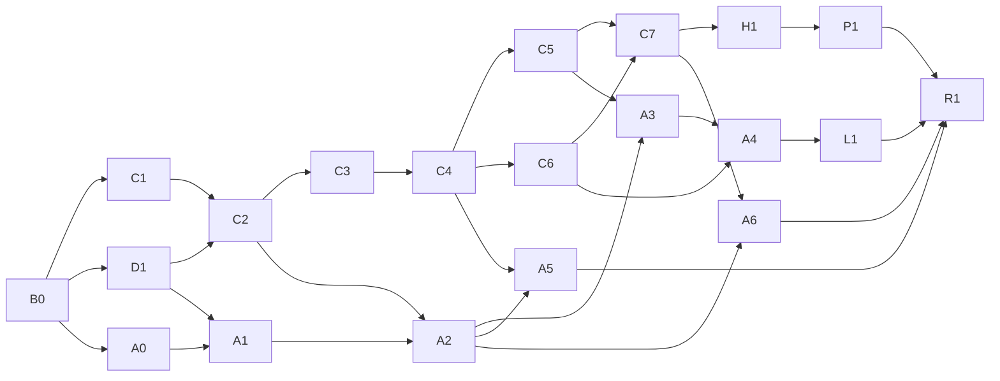

# Afterglow: Imjin 1593（代号 Tieqi）

Afterglow: Imjin 1593（繁中 餘暉：壬辰 1593）是以明军辽东骑兵为主视角的壬辰战争战术游戏 demo，第一个场景是 1593 年的碧蹄馆之战：可暂停实时制、棋子表现，冲锋破阵、士气崩溃、溃兵散开与收拢。技术栈是 C++20 + SFML 3.1，规则核心与表现层分离，开发按任务卡分给 coding agent。

**当前状态**：规则已在 HTML 原型里验证完毕。本仓库是初始骨架，含文档、原型、数据和空目录，构建文件由任务卡 B0 生成。

## 文档

| 文件 | 内容 | 什么时候读 |
|---|---|---|
| [docs/DEVELOPMENT.md](docs/DEVELOPMENT.md) | 工程规格：工作约定、依赖与构建、架构、API、规则公式、数据格式、AI、表现层、测试验收、任务卡 | 开工前必读；与其他资料冲突时以它为准 |
| [docs/DESIGN.md](docs/DESIGN.md) | 设计意图：设计支柱、阵营与兵种、场景、表现、市场与国际化 | 想知道为什么这样设计 |
| [docs/adr/](docs/adr/) | 架构决策：0001 迁移到 SFML 3.1，0002 游戏内中文用繁体 | 推翻大决定之前 |
| [reference/prototype/byeokjegwan.html](reference/prototype/byeokjegwan.html) | 规则的参考实现，浏览器直接打开就能玩 | 规格没写到的细节以它为准 |
| [AGENTS.md](AGENTS.md)、[CLAUDE.md](CLAUDE.md) | coding agent 的入口说明，两份内容相同 | agent 自动读取 |

资料冲突时的优先级：DEVELOPMENT.md 的"规则规格""数据格式"两章最高，其次是原型源码，最后是设计文档。

## 一页速览

- **玩法**：可暂停实时制，0.5×、1×、2× 变速，暂停时也能下令。明军骑兵靠冲锋破阵，日军靠鐵砲掩护近战。士气决定胜负；崩溃的部队散作两三股，集结后同营残部会收拢；可以分兵、合兵。
- **场景**：分遭遇、主力压上、撤退三个阶段，中间有斥候预警和杨元援军。李如松撤出即胜、阵亡即败，按撤出兵力和击溃敌军数评级。
- **架构**：`tq_core` 是确定性的规则核心，只依赖标准库；`tq_data` 读 JSON；`tieqi` 是 SFML 3 表现层；`tq_headless` 跑无头对战；`tq_tests` 用 doctest。
- **时间**：1 tick 等于 0.8 战场秒；`time_scale` 默认 8，与原型节奏一致。调节奏只改这一个数，平衡不变。
- **确定性**：同一种子、同一串玩家命令，每个 tick 的结果都相同，所以回放只需存种子和命令。
- **数据**：兵种、场景、配置、字符串表都是 JSON；规则常数只放 `src/core/rules/Constants.h`。
- **文字**：游戏内中文一律用繁体（zh-Hant），另有英文、韩文；字体用思源宋体 TC / KR 和霞鹜文楷 TC。
- **验收**：公式期望值、7 组对决和整场基线都来自原型实测，移植结果必须落在允许误差内。

## 目录结构

`←` 标出的位置由对应的任务卡填充，其余文件已在初始提交里。

```text
tieqi/
├─ README.md                    本页
├─ AGENTS.md  CLAUDE.md         agent 入口（内容相同）
├─ .gitignore  .gitattributes  .clang-format
├─ CMakeLists.txt  CMakePresets.json        ← B0
├─ cmake/                       ← B0：Dependencies.cmake、Warnings.cmake
├─ .github/
│  ├─ pull_request_template.md  PR 检查清单
│  ├─ ISSUE_TEMPLATE/task.md    任务卡模板
│  └─ workflows/                ← B0：ci.yml
├─ docs/
│  ├─ DEVELOPMENT.md            工程规格
│  ├─ DESIGN.md                 设计文档
│  ├─ images/                   设计文档的架构图
│  └─ adr/                      0001 SFML 3.1、0002 繁体中文
├─ reference/prototype/byeokjegwan.html     规则参考实现
├─ data/
│  ├─ config.json               时间压缩系数、语言等全局设置
│  ├─ units.json                兵种表
│  ├─ scenarios/byeokjegwan.json            碧蹄馆场景
│  ├─ strings/zh-Hant.json  en.json  ko.json  字符串表（← D1、L1 补全）
│  └─ schema/                   ← D1：JSON Schema
├─ assets/
│  ├─ fonts/                    按目录里的 README 下载字体
│  ├─ textures/{chits,map,ui}/  AIGC 美术
│  ├─ audio/                    音效
│  └─ AI_ASSETS.md              AIGC 素材登记表
├─ src/
│  ├─ core/                     ← C1–C7：规则核心 tq_core
│  │  └─ math/  defs/  rules/  sim/  ai/
│  ├─ data/                     ← D1：JSON 加载 tq_data
│  └─ app/                      ← A0–A6：SFML 表现层 tieqi
│     └─ render/  input/  ui/  audio/  dev/
├─ tools/headless/              ← H1：无头对战 tq_headless
└─ tests/                       ← 各卡的测试，目标 tq_tests
   └─ core/  data/  parity/  replay/
```

## 建库步骤

在 Windows PowerShell 里：

```powershell
# 1. 解压，例如放到 D:\dev\tieqi
Expand-Archive "$HOME\Downloads\tieqi.zip" -DestinationPath D:\dev
Set-Location D:\dev\tieqi

# 2. 初始化并做第一次提交
git init -b main
git add .
git commit -m "初始骨架：文档、原型、数据与目录"

# 3. 建 GitHub 私有仓库并推送（需要已安装并登录 GitHub CLI）
gh repo create tieqi --private --source . --remote origin --push
```

没有装 GitHub CLI 时，先在 github.com 上新建一个空仓库 `tieqi`（不要勾选生成 README），再执行：

```powershell
git remote add origin https://github.com/QizhouD/tieqi.git
git push -u origin main
```

推送之后：

1. 按 [assets/fonts/README.md](assets/fonts/README.md) 下载三款字体放进 `assets/fonts/`，A0 开工前要备好。
2. 用 Issues 里的"任务卡"模板，按 DEVELOPMENT.md"任务拆分"一章每张卡开一个 issue，标题如 `[B0] 仓库骨架与 CI`。
3. 先把 B0 派给 agent。B0 合并后，C1、D1、A0 可以同时开工。

## 任务卡与依赖



| 里程碑 | 卡 | 完成标准 |
|---|---|---|
| M1 规则核心 | B0、C1、D1、C2、C3、C4、C5、C6、C7、H1、P1 | 无头对战能跑完整场，原型对照全部通过 |
| M2 可以完整打一局 | A0、A1、A2、A3、A4、A5 | 在游戏窗口里打完一整局碧蹄馆 |
| M3 试玩包 | A6、L1、R1 | 在没有开发环境的 Windows 电脑上解压即玩，三种语言齐全 |

每张卡的范围和验收标准见 DEVELOPMENT.md"任务拆分"。

## 链接

在线版本是私有链接，只有作者能打开：[开发文档](https://claude.ai/artifact/6uRaYbNkV5QtLEZohtZ12b)、[设计文档](https://claude.ai/artifact/377hQjkSfs6krJiTqJUM5s)、[可玩原型](https://claude.ai/artifact/GEGVr72yHEmDop4MWd4fDy)。开工后以仓库里的 `docs/` 为准，在线版只作存档。

框架来源：[QizhouD/2D-action-game](https://github.com/QizhouD/2D-action-game)。
