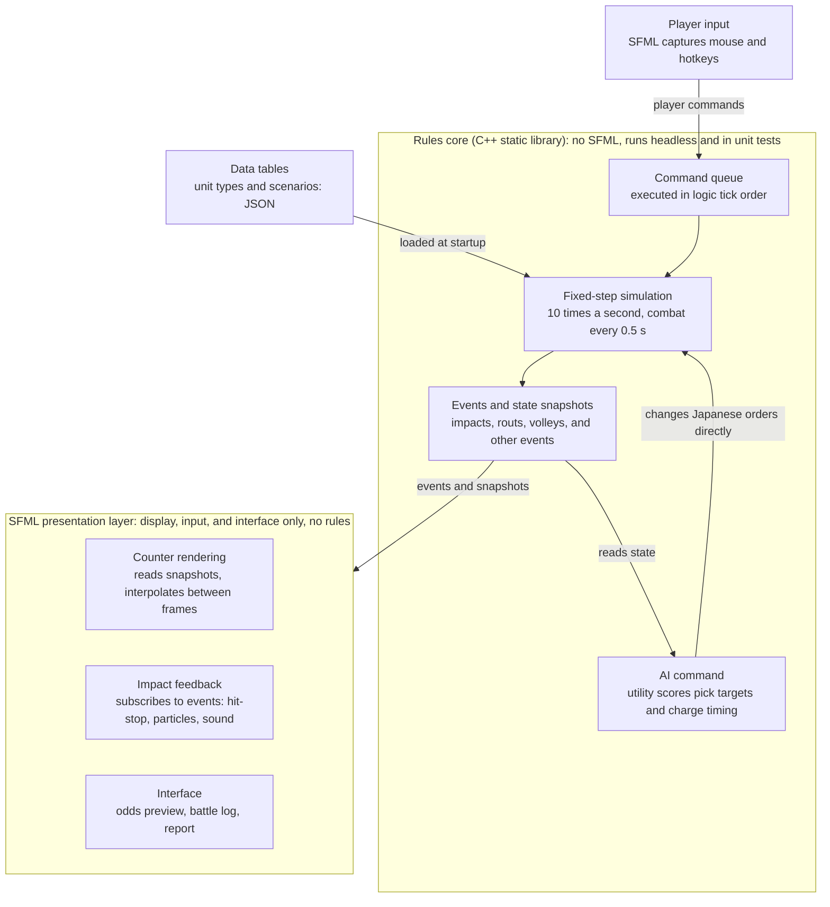

# Afterglow: Imjin 1593 design document

2026-10-27

## Overview

The game is titled Afterglow: Imjin 1593 (Traditional Chinese 餘暉：壬辰 1593), codename Tieqi, and the demo scenario is the Battle of Byeokjegwan. The demo uses this one battle to test whether "pausable real time plus counters" tactics is fun to play.

- **Positioning**: a land-battle tactics game about the Imjin War (1592–1598), played mainly from the side of the Ming army's Liaodong cavalry. A personal hobby project.
- **Reference**: the mechanical framework draws on Sengoku Jidai: Shadow of the Shogun, but in real time; all numbers, rule wording, and art are original, and none of its data, scripts, or assets are used.
- **Demo scope**: one scenario (Byeokjegwan), two sides (Ming and Japanese), five unit types and three generals, single player against the AI, PC.
- **Out of scope**: naval battles, a Joseon faction, a campaign layer, multiplayer.
- **Prototype**: the Byeokjegwan HTML playable prototype ([reference/prototype/byeokjegwan.html](../reference/prototype/byeokjegwan.html), open it in a browser) is the reference implementation of the rules, and the port follows it.

## Design pillars

The core goal is that it feels great to play: good positioning should pay off in fast, clear, readable victories.

1. **Decisive**: good play gets a clear, quick reward; the player never waits long for a result.
2. **Predictable**: randomness has bounds, the rough odds are visible before attacking, and after a loss the player knows why.
3. **Thrills are earned by positioning**: cavalry charging a steady pike block head-on must lose; disrupt first, then hit the flank, and breaking the line is the reward.
4. **Exaggerated feedback**: there are no soldier animations, so the feel comes entirely from the sound and visuals of moments like impacts and routs.

## Core mechanics

Each counter is one logical unit moving in real time on a continuous map; combat resolves at a fixed interval, and morale decides the outcome. The rules and numbers below come from the playable prototype and are the starting point for the full version, not the final values.

### Time and scale

- Pausable real time at 0.5×, 1×, and 2×; orders can be given while paused.
- Logic updates at a fixed step of 10 times per second, decoupled from the render frame rate; combat resolves every 0.5 seconds.
- One map unit is about one metre (the scale bar is drawn with a Ming pace at about 1.6 m). In the full version movement speeds are entered as real speeds (m/s) and multiplied by a single time compression factor; changing the pace means changing only this number.

### Unit model

- A unit is an oriented rectangle with a frontage and a depth; the counter itself does not rotate, and a wedge beside it marks the facing.
- On contact, the touching edge decides front, flank, or rear, which is the basis for envelopment and breakthroughs.
- Runtime state: troops, morale, formed or marching, reform and reload timers, momentum.
- Fighting power scales with actual troops relative to the unit type's full strength (square root of the ratio), so remnants and detachments are not artificially strong for being "full strength".

### Orders and movement

- Orders: move, attack, hold, retreat to the north exit, split, join. An attack charges automatically when the distance allows; moving into an enemy engages without charging, which can be used to pin.
- Cavalry is about three times as fast as infantry and turns faster, losing only 30% of its speed when turning on the move. Paddies slow cavalry by 40% and hills by 20%; the main road is slightly faster.
- A holding unit automatically turns toward the nearest enemy within 150 m, but at only 60% of normal turn speed, so cavalry coming in fast from the side can still reach the flank.
- Engaged cavalry can break away with a move order at a cost of 3% casualties and a little morale; infantry cannot break away once engaged.

### Shooting

- Arquebusiers must stop and form for 1.2 seconds before a volley and take 6 seconds to reload; against targets that are not charging they wait until the target is within 75% of their range.
- Hits fall off with distance, and the main effect is on morale; against cavalry in mid-charge, casualties and morale damage are both ×1.3.
- Liaodong cavalry automatically fires a round of three-eyed guns about 60 m before contact in a charge, softening the target's morale first.

### Charge impact

- An effective charge needs a run-up: speed at 70% of charge speed or more, and at least 35 m covered.
- Impact multiplier = impact value × speed × direction (flank 1.8, rear 2.4) × target state (wavering 1.35, disordered 2.2, arquebusiers reloading 1.25, arquebusiers not formed 1.2) × terrain (paddy 0.5, uphill 0.8) × momentum × strength ÷ target's charge resistance.
- At a multiplier of 1.9 or more the line breaks and the target collapses on the spot; generals cannot be broken by a single impact.
- Hitting a steady pike block head-on: impact ×0.35, and the charger takes 6% casualties and a morale blow in return.
- After a charge, cavalry reforms for 6 seconds (9 after hitting pikes), during which it cannot charge again and is slightly weaker in melee.

### Melee

- Once engaged, casualties and morale resolve every 0.5 seconds, and morale drains faster the longer the engagement lasts; flank and rear attacks speed up the drain by 1.5× and 2×, and power is shared when fighting several enemies at once.
- Pikes facing cavalry in melee fight at ×1.3, cavalry pressing into a pike front at ×0.7; cavalry that stays in melee longer than 6 seconds fights at ×0.85, which encourages a cycle of charge, pull back, charge again.
- Goal: a frontal melee decided in 10–20 seconds.

### Morale and chain collapse

- Four morale levels: steady (above 55), wavering (30–55), broken, routing; below 30 a unit breaks.
- When a unit breaks, friends within 170 m take a morale shock and may break in turn; nearby enemies gain a little morale.
- Units not in contact slowly recover morale, faster and with less damage inside a general's aura; the morale cap falls as troops are lost.
- Routing units flee away from the enemy and keep losing men to desertion on the way; after about 10 seconds away from the enemy they can rally.

### Scattering and regrouping

- On breaking, units of 330 or more scatter into three groups and units of 150 or more into two, each fleeing into a fan away from the attacker; the commander never splits.
- Each group can be pursued separately, and a small group caught by cavalry dissolves quickly; whom to chase, whom to let go, and when to stop become the player's decisions.
- Rallied remnants of the same unit merge automatically when they meet, and the Japanese AI actively regroups remnants. Left alone, a unit of arquebusiers regroups to about 80% of its original strength in about 26 seconds.

### Splitting and joining

- A unit of 160 or more that is not engaged can split into two, each taking half, deployed side by side; detachments have impact and melee discounted by troop count and a lower morale cap.
- The use is to pin the front with one half and break the flank with the other; select detachments of the same unit and give the join order to merge them back.

### Generals

- Generals give friendly units inside their aura morale recovery and resistance to pressure, and can join charges themselves.
- A general falls when his troops drop below a quarter, and nearby friends take a heavy morale shock.

### Victory and defeat

- Defeat: Li Rusong falls, flees the field with routing troops, or the whole Ming army is destroyed.
- Victory: Li Rusong leaves through the north exit, and units within 260 m of the exit that are not engaged leave with him; the share of troops withdrawn and the number of Japanese units routed decide a major victory, minor victory, or costly victory.

## Faction design

The Ming army breaks enemy lines first with cavalry impact; the Japanese army closes to melee under arquebus cover. The two sides have very different paths to victory.

| Faction | Thrill | Core mechanics | Weaknesses |
|---|---|---|---|
| Ming (Liaodong cavalry) | Cavalry breakthroughs, striking first | Fires a round of three-eyed guns before contact in a charge, hitting morale first; impact multiplies on the flank or against disordered enemies; breakthroughs set off chain collapses in the enemy army; fast | Charging a steady pike line head-on is very costly; must reform after charging; no infantry support in the demo |
| Japanese | Melee | Arquebus volleys followed by a shock assault with blades; winning a melee builds "momentum" for hitting the next target in a row; samurai are far more efficient in melee than any other unit type | Slow; vulnerable to cavalry on the flank; arquebusiers are easily overrun while reloading |
| Joseon (later) | Naval battles | Naval combat is a separate mode for later development; the land thrill is tentatively hwacha rocket volleys and siege defense | Outside the demo scope |

## Unit types

The demo has five unit types and three generals: two Ming unit types plus the commander Li Rusong, and three Japanese unit types plus two generals, Tachibana Muneshige and Kobayakawa Takakage. Yang Yuan's reinforcements use the Liaodong cavalry values.

| Faction | Unit type | Role | Key abilities | Strong against | Weak against |
|---|---|---|---|---|---|
| Ming | Liaodong retainer cavalry | Elite heavy cavalry, main breakthrough force | Three-eyed guns fire first; high impact, high morale | Arquebus ashigaru, any disordered unit | Spear ashigaru from the front |
| Ming | Liaodong cavalry | Regular cavalry, numerous, used for envelopment and pursuit | Three-eyed guns fire first; fast | Arquebus ashigaru, routing units | Spear ashigaru, samurai |
| Ming | Li Rusong (general) | Commander with bodyguards | Morale aura; can join charges; his death is defeat | — | Focused fire or encirclement |
| Japanese | Arquebus ashigaru | Ranged firepower | Volleys; long reload; weak in melee | Cavalry in mid-charge, dense formations from the front | Cavalry on the flank |
| Japanese | Spear ashigaru | Pike block, holds cavalry from the front | Resists impact from the front; slowest to turn | Cavalry charging head-on | Attacks on the flank and rear |
| Japanese | Samurai | Melee shock troops | High impact, strong melee; builds momentum after winning | Regular cavalry, infantry | Attrition from arquebuses or cavalry before they make contact |
| Japanese | Tachibana Muneshige (general) | Vanguard general, front-line assault | Strong bodyguard melee; nearby samurai build momentum faster | Cavalry reforming after a charge | Being surrounded by cavalry |
| Japanese | Kobayakawa Takakage (general) | Commander of the whole army | Large morale aura; can order one army-wide volley or general assault, with a cooldown | — | Surprise attack or encirclement; his aura does nothing far from the line |

### Attributes (prototype starting values)

| Unit type | Troops | Move | Charge | Impact | Charge resistance | Melee | Range / reload | Casualty factor | Morale | Traits |
|---|---|---|---|---|---|---|---|---|---|---|
| Liaodong retainer cavalry | 400 | 34 | 70 | 1.6 | 1.0 | 1.05 | — | 0.8 | 90 | Three-eyed guns; elite |
| Liaodong cavalry | 500 | 36 | 68 | 1.15 | 0.85 | 0.85 | — | 1.0 | 72 | Three-eyed guns |
| Li Rusong (general) | 200 | 34 | 66 | 1.2 | 1.1 | 1.15 | — | 0.7 | 95 | Aura 170 m; his death is defeat |
| Arquebus ashigaru | 500 | 10 | — | — | 0.6 | 0.55 | 175 m / 6 s | 1.0 | 66 | Must form for 1.2 s before a volley |
| Spear ashigaru | 600 | 9 | — | — | 1.3 | 0.85 | — | 0.95 | 70 | Counters cavalry from the front; slowest to turn |
| Samurai | 400 | 11 | 18 | 1.1 | 1.05 | 1.4 | — | 0.85 | 82 | Momentum (+10% per level) |
| Tachibana Muneshige (general) | 200 | 12 | 18 | 1.15 | 1.1 | 1.35 | — | 0.75 | 95 | Aura 150 m; doubles momentum for nearby samurai |
| Kobayakawa Takakage (general) | 250 | 10 | — | — | 1.15 | 1.05 | — | 0.75 | 95 | Aura 240 m; orders the general assault in the withdrawal phase |

Move and charge are in prototype units (map metres per game second); the full version uses real speeds times the time compression factor. Impact, charge resistance, and melee are relative values; a lower casualty factor means tougher.

## Scenario design: the Battle of Byeokjegwan

The scenario has three phases with two events in between, the scout warning and Yang Yuan's reinforcements: first break the Japanese vanguard, then hold off the main body, and finally escort Li Rusong out. A prototype battle lasts about 5 minutes; the full version scales it to 20–30 minutes through the time compression factor.

### Historical background

Early in 1593, after retaking Pyongyang, the Ming army moved south, and Li Rusong led a mostly cavalry vanguard toward Hanseong. Near Byeokjegwan it met a larger Japanese force. In the common account, Li Rusong arrived with about two thousand men, charged first with half of them, and left the other half with Yang Yuan in the rear; when the Ming were surrounded by the forces of Kobayakawa, Tachibana, and others, Yang Yuan arrived to strike from the other side and Li Rusong escaped. During the breakout his horse was shot from under him, and his bodyguard Li Yousheng died protecting him. After this battle the Ming turned toward peace talks. Troop numbers and casualties on both sides differ widely between sources; the demo does not aim for exact proportions, and before finalizing they need to be checked against the Ming Veritable Records and the Annals of King Seonjo.

### Map (first draft, to be checked against sources)

- A valley between hills, with a road running north to south.
- Paddies and mud on both sides, which sharply reduce cavalry speed and impact.
- The Ming withdrawal exit is to the north; the Japanese enter from the south and the flanks.

### Phases

1. **Meeting engagement**: six Ming units against Tachibana Muneshige's five vanguard units; this is the tutorial section. It lasts at least 80 seconds; at 160 seconds, or once three vanguard units have broken, the scouts report.
2. **Main body advances**: 20 seconds after the scout report, Kobayakawa Takakage's six main units cross Ryeoseokhyeon and enter, and the north withdrawal route opens.
3. **Withdrawal**: 90 seconds after the main body arrives, the samurai on both wings swing around the hills toward the north exit, Kobayakawa orders the general assault, and Japanese morale rises by 12.

**Yang Yuan's reinforcements**: from 20 seconds after the main body arrives, as soon as Japanese units come within 220 m of Li Rusong, Li Rusong is engaged, or his morale wavers, Yang Yuan enters from the north with two Liaodong cavalry units, a thousand riders in all, under the player's command; at the latest they arrive 25 seconds into the withdrawal phase. They come only once per battle, and Li Rusong's position decides when they arrive.

### Victory conditions

- Defeat: Li Rusong falls.
- Victory: Li Rusong leaves the map; the share of units withdrawn and the number of enemy units routed decide the grade (major victory, minor victory, costly victory).

## Presentation and feedback

There are no soldier animations, so the feel comes from the counters' dynamic feedback and a clear interface; the art is mostly 2D and can all be made first with AI generation.

### Counters

- The face of a counter is a portrait of the unit type with a faction-coloured border; troops and morale are bars along the counter's edge.
- State changes become physical actions of the counter: it tilts and shakes when disordered, flips to its "damaged side" when broken (borrowing the flipped counters of board wargames), and shatters when routing.
- Already in the prototype: a wedge marks the facing; on a breakthrough the counter throws off debris and splits into several small counters; remnants are small counters with a dashed frame, and detachments split off on purpose are small counters with a solid frame.

### Impact feedback

- At the moment of impact: hit-stop, camera shake, a burst of dust, and the struck counter pushed back.
- Volleys: smoke from three-eyed guns and arquebuses, parabolic arrow trails.
- Chain collapse: neighbouring counters flip one after another, a visible domino effect.
- Sound: hoofbeats, volleys, battle cries, and a horn or gong when units rout.

### Interface

- Odds preview: hovering a target shows the predicted result and a breakdown of modifiers (flank, disorder, terrain, and so on).
- Unit state icons, morale bars, and a scrollable battle log.
- After-battle report: casualties, the order units were routed, and the key events that decided the battle.

### AI-generated art and historical research

- AI generation handles portraits, maps, interface art, mission briefing illustrations, and loading screens, in a consistent gongbi or woodblock style.
- The Wanli-era paintings *Pingfan Desheng Tu* and *Chujing Rubi Tu* serve as reference images and style anchors for image-to-image generation or for training a style model.
- One fixed style guide (palette, line work, composition) and one set of models and prompt templates keep the output consistent.
- AI assets live in their own folder with consistent names, so each can be replaced when an artist is hired later.
- Research points: Liaodong cavalry wear brigandine, Ming helmets, and carry three-eyed guns, bows, and sabres; the Japanese wear gusoku and jingasa and carry arquebuses, spears, and sashimono.
- AI-generated assets are disclosed and registered in [assets/AI_ASSETS.md](../assets/AI_ASSETS.md).

### Historical portrayal

- The war is driven by Toyotomi Hideyoshi's ambition; the Japanese as a whole are not cast as villains.
- Generals have rounded motives: Konishi Yukinaga quietly pushes for peace and is at odds with the hawkish Katō Kiyomasa; Tachibana Muneshige is known for his courage.
- Neither demonize nor whitewash: wartime atrocities are stated as historical fact in campaign text, without gory images.

## Technical architecture

C++20 and SFML 3, built on the [2D-action-game](https://github.com/QizhouD/2D-action-game) framework: the rules core is a static library that does not depend on SFML, SFML handles only display, input, and interface, and the two communicate through commands and events.

Player commands enter the command queue stamped with a logic tick, the AI gives orders directly inside the simulation, and both are executed by the fixed-step simulation; the presentation layer only reads snapshots and subscribes to events, and contains no rules.

- **Rules core**: a C++20 static library that does not reference SFML. Units are plain data arrays and each system is a function over the arrays; commands are queued with a logic tick, each battle has a fixed random seed, and the same command sequence always reproduces the same battle, which enables replays and balance testing.
- **Porting basis**: the HTML prototype is the reference implementation of the rules and is ported rule by rule; key results (the breakthrough threshold, the outcome of several typical duels) become unit tests compared against the prototype.
- **Time and scale**: one map unit is one metre, unit speeds are real metres per second, and everything is multiplied by the time compression factor.
- **Data layer**: unit tables and scenario tables (deployment, phase triggers, reinforcement conditions) are JSON, following the framework's approach of defaults, configuration overrides, and warnings for bad values.
- **Presentation layer**: SFML draws the silk-scroll base map, counters, and effects, with a camera that can zoom and pan; counter and map textures are AI-generated. Chinese in the game is always Traditional; body text uses the Traditional Chinese and Korean versions of Noto Serif, and titles and counter glyphs use LXGW WenKai TC, all under the OFL.
- **Interface**: the in-game interface (selection panel, odds preview, battle report) is drawn by the game itself; the tuning panel and unit inspector use Dear ImGui (imgui-sfml) and are only enabled in dev builds.
- **AI**: utility scores choose targets, charge timing, and regrouping of remnants, and a higher-level "commander" assigns tasks by phase; rule-based first, no search.
- **Tools**: a headless command-line mode runs AI battles in bulk and outputs casualty and outcome statistics for balancing and CI regression.

### Why C++ and SFML rather than Unity

The original plan was Unity with a pure C# rules core. There are three reasons for switching to C++ and SFML: the presentation is pure 2D counters on a silk-scroll map and needs none of Unity's 3D or animation; 2D-action-game already has a fixed-step main loop, an engine-independent core library, unit tests, CI, and scripted replays, which is exactly the skeleton this architecture needs; and the code base is small and entirely owned, so iterating with AI coding assistants is fast.

The cost is mainly in the interface and localization: SFML has no UI framework or scene editor, so text-heavy panels, Chinese, English, and Korean fonts, and string tables must all be built by hand. A fallback remains: the rules core is a standalone C++ library, so if interface costs get out of hand it can be wrapped in a C interface as a native plugin for Unity, replacing only the presentation layer.

### Reusing the 2D-action-game framework

| Module | State in the framework | What this game does |
|---|---|---|
| Main loop | 60 Hz fixed step, variable render frame rate | Kept; the simulation runs at 10 Hz and rendering interpolates between frames |
| Build and CI | CMake and Ninja, Windows and Linux CI, SFML linked statically | Kept as is |
| Core library and unit tests | minigame_core does not depend on SFML and has its own unit tests | Keep this layering and put the whole rules core into the core library |
| Tuning values | Balance: built-in defaults, balance.ini overrides, warnings for bad values | Kept, changed to unit tables and scenario tables |
| Scripted replays | Scripts drive input and take screenshots for headless regression | Kept, extended to AI battle replays and balance tests |
| Resources, audio, particles, HUD | ResourceManager, synthesized sound fallback, CPU particles, toast messages | Kept with small changes: particles for dust, smoke, and debris; toasts become banners and the battle log |
| Design patterns | Command, Observer, Service Locator | Same ideas: commands queued with a logic tick, Observer becomes a battle event bus |
| Entities and systems | Entities are classes with sprites, components in a map, systems call virtual functions one by one | Rewritten: units become plain data arrays, fully separated from SFML |
| Collision | Tile map with axis-aligned bounding boxes | Rewritten: continuous coordinates, separating-axis tests on oriented rectangles, terrain sampling |
| Input and AI | Direct keyboard and gamepad control; patrol and chase AI | Rewritten: mouse selection, box selection, and orders; utility-score AI |
| Interface | No UI framework | New: in-game interface drawn by the game, Dear ImGui for tuning |

SFML 3 was released at the end of 2024 and is incompatible with 2.6; the framework is on 2.6, and the decision is to move to SFML 3.1 while the code base is small.

Migration notes, interfaces, rule formulas, data formats, and the task breakdown are in the development spec, [docs/DEVELOPMENT.md](DEVELOPMENT.md).

## Localization

- **Languages**: Traditional Chinese is the source text; English ships with the demo; a Korean string table exists and is held back until it is reviewed.
- **Technical preparation**: all interface text goes through string tables; CJK and Latin fonts are prepared together; the interface leaves extra room for longer English text.
- **Name glossary**: keep one list of Chinese, English, and Korean names for people, places, and unit types, for example 李如松 Li Rusong, 碧蹄館 Byeokjegwan, 立花宗茂 Tachibana Muneshige; personal names are transliterated by their own language, and Korean place names use Revised Romanization.
- **Naming**: the Chinese and English titles are chosen separately.

## Open questions

- [x] Official title of the game: decided, Afterglow: Imjin 1593
- [ ] Scale: how many men one counter represents
- [ ] Byeokjegwan's terrain, both sides' strength, the units and generals present, to be checked against sources
- [ ] Whether fog of war and line of sight are needed
- [ ] Camera: pure top-down 2D, or 2.5D with a tilt
- [ ] How AI difficulty is graded
- [ ] The range of each coefficient in the impact formula
- [x] SFML version: decided, move to SFML 3.1
- [x] Chinese in the game: decided, always Traditional
- [ ] Whether to add a Joseon land perspective
- [ ] Time compression factor (4×–6×) and map size (2–3 km)
- [ ] Whether to keep a fatigue system (not implemented in the prototype)

## Bibliography

- Kenneth Swope, *A Dragon's Head and a Serpent's Tail: Ming China and the First Great East Asian War, 1592–1598*: studies the war from the Ming side, with more on Li Rusong and the Liaodong army; the first choice for Ming research.
- Samuel Hawley, *The Imjin War*: leans more toward the Korean and Japanese sides; good for comparison.
