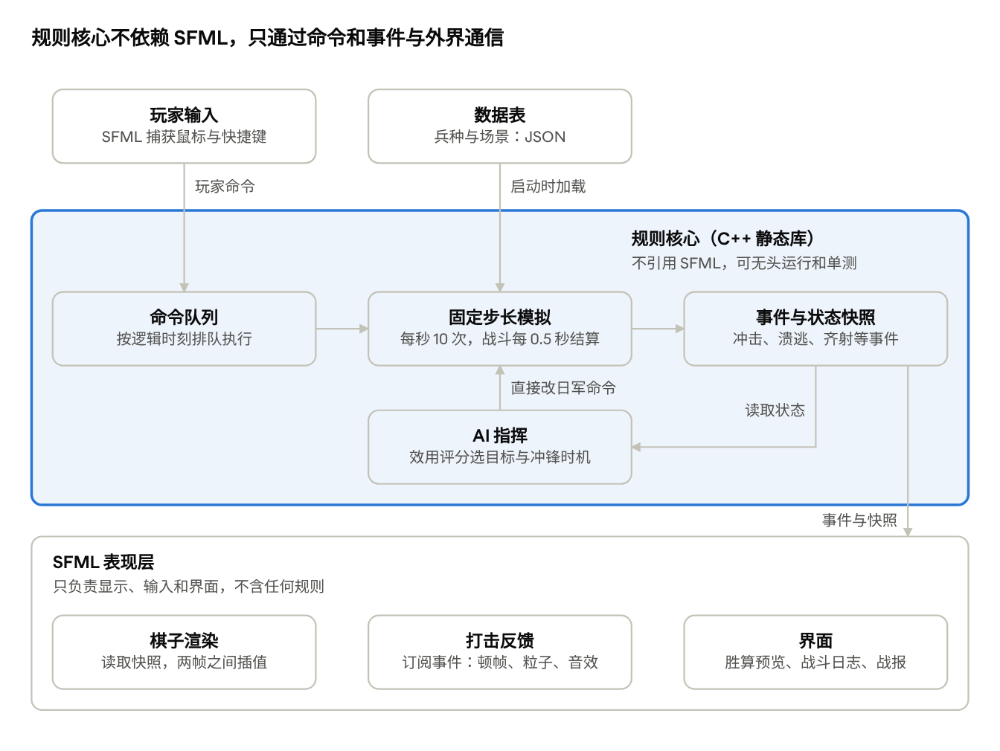

# Afterglow: Imjin 1593 设计文档

2026-10-27

## 概述

游戏名 Afterglow: Imjin 1593（繁中 餘暉：壬辰 1593），代号 Tieqi，demo 场景是碧蹄馆之战。这个 demo 用一场碧蹄馆之战，验证"可暂停实时制 + 棋子表现"的战术玩法是否好玩，以及是否有人愿意看、愿意玩。

- **定位**：以明军辽东骑兵为主视角的壬辰战争（1592–1598）陆战战术游戏，个人兴趣项目。
- **参考**：机制框架参考 Sengoku Jidai: Shadow of the Shogun，但改为实时制；数值、规则表述、美术全部自制，不使用其数据、脚本或素材。
- **demo 范围**：1 个场景（碧蹄馆），明军和日军两方，5 个兵种和 3 名将领，单人对 AI，PC 平台。
- **不在范围内**：海战、朝鲜阵营、战役层、多人联机。
- **试水目标**：在 B 站发布开发日志、开设 Steam 页面，用播放量、评论和心愿单数量衡量兴趣。
- **原型**：[碧蹄馆 HTML 可玩原型](https://claude.ai/artifact/GEGVr72yHEmDop4MWd4fDy)，是规则的参考实现，正式版移植以它为准。

## 设计支柱

核心目标是"玩起来爽"：好的布局要换来快速、明确、看得懂的胜利。

1. **决定性**：好的操作要有明确、快速的回报，不让玩家长时间等待结果。
2. **可预期**：随机性有边界，进攻前能看到大致胜算，输了知道为什么。
3. **爽要靠布局换来**：骑兵正面冲稳固枪阵必须吃亏；先打乱、再侧击，才有破阵的回报。
4. **反馈要夸张**：没有小兵动画，手感全靠冲击、溃逃这些瞬间的视听反馈。

### 针对 SJ 痛点的解决方案

| SJ 的痛点                        | 本作的做法                                                                                                              |
|----------------------------------|-------------------------------------------------------------------------------------------------------------------------|
| 随机性太大，优势被一次坏运气打崩 | 战斗每 0.5 秒结算一次，一场交锋是几十次小结算的累积，单次运气被自然抹平；随机波动限制在窄范围内，不设"一次检定定生死"   |
| 战斗结算不透明                   | 下令前悬停显示胜算预览和修正项明细；单位状态用图标显示；战后给出战报，指出胜负关键                                      |
| 近战拖沓，几回合分不出胜负       | 士气而非兵力决胜，单位在被消灭前崩溃；接战越久士气流失越快；侧翼、背后受攻大幅加速崩溃；目标是正面近战 10–20 秒分出胜负 |
| AP 与转向微操琐碎                | 取消 AP；转向自动完成、只耗时间；命令保持高层级，单位自动面向威胁                                                       |

## 核心机制

每个棋子是一个逻辑单位，在连续地图上实时移动；战斗按固定间隔结算，士气是决胜条件。以下规则和数值取自可玩原型，是正式版的起点而非定稿。

### 时间与尺度

- 可暂停的实时制，变速 0.5×、1×、2×；暂停时也可以下令。
- 逻辑以每秒 10 次的固定步长更新，与渲染帧率解耦；战斗每 0.5 秒结算一次。
- 地图 1 单位约合 1 米（比例尺按明代一步约 1.6 米绘制）。正式版的移动速度按真实速度（米/秒）填写，再乘一个统一的时间压缩系数换算，调节奏只改这一个数。

### 单位模型

- 单位是一个有朝向的矩形，有正面宽度和纵深；棋子本身不转，旁边的楔形标出正面朝向。
- 接触时按接触边判定正面、侧翼或背后，这是包抄和破阵的基础。
- 运行时状态：人数、士气、列阵或行进、重整与装填计时、气势。
- 战力按实际人数相对兵种满员人数换算（人数比例开平方），残部和分队不会因为"满编"而虚强。

### 命令与移动

- 命令：移动、进攻、坚守、撤往北口、分兵、合兵。进攻时距离足够会自动冲锋；用移动贴上敌人则只接战不冲锋，可用来牵制。
- 骑兵比步兵快约三倍，转向也更快，边转边走只损失三成速度。水田让骑兵减速四成、山地减速两成，大路略快。
- 坚守的单位会自动转向 150 米内最近的敌人，但转速只有正常的六成，从侧面快速冲来的骑兵仍有机会打到侧翼。
- 接战中的骑兵可以下移动令脱离，代价是 3% 伤亡和少量士气；步兵接战后无法脱离。

### 射击

- 铁炮必须停下列阵 1.2 秒才能齐射，装填 6 秒；对未冲锋的目标会等到进入 75% 射程再开火。
- 命中随距离衰减，主要效果是打击士气；对冲锋途中的骑兵伤亡和士气打击各 ×1.3。
- 辽东骑兵冲锋接敌前约 60 米自动放一轮三眼铳，先手削弱目标士气。

### 冲锋冲击

- 有效冲锋需要助跑：速度达到冲锋速度的七成，且已冲出 35 米以上。
- 冲击倍数 = 冲击值 × 速度 × 方向（侧击 1.8、背击 2.4）× 目标状态（动摇 1.35、溃乱 2.2、铁炮装填中 1.25、铁炮未列阵 1.2）× 地形（水田 0.5、仰攻 0.8）× 气势 × 兵力 ÷ 目标抗冲。
- 倍数达到 1.9 即破阵，目标当场崩溃；将领不会被一击破阵。
- 正面撞上整齐的长枪阵：冲击 ×0.35，冲锋方反受 6% 伤亡和士气打击。
- 冲锋后骑兵重整 6 秒（撞枪阵后 9 秒），期间不能再次冲锋，近战也略弱。

### 近战

- 接战后每 0.5 秒结算伤亡和士气，士气流失随接战时间加速；侧击、背击分别使流失加快 1.5 和 2 倍，同时与多个敌人接战时战力分摊。
- 长枪正面对骑兵近战 ×1.3，骑兵正面硬撼枪阵 ×0.7；骑兵缠斗超过 6 秒战力 ×0.85，鼓励冲、撤、再冲的循环。
- 目标：一场正面近战 10–20 秒分出胜负。

### 士气与连锁崩溃

- 士气四级：稳定（55 以上）、动摇（30–55）、崩溃、溃逃；低于 30 即崩溃。
- 一队崩溃时，170 米内的友军受士气冲击，可能连锁崩溃；附近敌军士气略升。
- 未接战的单位缓慢回复士气，将领光环内回复更快、受损更少；士气上限随兵力损失下降。
- 溃逃单位朝远离敌人的方向逃，途中不断逃散减员；远离敌人约 10 秒后可重新集结。

### 溃散拆分与收拢

- 崩溃时，330 人以上的部队散作三股，150 人以上散作两股，朝背离来敌的扇面各自逃散；主将不拆分。
- 每股可被单独追击，小股被骑兵追上很快溃散；追谁、放谁、何时收手成为玩家的决策。
- 集结后的同营残部相遇自动合并，日军 AI 会主动收拢残部。不被追击时，一队铁炮约 26 秒后能收拢回原兵力的八成左右。

### 分兵与合兵

- 160 人以上、未接战的部队可分为两队，各领一半，并排展开；分队的冲击力和近战按人数打折，士气上限也更低。
- 用途是一队牵制正面、一队绕侧破阵；同营分队一起选中下合兵令即可合回。

### 将领

- 将领为光环内友军提供士气回复和抗压，自身可参与冲锋。
- 兵力降到四分之一以下即阵亡，周围友军受大幅士气冲击。

### 胜负

- 失败：李如松阵亡、随溃兵逃离战场，或明军全部覆没。
- 胜利：李如松从北口撤出，北口 260 米内未接战的部队随行撤出；按撤出兵力比例和击溃日军队数评定大胜、小胜、惨胜。

## 阵营设计

明军靠骑兵冲击先手打崩敌阵，日军靠铁炮掩护贴身近战，两方的胜利路径截然不同。

| 阵营             | 爽点           | 核心机制                                                                                               | 弱点                                                        |
|------------------|----------------|--------------------------------------------------------------------------------------------------------|-------------------------------------------------------------|
| 明军（辽东骑兵） | 骑兵破阵、先攻 | 冲锋接敌前自动打一轮三眼铳，先手打击士气；侧击或冲击混乱之敌时冲击力倍增；破阵引发敌军连锁崩溃；机动快 | 正面冲整齐枪阵损失惨重；冲锋后需要重整；demo 中缺少步兵支援 |
| 日军             | 近战           | 铁炮齐射接白刃突击的组合；近战获胜获得"气势"，可连续冲击下一个目标；武士近战效率远高于其他兵种         | 机动慢；被骑兵侧击时脆弱；铁炮装填期间容易被冲垮            |
| 朝鲜（后续）     | 海战           | 海战作为独立模式后期开发；陆战爽点暂定为神机箭火车的齐射覆盖和守城战                                   | 不在 demo 范围内                                            |

## 兵种列表

demo 共 5 个兵种和 3 名将领：明军 2 个兵种加主将李如松，日军 3 个兵种加立花宗茂、小早川隆景两名将领；杨元援军沿用辽东骑兵的数值。

| 阵营 | 兵种               | 定位                             | 关键能力                                         | 克制                       | 被克制                           |
|------|--------------------|----------------------------------|--------------------------------------------------|----------------------------|----------------------------------|
| 明军 | 辽东家丁精骑       | 精锐重骑，主力破阵               | 三眼铳先手射击；高冲击、高士气                   | 铁炮足轻、混乱中的任何单位 | 正面的长枪足轻                   |
| 明军 | 辽东骑兵           | 普通骑兵，数量多，负责包抄与追击 | 三眼铳先手射击；机动快                           | 铁炮足轻、溃逃单位         | 长枪足轻、武士                   |
| 明军 | 李如松（将领）     | 主将，带亲兵                     | 士气光环；可参与冲锋；阵亡即失败                 | —                          | 被集火或包围                     |
| 日军 | 铁炮足轻           | 远程火力                         | 齐射；装填时间长；近战弱                         | 冲锋途中的骑兵、正面密集阵 | 骑兵侧击                         |
| 日军 | 长枪足轻           | 枪阵，正面防骑兵                 | 正面抵御冲击；转向慢                             | 正面冲锋的骑兵             | 侧翼、背后受攻                   |
| 日军 | 武士               | 近战突击                         | 高冲击、高近战；获胜后积累气势                   | 普通骑兵、步兵             | 铁炮或骑兵在其接敌前的消耗       |
| 日军 | 立花宗茂（将领）   | 先锋将领，前线突击               | 亲兵近战强；周围武士积累气势更快                 | 冲锋后正在重整的骑兵       | 被骑兵集火包围                   |
| 日军 | 小早川隆景（将领） | 主将，统筹全军                   | 士气光环范围大；可发动一次全军齐射或总攻，有冷却 | —                          | 被突袭或包围；远离战线时光环失效 |

### 属性表（原型初值）

| 兵种               | 人数 | 移动 | 冲锋 | 冲击 | 抗冲 | 近战 | 射程 / 装填   | 伤亡系数 | 士气 | 特性                          |
|--------------------|------|------|------|------|------|------|---------------|----------|------|-------------------------------|
| 辽东家丁精骑       | 400  | 34   | 70   | 1.6  | 1.0  | 1.05 | —             | 0.8      | 90   | 三眼铳；精锐                  |
| 辽东骑兵           | 500  | 36   | 68   | 1.15 | 0.85 | 0.85 | —             | 1.0      | 72   | 三眼铳                        |
| 李如松（将领）     | 200  | 34   | 66   | 1.2  | 1.1  | 1.15 | —             | 0.7      | 95   | 光环 170 米；阵亡即败         |
| 铁炮足轻           | 500  | 10   | —    | —    | 0.6  | 0.55 | 175 米 / 6 秒 | 1.0      | 66   | 须列阵 1.2 秒才能齐射         |
| 长枪足轻           | 600  | 9    | —    | —    | 1.3  | 0.85 | —             | 0.95     | 70   | 正面克骑兵；转向最慢          |
| 武士               | 400  | 11   | 18   | 1.1  | 1.05 | 1.4  | —             | 0.85     | 82   | 气势（每层 +10%）             |
| 立花宗茂（将领）   | 200  | 12   | 18   | 1.15 | 1.1  | 1.35 | —             | 0.75     | 95   | 光环 150 米；周围武士气势加倍 |
| 小早川隆景（将领） | 250  | 10   | —    | —    | 1.15 | 1.05 | —             | 0.75     | 95   | 光环 240 米；撤退阶段下令总攻 |

移动和冲锋是原型单位（地图米 / 游戏秒），正式版改为真实速度乘时间压缩系数。冲击、抗冲、近战是相对值；伤亡系数越低越耐打。

## 场景设计：碧蹄馆之战

场景分三个阶段，中间穿插斥候预警和杨元援军两个事件：先冲垮日军先锋，再顶住本队，最后护送李如松撤出。原型一局约 5 分钟，正式版按时间压缩系数放大到 20–30 分钟。

### 历史背景

1593 年初明军收复平壤后南下，李如松率以骑兵为主的前锋向汉城推进，在碧蹄馆一带遭遇兵力占优的日军。按通行记述，李如松带约两千人赶到，只领一半先冲，另一半交杨元押后；明军被小早川、立花等部合围时，杨元赶到夹击，李如松才得以脱身，突围中坐骑被射倒，亲兵李有升舍身护主。此战之后明军转向议和。双方兵力和伤亡在各方史料中出入很大，demo 不追求精确比例，定稿前需对照《明实录》《宣祖实录》核实。

### 地图（初稿，需对照史料核实）

- 丘陵之间的谷地，一条道路南北贯穿。
- 两侧有水田和泥地，大幅降低骑兵速度和冲击力。
- 北侧为明军撤退出口，南侧和侧翼为日军入场点。

### 阶段

1. **遭遇**：明军 6 部对立花宗茂先锋 5 部，是教学段。至少持续 80 秒；到 160 秒，或先锋已有三队崩溃时，斥候来报。
2. **主力压上**：斥候来报 20 秒后，小早川隆景本队 6 部越过砺石岘入场，北口撤退路线开放。
3. **撤退**：本队到达 90 秒后，两翼武士绕山包抄北口，小早川下令总攻，日军士气 +12。

**杨元援军**：本队到达 20 秒后，一旦日军逼近李如松 220 米内、李如松陷入接战或士气动摇，杨元率两队辽骑共一千骑自北边入场，交由玩家指挥；最迟在撤退阶段开始 25 秒后到达。每局只来一次，李如松的位置决定援军何时赶到。

### 胜利条件

- 失败：李如松阵亡。
- 胜利：李如松撤出地图；按撤出部队比例和击溃敌军数量评定等级（如大胜、小胜、惨胜）。

## 表现与反馈

没有小兵动画，手感全靠棋子的动态反馈和清晰的界面；美术以 2D 为主，全部可由 AIGC 先行制作。

### 棋子

- 棋子正面是兵种立绘，配阵营色边框；人数和士气用棋子边缘的条带显示。
- 状态变化做成棋子的物理动作：混乱时倾斜晃动，崩溃时翻到"受损面"（借鉴桌面兵棋棋子翻面），溃逃时碎裂四散。
- 原型中已做：楔形标出正面朝向；破阵时棋子碎片四溅、分成数枚小棋子飞散；残部是小棋子加虚线框，主动分出的分队是小棋子加实线框。

### 打击反馈

- 冲击瞬间：顿帧、镜头震动、尘土爆开，被撞棋子后退。
- 齐射：三眼铳和铁炮的烟雾，弓箭的抛物线轨迹。
- 连锁崩溃：相邻棋子依次翻面，形成可见的多米诺效果。
- 音效：马蹄、齐射、喊杀、溃逃时的号角或锣声。

### 界面

- 胜算预览：悬停目标时显示预估结果和修正项明细（侧翼、混乱、地形等）。
- 单位状态图标、士气条、可滚动的战斗日志。
- 战后战报：伤亡、击溃顺序和决定胜负的关键事件。

### AIGC 美术流程与考据

- AIGC 负责立绘、地图、界面、任务简报插画和加载画面，统一为工笔或版画风格。
- 以万历年间的《平番得胜图》《出警入跸图》作为参考图和风格锚点，用于图生图或训练风格模型。
- 固定一份风格指南（色板、线条、构图）和同一套模型与提示词模板，保证一致性。
- AI 素材放在独立目录并规范命名，以后请美术时可逐个替换。
- 考据要点：辽东骑兵为布面甲、明式头盔、三眼铳、弓、腰刀；日军为具足、阵笠、铁炮、长枪、旗指物。
- 上架 Steam 时需在商店页披露 AI 生成的美术素材。

## 技术架构

C++20 + SFML 3，以 [2D-action-game](https://github.com/QizhouD/2D-action-game) 框架为底座：规则核心是不依赖 SFML 的静态库，SFML 只负责显示、输入和界面，两者通过命令和事件通信。

玩家的命令带逻辑时刻进入命令队列，AI 在模拟内部直接下令，两者都由固定步长模拟统一执行；表现层只读取快照、订阅事件，不包含任何规则。

- **规则核心**：C++20 静态库，不引用 SFML。单位是纯数据数组，各系统是遍历数组的函数；命令带逻辑时刻入队，每局固定随机种子，同样的命令序列必定重现同样的战斗，可以做回放和平衡测试。
- **移植依据**：HTML 原型是规则的参考实现，逐条移植；关键结果（破阵阈值、几组典型对决的胜负）写成单测，与原型对照。
- **时间与尺度**：地图 1 单位等于 1 米，兵种速度填真实米/秒，统一乘时间压缩系数。
- **数据层**：兵种表和场景表（部署、阶段触发、援军条件）用 JSON，沿用框架"默认值 + 配置覆盖 + 坏值报警"的做法。
- **表现层**：SFML 绘制绢本底图、棋子和特效，镜头可缩放平移；棋子与地图贴图由 AIGC 生成。游戏里的中文一律用繁体；正文用思源宋体的繁体与韩文版，标题和棋子字用霞鹜文楷 TC，两者均为 OFL 授权。
- **界面**：游戏内界面（选中面板、胜算预览、战报）自绘；调参面板和单位检查器用 Dear ImGui（imgui-sfml），只在开发版开启。
- **AI**：效用评分选择目标、冲锋时机和收拢残部，上层"指挥官"按阶段分配任务；先用规则式，不做搜索。
- **工具**：命令行无头模式批量跑 AI 对战，输出伤亡和胜负统计，用于调平衡和 CI 回归。

### 为什么用 C++ / SFML 而不是 Unity

原定方案是 Unity 加纯 C# 规则核心。改用 C++ / SFML 有三个理由：表现层是纯 2D 的棋子和绢本地图，用不到 Unity 的 3D 和动画；2D-action-game 已经具备固定步长主循环、不依赖引擎的核心库、单测、CI 和脚本回放，正是这套架构需要的骨架；代码量小、全部自有，配合 AI 编码助手迭代快。

代价主要在界面和本地化：SFML 没有 UI 框架和场景编辑器，文字多的面板、中英韩字体和字符串表都要自己做。退路也留着：规则核心是独立的 C++ 库，如果界面成本失控，可以用 C 接口包成原生插件接入 Unity，只换表现层。

### 复用 2D-action-game 框架

| 模块                  | 框架现状                                                | 本作处理                                                |
|-----------------------|---------------------------------------------------------|---------------------------------------------------------|
| 主循环                | 60 Hz 固定步长，渲染帧率可变                            | 沿用；模拟改为 10 Hz，渲染在两帧之间插值                |
| 构建与 CI             | CMake + Ninja，Windows / Linux 双平台 CI，静态链接 SFML | 直接沿用                                                |
| 核心库与单测          | minigame_core 不依赖 SFML，自带单测                     | 沿用这个分层，整个规则核心放进核心库                    |
| 数值配置              | Balance：内置默认值，balance.ini 覆盖，坏值报警         | 沿用，改为兵种表和场景表                                |
| 脚本回放              | 脚本驱动输入并截图，用于无头回归                        | 沿用，扩展为 AI 对战回放和平衡测试                      |
| 资源、音频、粒子、HUD | ResourceManager、合成音效兜底、CPU 粒子、提示条         | 小改沿用：粒子做尘土、烟雾和碎片，提示条改成横幅和战报  |
| 设计模式              | Command、Observer、Service Locator                      | 沿用思路：命令带逻辑时刻入队，Observer 改为战斗事件总线 |
| 实体与系统            | 实体是带精灵的类，组件存在 map 里，系统逐个虚函数调用   | 重写：单位改为纯数据数组，与 SFML 完全分离              |
| 碰撞                  | 瓦片地图加轴对齐包围盒                                  | 重写：连续坐标、有向矩形分离轴检测、地形采样            |
| 输入与 AI             | 键盘手柄直接操控；巡逻、追击 AI                         | 重写：鼠标选择、框选与下令；效用评分 AI                 |
| 界面                  | 无 UI 框架                                              | 新增：游戏内界面自绘，调参用 Dear ImGui                 |

SFML 3 已于 2024 年底发布，接口与 2.6 不兼容；框架基于 2.6，已决定趁代码量小迁到 SFML 3.1。

迁移要点、接口、规则公式、数据格式和任务拆分见[开发文档](https://claude.ai/artifact/6uRaYbNkV5QtLEZohtZ12b)（仓库里为 docs/DEVELOPMENT.md）。

## 市场定位与国际化

语言按中文（繁体）、英文、韩文的顺序推进，日文暂缓；欧美历史兵棋玩家可能是对明军视角接受度最高的海外群体。

英文宣传的切入点：一场牵动中日韩三国、影响明朝衰落和满洲崛起，却在西方几乎无人知晓的东亚大战。

| 市场 | 优先级 | 机会                                                                                                                                                                                          | 风险与对策                                                                                                                                                                                                                                             |
|------|--------|-----------------------------------------------------------------------------------------------------------------------------------------------------------------------------------------------|--------------------------------------------------------------------------------------------------------------------------------------------------------------------------------------------------------------------------------------------------------|
| 中文 | 第一   | 明朝题材热度高，B 站开发日志是主要渠道                                                                                                                                                        | 考据要求严格：以同时代宫廷画为参考，把考据做成卖点                                                                                                                                                                                                     |
| 英语 | 第二   | 欧美兵棋玩家在找欧洲以外的题材，对中日韩三方没有历史包袱；与美国兵棋和历史爱好者的交流也印证了兴趣；已有西方发行商推出同题材的电脑游戏和[桌面兵棋](https://www.avalon-digital.com/imjin-war/) | 玩家缺少背景知识：游戏内加入简短的历史注释和人物介绍                                                                                                                                                                                                   |
| 韩文 | 第三   | 壬辰战争在韩国有大众热度，同题材手游 2026 年登顶人气榜（[来源](https://www.inews24.com/view/1967550)）                                                                                        | 明军主视角可能引发争议：诚实呈现明军失利，后续加入朝鲜陆战视角；"Imjin War"已被韩国开发商注册为商标（[来源](https://labs.invenglobal.com/articles/19730/legendary-korean-game-developers-new-title-project-imjin-reveals-combat-footage)），命名需避开 |
| 日文 | 暂缓   | 战国题材玩家基数大                                                                                                                                                                            | 该题材在日本偏冷且敏感（[来源](https://books.bunshun.jp/articles/-/2709?page=3)）：日军以尊重的方式呈现，不做脸谱化反派                                                                                                                                |

- **技术准备**：所有界面文本走字符串表；中日韩字体和英文字体同时准备；界面为英文预留更长的文字空间。
- **译名表**：统一维护人名、地名、兵种的中英韩译名，例如李如松 Li Rusong、碧蹄馆 Byeokjegwan、立花宗茂 Tachibana Muneshige；人名按各自语言转写，朝鲜地名用韩语罗马字。
- **命名**：中文名和英文名分别确定，英文标题不直接使用"Imjin War"。
- **渠道**：Steam 页面中英双语；开发日志同时发 B 站和 YouTube；英文兵棋和历史社区作为早期反馈来源。

### 市场定位

一套内容、一套数值，各市场只调整宣传角度和文案侧重；两套数值会引来"双标"争议，维护成本也会翻倍。

- **国内宣传**：以明军抗倭援朝为主线，突出辽东铁骑的冲锋演出、三眼铳齐射和明甲考据；明军的强大通过表现层体现，不靠调高数值。
- **内容边界**：宣传和内容聚焦壬辰战争本身，不涉及明清易代和族群对立话题；若在国内正式上架，需申请版号并通过内容审核。
- **国际宣传**：以"被遗忘的东亚大战"为钩子，讲述一场反侵略战争从劣势到反击的过程。

### 国际版叙事：三幕结构

1. **入侵与崩溃（1592）**：日军登陆釜山，约二十天攻入汉城，朝鲜几近亡国，形成弱者开局。
2. **援军与反击**：明军入朝、收复平壤，辽东骑兵驰援是第一个高潮。
3. **挫折与最终胜利**：碧蹄馆受挫、双方僵持议和，第二次入侵后以露梁海战结束战争；中段的挫折让最终胜利更有分量。

弱者开局主要是朝鲜的故事，因此朝鲜陆战视角可能需要比原计划更早加入。

### 日军塑造原则

- 战争的驱动力落在丰臣秀吉的野心上，而不是把日本人整体塑造成反派。
- 将领有立体的动机：小西行长暗中推动议和，与主战的加藤清正互相掣肘；立花宗茂以骁勇著称。
- 不丑化也不洗白：战争暴行作为史实在战役文本中如实交代，不使用血腥画面。

## 里程碑与试水计划

先验证冲锋和士气崩溃的手感是否成立，再投入内容和美术；每个里程碑以"可以演示"为完成标准。

1. **规则原型（已完成）**：[HTML 可玩原型](https://claude.ai/artifact/GEGVr72yHEmDop4MWd4fDy)已验证冲锋破阵、枪阵相克、士气连锁、溃散拆分、分兵合兵和援军事件。
2. **框架整理**：新建仓库，从 2D-action-game 保留主循环、构建、CI、配置和脚本回放，移除动作游戏内容，迁到 SFML 3。
3. **规则核心移植**：原型规则逐条移植到 C++ 核心库，单测覆盖冲击计算和典型对决，无头 AI 对战跑通整场。
4. **SFML 表现层**：底图、棋子、选择框选与下令、暂停变速、胜算预览、战报。
5. **手感与节奏**：移植打击反馈和音效，定下时间压缩系数和地图尺寸。
6. **demo 内容与美术**：AIGC 棋子与地图、考据核对、中英文本。
7. **试水**：录制"骑兵冲垮整条阵线"的片段，在 B 站和 YouTube 发布开发日志，开设 Steam 页面，收集播放、评论和心愿单数据。

开发日志可以从第 1 步就开始记录，原型阶段的粗糙画面同样是有吸引力的素材。

## 待定问题

- [ ] 游戏的正式名称
- [ ] 比例尺：一个棋子代表多少人
- [ ] 碧蹄馆的地形、双方兵力、参战部队和将领，需对照史料核实
- [ ] 是否需要战争迷雾和视野系统
- [ ] 镜头：纯俯视 2D，还是带倾斜角度的 2.5D
- [ ] AI 难度如何分级
- [ ] 冲击力公式中各系数的取值范围
- [x] SFML 版本：已定，迁到 SFML 3.1
- [x] 游戏内中文：已定，一律用繁体
- [ ] 朝鲜陆战视角是否提前加入（国际版弱者开局的需要）
- [ ] 时间压缩系数（4×–6×）与地图尺寸（2–3 公里）
- [ ] 疲劳系统是否保留（原型未实现）

## 参考书目

- Kenneth Swope, *A Dragon's Head and a Serpent's Tail: Ming China and the First Great East Asian War, 1592–1598*：从明朝视角研究这场战争，李如松和辽东军的记述较多，是明军考据的首选。
- Samuel Hawley, *The Imjin War*：更偏朝鲜和日本视角，适合对照阅读。
