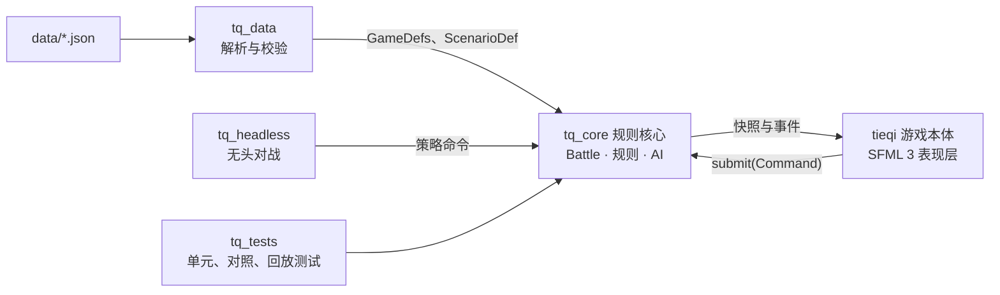

# Afterglow: Imjin 1593 开发文档

2026-10-27

## 概述

游戏名 Afterglow: Imjin 1593（繁中 餘暉：壬辰 1593），代号 Tieqi，demo 场景是碧蹄馆之战。本文档把碧蹄馆 demo 拆成可以直接开工的工程任务：任何一个 coding agent 都能领一张任务卡，在约定的目录里写代码，用约定的测试证明做对了。

- **读者**：参与开发的 coding agent 和项目作者。
- **目标**：用 C++20 和 SFML 3 做出碧蹄馆 demo 的 PC 版，玩法与 HTML 原型一致：可暂停实时制、棋子表现、明军辽东骑兵对日军先锋与本队。
- **代号**：英文名 Afterglow: Imjin 1593，繁中 餘暉：壬辰 1593。代码和仓库仍用代号 Tieqi，C++ 命名空间 `tq`，可执行文件 `tieqi`。
- **起点**：从 [2D-action-game](https://github.com/QizhouD/2D-action-game) 复制可复用的基础设施（主循环、构建、CI、配置加载、脚本回放），玩法层全部重写。

### 文档之间的关系

| 文档 | 在仓库里的位置 | 管什么 |
| --- | --- | --- |
| 本开发文档 | `docs/DEVELOPMENT.md`（从本文导出 Markdown） | 工程规格：架构、接口、规则公式、数据格式、任务与验收 |
| 设计文档 | `docs/DESIGN.md`（从 [设计文档](https://claude.ai/artifact/377hQjkSfs6krJiTqJUM5s) 导出） | 玩法意图、阵营设计、市场与美术方向 |
| HTML 原型 | `reference/prototype/byeokjegwan.html` | 规则的参考实现，浏览器直接打开即可试玩 |

两份文档的在线版本是私有链接，agent 打不开，所以开工前作者要先把它们导出放进仓库，并提交原型文件。

### 事实来源优先级

1. 本文档的"规则规格"和"数据格式"两章。
2. HTML 原型源码：规格没写到的细节以原型为准。
3. 设计文档。

三者冲突时不要自行取舍：按优先级最高的实现，并在 PR 描述里写明冲突点，由作者裁决。

## 给 agent 的工作约定

每个 agent 开工前读完本章。这里的规则是硬性的，违反任何一条的 PR 都不合并。

### 开工流程

1. 读概述、架构总览、术语对照表，以及自己任务卡涉及的章节。
2. 在"任务拆分"一章领一张依赖已全部完成的任务卡，PR 标题带上卡号，例如 `[C3] contacts and charge impact`。
3. 从 `main` 拉分支，命名 `task/<卡号>-<短名>`，例如 `task/C3-charge-impact`。
4. 先把任务卡的验收项写成测试，确认它们失败，再写实现。
5. 本地构建无警告、全部测试通过后再开 PR。

### 硬性规则

- `src/core/` 不得包含任何 SFML、ImGui、操作系统或文件系统头文件，只用标准库；JSON 解析放在 `src/data/`。CI 用 grep 检查。
- 规则核心里的随机数只能来自 `tq::Rng`，每局一个种子；禁止 `std::rand`、`std::random_device` 和时间戳。
- 规则核心只在固定逻辑时刻（tick）里修改状态；表现层只读快照，只通过 `Battle::submit()` 下命令。
- 遍历单位一律按 `UnitId` 升序；不得依赖 `unordered_map` 的遍历顺序做逻辑判断。
- 兵种数值只放在 `data/` 的 JSON 里；规则常数集中在 `src/core/rules/Constants.h`，不得散落在代码里。
- 改动规则或常数时，必须同时更新本文档的"规则规格"，并在 PR 描述里写明对平衡的预期影响。
- 不得引入 Sengoku Jidai 或 Field of Glory 的数据、脚本、文字或素材。
- 新增第三方依赖要在 PR 里说明理由，并用 CMake FetchContent 锁定到具体版本。
- 不确定时停下来提问，不要猜：在 PR 或 issue 里写清问题，并给出你建议的默认做法。
- 游戏里的中文一律用繁体（zh-Hant），包括界面、战报、棋子字和地图标注。源代码（含注释、日志、测试）一律英文，不出现中文；玩家可见的文字只放 data/strings/；中文只出现在 data/、docs/、reference/。

### 提交检查清单

- [ ] 构建无警告（GCC/Clang 开 `-Wall -Wextra -Wpedantic`，MSVC 开 `/W4`），代码已用 `clang-format` 格式化
- [ ] `ctest` 全部通过，新逻辑都有测试
- [ ] 改动规则时：规格已同步，原型对照测试仍在允许误差内
- [ ] 改动数据格式时：`data/schema/` 和"数据格式"一章已同步
- [ ] PR 描述写明卡号、做了什么、怎么验证的、遗留问题

### AGENTS.md 模板

放在仓库根目录。多数 coding agent 会读取它；Claude Code 读取 `CLAUDE.md`，放一份同内容的副本即可。

```markdown
# Tieqi（Afterglow: Imjin 1593）

C++20 + SFML 3 的可暂停实时制战棋。完整规格见 docs/DEVELOPMENT.md，
规则参考实现见 reference/prototype/byeokjegwan.html（浏览器直接打开）。

## 构建与测试
cmake --preset dev
cmake --build --preset dev
ctest --preset dev

## 硬性规则
- src/core 不得引用 SFML、ImGui 或系统头文件
- 模拟里的随机数只用 Battle 自己的 tq::Rng；表现层（粒子、音效）用自己的生成器，不许碰模拟的随机数；遍历单位按 UnitId 升序
- 兵种数值只放 data/*.json；规则常数只放 src/core/rules/Constants.h
- 改规则必须同步 docs/DEVELOPMENT.md 的"规则规格"
- 每个任务对应"任务拆分"里的一张卡，分支名 task/<卡号>-<短名>
- 不确定时在 PR 里提问，不要猜
- 游戏内中文一律繁体（zh-Hant），文案以 data/strings/zh-Hant.json 为准

## 目录
src/core 规则核心 · src/data 数据加载 · src/app 表现层 · tools/headless 无头对战
data 兵种与场景 · tests 测试 · reference 原型与参考资料
```

## 技术选型与依赖版本

全部依赖用 CMake FetchContent 从源码构建并锁定版本，不依赖系统里预装的 SFML，这样 Windows 和 Linux、MSVC 和 MinGW 不会出现编译器与库不匹配的问题。

| 组件 | 选型与版本 | 用途 | 备注 |
| --- | --- | --- | --- |
| 语言 | C++20 | 全部代码 | SFML 3 本身只要求 C++17；本项目用 C++20 的指定初始化、`std::span`、`<numbers>` |
| 编译器 | MSVC 2022 以上、GCC 13 以上、Clang 17 以上 | 构建 | Windows 上 MSVC 与 MinGW-w64 都要能编过 |
| 构建 | CMake 3.28 以上（含 4.x）+ Ninja，`CMakePresets.json` | 构建与测试 | 3.28 起 FetchContent 支持 `EXCLUDE_FROM_ALL` 和 `SYSTEM` |
| 窗口、图形、音频 | SFML 3.1.0 | 表现层 | 3.1 的文字排版改用 HarfBuzz 塑形，中韩文字渲染更稳；SFML 3 默认构建静态库 |
| 单元测试 | doctest v2.4.12 | `tests/` | 单头文件，编译快。不要用 2.4.11：它的 CMakeLists 声明 CMake 3.0，CMake 4 会拒绝配置 |
| JSON | nlohmann/json v3.11.3 | `src/data/` 读取数据 | 解析时开启注释支持，数据文件里可以写注释 |
| 调试界面 | Dear ImGui v1.91.9b + imgui-sfml 3 系列（master 分支，锁定在 2026-08-21 的提交 e8ee366） | 开发版调参面板 | imgui-sfml 要求 ImGui 不低于 1.91.1 且低于 1.92.0；只在 `TQ_DEV_TOOLS=ON` 时编译 |
| 字体 | 思源宋体繁体与韩文版（Noto Serif TC / KR）、霞鹜文楷 TC（LXGW WenKai TC） | 正文、韩文、标题与棋子字 | 均为 SIL OFL 授权，许可证文件随字体放进 `assets/fonts/` |
| 格式与静态检查 | clang-format 18 以上、clang-tidy（可选） | 代码风格 | 仓库根目录放 `.clang-format`：LLVM 风格、4 空格缩进、每行 120 列 |
| CI | GitHub Actions：Windows（MSVC）与 Ubuntu（GCC） | 构建、测试、无头对战冒烟 | Ubuntu 需安装 SFML 的系统依赖，见下一章 |

版本以表中为准；某个版本拉取失败或与其他依赖冲突时，换成同一主版本里最近的可用版本，并在 PR 里说明。

参考：[SFML 3 迁移指南](https://www.sfml-dev.org/tutorials/3.0/getting-started/migrate/)、[SFML CMake 项目模板](https://github.com/SFML/cmake-sfml-project)、[SFML 3.1.0 发布说明](https://newreleases.io/project/github/SFML/SFML/release/3.1.0)、[imgui-sfml](https://github.com/SFML/imgui-sfml)。

## 仓库结构

新建仓库 `tieqi`，按下面的目录组织；规则核心、数据加载、表现层和工具各是一个 CMake 目标，依赖只能自上而下。

```text
tieqi/
├─ AGENTS.md  CLAUDE.md        # agent 入口（同内容）
├─ CMakeLists.txt  CMakePresets.json  .clang-format
├─ cmake/
│  ├─ Dependencies.cmake        # 所有 FetchContent 声明与锁定版本，只此一处
│  └─ Warnings.cmake
├─ docs/
│  ├─ DEVELOPMENT.md  DESIGN.md
│  └─ adr/                      # 架构决策记录，一个决定一个文件
├─ reference/prototype/byeokjegwan.html   # 规则参考实现
├─ data/
│  ├─ schema/                   # 各 JSON 文件的 JSON Schema
│  ├─ config.json               # 时间压缩系数等全局设置
│  ├─ units.json                # 兵种表
│  ├─ scenarios/byeokjegwan.json
│  └─ strings/zh-Hant.json  en.json  ko.json
├─ assets/
│  ├─ fonts/                    # 字体及 OFL 许可证
│  ├─ textures/{chits,map,ui}/
│  ├─ audio/
│  └─ AI_ASSETS.md              # AIGC 素材清单，Steam 披露用
├─ src/
│  ├─ core/                     # 目标 tq_core：规则核心，只依赖标准库
│  │  ├─ math/                  # Vec2、角度、有向矩形与分离轴检测
│  │  ├─ defs/                  # UnitType、ScenarioDef、Config 等纯数据定义
│  │  ├─ rules/                 # Constants.h、冲击、近战、射击、士气、预估
│  │  ├─ sim/                   # Battle、Unit、Command、Event、Rng、地形、移动、接触、拆分合并、场景流程
│  │  └─ ai/                    # 日军指挥官
│  ├─ data/                     # 目标 tq_data：读取 JSON 生成 defs，校验并报告错误
│  └─ app/                      # 目标 tieqi：SFML 表现层
│     ├─ main.cpp  App.*        # 主循环与界面状态机
│     ├─ render/                # 镜头、底图、单位、特效
│     ├─ input/                 # 选择、框选、下令、快捷键
│     ├─ ui/                    # 面板、胜算预估、战报、横幅、结算
│     ├─ audio/                 # 音效与合成兜底
│     └─ dev/                   # ImGui 调试工具，仅 TQ_DEV_TOOLS=ON
├─ tools/headless/              # 目标 tq_headless：无头对战与批量统计
├─ tests/                       # 目标 tq_tests：core/ data/ parity/ replay/
└─ .github/workflows/ci.yml
```

| 目标 | 类型 | 依赖 | 说明 |
| --- | --- | --- | --- |
| `tq_core` | 静态库 | 无 | 全部规则与 AI；不做文件读写，数据通过 defs 结构体传入 |
| `tq_data` | 静态库 | `tq_core`、nlohmann/json | JSON 解析、校验、错误信息（带文件名和字段路径） |
| `tieqi` | 可执行文件 | `tq_core`、`tq_data`、SFML；开发版另加 ImGui | 游戏本体 |
| `tq_headless` | 可执行文件 | `tq_core`、`tq_data` | 无窗口跑整场对战，输出统计，用于调平衡和 CI |
| `tq_tests` | 可执行文件 | `tq_core`、`tq_data`、doctest | 单元测试、原型对照测试、回放测试 |

## 构建、运行与 CI

一条命令配置、一条构建、一条测试；Windows 与 Linux 用同一套 `CMakePresets.json`。

### 依赖声明

所有第三方库只在 `cmake/Dependencies.cmake` 里声明。SFML 关闭网络模块，可以省掉 TLS 和 SSH 相关的系统依赖。

```cmake
include(FetchContent)

set(SFML_BUILD_NETWORK OFF CACHE BOOL "" FORCE)
FetchContent_Declare(SFML
    GIT_REPOSITORY https://github.com/SFML/SFML.git
    GIT_TAG 3.1.0
    GIT_SHALLOW ON
    EXCLUDE_FROM_ALL SYSTEM)

FetchContent_Declare(doctest
    GIT_REPOSITORY https://github.com/doctest/doctest.git
    GIT_TAG v2.4.12
    GIT_SHALLOW ON
    EXCLUDE_FROM_ALL SYSTEM)

FetchContent_Declare(json
    URL https://github.com/nlohmann/json/releases/download/v3.11.3/json.tar.xz
    EXCLUDE_FROM_ALL SYSTEM)

FetchContent_MakeAvailable(SFML doctest json)

if(TQ_DEV_TOOLS)
    FetchContent_Declare(imgui
        GIT_REPOSITORY https://github.com/ocornut/imgui.git
        GIT_TAG v1.91.9b
        GIT_SHALLOW ON)
    FetchContent_MakeAvailable(imgui)
    set(IMGUI_DIR ${imgui_SOURCE_DIR})
    set(IMGUI_SFML_FIND_SFML OFF)
    FetchContent_Declare(imgui-sfml
        GIT_REPOSITORY https://github.com/SFML/imgui-sfml.git
        GIT_TAG e8ee3667f1b1f731e5c9c32be4c544915291f987 # master 分支，2026-08-21
        SYSTEM)
    FetchContent_MakeAvailable(imgui-sfml)
endif()
```

链接目标：`SFML::Graphics`、`SFML::Audio`、`doctest::doctest`、`nlohmann_json::nlohmann_json`、`ImGui-SFML::ImGui-SFML`。

### 预设与命令

| 预设 | 构建类型 | `TQ_DEV_TOOLS` | `TQ_BUILD_TESTS` | 用途 |
| --- | --- | --- | --- | --- |
| `dev` | Debug | ON | ON | 日常开发 |
| `release` | Release | OFF | OFF | 试玩包 |
| `ci` | RelWithDebInfo | OFF | ON | CI 构建与测试 |

```powershell
# Windows PowerShell（已进入 x64 的 VS 开发者环境，例如从 x64 Native Tools 命令行启动；或 MinGW 环境）
cmake --preset dev
cmake --build --preset dev
ctest --preset dev
.\build\dev\tieqi.exe --scenario byeokjegwan
.\build\dev\tq_headless.exe --scenario byeokjegwan --seed 1 --runs 20 --policy scripted --out runs.csv
```

```bash
# Ubuntu：先装 SFML 的系统依赖（网络模块已关闭）
sudo apt install libxrandr-dev libxcursor-dev libxi-dev libudev-dev libfreetype-dev \
  libflac-dev libvorbis-dev libgl1-mesa-dev libegl1-mesa-dev libharfbuzz-dev
cmake --preset dev && cmake --build --preset dev && ctest --preset dev
```

- 构建后把 `data/` 和 `assets/` 复制到可执行文件旁边。程序按顺序查找资源根目录：命令行 `--data-root`，当前目录下有 `data/` 时用当前目录，最后用可执行文件所在目录（沿用框架的 `chdirToAssets` 思路）。
- `tieqi` 命令行参数：`--scenario <id>`、`--seed <n>`、`--time-scale <x>`、`--replay <file>`、`--script <file>`（脚本输入加截图，沿用框架做法）、`--data-root <dir>`、`--perf`。`--perf` 关掉帧率上限，以 2 倍速自动开战，跑到结算后在标准输出打印帧时间的平均值、p95 和最大值（毫秒），然后退出。脚本行是 `<秒> down|up|press <键>`、`<秒> shot <文件>`、`<秒> quit`，另加 `<秒> resize <宽> <高>`。显式的 `--scenario`、`--seed` 盖过回放里的同名字段。脚本计时从第一帧开始，不从加载脚本时开始。

### CI

`.github/workflows/ci.yml` 两个任务：`windows-msvc` 与 `ubuntu-gcc`，每次推送和 PR 都跑：

1. 用 `ci` 预设配置、构建，并缓存 `_deps`。
2. 运行 `ctest`。ci 预设包含带 `slow` 标签的 100 种子整场基线；dev 和 release 预设排除该标签。
3. 纯净性检查：`src/core/` 中出现 `#include <SFML`、`imgui` 或 `<filesystem>` 即失败。
4. 无头冒烟（由 H1 加入，B0 只做前三步）：`tq_headless` 用 3 个种子各跑一整场，要求不崩溃、在 18000 tick 内结束、输出的事件数大于 0。

### 从 2D-action-game 迁移到 SFML 3

只复制下表"复制"一栏的文件，其余重写。复制过来的代码按右栏改到 SFML 3。

| 框架里的文件 | 处理 | SFML 3 要改的地方 |
| --- | --- | --- |
| `main.cpp` | 复制主循环与资源目录查找 | 主循环改为按 tick 推进加插值，见"架构总览" |
| `graphics/Window.*` | 复制镜头、黑边视图、脚本输入 | `pollEvent()` 返回 `std::optional<sf::Event>`，用 `is<>()`、`getIf<>()` 取事件；`sf::VideoMode({w, h})`；`sf::Rect` 改用 `position`、`size`；全屏用 `sf::State::Fullscreen`；按键改成 `sf::Keyboard::Key::W` 这类带作用域的枚举 |
| `graphics/ParticleSystem.*` | 复制 | `PrimitiveType::Quads` 已删除，改为两个三角形；`Vertex` 用聚合初始化 |
| `core/AudioManager.*` | 复制，含合成音效兜底 | `sf::Sound` 必须用缓冲区构造，音效池改成 `std::vector<sf::Sound>` 或 `std::optional`；`setLoop` 改名 `setLooping`；`loadFromSamples` 需要声道表参数；SFML 3 音频后端是 miniaudio，不再附带 `openal32.dll` |
| `core/ResourceManager.*` | 复制 | 字体用 `openFromFile`；`sf::Text`、`sf::Sprite` 没有默认构造，必须传入字体或纹理（`sf::Text(font, str, size)`） |
| `core/Balance.*` | 只借鉴做法 | 改写为 `tq_data` 的 JSON 加载：默认值、覆盖、坏值报警 |
| `core/SaveData.*` | 复制 | 无图形依赖，基本不用改 |
| `entities/`、`components/`、`systems/`、`Board`、`Tile`、`LevelParser`、`Player`、`Enemy`、`InputHandler`、`Hud` | 不复制 | 玩法层全部按本文档重写 |

旋转统一用 `sf::degrees()` / `sf::radians()`；`sf::Thread`、`sf::Mutex` 已删除，需要时用标准库。完整对照见 [SFML 3 迁移指南](https://www.sfml-dev.org/tutorials/3.0/getting-started/migrate/)。

## 架构总览

规则核心是一个确定性的模拟器：输入是数据定义、随机种子和带时刻的命令，输出是每个 tick 的快照和事件；游戏本体、无头工具和测试都只是它的使用方。



玩家命令进命令队列，AI 在核心内部直接改日军的命令；同样的种子和玩家命令下 AI 会做出同样的决定，所以回放只需记录种子和玩家命令。

### 每个 tick 的执行顺序

顺序与原型的 `step()` 一致，不得调换：

1. 应用时刻等于本 tick 的玩家命令。
2. 战场时间增加一个 tick；场景流程检查阶段切换与援军触发。
3. 每 10 个 tick，AI 指挥官思考一次并修改日军单位的命令。
4. 按 `UnitId` 升序更新每个单位的计时和移动。
5. 接触检测：分离重叠、结算冲击、登记接战对象、处理撤出。
6. 每 5 个 tick 做一次战斗结算：近战、齐射、士气与状态切换、溃逃减员与集结、残部合并。
7. 胜负检查。

### 时间模型

数据和常数一律用真实世界的单位：米、米/秒、战场秒。节奏只由一个时间压缩系数决定，它只改变每个墙钟秒推进多少个 tick，不改变任何规则结果。

| 量 | 值 | 说明 |
| --- | --- | --- |
| tick 长度 | 0.8 战场秒 | 等于原型的 0.1 游戏秒 × 8 |
| 战斗结算间隔 | 5 tick（4 战场秒） |  |
| AI 思考间隔 | 10 tick（8 战场秒） |  |
| 时间压缩系数 `time_scale` | 默认 8 | 1 个墙钟秒对应的战场秒数；8 时与原型节奏完全一致，调节奏只改它 |
| tick 频率 | `time_scale` ÷ 0.8 × 玩家倍速 | 默认每墙钟秒 10 个 tick |
| 玩家倍速 | 0.5、1、2 | 可暂停，暂停时仍可下令 |
| 顿帧 | 墙钟 40–190 毫秒 | 只在表现层暂停推进 tick，不进入规则核心 |

原型里的数值是"游戏秒"：移植时速度除以 8、时长乘以 8、距离不变。换算后骑兵常速约 4.3 米/秒、步兵约 1.2 米/秒、铁炮装填 48 秒，都在史实合理范围内。把 `time_scale` 从 8 降到 5，整场变慢 1.6 倍，平衡不变。

### 确定性要求

- 同一二进制、同一份数据、同一种子和同样的玩家命令序列，每个 tick 的状态必须逐位相同。不同编译器之间不要求一致，回放文件记录构建号。
- 随机数只用 `tq::Rng`（PCG32），每局一个流，取数顺序由单位遍历顺序决定。
- 单位放在一个只增不减的数组里，`UnitId` 就是下标；残部、分队、援军都追加到末尾，退场单位只把状态设为 `Gone`，整局不删除。
- 核心里没有线程、没有墙钟、没有文件读写。

### 主循环

```cpp
// app/App.cpp：累加器以 tick 为单位
while (window.isOpen()) {
    const float frame = std::min(clock.restart().asSeconds(), 0.25f);
    input.handleEvents(window, battle);            // 产生命令 -> battle.submit()
    if (!paused && !battle.isOver()) {
        if (hitstop > 0.f) hitstop -= frame;
        else acc += frame * config.timeScale / tq::kTickSeconds * playerSpeed;
    }
    for (int n = 0; acc >= 1.f && n < 8; ++n, acc -= 1.f) {
        battle.step();
        fx.consume(battle.drainEvents(), hitstop, shake);  // 冲击事件设置顿帧与震动
    }
    renderer.draw(battle, /*alpha=*/acc);           // 用 prev/cur 位置插值
}
```

## 规则核心 API

下面是对外接口的约定，字段名和函数签名照此实现；内部实现自由，但不得暴露可写的内部状态给表现层。坐标系与原型一致：x 向东、y 向南，北口在 y = 0；角度用弧度，0 指向东，π/2 指向南。

### 基础类型

```cpp
// src/core/sim/Types.h
namespace tq {
using UnitId = std::uint32_t;               // 即单位数组下标，只增不减
inline constexpr UnitId kNoUnit = 0xFFFFFFFF;
inline constexpr float kTickSeconds = 0.8f; // 每 tick 的战场秒数

enum class Side : std::uint8_t { Ming, Jp };
enum class UnitState : std::uint8_t { Steady, Wavering, Broken, Routing, Gone };
enum class GoneReason : std::uint8_t { None, Dispersed, Fled, Withdrawn, GeneralKilled, Merged };
enum class Terrain : std::uint8_t { Open, Road, Hill, Paddy };
enum class ContactSide : std::uint8_t { Front, Flank, Rear };

struct Order {
    enum class Type : std::uint8_t { Hold, Move, Attack } type = Type::Hold;
    Vec2 point{};                     // Move 的目标点
    std::optional<float> face;        // 到达或坚守时转向的朝向
    UnitId target = kNoUnit;          // Attack 的目标
};
}
```

### 单位

```cpp
// src/core/sim/Unit.h（字段与原型一一对应）
struct Unit {
    UnitId id; std::uint16_t type; Side side;
    std::string labelKey;             // 字符串表键，如 "unit.jiading_left"
    std::uint16_t fragNo = 0;         // 残部或分队编号，显示为"·残一""·分二"
    Vec2 pos, prevPos; float facing, prevFacing;   // prev* 供渲染插值
    float frontage, depth;            // 正面宽度、纵深（米）
    float men, maxMen, morale;
    UnitState state = UnitState::Steady; GoneReason gone = GoneReason::None;
    Order order;
    std::vector<UnitId> contacts;     // 本 tick 接战的敌方单位，按 id 升序
    float engagedSec = 0, recoverSec = 0, reloadSec = 0, stillSec = 16;
    float speed = 0, runDist = 0;     // 当前速度（米/秒）、本次冲锋已冲出距离
    bool charging = false, volleyDone = false, breaking = false;
    int momentum = 0; float momentumSec = 0;
    float brokenSec = 0, routSec = 0;
    Vec2 knock{};                     // 溃散冲力（米/秒）
    std::optional<float> scatterAngle;
    bool everBroken = false, isFragment = false, rejoin = false;
    bool vanguard = false, deploying = false;
    UnitId origin = kNoUnit;          // 分兵或崩溃散开时的来源单位；从未拆分过为 kNoUnit
};
```

### 命令与事件

```cpp
// src/core/sim/Command.h —— 只有玩家命令进队列，AI 在核心内部直接改日军 Order
struct Command {
    std::uint32_t tick;               // 由 submit() 填为下一个要执行的 tick
    enum class Type : std::uint8_t { Move, Attack, Hold, Retreat, Split, Join } type;
    std::vector<UnitId> units;        // 选中的我方单位
    Vec2 point{};                     // Move
    UnitId target = kNoUnit;          // Attack
};

// src/core/sim/Event.h —— 表现层据此播放特效、音效并生成本地化战报
struct Event {
    enum class Type : std::uint8_t {
        Impact, ThreeEyedVolley, TeppoVolley, Breakaway, Broken, Shattered, Rallied,
        Merged, Split, Dispersed, Fled, Withdrawn, GeneralDown, MomentumGained,
        ScoutWarning, PhaseChanged, Reinforcement, GrandAssault, BattleEnded
    } type;
    std::uint32_t tick;
    UnitId a = kNoUnit, b = kNoUnit;  // 主体与对象，含义随 type
    Vec2 pos{};
    float value = 0;                  // 冲击倍数、兵数、气势层数、阶段号等
    ContactSide side = ContactSide::Front;
    std::uint8_t flags = 0;           // 位标志：kPikeFront、kBreaks、kImportant 等
};
```

### Battle

```cpp
// src/core/sim/Battle.h
class Battle {
public:
    Battle(const GameDefs& defs, const ScenarioDef& scenario, std::uint64_t seed,
           BattleOptions opts = {});        // opts.aiEnabled = false 供对决测试关闭 AI

    void submit(Command cmd);                 // 线程不安全，由主循环调用
    void step();                              // 推进一个 tick
    std::vector<Event> drainEvents();         // 取走并清空本 tick 以来的事件

    std::uint32_t tick() const;
    float battleSeconds() const;              // tick × kTickSeconds
    std::span<const Unit> units() const;
    const Unit& unit(UnitId id) const;
    const UnitType& typeOf(const Unit& u) const;
    int phase() const;                        // 0 未开始，1 遭遇，2 主力压上，3 撤退
    bool exitOpen() const;
    Terrain terrainAt(Vec2 p) const;
    bool isOver() const;
    const BattleResult& result() const;       // 结果、评级、撤出兵力、统计
    const BattleStats& stats() const;
    std::uint64_t stateHash() const;          // 全部单位状态的 FNV-1a，确定性测试用
};

// src/core/rules/Preview.h —— 与实际结算共用同一套计算函数
struct Modifier { ModKind kind; float value; };          // ModKind 对应字符串表
struct Preview {
    enum class Kind : std::uint8_t { Charge, Melee } kind;
    float ratio; ContactSide side; Verdict verdict;      // Verdict：Breaks/Favored/Even/Unfavored/PikeWall/Pursuit
    std::vector<Modifier> mods; std::vector<NoteKind> notes;
};
Preview previewAttack(const Battle& b, UnitId attacker, UnitId target);
bool canSplit(const Battle& b, UnitId id);
std::vector<std::vector<UnitId>> joinGroups(const Battle& b, std::span<const UnitId> selection);

// src/core/sim/Replay.h —— 序列化在 tq_data 里做
struct Replay { std::string build, scenario; std::uint64_t seed; std::vector<Command> commands; };
```

- 命令的处理（含多选时保持相对位置的偏移，见规则规格）全部在核心里完成，表现层只传原始的点击点和选中列表，保证回放一致。
- 战报文字不在核心里生成：核心只发事件，表现层用字符串表格式化。

测试需要直接改单位状态时（摆对决、强行击溃、设置士气），用只在测试目标里编译的友元辅助类 `tq::testing::BattleAccess`，表现层和工具不得使用。

## 规则规格

本章是规则的权威描述，按一个 tick 内的执行顺序组织（顺序见"架构总览"）。数值已换算成真实单位（米、米/秒、战场秒），`time_scale` 取 8 时与 HTML 原型逐 tick 等价。伪代码里的函数名与原型源码同名，方便逐段对照。实现时所有数字都写成 `Constants.h` 里的具名常数，场景相关的数字写进场景 JSON，代码里不得直接写字面量。

### 约定

- `dt = 0.8`，tick 计数从 1 开始：`tick % 10 == 0` 时 AI 思考，`tick % 5 == 0` 时做战斗结算。构造后 `phase = 0`，第一次 `step()` 先进入阶段 1 并发出 `PhaseChanged`。
- `U()` 表示从 `tq::Rng` 取一个 \[0, 1) 的均匀数，取数顺序就是伪代码的书写顺序。特效、音效等表现层的随机数用表现层自己的随机源，不得消耗 `tq::Rng`。
- 存活：状态不是 Gone。可战：状态为 Steady 或 Wavering。
- `angDiff(a, b)` 把 a − b 归一化到 (−π, π\]；`turnToward(u, a, step)` 即 `facing += clamp(angDiff(a, facing), -step, step)`，`step = 兵种角速度 × 系数 × dt`。
- `str(u) = sqrt(men / type.men)` 是兵力系数。分母是兵种满编人数而不是 maxMen，所以残部和分队天然更弱。
- `nearGeneral(u)`：同阵营、可战、与 u 的距离小于自身 `aura` 的将领单位（不含 u 自己），有多个时取 UnitId 最小者。
- 范围判定一律用严格小于；"最近""最高"出现并列时取 UnitId 最小者。
- 遍历单位一律按 UnitId 升序。一个步骤开始时记下单位总数，步骤中新产生的单位（残部、分队）从下一个步骤起才参与。
- 单位生成时：`men = maxMen = type.men`，`morale = type.morale`，状态 Steady，命令 Hold（朝向为初始朝向），正面宽度和纵深取兵种值，`stillSec = 16`。每个新单位都消耗一次 `U()`（与原型 `add()` 相同）；有射程的把 `reloadSec` 设为 `16 ×` 该值，其余丢掉这次结果，`reloadSec` 为 0。
- `isMoving(u)`：可战，且命令为 Move 或 Attack。

### 原型数值换算

| 量 | 换算 | 例：原型 → 本项目 |
| --- | --- | --- |
| 速度 | ÷ 8 | 家丁精骑常速 34 → 4.25 米/秒，冲锋 70 → 8.75 米/秒 |
| 角速度 | ÷ 8 | 家丁精骑 1.8 → 0.225 弧度/秒 |
| 加速度 | ÷ 64 | 骑兵冲锋加速 60 → 0.9375 米/秒² |
| 时长 | × 8 | 铁炮装填 6 → 48 秒；崩溃翻面 1.2 → 9.6 秒；溃兵集结等待 10 → 80 秒 |
| 距离、倍率、兵数、士气 | 不变 | 冲锋起步距离 210 米；破阵阈值 1.9 |
| 每次战斗结算的增减量 | 不变 | 士气恢复每次 +0.5；溃逃减员每次 0.7% |

### 地形

```text
terrainAt(p)  按顺序判定，先命中先返回
  1. 在任一水田矩形内（含边界）                   -> Paddy
  2. 在任一山地椭圆内：(dx/rx)^2 + (dy/ry)^2 < 1  -> Hill
  3. 到大路折线任一段的距离 < 14                   -> Road
  4. 其余                                           -> Open
```

地形按单位中心点取。行进系数 `terrainSpeed(u)`：

| 地形 | 骑兵 | 步兵 |
| --- | --- | --- |
| 水田 | 0.6 | 0.7 |
| 山地 | 0.8 | 0.85 |
| 大路 | 1.1 | 1.1 |
| 平地 | 1 | 1 |

### 有向矩形与接触面

```text
单位是有向矩形：中心 pos、朝向 f、沿朝向的纵深 depth、横向的正面宽度 frontage
obb(u, inflate)  轴 a0 = (cos f, sin f)，a1 = (-sin f, cos f)
                 半长 h0 = depth/2 + inflate，h1 = frontage/2 + inflate
                 在轴 n 上的投影：中心 dot(pos, n)，半径 h0*|dot(a0, n)| + h1*|dot(a1, n)|
sat(A, B)        依次在 A.a0、A.a1、B.a0、B.a1 上投影，重叠量 o = min(两右端) - max(两左端)
                 任一轴 o <= 0 即不相交；否则返回 o 最小的轴 n（并列取先出现的）和 o
                 若 dot(B.pos - A.pos, n) < 0 则 n 取反，保证 n 由 A 指向 B
sideOf(d, a)     a 位于 d 的哪一面
                 lx = dot(a.pos - d.pos, d.a0)，ly = dot(a.pos - d.pos, d.a1)
                 nx = lx / (d.depth/2 + 14)，ny = ly / (d.frontage/2 + 14)
                 |nx| >= |ny| 时 lx > 0 为 Front，否则 Rear；|nx| < |ny| 为 Flank
```

### 单位移动（每 tick）

```text
moveUnit(u)  对每个存活单位调用
  recoverSec = max(0, recoverSec - dt)；reloadSec = max(0, reloadSec - dt)
  momentum > 0 时：momentumSec += dt；momentumSec > 240 则 momentum -= 1，momentumSec = 0
  knock 非零时：
      pos += knock * dt；knock *= pow(0.05, dt / 8)            // 每 tick 约 ×0.7411
      |knock.x| + |knock.y| < 0.25 则 knock = 0；clampPos(u)
  Broken：brokenSec -= dt；<= 0 则转为 Routing，routSec = 0；return
  Routing：routMove(u)；return
  contacts 非空且 breaking 为假：
      骑兵且命令为 Move：startBreakaway(u)；若因此退场则 return，否则继续往下
      其他情况：以角速度 * 0.5 转向 primaryContact(u)；charging = false，speed = 0，stillSec = 0；return
  按命令确定目标点：
    Attack：目标已退场 -> 命令改为 Hold（朝向取当前朝向），charging = false；return
            d = 到目标中心的距离；兵种 run > 0 时判定冲锋，cs = 骑兵 210 / 步兵 70
              已在冲锋：d < cs * 1.4 则继续冲锋
              未在冲锋：recoverSec <= 0 且 45 < d < cs 则开始冲锋
    Move：  距目标点 < 5 -> 命令改为 Hold（朝向取命令里的朝向），speed = 0；return
    Hold：  charging = false，speed = 0，stillSec += dt
            150 内有可战敌军 -> 以角速度 * 0.6 转向最近的一个
            否则命令带朝向 -> 以全角速度转向该朝向
            return
  stillSec = 0
  want = 指向目标点的方向；以角速度 *（冲锋 0.7，否则 1）转向 want；diff = |angDiff(want, facing)|
  冲锋：刚开始时置 charging = true，runDist = 0，volleyDone = false，speed = max(speed, walk)
        speed = min(run, speed + acc * dt)，acc = 骑兵 0.9375 / 步兵 0.46875
  不冲锋：charging = false；speed += clamp(walk - speed, -0.9375 * dt, acc * dt)，acc = 骑兵 0.9375 / 步兵 0.390625
  align = 骑兵：diff < 0.6 取 1，< 1.4 取 0.65，否则 0.3
          步兵：diff < 0.5 取 1，< 1.2 取 0.45，否则 0.12
  v = speed * align * terrainSpeed(u)；pos += (cos f, sin f) * v * dt
  冲锋中：runDist += v * dt；兵种有三眼铳、volleyDone 为假且 d < 62 -> volleyDone = true，mingVolley(u, 目标)
  clampPos(u)

startBreakaway(u)  breaking = true；kill(u, 0.03 * type.men)；morale -= 5；事件 Breakaway
primaryContact(u)  contacts 中 meleePower 最高者，不可战的按 0.01 计
clampPos(u)        入场中：x ∈ [-90, W + 90]，y ∈ [-90, H + 90]；否则 x ∈ [10, W - 10]，y ∈ [10, H - 10]
```

### 溃逃移动

```text
routMove(u)
  routSec += dt；charging = false
  dir = 回撤方向：明军 (0, -1)，日军 (0, 1)
  e = 最近的可战敌军（不限距离）；有则 dir += normalize(u.pos - e.pos) * (距离 < 200 ? 1.2 : 0.35)
  有 scatterAngle 且 routSec < 40：dir += (cos s, sin s) * 1.6 * (1 - routSec / 40)
  以角速度 * 1.6 转向 dir 的方向
  v = (骑兵 5 / 步兵 1.75) * terrainSpeed(u)；pos += (cos f, sin f) * v * dt
  x 限制在 [10, W - 10]，y 不限制；y < -12 或 y > H + 12 -> fled(u)
```

接触检测末尾对所有存活单位调用 `clampPos`，溃逃单位的 y 也会被夹回 \[10, H − 10\]。因此上面的 `fled` 判定目前到不了：溃兵停在地图边缘，可能集结后再走进撤退口。这与原型 `contactsStep` 一致，本阶段维持现状。

### 接触检测（每 tick）

```text
contactsStep()
  清空所有存活单位的 contacts
  对存活单位对 (a, b)，a.id < b.id：
    任一已退场（可能是本步骤里刚退场）-> 跳过；中心距 > 120 -> 跳过
    同阵营：任一 Routing -> 跳过；sat(obb(a, 0), obb(b, 0)) 相交 -> a -= n * o/2，b += n * o/2；跳过后续
    敌对：sat(obb(a, 2.5), obb(b, 2.5)) 不相交 -> 跳过
          a.charging 且 fastEnough(a) -> impact(a, b)
          a、b 都存活，且 b.charging 且 fastEnough(b) -> impact(b, a)
          任一已退场 -> 跳过
          互相登记 contacts
          sat(obb(a, 0), obb(b, 0)) 相交 -> a -= n * o * wa，b += n * o * (1 - wa)
            wa = a 溃逃 0.8；否则 b 溃逃 0.2；否则仅 isMoving(a) 0.85；仅 isMoving(b) 0.15；否则 0.5
  对每个存活单位 u：
    breaking 且 contacts 为空 -> breaking = false
    明军、入场中且 y > 60 -> 入场结束
    clampPos(u)
    撤退口已开、明军、非入场中、可战，且 x0 < x < x0 + w、y < y0 + h -> withdraw(u)

fastEnough(u) = speed >= 0.7 * run 且 runDist >= 35
```

### 冲击

```text
chargeCalc(a, t, predict)
  side  = sideOf(t, a)
  base  = a.type.impact
  spd   = predict ? 1 : clamp(a.speed / a.type.run, 0.5, 1)
  sm    = Front 1，Flank 1.8，Rear 2.4
  st    = t Wavering 1.35；t Broken 或 Routing 2.2；否则 1
          t 有射程且可战：reloadSec > 2.4 再 * 1.25；否则 stillSec < 9.6 再 * 1.2
  ter   = a 或 t 在水田 * 0.5；t 在山地而 a 不在 * 0.8
  pikeFront = t 有长枪、side 为 Front 且 t 可战；pk = pikeFront ? 0.35 : 1
  mo    = 1 + 0.1 * a.momentum
  aw    = a Wavering ? 0.8 : 1
  power  = base * spd * sm * st * ter * pk * mo * aw * str(a)
  resist = t.type.defense * str(t) * (t Steady ? 1 : 0.85)
  ratio  = power / max(resist, 0.15)

impact(a, t)
  r = chargeCalc(a, t, false).ratio；stats.impacts += 1；t 可战时 stats.bestImpact = max(stats.bestImpact, r)
  a.charging = false，a.speed = 0，a.runDist = 0，a.recoverSec = 骑兵 48 / 步兵 32
  wasFighting = t 可战
  wasFighting 时 t.morale -= pikeFront ? 2 : 4 + 9 * r
  kill(t, 0.035 * r * t.type.armor * t.type.men)
  pikeFront：kill(a, 0.06 * a.type.men)，a.morale -= 14，a.recoverSec = 72
  否则：     kill(a, 0.012 * a.type.men / sqrt(max(r, 0.3)))
  非 pikeFront 且 t 存活：t 沿 a 指向 t 的方向立即位移 min(26, 6 + 7 * r)，clampPos(t)
  breaks = r >= 1.9 且非 pikeFront 且 wasFighting 且 t 存活且 t 不是将领
  事件 Impact（a, b = t, value = r, side, flags = pikeFront / breaks）
  breaks -> breakUnit(t, from = a)
```

冲击后的顿帧、震屏、尘土、地面痕迹和飘字都由表现层根据 `Impact` 事件生成，见"表现层规格"。

### 三眼铳

```text
mingVolley(u, t)  t 已退场则无效
  kill(t, 0.015 * t.type.men)；t 可战时 t.morale -= 8；事件 ThreeEyedVolley
```

### 战斗结算（每 5 tick）

```text
combatTick()  开始时的存活单位快照记为 us
  1. 接战计时：us 中有接战的 engagedSec += 4，否则 engagedSec = max(0, engagedSec - 8)
  2. 近战（先累计，再统一结算）
  3. 铁炮齐射
  4. 士气、状态与集结
  5. mergeStep()
```

**近战**

```text
meleePower(u) = melee * str(u)
              * (Wavering ? 0.8 : 1) * (1 + 0.1 * momentum)
              * (骑兵且 recoverSec > 0 ? 0.85 : 1)
              * (骑兵且在水田 ? 0.75 : 1)
              * (骑兵且 engagedSec > 48 ? 0.85 : 1)
pairMul(x, y) = (x 有长枪、y 是骑兵、sideOf(x, y) 为 Front ? 1.3 : 1)
              * (x 是骑兵、y 有长枪且可战、sideOf(y, x) 为 Front ? 0.7 : 1)

对 us 中有接战、可战、breaking 为假的每个单位 a：
  share = 1 / contacts 数
  对 a.contacts 中每个存活的 e：
    side  = sideOf(e, a)；routed = e 不可战
    aP    = meleePower(a) * pairMul(a, e)
    sm    = routed ? 2.5 : Front 1，Flank 1.6，Rear 2.2
    eP    = routed ? 0.15 : meleePower(e) * pairMul(e, a)
    ratio = clamp(aP * sm / max(eP, 0.1), 0.3, 3)
    rnd   = 0.9 + 0.2 * U()
    cas   = e.type.men * 0.012 * aP * sm * rnd * share * e.type.armor * (routed 且 a 是骑兵 ? 1.4 : 1)
    ml    = routed ? 0 : (0.8 + e.engagedSec / 160) * sqrt(ratio) * (Front 1，Flank 1.5，Rear 2) * share * rnd
    e 的累计伤亡 += cas，累计士气损失 += ml
按首次累计到该目标的顺序结算（攻击方按 id 升序，其接战列表按 id 升序；同一目标只在第一次被计入时入队）。这与原型 `Map` 的插入顺序一致，并且确定。before = e.men；kill(e, 累计伤亡)
  e 仍存活且可战：frac = (before - e.men) / e.maxMen
                 e.morale -= (累计士气损失 + 75 * frac) * (nearGeneral(e) ? 0.85 : 1)
```

**铁炮齐射**

```text
对 us 中存活、有射程、可战、无接战、reloadSec <= 0 且 stillSec >= 9.6 的每个单位 u：tryFire(u)
tryFire(u)
  候选：存活敌军 e，d = 距离 <= range；e 未在冲锋时还要 d <= 0.75 * range；|angDiff(u 指向 e 的方位, u.facing)| <= 0.8
  取 score = (e 冲锋中 ? 2 : 1) / (d + 30) 最高者；没有候选则返回
  f = 1 - 0.6 * d / range；s = str(u) * (u Wavering ? 0.75 : 1)；c = e 冲锋中 ? 1.3 : 1
  kill(e, e.type.men * 0.08 * f * s * e.type.armor * c)
  e 可战：e.morale -= (7 + 9 * f) * s * c * (nearGeneral(e) ? 0.85 : 1)
  e 冲锋中且存活：e.speed *= 0.8
  u.reloadSec = type.reload + 6.4 * U()
  事件 TeppoVolley（a = u, b = e）
```

**士气、状态与集结**

```text
cap(u) = type.morale * (0.55 + 0.45 * min(1, men / type.men))
对每个存活单位 u：
  可战：
    无接战且 morale < cap -> morale = min(cap, morale + 0.5 + (nearGeneral(u) ? 1.0 : 0))
    morale 限制在 [0, 100]
    morale < 30 -> breakUnit(u)；否则 state = morale < 55 ? Wavering : Steady
  Routing：
    kill(u, 0.007 * maxMen)；已退场则跳过
    180 内没有可战敌军且 routSec > 80：
      morale = min(morale + 1.5, cap)
      morale >= 40 且 men > 0.25 * maxMen -> state = Wavering，
        命令改为 Hold（明军朝向 π/2，日军朝向 -π/2），事件 Rallied
```

这一步按 id 顺序进行，所以一个单位崩溃时扣掉的友军士气，会让 id 更大的友军在同一次结算里接着崩溃，这就是连锁溃败。

### 崩溃与残部

```text
breakUnit(u, from)  u 不可战时无效
  parts = (u 不是将领且 men >= 150) ? (men >= 330 ? 3 : 2) : 1
  state = Broken，brokenSec = 9.6，命令 Hold（不带朝向），charging = false，momentum = 0，breaking = false
  everBroken 为假：stats.broken[阵营] += 1，everBroken = true
  morale = min(morale, 25)；事件 Broken（value = parts）
  其他存活单位 v，距离 d：
    同阵营、可战、d < 170：v.morale -= (4 + 10 * (1 - d / 170)) * (nearGeneral(v) ? 0.7 : 1)
    敌方、可战、d < 200：v.morale = min(cap(v) + 5, v.morale + 4)
  u.contacts 中兵种有"气势"特性且可战的 v：
    加层 = (v 兵种有 boost，或 nearGeneral(v) 的兵种有 boost) ? 2 : 1
    v.momentum = min(3, v.momentum + 加层)，momentumSec = 0，事件 MomentumGained
  from 为空时取 primaryContact(u)；仍为空则取 400 内最近的可战敌军
  shatter(u, parts, from)

shatter(u, n, from)
  base = from 存在 ? from 指向 u 的方向 : (明军 -π/2，日军 π/2)；u.facing = base
  n <= 1：knock = (cos base, sin base) * 8.75，scatterAngle = 空；return
  origin = u.origin 已设 ? u.origin : u.id
  share = u.men / n；mor = u.morale
  新建 n - 1 个同兵种单位，位置和朝向同 u，不计入总兵力（按生成规则取 reloadSec）
  parts = [u, 新单位...]；对 parts[i] 依次：
    fragNo = ++fragCounter[origin]
    a = base + (i / (n - 1) - 0.5) * 1.9 + (U() - 0.5) * 0.3
    v = 18.75 + 10 * U()
    men = maxMen = share，morale = mor，state = Broken，brokenSec = 9.6，命令 Hold
    charging = false，speed = 0，momentum = 0，everBroken = true，isFragment = true，origin = origin
    knock = (cos a, sin a) * v，scatterAngle = a，facing = a，routSec = 0，breaking = false，recoverSec = 0
    vanguard：parts[0] 保持原值，其余为假
    sizeFrag(parts[i])
  事件 Shattered（a = u, value = n）

sizeFrag(p)  k = clamp(p.maxMen / type.men, 0.12, 1)
             frontage = max(22, type.frontage * k^0.6)，depth = max(14, type.depth * k^0.3)
```

### 减员与退场

```text
kill(u, n)  u 已退场则无效
  real = min(max(0, n), men)；men -= real；stats.lost[阵营] += real
  将领：men < 0.25 * maxMen -> generalDown(u)
  其他：men < max(0.12 * maxMen, 25) -> disperse(u)
generalDown(u)  -> Gone(GeneralKilled)；事件 GeneralDown
  所有可战单位 v，距离 < 260：同阵营 morale -= 22；敌方 morale = min(100, morale + 8)
disperse(u)     -> Gone(Dispersed)；事件 Dispersed
fled(u)         -> Gone(Fled)；事件 Fled
withdraw(u)     -> Gone(Withdrawn)；exitedMen += men；事件 Withdrawn
```

### 合并、分兵与合兵

```text
mergeStep()  候选 = 存活、(isFragment 或 rejoin)、可战、无接战、knock 为零的单位
  对候选对 (a, b)，a.id < b.id：两者都存活、origin 相同、距离 <= 46 -> 把 b 并入 a
    a.morale = 按兵数加权平均；a.men += b.men；a.maxMen += b.maxMen；b -> Gone(Merged)
    a.rejoin = a.rejoin 或 b.rejoin；a.fragNo = 0
    同 origin 的存活单位只剩 a：isFragment = false，rejoin = false
    sizeFrag(a)；事件 Merged（a, b, value = 合并后兵数）

canSplit(u) = 可战 且 无接战 且 不是将领 且 非入场中 且 men >= 160
splitUnit(u)
  origin = u.origin 已设 ? u.origin : u.id
  新建同兵种单位 b，位置和朝向同 u，不计入总兵力；u、b 先后取 fragNo = ++fragCounter[origin]
  u 与 b：men = u.men / 2，maxMen = u.maxMen / 2，origin = origin，isFragment = false，rejoin = false
  b 复制 u 的 morale、state、recoverSec、reloadSec、stillSec、momentum、everBroken；b.vanguard = false
  sizeFrag(u)，sizeFrag(b)
  r = (-sin f, cos f)，off = u.frontage / 2 + 2（取 sizeFrag 之后的宽度）
  u.pos -= r * off，b.pos += r * off；两者 clampPos，命令 Hold（朝向 = u.facing）
  事件 Split（a = u, b = b）
joinGroups(选中)  选中单位里可战、origin 已设、isFragment 为假的，按 origin 分组，保留两个及以上的组
```

单位显示名由名称键加后缀组成：`fragNo > 0` 且是残部显示"·残N"，`fragNo > 0` 且不是残部显示"·分N"，`fragNo = 0` 且（是残部或正在合兵）显示"·合"，其余不加后缀。中文的 N 用一到十循环。

### 玩家命令

```text
可下令单位 = 命令列出的单位中属于明军且可战的（入场中的也可以）；没有则忽略该命令
Move(point)
  c = 这些单位的位置均值；face = 只有一个单位时为它指向 point 的方向，否则为 c 指向 point 的方向
  每个单位：offset = 多个单位时 (clamp(x - c.x, -140, 140), clamp(y - c.y, -140, 140))，单个时为 0
           目标 = (clamp(point.x + offset.x, 12, W - 12), clamp(point.y + offset.y, 12, H - 12))
           命令 Move(目标, face)
Attack(target)  target 存活且是敌军时，每个单位命令 Attack(target)
Hold            每个单位命令 Hold（朝向 = 当前朝向）
Retreat         等同 Move((撤退口中心 x, 撤退口已开 ? 20 : 60))
Split           每个满足 canSplit 的单位执行 splitUnit
Join            对 joinGroups 的每一组：按 men 降序（并列按 id 升序）取第一个为锚点
                全组 rejoin = true；锚点 Hold（朝向 = 锚点朝向）；其余 Move(锚点位置, 锚点朝向)
```

### 场景流程

下面是碧蹄馆的流程，数字都来自场景 JSON（格式见下一章）。每个 tick 开头、时间增加之后检查：

```text
阶段 1
  未预警且（t >= 1280，或 先锋已崩溃数 >= 3 且 t >= 640）-> 预警，mainAt = t + 160，事件 ScoutWarning
  已预警且 t >= mainAt -> 进入阶段 2
阶段 2
  t - phase2At >= 720 -> 进入阶段 3
援军（尚未入场且阶段 >= 2）
  danger = 主帅存活且（有接战，或不是 Steady，或 men < 0.7 * maxMen，或 220 内有可战敌军）
  （阶段 3 且 t - phase3At >= 200）或（danger 且 t - phase2At >= 160）-> 援军入场

先锋已崩溃数  开局标为先锋的单位（不含其残部和分队）中 everBroken 为真或已退场的个数
进入阶段 2    phase2At = t，撤退口打开，生成"本队"组，事件 PhaseChanged(2)
进入阶段 3    phase3At = t，生成"两翼"组
              敌方主将可战：所有可战日军 morale = min(type.morale + 10, morale + 12)，事件 GrandAssault
              否则事件 GrandAssault（flags 标明未能发动）
              事件 PhaseChanged(3)
援军入场      生成"杨元"组，事件 Reinforcement
生成组        每个单位入场中，出现在出生点，命令 Move(集结点, 组朝向)，speed = walk，计入总兵力
```

阶段 3 的总攻加成在"两翼"组生成之后执行，所以两翼武士也会得到加成。

实现时把场景里的秒数在加载时换算成 tick（秒 ÷ 0.8，四舍五入），流程判定一律比较整数 tick，不要累加浮点秒。例如预警在 tick 1600（或提前到 tick 800），本队在预警后 200 tick 赶到，阶段 3 在阶段 2 后 900 tick。原型用浮点累加时间，这些事件会晚 1 到 2 个 tick，对照测试允许这个误差。

### 胜负与战果

```text
每 tick 末尾检查，先命中先生效：
  主帅 GeneralKilled  -> 败（主帅阵亡）
  主帅 Withdrawn      -> 胜（撤出）
  主帅 Fled           -> 败（主帅溃逃）
  明军无存活单位       -> 败（全军溃散）
  阶段 >= 3 且日军无存活单位 -> 胜（肃清）
战果
  saved = exitedMen
  撤出胜利：再加上可战、无接战、距撤退口中心小于 260 的明军兵数（随主帅撤出）
  肃清胜利：再加上全部可战明军的兵数
  rate = saved / 明军总兵力（含已入场的援军）
  胜：肃清，或 rate >= 0.6 且日军崩溃数 >= 6 -> 大胜；rate >= 0.35 -> 小胜；否则惨胜
```

### 胜算预估

预估与实际结算调用同一组函数，只有冲击速度按满速计。

```text
previewAttack(a, t)
  canCharge = a.type.run > 0 且 a.recoverSec <= 0 且 距离 > 45
  提示：
    run > 0 且 recoverSec > 0 -> Recovering（附剩余秒数，向上取整）
    run > 0 且 距离 <= 45      -> TooClose
    canCharge 且存在敌方可战铁炮 e：reloadSec <= 8、stillSec >= 6.4、dist(e, t) < 160、
      dist(e, a) < range + 220、|angDiff(e 指向 a 的方位, e.facing)| < 1.0 -> VolleyThreat(e)
    a Wavering -> OwnWavering
  canCharge：kind = Charge，ratio = chargeCalc(a, t, true)
    verdict = pikeFront PikeWall；t 不可战 Pursuit；>= 1.9 Breaks；>= 1.2 Favored；>= 0.8 Even；否则 Unfavored
  否则：kind = Melee，ratio = meleePower(a) * pairMul(a, t) * sm / max(eP, 0.1)，sm 和 eP 同近战，不截断
    verdict = >= 1.4 Favored；>= 0.8 Even；否则 Unfavored
```

修正项列表（`mods`）按以下顺序给出，只列不等于 1 的项：

- 冲击：兵种冲击（基础值）、冲速不足（spd < 0.95 时）、侧击或背击、敌军动摇或溃乱、敌铁炮装填中或未列阵、水田泥泞、仰攻、正面枪阵、气势、我军动摇、兵力折损（str < 0.95 时）、敌兵种抗冲（defense 偏离 1 超过 0.01 时，值为 1/defense）。
- 接战：兵种近战（基础值，即 meleePower）、正面硬撼枪阵（pairMul < 1）、骑兵缠斗乏力、侧击或背击或追击溃兵、敌方近战（值为 1/max(eP, 0.1)）。

多选时用选中列表里第一个可下令的单位计算。

## 数据格式

所有数据都是 UTF-8 编码的 JSON，允许注释（解析时打开 nlohmann/json 的 `ignore_comments`），用 `nlohmann::ordered_json` 读取以保留文件里的顺序。每个文件顶层带 `"schema": 1`，字段名一律 snake\_case。单位：距离米、速度米/秒、角速度弧度/秒、时长战场秒；场景文件里的朝向用度（`facing_deg`，0 向东、90 向南、-90 向北），加载时转成弧度。

`tq_data` 负责解析和校验，任何错误都报出文件名和 JSON 指针路径，例如 `data/units.json:/units/teppo/reload: 必须大于 0（实际为 -1）`，然后拒绝启动。`tq_core` 只接收下面的结构体，不碰 JSON。

```cpp
// src/core/defs/UnitType.h
enum class UnitClass : std::uint8_t { Cavalry, Infantry };
enum class AiRole : std::uint8_t { None, Gunner, PikeLine, Shock, VanGeneral, MainGeneral };
struct UnitType {
    std::string id, nameKey, glyphKey;
    Side side; UnitClass cls; AiRole ai;
    float men, walk, run, turn, impact, melee, defense, armor, morale, frontage, depth;
    float range = 0, reload = 0, aura = 0;
    bool threeEyedGun = false, elite = false, general = false;
    bool pike = false, momentum = false, momentumBoost = false;
};
struct GameDefs { std::vector<UnitType> types; };   // 下标即 Unit::type，按文件顺序

// src/core/defs/ScenarioDef.h（字段与下文 JSON 一一对应）
struct Placement { std::string id, labelKey; std::uint16_t type; Vec2 pos; float facing;
                   Vec2 rally{}; float rallyFacing = 0; bool vanguard = false; };
struct SpawnGroup { std::string id; std::vector<Placement> units; };
struct ScenarioDef {
    std::string id, nameKey, startClock;
    MapDef map; std::string commander; ExitDef exit;
    std::vector<Placement> deployment; std::vector<SpawnGroup> groups;
    FlowDef flow; AiDef ai; ResultDef result;
};
```

### config.json

只给表现层用，规则核心不读它。

```jsonc
{
  "schema": 1,
  "time_scale": 8,              // 1 个墙钟秒对应的战场秒数；8 与原型节奏一致
  "player_speeds": [0.5, 1, 2], // 快捷键 1、2、3
  "default_speed": 1,
  "max_ticks_per_frame": 8,
  "language": "zh-Hant",        // zh-Hant（繁体中文）、en、ko
  "reduced_motion": false,      // 关掉震屏，顿帧缩短为 40 毫秒
  "sound": true
}
```

### units.json

| 字段 | 类型 | 含义 |
| --- | --- | --- |
| side | "ming" 或 "jp" | 阵营 |
| class | "cavalry" 或 "infantry" | 兵种大类，决定地形系数、加速度、冲锋距离等 |
| ai\_role | 见下 | 日军 AI 角色；明军填 "none" |
| name\_key、glyph\_key | 字符串表键 | 兵种名、棋子上的字 |
| men | 人 | 满编人数 |
| walk、run | 米/秒 | 常速、冲锋速度；run 为 0 表示不能冲锋 |
| turn | 弧度/秒 | 转向角速度 |
| impact、melee、defense、armor | 倍率 | 冲击力、近战力、抗冲击、受伤系数（越小越耐打） |
| morale | 0–100 | 满编时的士气上限 |
| frontage、depth | 米 | 正面宽度、纵深 |
| range、reload | 米、秒 | 射程与装填时间，只有铁炮有，两者同时出现 |
| aura | 米 | 将领鼓舞半径，只有带 general 的兵种有 |
| traits | 字符串数组 | three\_eyed\_gun、elite、general、pike、momentum、momentum\_boost |

ai\_role 取值：gunner（铁炮）、pike\_line（长枪）、shock（武士）、van\_general（先锋大将）、main\_general（本队主将）、none。

下面是 demo 的完整兵种表，即原型初值换算后的结果：

```jsonc
// data/units.json
{
  "schema": 1,
  "units": {
    "jiading": {
      "side": "ming", "class": "cavalry", "ai_role": "none",
      "name_key": "type.jiading", "glyph_key": "glyph.cavalry",
      "men": 400, "walk": 4.25, "run": 8.75, "turn": 0.225,
      "impact": 1.6, "melee": 1.05, "defense": 1.0, "armor": 0.8, "morale": 90,
      "frontage": 60, "depth": 24,
      "traits": ["three_eyed_gun", "elite"]
    },
    "liaodong": {
      "side": "ming", "class": "cavalry", "ai_role": "none",
      "name_key": "type.liaodong", "glyph_key": "glyph.cavalry",
      "men": 500, "walk": 4.5, "run": 8.5, "turn": 0.25,
      "impact": 1.15, "melee": 0.85, "defense": 0.85, "armor": 1.0, "morale": 72,
      "frontage": 64, "depth": 24,
      "traits": ["three_eyed_gun"]
    },
    "lirusong": {
      "side": "ming", "class": "cavalry", "ai_role": "none",
      "name_key": "type.lirusong", "glyph_key": "glyph.li",
      "men": 200, "walk": 4.25, "run": 8.25, "turn": 0.275,
      "impact": 1.2, "melee": 1.15, "defense": 1.1, "armor": 0.7, "morale": 95,
      "frontage": 40, "depth": 20, "aura": 170,
      "traits": ["three_eyed_gun", "general"]
    },
    "teppo": {
      "side": "jp", "class": "infantry", "ai_role": "gunner",
      "name_key": "type.teppo", "glyph_key": "glyph.gun",
      "men": 500, "walk": 1.25, "run": 0, "turn": 0.1125,
      "impact": 0, "melee": 0.55, "defense": 0.6, "armor": 1.0, "morale": 66,
      "frontage": 66, "depth": 22, "range": 175, "reload": 48,
      "traits": []
    },
    "yari": {
      "side": "jp", "class": "infantry", "ai_role": "pike_line",
      "name_key": "type.yari", "glyph_key": "glyph.pike",
      "men": 600, "walk": 1.125, "run": 0, "turn": 0.0625,
      "impact": 0, "melee": 0.85, "defense": 1.3, "armor": 0.95, "morale": 70,
      "frontage": 66, "depth": 28,
      "traits": ["pike"]
    },
    "samurai": {
      "side": "jp", "class": "infantry", "ai_role": "shock",
      "name_key": "type.samurai", "glyph_key": "glyph.samurai",
      "men": 400, "walk": 1.375, "run": 2.25, "turn": 0.125,
      "impact": 1.1, "melee": 1.4, "defense": 1.05, "armor": 0.85, "morale": 82,
      "frontage": 56, "depth": 26,
      "traits": ["momentum"]
    },
    "tachibana": {
      "side": "jp", "class": "infantry", "ai_role": "van_general",
      "name_key": "type.tachibana", "glyph_key": "glyph.tachibana",
      "men": 200, "walk": 1.5, "run": 2.25, "turn": 0.15,
      "impact": 1.15, "melee": 1.35, "defense": 1.1, "armor": 0.75, "morale": 95,
      "frontage": 40, "depth": 20, "aura": 150,
      "traits": ["general", "momentum", "momentum_boost"]
    },
    "kobayakawa": {
      "side": "jp", "class": "infantry", "ai_role": "main_general",
      "name_key": "type.kobayakawa", "glyph_key": "glyph.kobayakawa",
      "men": 250, "walk": 1.25, "run": 0, "turn": 0.125,
      "impact": 0, "melee": 1.05, "defense": 1.15, "armor": 0.75, "morale": 95,
      "frontage": 44, "depth": 22, "aura": 240,
      "traits": ["general"]
    }
  }
}
```

### scenarios/byeokjegwan.json

- `map`：地图宽高（米）、水田矩形 `[x, y, w, h]`、山地椭圆 `[cx, cy, rx, ry]`（最后一个是砺石岘）、大路折线和半宽、地名标注、驿舍位置。标注的 `pos` 是文字基线的左端（align 为 left）或基线中点（center）。
- `commander`：明军主帅的单位 id，用于胜负判定和援军的危急判定。
- `exit`：撤退口矩形、随主帅撤出的半径、撤退命令的目标 y（撤退口开与未开两种）。
- `deployment`：开局单位，数组顺序就是 UnitId 顺序。
- `groups`：阶段推进和援军时生成的单位组；单位从 `spawn` 出发，入场中，向 `rally` 行进。
- `flow`、`ai`、`result`：场景流程、AI 的场景参数、评级门槛，含义见"规则规格"和"AI 规格"。

```jsonc
// data/scenarios/byeokjegwan.json
{
  "schema": 1,
  "id": "byeokjegwan",
  "name_key": "scn.byeokjegwan",
  "start_clock": "07:00",          // 战场时钟起点，用于显示时辰
  "map": {
    "width": 880, "height": 1100,
    "paddies": [[230,250,150,150],[500,280,160,140],[250,720,150,150],[500,760,150,130],[330,520,80,70]],
    "hills": [[40,180,150,250],[70,620,160,300],[40,1000,150,200],[850,220,150,270],[820,700,160,280],
              [860,1040,140,160],[250,460,80,60],[640,600,80,70],[520,985,120,68]],
    "road": { "half_width": 14, "points": [[440,-10],[425,240],[455,520],[430,800],[460,1110]] },
    "post_station": [470, 122],
    "labels": [
      { "key": "place.byeokjegwan",  "pos": [494,132],  "size": 30, "align": "left" },
      { "key": "place.yeoseokhyeon", "pos": [592,1016], "size": 26, "align": "left" },
      { "key": "place.to_paju",      "pos": [440,74],   "size": 20, "align": "center" },
      { "key": "place.to_hanseong",  "pos": [470,1088], "size": 20, "align": "center" },
      { "key": "terrain.paddy", "pos": [305,247], "size": 16, "align": "center", "faint": true },
      { "key": "terrain.paddy", "pos": [580,277], "size": 16, "align": "center", "faint": true },
      { "key": "terrain.paddy", "pos": [325,717], "size": 16, "align": "center", "faint": true },
      { "key": "terrain.paddy", "pos": [575,757], "size": 16, "align": "center", "faint": true }
    ]
  },
  "commander": "li_rusong",
  "exit": { "rect": [360,0,160,48], "follow_radius": 260, "retreat_y_open": 20, "retreat_y_closed": 60 },
  "deployment": [
    { "id": "li_rusong",       "type": "lirusong", "pos": [440,250], "facing_deg": 90,  "label_key": "unit.li_rusong" },
    { "id": "jiading_left",    "type": "jiading",  "pos": [400,330], "facing_deg": 90,  "label_key": "unit.jiading_left" },
    { "id": "jiading_right",   "type": "jiading",  "pos": [480,330], "facing_deg": 90,  "label_key": "unit.jiading_right" },
    { "id": "liaodong_left",   "type": "liaodong", "pos": [190,380], "facing_deg": 90,  "label_key": "unit.liaodong_left" },
    { "id": "liaodong_center", "type": "liaodong", "pos": [440,410], "facing_deg": 90,  "label_key": "unit.liaodong_center" },
    { "id": "liaodong_right",  "type": "liaodong", "pos": [690,380], "facing_deg": 90,  "label_key": "unit.liaodong_right" },
    { "id": "van_yari",        "type": "yari",     "pos": [450,640], "facing_deg": -90, "label_key": "unit.van_yari",        "vanguard": true },
    { "id": "van_teppo_left",  "type": "teppo",    "pos": [320,660], "facing_deg": -90, "label_key": "unit.van_teppo_left",  "vanguard": true },
    { "id": "van_teppo_right", "type": "teppo",    "pos": [590,660], "facing_deg": -90, "label_key": "unit.van_teppo_right", "vanguard": true },
    { "id": "van_samurai",     "type": "samurai",  "pos": [450,720], "facing_deg": -90, "label_key": "unit.van_samurai",     "vanguard": true },
    { "id": "tachibana",       "type": "tachibana","pos": [470,775], "facing_deg": -90, "label_key": "unit.tachibana",       "vanguard": true }
  ],
  "groups": {
    "jp_main": { "facing_deg": -90, "rally_facing_deg": -90, "units": [
      { "id": "kobayakawa",       "type": "kobayakawa", "spawn": [480,1140], "rally": [500,975], "label_key": "unit.kobayakawa" },
      { "id": "main_teppo_left",  "type": "teppo",      "spawn": [330,1150], "rally": [330,930], "label_key": "unit.main_teppo_left" },
      { "id": "main_teppo_right", "type": "teppo",      "spawn": [640,1150], "rally": [640,920], "label_key": "unit.main_teppo_right" },
      { "id": "main_yari_left",   "type": "yari",       "spawn": [400,1130], "rally": [400,880], "label_key": "unit.main_yari_left" },
      { "id": "main_yari_right",  "type": "yari",       "spawn": [560,1130], "rally": [560,905], "label_key": "unit.main_yari_right" },
      { "id": "main_samurai",     "type": "samurai",    "spawn": [480,1175], "rally": [480,860], "label_key": "unit.main_samurai" }
    ]},
    "jp_wings": { "rally_facing_deg": -90, "units": [
      { "id": "wing_samurai_left",  "type": "samurai", "spawn": [-50,430], "facing_deg": 0,   "rally": [360,210], "label_key": "unit.wing_samurai_left" },
      { "id": "wing_samurai_right", "type": "samurai", "spawn": [930,400], "facing_deg": 180, "rally": [520,210], "label_key": "unit.wing_samurai_right" }
    ]},
    "ming_yang": { "facing_deg": 90, "rally_facing_deg": 90, "units": [
      { "id": "yang_left",  "type": "liaodong", "spawn": [320,-40], "rally": [320,170], "label_key": "unit.yang_left" },
      { "id": "yang_right", "type": "liaodong", "spawn": [560,-40], "rally": [560,170], "label_key": "unit.yang_right" }
    ]}
  },
  "flow": {
    "scout_warning": { "at_sec": 1280, "early_at_sec": 640, "early_vanguard_broken": 3, "lead_sec": 160 },
    "phase2": { "spawn_group": "jp_main", "open_exit": true },
    "phase3": { "after_phase2_sec": 720, "spawn_group": "jp_wings",
                "grand_assault": { "general": "kobayakawa", "morale_add": 12, "cap_over_type": 10 } },
    "reinforcements": [
      { "id": "yang_yuan", "spawn_group": "ming_yang", "after_phase3_sec": 200,
        "danger": { "after_phase2_sec": 160, "enemy_within": 220, "men_below": 0.7 } }
    ]
  },
  "ai": { "vanguard_hold_sec": 360, "vanguard_trigger_dist": 200 },
  "result": { "decisive_rate": 0.6, "decisive_enemy_broken": 6, "minor_rate": 0.35 }
}
```

组里单位的 `facing_deg` 可以覆盖组的默认值。场景里的单位 id 在整个文件内唯一，规则核心维护"场景 id → UnitId"的映射，供 `commander`、`grand_assault.general` 等引用。

### strings/<语言>.json

```jsonc
// data/strings/zh-Hant.json
{
  "schema": 1,
  "language": "zh-Hant",
  "fonts": { "body": "NotoSerifTC-Regular.otf", "brush": "LXGWWenKaiTC-Bold.ttf" },
  "strings": {
    "unit.li_rusong": "李如松",
    "log.impact": "{a} 自{side}衝擊 {b}，衝擊 ×{r}",
    "log.broken_impact_scatter": "{a} 陣腳被衝破，崩潰，散作{parts}股",
    "suffix.remnant": "{name}·殘{n}"
  }
}
```

- 键按前缀分族：`type.`、`glyph.`、`unit.`、`place.`、`terrain.`、`phase.`、`obj.`（目标提示）、`banner.`、`log.`（战报）、`float.`（飘字）、`ui.`、`state.`、`side.`、`mod.`、`verdict.`、`note.`、`tag.`、`grade.`、`end.`、`suffix.`、`num.`。
- 占位符：`{a}`、`{b}` 是单位显示名，`{name}` 是不带后缀的名字，`{n}`、`{parts}` 是数字，`{r}` 是保留一位小数的倍数，`{side}` 是接触面文字，`{sec}` 是秒数。整句做成一个模板，不要拼接句子片段，否则无法翻译。
- `num.` 族给出中文的"一"到"十"和"兩""三"，供编号和"散作兩股"使用；英文、韩文用阿拉伯数字。
- zh-Hant 是源语言：字形按台湾标准（与思源宋体 TC 一致），从简体转写时只换字、不换词；文案从原型逐条搬运，原型界面已改为繁体，可以直接复制。"铁炮"一律写作"鐵砲"。en、ko 由 agent 起草，作者审校后合并。缺键时依次回退到 zh-Hant 和键名本身，开发版在控制台警告。

### replay.json

回放记在 `tq_data`，供无头工具和测试往返。命令用场景 id；没有场景 id 的单位（残部、分队）写成 `#` 加 UnitId。构建号是配置时的 git 短哈希，不同编译器之间不要求能互放。

```json
{
  "schema": 1,
  "build": "0123456789ab",
  "scenario": "byeokjegwan",
  "seed": 1,
  "ai": true,
  "commands": [
    { "tick": 1, "type": "attack", "units": ["liaodong_right"], "target": "van_teppo_right" },
    { "tick": 301, "type": "attack", "units": ["jiading_right"], "target": "van_samurai" }
  ]
}
```

专有名词以下表为准：

| 键 | zh-Hant | en | ko |
| --- | --- | --- | --- |
| place.byeokjegwan | 碧蹄館 | Byeokjegwan | 벽제관 |
| place.yeoseokhyeon | 礪石峴 | Yeoseok Pass | 여석현 |
| place.to\_paju | 往坡州 | To Paju | 파주 방면 |
| place.to\_hanseong | 往漢城 | To Hanseong | 한성 방면 |
| unit.li\_rusong | 李如松 | Li Rusong | 이여송 |
| unit.yang\_left / yang\_right | 楊元左營 / 楊元右營 | Yang Yuan (Left) / (Right) | 양원 좌영 / 우영 |
| unit.tachibana | 立花宗茂 | Tachibana Muneshige | 다치바나 무네시게 |
| unit.kobayakawa | 小早川隆景 | Kobayakawa Takakage | 고바야카와 다카카게 |
| type.jiading | 遼東家丁精騎 | Liaodong Retainer Cavalry | 요동 가정 정기 |
| type.liaodong | 遼東騎兵 | Liaodong Cavalry | 요동 기병 |
| type.lirusong | 提督親兵 | Commander's Guard | 제독 친병 |
| type.teppo | 鐵砲足輕 | Teppō Ashigaru | 조총 아시가루 |
| type.yari | 長槍足輕 | Yari Ashigaru | 장창 아시가루 |
| type.samurai | 武士 | Samurai | 사무라이 |
| type.tachibana | 先鋒大將 | Vanguard General | 선봉 대장 |
| type.kobayakawa | 本隊主將 | Main Army General | 본대 주장 |

其余单位名（zh-Hant）：家丁左營、家丁右營、遼騎左營、遼騎中營、遼騎右營、立花長槍隊、立花鐵砲左隊、立花鐵砲右隊、立花武士隊、本隊鐵砲左隊、本隊鐵砲右隊、本隊長槍左隊、本隊長槍右隊、本隊武士隊、左翼武士隊、右翼武士隊。棋子字 `glyph.` 三种语言都用繁体：騎、銃、槍、武、李、立、隆，溃兵翻面为"潰"；韩国玩家可以按汉字直接认读。

### 校验规则

- 缺少必填字段、类型不对、出现未知字段，都是错误（未知字段多半是拼写错误）。
- 数值范围：men > 0；walk > 0；run 为 0 或不小于 walk；turn > 0；impact ≥ 0；melee、defense、armor > 0；0 < morale ≤ 100；frontage、depth > 0；range 与 reload 同时出现且都大于 0；带 general 的兵种必须有 aura > 0，不带的不能有 aura。
- 场景：引用的兵种都存在；单位 id 全文件唯一；`commander` 指向 deployment 里一个明军将领；`grand_assault.general` 指向某个组里的单位；`spawn_group` 都存在；开局单位都在地图范围内，组的出生点可以在图外 90 米以内。
- 字符串：数据里引用的每个键在 zh-Hant 中都必须存在；其他语言缺键只警告。
- 加载器在 `tests/data/` 里要有正反两类用例：完整数据能通过，每类错误各有一个坏文件并断言报错路径正确。

## AI 规格

日军指挥官在规则核心内（`src/core/ai/`），每 10 个 tick 在单位移动之前运行一次，直接修改日军单位的 Order。它不进命令队列、不消耗随机数，所以回放只需记录玩家命令。明军没有 AI；无头工具里代替玩家的"策略"见"测试与验收"。

设计意图：先锋开战后先列阵不动，给玩家观察和布置的时间；铁炮在射程内停下列阵齐射；长枪护在铁炮身边；武士追杀动摇和溃逃的部队、偏好将领；主将在本队后方压阵；溃散的残部互相靠拢。日军是可敬的对手，不写成无脑冲锋的靶子。

### 全局状态

`vanAggro`（先锋是否出击）：初始为假。战场时间超过 `ai.vanguard_hold_sec`（360 秒），或任一可战的日军先锋单位与任一存活明军的距离小于 `ai.vanguard_trigger_dist`（200 米）时置真，此后不再回落。

### 每次思考

```text
aiThink()
  ming = 存活明军；为空则返回
  jp   = 可战日军的快照
  更新 vanAggro
  对 jp 中每个单位 u：
    有接战 -> 跳过（保持当前命令）
    near = 最近的存活明军（不论状态、不限距离）；nd = 距离
    入场中：命令为 Move 且 nd > 170 -> 跳过；否则入场结束
    aggressive = u 是先锋 ? vanAggro : true
    u 是残部：mate = jp 中与 u 同 origin、无接战、距离 < 260 的最近的另一个残部
              mate 存在且 nd > 120 -> Move(mate.pos, 朝向 -π/2)；跳过后续
    按兵种的 ai_role 分派（见下）
```

**gunner（铁炮）**

```text
f = 最近的可战明军（不限距离），没有则用 near；fd = 距离
aggressive 且 fd > range + 15        -> approach(u, f, range - 40)
否则命令为 Move 且 fd <= range - 20  -> Hold（不带朝向）
否则命令为 Attack                    -> Hold（不带朝向）
```

不带朝向的 Hold 会让单位自动转向 150 米内最近的可战敌军，配合 0.8 弧度的射击扇面。

**main\_general（本队主将）**

```text
nd < 100 -> Attack(near)；结束
mates = jp 中不是将领的单位
mates 非空：c = 位置均值；ty = min(H - 20, c.y + 130)
  u 到 (c.x, ty) 的距离 > 40 -> Move((c.x, ty), 朝向 -π/2)
```

**van\_general（先锋大将）**

```text
mate = jp 中除 u 外 id 最小的、有接战且距离 < 240 的单位
mate 存在 -> Attack(mate.contacts 中第一个可战者，没有则 mate.contacts[0])；结束
sam = jp 中 id 最小的、ai_role 为 shock 且是先锋的单位
sam 存在且无接战 -> Move(sam.pos - (cos sam.f, sin sam.f) * 55, 朝向 sam.f)
否则 nd < 260 且 aggressive -> Attack(near)
```

**pike\_line（长枪）与 shock（武士）**

```text
不 aggressive：命令不是 Hold 则改为 Hold（不带朝向）；结束
best = ming 中 scoreTarget(u, m) 最高者
cur = 当前 Attack 的目标；cur 存活且 scoreTarget(u, cur) >= 0.7 * best 的得分 -> 保持
否则 Attack(best)

scoreTarget(u, m)
  s = 1 / (dist(u, m) + 60)
  m Wavering        -> s *= 1.6
  m 不可战          -> s *= (u 是 shock ? 1.6 : 0.5)
  m 是将领          -> s *= (u 是 shock ? 1.3 : 1.05)
  m.recoverSec > 0  -> s *= 1.3
  u 是 pike_line，且存在可战的日军 gunner 与 m 的距离 < 150 -> s *= 1.7
```

**公用动作**

```text
approach(u, f, keep)
  d = dist(u, f)；d <= keep 则不变
  目标 = f.pos + (u.pos - f.pos) / d * keep，x 限制在 [12, W - 12]，y 限制在 [12, H - 12]
  Move(目标, 朝向 = u 指向 f 的方向)
```

### 参数一览

| 参数 | 值 | 位置 |
| --- | --- | --- |
| 先锋按兵不动的时长、触发距离 | 360 秒、200 米 | 场景 JSON 的 ai |
| 入场单位接管距离 | 170 米 | Constants.h |
| 残部寻伴半径、敢军远于多少才去靠拢 | 260 米、120 米 | Constants.h |
| 铁炮：前移阈值、停住距离、列阵距离 | range + 15、range − 20、range − 40 | Constants.h |
| 主将：亲自接战距离、压阵距离、重新就位阈值 | 100 米、130 米、40 米 | Constants.h |
| 先锋大将：支援半径、跟随距离、出击半径 | 240 米、55 米、260 米 | Constants.h |
| 选目标权重 | 见 scoreTarget | Constants.h |
| 换目标滞后 | 0.7 | Constants.h |

### 调试

开发版的 ImGui 面板显示每个日军单位的角色、当前命令、目标及其得分、是否 aggressive，并可在地图上画出目标连线。无头工具可以用 `--no-ai` 关闭 AI，供对决测试使用。

## 表现层规格

表现层（`src/app/`）只读 `Battle` 的快照和事件，只通过 `Battle::submit()` 下令。视觉以原型为准：绢本青绿底图、书法字棋子、朱红对靛蓝。本章的像素值都是屏幕像素，地图上的长度是米。AIGC 美术到位前一律用代码绘制，素材到位后只替换纹理，不改分层和尺寸。

### 窗口与布局

- 逻辑分辨率 1600 × 1000。默认窗口不超过桌面的 90%（向下取整），窗口没有最大尺寸。最小尺寸取 1280 × 800 与桌面 90% 中较小的一边，因此 1366 × 768 的屏幕也能放下。窗口任意比例都用黑边保住逻辑纵横比。战场矩形是原型在 1600×1000 下量到的画布 (17, 55)、1216×932。`.field` 外框是 (16, 54)、1218×934，多出来的是 1px 边框，不计入画布。顶栏在画布上方，右侧面板在画布右侧。
- 系统窗口标题用字符串 game.title。
- 战场是逻辑画面去掉顶栏和右侧面板后的矩形，由 `battlefieldRect()` 给出。地图在这块区域里居中，缩放比 `sc = min((战场宽 - 20) / W, (战场高 - 20) / H)`。单位绘制和鼠标换算都用这个矩形。原型没有缩放和平移，作为可选任务：滚轮以光标为中心 1 到 3 倍，中键拖动平移，Home 复位。
- 单位的位置和朝向按 `prev + (cur - prev) * alpha` 插值绘制，alpha 为主循环累加器里不足一个 tick 的部分。翻面用的 brokenSec 按 `brokenSec + kTickSeconds × (1 − alpha)` 绘制，和位置一样落后一个 tick，这样 0.5 倍速下翻面也是连续的。

### 时间

- 特效时间 `fxDt = 墙钟 dt × 玩家倍速 × time_scale / 8`，暂停和顿帧时为 0。下文特效时长都按这个时间计，time\_scale 为 8 时与原型一致。
- 点击标记、震屏衰减（每墙钟秒 30 像素）、横幅动画用墙钟时间。
- 界面上显示的秒数一律是战场秒（如"重整 48 秒"），与战场时钟一致。战场时钟显示开战后的 mm:ss；时辰由场景的 `start_clock` 加战场秒算出，每个时辰分"初""正"，07:00 为辰初。

### 渲染分层（自下而上）

1. 背景：深色边框 #100a08，地图外沿 5 米处一道暗金细框 #9c7c3f。
2. 底图：加载场景时预渲染到 `sf::RenderTexture`（每米 1.5 像素以上）。绢本底色从 #ebdfc2 渐变到 #ddcda9，16 块淡褐晕染，横向绢纹和纵向亮纹；水田是轮廓微抖的四边形、淡绿填充、田埂线和水光短线；山是青绿径向渐变、山顶石青高光、三层断续等高线和皴点；大路是 22 米宽的半透明土黄带加虚线；另画驿舍小图标、地名、左上角朱红"北"字方印、左下角"百步"比例尺（160 米）。底图的随机数用表现层自己的随机源，固定种子 1593。
3. 地面痕迹：另一张 RenderTexture，每次冲击在撞击点叠加 4 个淡褐径向斑点（半径 6 到 6 + 8 × min(2, r)），整局不清除。
4. 撤退口：阶段 2 起显示，金色呼吸闪烁的矩形、虚线框和"北口"二字。
5. 单位方阵：按有向矩形画阵营色半透明底，再按 `列数 × 行数 × men / maxMen` 画 2.6 米的方点（间距 6 米，从前排往后排）；正面一条粗线；溃逃时方点抖开、整体半透明、不画边框；冲锋时在尾部画 5 条速度线。
6. 尘土特效。
7. 选中单位的命令示意：移动为虚线加终点小圈，进攻为朱红箭头。
8. 棋子：先画日军再画明军，见下。
9. 空中特效：硝烟、碎片、枪口火光、波纹、点击标记、飘字。
10. 胜算预估：从选中单位到目标的虚线箭头，颜色按判定（优 #4f8a4b、平 #c9962f、劣 #b8402c），目标旁边画深底倍数标签"×2.7"。
11. 框选矩形（屏幕空间）。
12. 界面面板、横幅、开局与结算遮罩（屏幕空间）。

### 棋子

- 每个单位在中心画一枚不旋转的方形棋子，边长 `clamp(48 × sc, 22, 34)` 像素；残部和分队（maxMen < 满编）再乘 `0.58 + 0.42 × sqrt(maxMen / type.men)`。朝向由棋子外侧的小楔形表示，只在可战时画。
- 配色：明军朱红底 #a8382a、金边 #d9b466、浅金字 #f4dba4；明军将领反过来是金底朱字；日军靛蓝底 #2f3a56、银灰边 #aab4c9、米白字 #efe5cb；日军将领为米白底靛蓝字；溃逃的棋子翻到灰面 #bdb09a，字换成"溃"，加一道裂纹。
- 结构：右下偏移的阴影、圆角 0.12 倍边长、上半部高光、内框（残部用虚线）、精锐加第二道内框、霞鹜文楷 TC 粗体的兵种字（字号 0.62 倍边长）。
- 动态：动摇时轻摇 `sin(t × 8 + id) × 0.06` 弧度，溃逃时 `sin(t × 13 + 2id) × 0.14`；崩溃的 9.6 秒内做翻面动画：`p = 1 - brokenSec / 9.6`，这里的 brokenSec 用上面的帧间插值。横向缩放 `|cos(pπ)|`（不小于 0.06），`cos(pπ) < 0` 时显示灰面。
- 棋子下方两条细条：兵力（米白）和士气（按状态着色：稳定 #4f8a4b、动摇 #c9962f、崩溃 #b8402c、溃逃 #857769）。上方按气势层数画朱红小菱形。右上角计时弧：重整为金色（分母 recoverSec > 48 时取 72，否则 48），装填为浅灰（分母 type.reload）。
- 选中：沿单位方阵外扩 3 米画金色虚线框；选中将领时加画鼓舞半径的淡金圆。悬停或待确认的敌军棋子加一道粗描边。

### 事件与特效、音效、战报

| 事件 | 特效 | 音效 | 战报与提示 |
| --- | --- | --- | --- |
| Impact | 尘土 6 + min(10, round(4r)) 团；地面痕迹；震屏 min(12, 3 + 3r) 像素；顿帧 0.07 + min(0.12, 0.035r) 秒；飘字：枪阵（墨色 26）、破阵（朱红 44）、冲入（r ≥ 1.2，朱红 28）、受阻（墨色 24） | thud，音量 min(1, 0.4 + 0.25r) | "{a} 自{side}冲击 {b}，冲击 ×{r}"，撞枪阵加后半句；破阵或撞枪阵记为要事 |
| ThreeEyedVolley | 正面 5 团小硝烟和火光；飘字"三眼铳"（墨色 15） | crack | 无 |
| TeppoVolley | 正面 7 团硝烟和火光 | crack（两次之间至少隔 90 毫秒） | 每个单位只记第一次："{a} 向 {b} 齐射" |
| Breakaway | 无 | 无 | "{a} 脱离接战" |
| Broken | 以单位为中心的扩散圆环 | rout | 见字符串表 log.broken 一组，记为要事 |
| Shattered | 14 片碎片（7 成阵营色、3 成金色） | 无 | 无 |
| MomentumGained | 飘字"气势"（靛蓝 18） | 无 | 无 |
| Rallied | 飘字"集结"（阵营色 20） | 无 | "{a} 重新集结" |
| Merged | 飘字"收拢"（22） | 无 | "{name} 收拢残部，兵 {n}"或"{name} 合兵，兵 {n}" |
| Split | 飘字"分兵"（20） | 无 | "{name} 分为两队，各 {n} 人" |
| Dispersed | 飘字"溃散"（残部 16、整队 22） | 无 | 同源最后一支时："{a} 溃散"或"{name} 残部尽散" |
| Fled | 无 | 无 | 同源最后一支时："{a} 逃离战场" |
| Withdrawn | 飘字"撤出"（朱红 20） | 无 | "{a} 撤出战场，兵 {n}"，将领记为要事 |
| GeneralDown | 飘字"阵亡"（朱红 30），圆环 | 无 | "{a} 阵亡"，要事 |
| ScoutWarning | 横幅"斥候来报" | 无 | 要事；更新军令文字 |
| PhaseChanged | 横幅与阶段名 | drum | 要事；更新军令文字 |
| Reinforcement | 横幅"援军 · 杨元" | drum | 要事 |
| GrandAssault | 主将处飘字"总攻"（靛蓝 32） | 无 | 要事；未能发动时换一句 |
| BattleEnded | 结算遮罩 | 无 | 无 |

特效参数（按特效时间）：尘土半径 4–10 米、每秒扩大 16–38、寿命 0.9–1.5 秒；硝烟半径 2–6 米、沿朝向飘 10–14 米/秒、寿命 1.4–3 秒；火光 0.12 秒；碎片 3–7 像素、飞散 60–170、寿命 0.8–1.3 秒；圆环半径从 20 扩到 170 米、寿命 1.1 秒；飘字寿命 1.5 秒、开头放大 1.35 倍、每秒上浮 18、米白描边；粒子速度每秒乘 0.4。

### 输入

- 左键点我军棋子：选中；Shift 加选或取消。在空地上左键拖动超过 6 像素：框选我军（Shift 追加）。
- 有选中时：左键点地面移动，左键点敌军进攻；右键同样是移动或进攻。触控时点敌军先进入"待确认"并显示预估，再点一次或点"确认进攻"才下令。
- 拾取：点在棋子方块内（外扩 4 像素）或单位方阵内（外扩 3 米）算命中，多个命中取中心最近者。
- 快捷键：空格开战或暂停与继续；1、2、3 切换 0.5、1、2 倍速；H 坚守；R 撤往北口；F 分兵；G 合兵；A 全选可战我军；Esc 取消选择和待确认。暂停时可以下令；开战前和结束后不接受命令。
- 下令即把选中列表和点击点原样交给 `submit()`，筛选和阵型偏移由核心完成。分兵产生的新单位、合并后的单位按 Split、Merged 事件更新选中列表。
- 脚本坐标是逻辑像素：`click`、`rclick`、`shiftclick`、`touchclick`、`move` 带 `x y`，`drag`、`shiftdrag` 带 `x0 y0 x1 y1`。`click`、`rclick`、`shiftclick` 先在同一点补一次 `move` 再按下，悬停和真鼠标一致；`touchclick` 不补。脚本时钟在第一帧归零，加载阶段耗掉的时间不计入。空格开战之后的下一 tick 才接受命令。开战前阶段仍是 0。

### 界面

- 顶栏：标题"碧蹄馆"与副标题"万历二十一年正月二十七日 · 京畿道"、阶段名、时辰与战场时钟、开战/暂停/继续按钮、倍速组、声音开关、重开。
- 军令卡：当前目标提示（`obj.*`）。
- 麾下卡：未选中时显示操作提示；选中一个时显示小棋子、名称、兵种（精锐加注）、状态、兵力条"men / maxMen"、士气条和标签；选中多个时显示"已选 N 部，兵 M"和列表。下方是坚守、撤往北口、分兵、合兵、取消五个按钮，分兵仅在有单位满足 canSplit 时可用，合兵仅在 joinGroups 非空时可用。
- 标签（按顺序）：冲锋中、脱离接战、接战、侧背受击（有接战对象不在本部正面）、重整 N 秒、装填 N 秒或已装填或行进中不能齐射、气势 ×N、残部或分队提示、某将鼓舞、身陷水田或山地或大路、当前命令（目标：X、行进中、坚守）。
- 预估卡：悬停或待确认敌军且有选中时出现。标题"冲击预估 · 正面"或"接战预估 · 侧翼"（多选时加"（按 X）"）、大号倍数、带颜色的判定、修正项列表（基础值直接写数，倍率写"×v"，大于 1 着朱红、小于 1 着灰蓝）和提示。接战预估的基础值 meleePower 已含动摇、重整、水田、缠斗乏力等因素，列表里的"骑兵缠斗乏力"只是说明，不再相乘。
- 两军卡：明军"兵 X / Y · 可战 N 部 · 已撤出 K 部"（X 含已撤出兵力）；日军"兵 X / Y · 已崩溃 N 队 · 本队未到"。
- 战报卡：最新在上，最多 90 条，带 mm:ss 时间戳，要事高亮。地形图例卡照原型。
- 开局遮罩：历史背景、骑兵要诀、操作说明、开战按钮，文案照原型，其中"重整约 6 秒"改为战场秒的说法。结算遮罩：评级大字、"战报 · 历时 mm:ss"、结果说明、五项统计（撤出兵力、明军伤亡、日军伤亡、日军崩溃队数、最大冲击）、最后 7 条要事、史实注释、再战按钮。
- 横幅：大字加副标题，淡入停留约 2.5 秒后淡出；暂停时战场上方显示"暂停中"。

### 音频

沿用框架 AudioManager 的"文件优先、缺文件就合成"的做法。四个音效按原型合成：thud 是 0.45 秒 220 Hz 低通噪声加 70 Hz 下滑音；crack 是 0.16 秒 1800 Hz 高通噪声；drum 是 82、82、64 Hz 三下鼓声，间隔 0.38 秒；rout 是 0.6 秒 700 Hz 带通噪声。放在 `assets/audio/` 的同名文件会自动替换合成音。

### 本地化与字体

- 所有可见文字来自字符串表，代码里不写中文字面量。数字按语言加千位分隔。本文档引用界面文字时为了阅读方便写成简体，游戏里实际显示一律以 zh-Hant 字符串表为准。
- 字体文件仍由 `data/strings/<语言>.json` 的 `fonts` 字段指定，字段保持 `body` 和 `brush` 两个名字，不按角色再拆文件。选字体的规则是：
  - 棋子字三种语言都用 brush（霞鹜文楷 TC）。
  - 正文用该语言的 body。zh-Hant 和 en 的 body 是思源宋体 TC，ko 的 body 是思源宋体 KR。
  - 标题、横幅、飘字：zh-Hant 用 brush；ko 和 en 用各自的 body，并加上 SFML 的 Bold 样式。霞鹜文楷 TC 没有韩文字形，ko 的标题、横幅、飘字不能用 brush。
- SFML 3.1 用 HarfBuzz 塑形，中韩文字直接交给 `sf::Text`。

### 无障碍与设置

- `reduced_motion` 打开时不震屏，顿帧固定 40 毫秒，横幅放慢。
- 状态除颜色外都有文字（状态签、标签），不只靠颜色传达。
- 设置保存沿用框架的 SaveData：语言、音量、倍速、reduced\_motion，写在可执行文件旁边的 `settings.txt`。缺文件时用 `config.json`。

## 测试与验收

规则移植对不对，以本章的期望值为准。下面所有数字都是用原型实际跑出来的（原型已改成与本规格一致的整数 tick 计数），不是手算。

| 层 | 位置 | 内容 | 何时跑 |
| --- | --- | --- | --- |
| 单元 | tests/core/ | 几何、地形、公式、状态切换、命令、AI | 每次构建 |
| 数据 | tests/data/ | JSON 加载与校验的正反例 | 每次构建 |
| 对照 | tests/parity/ | 公式期望值、对决场景 | 每次构建 |
| 回放 | tests/replay/ | 同种子同命令逐 tick 相同 | 每次构建 |
| 整场 | tests/parity/ 的 slow 用例，另有 tq\_headless 冒烟 | 100 种子基线；冒烟 3 个种子 | CI 跑 100 种子基线，并另跑 3 种子冒烟。dev 预设排除 slow |

### 公式期望值

布置：碧蹄馆地图；守方在 (700, 470) 朝北，`reloadSec = 0`、`stillSec = 16`；攻方正面在 (700, 440) 朝南、侧面在 (660, 470) 朝东、背面在 (700, 500) 朝北，都是平地。除注明外都是满编、Steady、`predict = true`。允许误差 ±0.001。

| 编号 | 冲击（chargeCalc） | 期望 |
| --- | --- | --- |
| C1 | 家丁 → 铁炮，正面 | 2.6667 |
| C2 | 同上，铁炮 reloadSec = 40 | 3.3333 |
| C3 | 同上，铁炮 stillSec = 4 | 3.2 |
| C4 | 辽骑 → 铁炮，正面 | 1.9167 |
| C5 | 家丁 → 长枪，正面（pikeFront） | 0.4308 |
| C6 | 家丁 → 长枪，侧面 | 2.2154 |
| C7 | 家丁 → 长枪，背面 | 2.9538 |
| C8 | 家丁 → 武士，正面 | 1.5238 |
| C9 | 同上，武士 Wavering | 2.4202 |
| C10 | 家丁 men = 200 → 铁炮 | 1.8856 |
| C11 | 武士 momentum = 2 → 家丁，正面 | 1.32 |
| C12 | 提督亲兵 → 本队主将 | 1.0435 |
| C13 | 家丁在水田 (300, 400) → 山地上的铁炮 (300, 440) | 1.0667 |
| C14 | 家丁在平地 (560, 900) → 山地上的铁炮 (560, 985) | 2.1333 |
| C15 | 家丁 → Routing 的铁炮 | 6.902 |
| C16 | 家丁 speed = 4.375，predict = false | 1.3333 |

| 编号 | 近战（meleeCalc，不截断） | 期望 |
| --- | --- | --- |
| M1 | 家丁 → 铁炮，正面 | 1.9091 |
| M2 | 家丁 → 长枪，正面 | 0.6652 |
| M3 | 同上，家丁 recoverSec > 0 | 0.5654 |
| M4 | 武士 → 家丁，正面 | 1.3333 |
| M5 | 家丁 → 武士，侧面 | 1.2 |
| M6 | 辽骑 → Routing 的铁炮 | 14.1667 |
| M7 | 家丁 engagedSec = 56 → 武士，正面 | 0.6375 |
| M8 | 长枪 → 家丁，正面 | 1.5034 |

其他单项：

- sideOf：守方铁炮在 (500, 500) 朝北。(500, 470) Front；(540, 500) Flank；(500, 530) Rear；(530, 474) Front；(540, 470) Front；(530, 526) Rear。
- terrainAt：(700, 470) Open；(300, 300) Paddy；(560, 985) Hill；(440, 100) Road；水田角点 (230, 250) Paddy。
- cap：家丁满编 90；men = 200 时 69.75。
- sizeFrag：铁炮 maxMen = 500/3 时正面 34.1406、纵深 15.8229；maxMen = 30 时 22 和 14。辽骑分兵后各 250 人，正面 42.2243、纵深 19.4941，两队各向两侧偏移 23.1121。
- impact 结果（按 C2，r = 3.3333）：铁炮士气 −34、减员 58.333；家丁减员 2.629、recoverSec = 48；铁炮被推开 26 米；破阵，剩 441.67 人散作三股，各 147.22 人。
- 状态机：士气 54.9 为 Wavering、55 为 Steady、29.9 触发崩溃；将领兵力低于 25% 阵亡、其他单位低于 max(12%, 25 人) 溃散；崩溃时 330 人散作三股、329 人两股、149 人不分。

### 对决场景

用无地形的测试地图（880 × 1100，`tests/data/scenarios/duel_flat.json`），只放对决双方和一个站在 (100, 60) 朝南坚守的李如松（让战斗不提前结束），关闭场景流程。守方在 (440, 700) 朝北，`reloadSec = 0`、`stillSec = 16`；攻方 tick 1 接到 Attack。除 D7 外关闭 AI。原型各跑 40 次，结果如下：

| 编号 | 布置 | 原型结果 |
| --- | --- | --- |
| D1 | 家丁 (440, 420) 朝南，攻铁炮，跑 300 tick | tick 51 冲击 ×3.30（铁炮刚齐射完在装填），当场破阵；家丁剩 383 人、士气 88；铁炮残部共 222–227 人 |
| D2 | 辽骑同上 | tick 50 冲击 ×2.36，破阵；辽骑剩 473 人、士气 70 |
| D3 | 家丁正面攻长枪，跑 600 tick | tick 50 撞上枪阵 ×0.43；家丁 40 次全部崩溃；长枪未崩，剩约 507 人 |
| D4 | 家丁 (160, 700) 朝东侧击长枪，跑 300 tick | tick 47 冲击 ×2.23，破阵；家丁剩 397 人、士气 94 |
| D5 | 家丁正面攻武士，跑 600 tick | tick 50 冲击 ×1.54 未破阵；缠斗后武士在 tick 135–140 崩溃；家丁剩约 321 人、未崩 |
| D6 | 辽骑 (440, 600) recoverSec = 400（不能冲锋）接战长枪；家丁 (150, 700) 朝东坚守，tick 61 转为攻击，跑 300 tick | tick 110 侧击 ×2.32–3.70，长枪当场崩溃；辽骑在正面缠斗中也全部崩溃 |
| D7 | 同 D1 但开 AI；铁炮崩溃后家丁 Move 到 (440, 150)，跑 900 tick | tick 47 冲击 ×3.14（铁炮在 AI 驱使下前移，未列阵）；残部自行靠拢，tick 245–270 开始合并；结束时合成一队 343 人、可战 |

验收：第一次冲击的 tick ±2、倍数 ±0.05；是否破阵、攻方是否崩溃与原型一致；崩溃 tick ±10；兵数 ±3%；D7 的合并 tick ±20。D1 铁炮残部相对上表的 222–227 同样按 ±3%。跑 10 个种子，全部满足才算通过。对齐 `add()` 的随机数之后，种子 3、6、8、9 的残部是 218.8–221.9。

### 整场基线

`tq_headless` 的两种明军策略：

- `passive`：不下任何命令。
- `scripted`：tick 1 令辽骑右营攻立花铁炮右队、家丁左营攻立花铁炮左队；tick 300 之后令家丁右营攻立花武士队（双方都在且家丁右营可战时）；进入阶段 3 满 300 tick 时，给每个可战明军单独下一条 Move 到 (440, 20)，只下一次。单位按场景 id 引用。

原型用官方浮点时钟各跑 100 场（种子 1–100）的结果。分位取排序后的下标 `ceil(p×n)−1`。

| 指标 | passive | scripted |
| --- | --- | --- |
| 结果 | 败 98、惨胜 1、小胜 1、大胜 0；主帅阵亡 98 | 败 51、小胜 34、惨胜 15、大胜 0；主帅阵亡 51 |
| 结束 tick（5% / 25% / 中位 / 75% / 95%） | 1475 / 1575 / 1625 / 1765 / 3125 | 1930 / 2268 / 2398 / 2885 / 3205 |
| 预警 tick | 58 场，全是 1601 | 100 场：801 或 1601，另有 1 场 1536；中位 801 |
| 阶段 2 / 阶段 3 | 20 场全是 1802 / 11 场全是 2703 | 1002×50、1737×1、1802×49 / 1903×47、2703×29 |
| 杨元入场 tick | 13 场全是 2003 | 98 场：1267 / 1663 / 2003 / 2003 / 2540 |
| 撤出兵力比例（25% / 中位 / 75% / 95%） | 0 / 0 / 0 / 0.057 | 0.042 / 0.284 / 0.438 / 0.550 |
| 日军崩溃队数（25% / 中位 / 75%） | 0 / 1 / 1 | 2 / 3 / 3 |
| 冲击次数（25% / 中位 / 75%） | 4 / 5 / 6 | 9 / 10 / 13 |

同一种子上移植的 100 场：

| 指标 | passive 移植 | scripted 移植 |
| --- | --- | --- |
| 胜 / 主帅阵亡 | 2 / 98 | 48 / 52 |
| 结束 tick 中位 | 1615 | 2271 |
| 杨元入场中位（有入场的场次） | 12 场全是 2000 | 98 场，中位 1864 |
| 日军崩溃队数中位 | 1 | 3 |
| 冲击次数中位 | 5 | 10 |
| 撤出兵力比例中位 | 0 | 0.249 |

阶段 2 的规则是先锋崩满 3 队且 t ≥ 800 就立即预警，所以它可以落在 1000–1800 之间的任何 tick。验收（两种策略分开算）：

- 胜率、主帅阵亡占比与原型相差不超过 15 个百分点。
- 结束 tick、日军崩溃队数、冲击次数：移植中位数落在原型的 25%–75% 分位之间。
- scripted 的撤出兵力比例：移植中位数落在原型的 25%–75% 分位之间（0.042–0.438）。
- 杨元入场 tick 同样比分位。passive 的原型样本挤在 2003，移植是 2000，差 3 tick，来自 0.1 累加（预警、阶段 2、危急各晚 1 tick）。这一项允许移植中位数比原型中位数早最多 4 tick。
- 阶段 2 = 该场预警 tick + 200（±2），并且在 1000–1800 之内。

### 回放与确定性

- 状态哈希：按 UnitId 顺序把每个单位的全部字段的原始字节做 FNV-1a。同一种子、同一命令序列跑 3000 tick，两次每个 tick 的哈希全部相同；换种子必须在某个 tick 不同。
- 回放往返：scripted 策略跑一场，存成回放文件，读回来重放，最终哈希和战果一致。
- 事件序列也要一致：两次运行的全部事件（类型、tick、单位、数值）逐条相同。

### tq\_headless

```text
tq_headless --scenario byeokjegwan --seed 1 --runs 30 --policy scripted
            [--no-ai] [--max-ticks 18000] [--out runs.csv] [--replay-dir replays/]
            [--events-out trace.jsonl]
```

每场一行 CSV：seed、policy、end\_tick、end\_kind、grade、saved\_rate、warn\_tick、phase2\_tick、phase3\_tick、reinforce\_tick、ming\_lost、jp\_lost、ming\_broken、jp\_broken、impacts、best\_impact、events。最后打印各列的 5%、中位、95% 和结果计数。超过 `--max-ticks` 未结束记为 timeout。CI 冒烟用 scripted 策略跑种子 1、2、3：不崩溃、不 timeout、至少一次 Impact、所有单位字段始终是有限数、每场少于 10 秒。

### 用原型生成新的期望值

需要新的对照数据时，复制一份原型（不要提交修改），做两处改动后用 Playwright 的 Chromium 打开调用。注意原型内部是游戏秒和像素/游戏秒，取出的数要按"规则规格"的换算表转换。

```js
// 1. step() 里的两个累加器改为整数 tick，与本规格一致
S.tick = (S.tick || 0) + 1; if (S.tick % 10 === 0 && !window.__noAI) aiThink();
// ...moveUnit 循环、contactsStep() 不变...
if (S.tick % 5 === 0) combatTick();

// 2. 脚本末尾、IIFE 结束之前导出调试钩子
window.__S = () => S; window.__step = step;
window.__f = { PADDIES, HILLS, ROAD, TYPES, chargeCalc, meleeCalc, sideOf, terrainAt, capOf,
               meleePower, pairMul, previewCalc, add, newGame, sizeFrag, startBattle };
```

本机脚本在 `tools/parity/`，不进 CMake，也不进 CI。它运行时复制原型再打上面两处补丁，模拟用的 `Math.random` 换成与 `tq::Rng` 相同的 PCG32（种子、initseq 1、24 位），特效随机数另走一条。`--events-out` 与原型脚本写出同一种 JSON Lines：事件带类型、tick、场景 id、序号和数值，每个 tick 再附一条单位状态。

```text
node tools/parity/drive.mjs --seed 1 --policy passive --out trace.jsonl
tq_headless --scenario byeokjegwan --seed 1 --runs 1 --policy passive --events-out trace.jsonl
node tools/parity/compare.mjs proto.jsonl port.jsonl
```

种子 1–30、两种策略逐 tick 对照过。第一处分歧都是浮点，没有改移植：

- 分离轴用 float32，原型用 JS 的 float64。重叠残部会选到不同的轴。passive 种子 1 在 tick 761，辽骑中营三股的击退速度仍一致，位置差约 15 米。scripted 的同样差别在第一次散开后的 tick 60。
- 崩溃计时。float32 的 9.6 − 12×0.8 < 0，第 12 次扣减进入溃逃；JS 的 1.2 − 12×0.1 仍是正的极小值，要第 13 次。scripted 在 tick 71、passive 在 tick 772 看得到状态差。
- 先锋按兵。原型 `S.t > 45` 在 tick 450 已经为真（450×0.1 = 45.00000000000037）。移植用整数 tick > 450，AI 又只在整十 tick 思考，最早是 tick 460。
- 阶段时钟。原型预警 1601、阶段 2 为 1802、危急援军 2003；移植是 1600、1800、2000。
- 大约从 tick 507 起，个别单位位置差约 1e-3 米，朝向差约 1e-6。

### 手动验收（每个里程碑）

- 作者用 1080p 显示器完整打三局：破阵、溃散、集结、合并、分兵、合兵、撤出、援军都能看到并看懂。
- 核显上 40 个单位常驻 60 帧；单个 tick 的模拟耗时小于 0.5 毫秒。
- 窗口缩放、切换语言、关闭声音、reduced\_motion 都生效。
- 与原型并排对比截图，配色、棋子、特效大体一致。

## 任务拆分

每张卡是一个 PR 的工作量。作者在 GitHub 上按卡开 issue（标题如 `[C3] contacts and charge impact`），PR 合并时关闭对应 issue。卡太大时可以拆成 C3a、C3b，在 PR 里说明。依赖全部合并后才能领卡；同一时间可以有多个 agent 各做一张互不依赖的卡。

| 卡号 | 标题 | 依赖 | 里程碑 |
| --- | --- | --- | --- |
| B0 | 仓库骨架与 CI | 无 | M1 |
| C1 | 数学、几何与地形 | B0 | M1 |
| D1 | 数据定义与加载 | B0 | M1 |
| C2 | 模拟骨架、命令与移动 | C1、D1 | M1 |
| C3 | 接触与冲击 | C2 | M1 |
| C4 | 近战、齐射与士气 | C3 | M1 |
| C5 | 崩溃散开、合并、分兵与合兵 | C4 | M1 |
| C6 | 场景流程与胜负 | C4 | M1 |
| C7 | 日军 AI | C5、C6 | M1 |
| H1 | 无头工具与回放 | C7 | M1 |
| P1 | 原型对照 | H1 | M1 |
| A0 | SFML 3 外壳 | B0 | M2 |
| A1 | 底图与镜头 | A0、D1 | M2 |
| A2 | 单位与棋子 | A1、C2 | M2 |
| A3 | 输入与命令 | A2、C5 | M2 |
| A4 | 界面面板 | A3、C6 | M2 |
| A5 | 特效与音效 | A2、C4 | M2 |
| A6 | 调试工具 | A2、C7 | M3 |
| L1 | 英文与韩文 | A4 | M3 |
| R1 | 试玩包 | 全部 | M3 |

里程碑：M1 规则核心完成并通过对照；M2 可以完整打一局；M3 试玩包。B0 之后 C1、D1、A0 可以同时做；C2 之后规则线与表现线并行。

### B0 仓库骨架与 CI

- 做：初始提交里已有目录骨架、`.clang-format`、AGENTS.md、CLAUDE.md、两份文档、原型、`data/` 数据和 ADR 0001–0002，B0 在此基础上补齐五个 CMake 目标（空实现即可）；`CMakePresets.json` 的 dev、release、ci 三个预设；`cmake/Dependencies.cmake`、`cmake/Warnings.cmake`；CI 两个任务含纯净性检查。
- 验收：两个 CI 任务都绿；`tq_tests` 跑通一个占位测试；在 `src/core` 里故意加一行 `#include <SFML/...>` 会让 CI 失败。

### C1 数学、几何与地形

- 做：`Vec2`、`angDiff`、`turnToward`、有向矩形、分离轴检测、`sideOf`；按 MapDef 实现 `terrainAt` 和 `terrainSpeed`。先写 `Constants.h` 的几何与地形部分。
- 验收："测试与验收"里的 sideOf、terrainAt 全部用例；分离轴的相交、不相交、轴方向、并列取先出现轴各有用例。

### D1 数据定义与加载

- 做：`src/core/defs/` 的全部结构体；`src/data/` 的 JSON 加载、校验与报错；字符串表加载与回退；核对初始提交里 `data/` 下的兵种表、碧蹄馆场景和 config 与本文档一致；补全 zh-Hant 字符串表（初始提交只有数据引用到的键，界面文案从原型搬运）；`data/schema/`；测试用的 `duel_flat.json`。`flow` 可以省略，省略时停在阶段 1、撤退口不开。
- 验收："数据格式"的每条校验规则都有反例文件，报错带正确的文件名和 JSON 指针；加载碧蹄馆后开局 11 个单位、三个组与场景文件一致。

### C2 模拟骨架、命令与移动

- 做：`tq::Rng`（PCG32，取 24 位生成 \[0, 1) 浮点数）；`Unit`、`Battle`、`Command`、`Event` 按 API 章；tick 顺序的骨架（未实现的步骤留空）；命令队列与 Move、Attack、Hold、Retreat；`moveUnit`（不含三眼铳）、`routMove`、`clampPos`；状态哈希。
- 验收：单位走到目标点后转入 Hold；转向角速度和对齐减速符合规格；多选 Move 的偏移与截断；同种子两次运行哈希一致。

### C3 接触与冲击

- 做：`contactsStep`（含分离权重、同阵营推挤、撤出判定）、`chargeCalc`、`impact`、三眼铳、脱离接战；胜算预估的冲击部分。崩溃暂时只置状态，散开由 C5 补。
- 验收：C1–C16 全部期望值；impact 结果的各项数字；fastEnough 的边界；移动方与坚守方分开时按 0.85/0.15 分配位移。

### C4 近战、齐射与士气

- 做：`combatTick` 的接战计时、近战、`tryFire`、士气恢复与上限、状态切换、溃逃减员与集结；`breakUnit` 的连锁士气与气势；`kill`、阵亡、溃散、逃离、撤出；胜算预估的接战部分与全部提示。
- 验收：M1–M8；状态机用例；齐射的射程、扇面、冲锋目标优先与加成；集结的两个条件；将领阵亡对 260 米内双方士气的影响。

### C5 崩溃散开、合并、分兵与合兵

- 做：`shatter`、`sizeFrag`、`mergeStep`、`canSplit`、`splitUnit`、`joinGroups` 与 Split、Join 命令；单位显示名的后缀规则（给表现层调用的纯函数）。
- 验收：sizeFrag 与分兵的期望值；散开股数、每股兵数、编号递增；合并只在同源、可战、无接战、冲力为零且相距不超过 46 米时发生；最后一支合并后恢复原名。

### C6 场景流程与胜负

- 做：阶段 0 到 3、预警、生成组、撤退口、总攻、援军两种触发、胜负与战果、统计；场景秒数换算为 tick。
- 验收：用测试钩子让三个先锋崩溃后预警在 tick 800、阶段 2 在 1000、阶段 3 在 1900；不崩溃时分别是 1600、1800、2700；援军的危急触发与延时触发各一例；五种结局各一例；评级门槛的边界。

### C7 日军 AI

- 做：按"AI 规格"实现 `aiThink`、`scoreTarget`、`approach`、`vanAggro`；`Battle` 加一个关闭 AI 的选项。
- 验收：scoreTarget 的各项倍率；铁炮前移、停住、不执行 Attack；先锋大将支援与跟随；主将压阵位置；入场单位在 170 米内被接管；残部靠拢；换目标滞后。

### H1 无头工具与回放

- 做：`tq_headless` 的命令行、两种策略、CSV 与汇总；回放文件的读写（在 tq\_data，JSON，含构建号、场景、种子、命令列表）；CI 冒烟步骤。
- 验收："回放与确定性"的三项测试；CI 冒烟通过。

### P1 原型对照

- 做：`tests/parity/` 里的 D1–D7 对决测试（10 个种子）；整场基线检查做成带 `slow` 标签的 ctest（100 个种子）。
- 验收：对决全部在允许范围内；整场按「整场基线」的 100 场规则。不在范围内时找出移植差异并在 PR 里分析，不要为了过测试改数值。

### A0 SFML 3 外壳

- 做：按迁移表从框架搬过来 Window、ResourceManager、AudioManager（含四个合成音效）、ParticleSystem、SaveData，改到 SFML 3；主循环按"架构总览"；资源目录查找与命令行参数；字体加载。
- 验收：窗口里同时正确显示中文、韩文、英文各一行和一个霞鹜文楷 TC 粗体的"騎"字；按键能播放四个合成音；缩放窗口不变形。

### A1 底图与镜头

- 做：渲染分层的 1 到 4 层；地图居中适配；可选的缩放与平移另开 A1b。
- 验收：与原型并排截图，水田、山、大路、地名、方印、比例尺的位置一致。

### A2 单位与棋子

- 做：单位方阵、棋子、朝向楔形、兵力与士气条、气势、计时弧、翻面动画、选中框；插值。
- 验收：用无头脚本录一场回放，在游戏里播放时棋子状态变化与战报一致。

### A3 输入与命令

- 做：拾取、点选、框选、下令、快捷键、待确认模式；预估箭头与倍数标签。翻面用的 brokenSec 按帧间 alpha 插值。
- 验收：用 `--script` 回放一段脚本输入（点选、框选、移动、进攻、分兵、合兵），生成的命令序列与期望一致。

### A4 界面面板

- 做：顶栏、右侧各卡、开局与结算遮罩、横幅、战报格式化；全部文字走字符串表。按原型在 1600×1000 下量到的画布重设战场矩形：画布 (17, 55)、1216×932，用来替换顶栏 56 和右侧 380。`.field` 外框是 (16, 54)、1218×934，多出来的是 1px 边框。
- 验收：一局中每种事件都有对应的战报或横幅；结算数字与 `BattleResult` 一致。

### A5 特效与音效

- 做：事件与特效表的全部内容；顿帧与震屏；地面痕迹；reduced\_motion。
- 验收：顿帧期间不推进 tick，但这不改变任何规则结果（同一回放开关 reduced\_motion 战果相同）。

### A6 调试工具

- 做：ImGui 面板：单位检查器、AI 意图、常数查看、生成与击溃单位、单步 tick、保存与载入回放、模拟与渲染耗时。只在 `TQ_DEV_TOOLS=ON` 时编译。
- 验收：release 预设的产物里没有 ImGui 符号。

### L1 英文与韩文

- 做：补全 en、ko 字符串表（初稿标注待审）、按语言切换字体、三种语言的排版检查。
- 验收：三种语言下没有缺键警告、没有文字溢出面板。

### R1 试玩包

- 做：Windows 的 release 构建打包（可执行文件、data、assets、字体许可证）；版本号写入回放；AI\_ASSETS.md；试玩说明。
- 验收：在一台没有开发环境的 Windows 电脑上解压即玩。

## 术语对照表

代码、文档、PR 里统一用下表的叫法。

| 中文 | 代码标识符 | 含义 |
| --- | --- | --- |
| 战场秒 | battleSeconds | 规则里的时间单位，1 tick = 0.8 战场秒 |
| 时间压缩系数 | time\_scale | 1 墙钟秒对应的战场秒，只影响节奏 |
| 单位 | Unit | 地图上一支部队，对应一枚棋子 |
| 兵种 | UnitType | units.json 里的一项 |
| 阵营 | Side（Ming、Jp） | 明军、日军 |
| 稳定 / 动摇 / 崩溃 / 溃逃 / 退场 | Steady / Wavering / Broken / Routing / Gone | 单位状态 |
| 可战 | fighting | 稳定或动摇 |
| 存活 | alive | 未退场 |
| 正面宽度 / 纵深 / 朝向 | frontage / depth / facing | 有向矩形的尺寸与方向 |
| 有向矩形 / 分离轴检测 | OBB / SAT | 碰撞与接触判定 |
| 接触面 | ContactSide（Front、Flank、Rear） | 攻方在守方的正面、侧翼或背后 |
| 接战 | contacts | 与敌军矩形相接 |
| 冲锋 | charging | Attack 命令下进入冲锋距离后的加速状态 |
| 冲击 / 冲击倍数 | impact / ratio | 冲锋撞上敌军的一次结算及其攻守比 |
| 破阵 | breaks | 冲击倍数 ≥ 1.9 使守方当场崩溃 |
| 枪阵 | pikeFront | 从正面冲击可战的长枪队 |
| 重整 | recover（recoverSec） | 冲击后不能再冲锋的时间 |
| 装填 | reload（reloadSec） | 铁炮两次齐射之间的时间 |
| 列阵 | stillSec | 单位已经静止的时间；铁炮满 9.6 秒才能齐射 |
| 三眼铳 | three\_eyed\_gun / ThreeEyedVolley | 明军骑兵冲锋接敌前的一轮射击 |
| 齐射 | TeppoVolley / tryFire | 铁炮的射击 |
| 近战力 / 兵种相克 | meleePower / pairMul | 近战计算 |
| 缠斗乏力 | engagedSec > 48 | 骑兵接战过久的近战惩罚 |
| 脱离接战 | breakaway / breaking | 骑兵在接战中接到 Move 后付出代价撤出 |
| 士气 / 士气上限 | morale / cap | 上限随兵力下降 |
| 鼓舞 | aura / nearGeneral | 将领半径内的士气加成 |
| 气势 | momentum / momentum\_boost | 日军武士击溃敌军后叠加的攻击加成 |
| 连锁溃败 | （breakUnit 的友军士气惩罚） | 一队崩溃拖累附近友军 |
| 散开 / 残部 | shatter / isFragment | 崩溃的部队分成两三股 |
| 溃散 | disperse / Dispersed | 兵力太少而退场 |
| 逃离 | fled / Fled | 溃兵跑出地图 |
| 撤出 | withdraw / Withdrawn | 从北口有序离开，计入保全兵力 |
| 集结 | rally / Rallied | 溃兵恢复为可战 |
| 收拢 / 合并 | merge / mergeStep | 同源残部或分队合为一队 |
| 分兵 / 分队 | split / splitUnit | 一队拆成两队 |
| 合兵 | join / rejoin | 把同源分队收回 |
| 来源 / 编号 | origin / fragNo | 残部和分队的归属与序号 |
| 冲力 | knock | 崩溃散开时的初速度 |
| 入场中 | deploying | 刚生成、正走向集结点的单位 |
| 先锋 / 本队 / 两翼 | vanguard / jp\_main / jp\_wings | 日军三批部队 |
| 主帅 | commander | 明军李如松，阵亡即败 |
| 先锋大将 / 本队主将 | van\_general / main\_general | 立花宗茂 / 小早川隆景 |
| 阶段 | phase | 1 遭遇、2 主力压上、3 撤退 |
| 斥候预警 | ScoutWarning | 本队将至的提前量 |
| 总攻 | GrandAssault | 阶段 3 日军士气加成 |
| 援军 | reinforcement | 杨元的两营骑兵 |
| 北口 / 撤退口 | exit | 地图北端的撤出区域 |
| 大胜 / 小胜 / 惨胜 / 败 | Decisive / Minor / Pyrrhic / Defeat | 评级 |
| 胜算预估 / 修正项 / 判定 | Preview / Modifier / Verdict | 下令前的结算预览 |
| 顿帧 / 震屏 | hitstop / shake | 冲击的表现，不进核心 |
| 回放 | Replay | 种子加玩家命令序列 |
| 无头对战 / 策略 | headless / policy | 无窗口跑整场，策略代替明军玩家 |

## 待定问题与默认决定

agent 碰到下列问题时按"默认做法"继续干，不要停工；作者改了决定会更新本表。

| 问题 | 默认做法 | 何时定 |
| --- | --- | --- |
| 正式名称 | 代码用代号 Tieqi，界面标题用"碧蹄館" | 开 Steam 页面前 |
| SFML 版本 | 已定：SFML 3.1.0，B0 写成 ADR | 已定 |
| 游戏内中文用简体还是繁体 | 已定：一律繁体（zh-Hant），棋子字三种语言都用繁体；标题类字体改用覆盖繁体的霞鹜文楷 TC | 已定 |
| 节奏与地图尺度 | time\_scale 取 8，与原型一致；可玩后再试 4–6，以及 2–3 公里的更大地图。改 time\_scale 不影响平衡，改地图尺度要重新调数 | M2 试玩后 |
| 平衡 | 用原型初值。脚本基线里李如松半数场次阵亡，可能偏难，但 P1 对照通过之前不动数值 | M2 试玩后 |
| 疲劳系统 | demo 不做，只有骑兵缠斗乏力 | demo 之后 |
| 战争迷雾 | demo 不做 | demo 之后 |
| 镜头缩放与平移 | 默认整图显示，缩放作为可选卡 A1b | M2 |
| AI 难度 | 只有一档 | demo 之后 |
| 兵力与地形的史实核对 | 数值标为暂定，开局遮罩保留原型里的说明 | 试玩包前 |
| 朝鲜军陆战视角 | demo 不做，海战以后另议 | demo 之后 |
| 韩文、英文标题字体 | 已定：ko、en 的标题、横幅、飘字用各自 body 加 SFML Bold；棋子字仍用霞鹜文楷 TC。Nanum Brush Script 仍只是以后的候选，本阶段不用 | 已定 |
| 界面秒数用战场秒还是墙钟秒 | 战场秒，与战场时钟一致 | M2 试玩后 |
| 溃兵能否逃出地图，以及溃兵在撤退口里集结后是否算撤出 | 维持原型：接触检测对所有单位 clampPos，溃兵出不了地图，fled 目前不会触发 | M2 试玩后 |
| 美术 | 代码绘制；AIGC 素材到位后按原尺寸替换，并登记到 AI\_ASSETS.md | 随时 |
| 存档与多场景 | demo 只有一个场景，不做存档，只存设置 | demo 之后 |
| macOS 构建 | demo 不支持；CI 只有 Windows 和 Ubuntu | demo 之后 |
