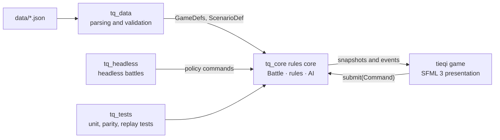

# Afterglow: Imjin 1593 development spec

2026-10-27

## Overview

The game is titled Afterglow: Imjin 1593 (Traditional Chinese 餘暉：壬辰 1593), codename Tieqi, and the demo scenario is the Battle of Byeokjegwan. This document breaks the Byeokjegwan demo into engineering tasks that can be started directly: any coding agent can take a task card, write code in the agreed directories, and prove it is right with the agreed tests.

- **Readers**: the coding agents working on the project and the project author.
- **Goal**: a PC version of the Byeokjegwan demo in C++20 and SFML 3, playing the same as the HTML prototype: pausable real time, counters, Ming Liaodong cavalry against the Japanese vanguard and main body.
- **Codename**: the English title is Afterglow: Imjin 1593, Traditional Chinese 餘暉：壬辰 1593. Code and repository keep the codename Tieqi, the C++ namespace is `tq`, and the executable is `tieqi`.
- **Starting point**: copy the reusable infrastructure (main loop, build, CI, configuration loading, scripted replays) from [2D-action-game](https://github.com/QizhouD/2D-action-game); the gameplay layer is entirely rewritten.

### How the documents relate

| Document | Location in the repository | Covers |
| --- | --- | --- |
| This development spec | `docs/DEVELOPMENT.md` | Engineering spec: architecture, interfaces, rule formulas, data formats, tasks and acceptance |
| Design document | `docs/DESIGN.md` (exported from the [design document](https://claude.ai/artifact/377hQjkSfs6krJiTqJUM5s)) | Gameplay intent, faction design, market and art direction |
| HTML prototype | `reference/prototype/byeokjegwan.html` | Reference implementation of the rules; open it in a browser to play |

The online versions of the two documents are private links that agents cannot open, so the copies in the repository are authoritative.

### Priority of sources

1. The "Rule spec" and "Data formats" chapters of this document.
2. The HTML prototype source: it decides any detail the spec does not cover.
3. The design document.

When they conflict, do not pick one yourself: implement the highest-priority source and describe the conflict in the PR description for the author to decide.

## Working agreement for agents

Every agent reads this chapter before starting. These rules are hard rules; a PR that breaks any of them is not merged.

### Starting a task

1. Read the overview, the architecture overview, the glossary, and the chapters your task card touches.
2. In the "Task breakdown" chapter, take a card whose dependencies are all done, and put the card number in the PR title, for example `[C3] contacts and charge impact`.
3. Branch from `main` as `task/<card>-<short-name>`, for example `task/C3-charge-impact`.
4. Write the card's acceptance items as tests first and confirm they fail, then write the implementation.
5. Open the PR only after a local build with no warnings and all tests passing.

### Hard rules

- `src/core/` must not include any SFML, ImGui, operating system, or file system header, only the standard library; JSON parsing lives in `src/data/`. CI checks this with grep.
- Randomness in the rules core comes only from `tq::Rng`, with one seed per battle; `std::rand`, `std::random_device`, and timestamps are forbidden.
- The rules core changes state only inside fixed logic ticks; the presentation layer only reads snapshots and gives commands only through `Battle::submit()`.
- Always iterate units in ascending `UnitId`; never let logic depend on the iteration order of an `unordered_map`.
- Unit values live only in the JSON files under `data/`; rule constants are gathered in `src/core/rules/Constants.h` and must not be scattered through the code.
- Any change to rules or constants must update the "Rule spec" of this document at the same time, and the PR description must state the expected effect on balance.
- Do not bring in data, scripts, text, or assets from Sengoku Jidai or Field of Glory.
- A new third-party dependency needs a reason in the PR and must be pinned to an exact version with CMake FetchContent.
- When unsure, stop and ask instead of guessing: describe the question in the PR or an issue, with the default you suggest.
- Chinese in the game is always Traditional (zh-Hant), including the interface, battle log, counter glyphs, and map labels.
- The repository is written in English: source code (including comments, logs, and tests), documentation, PR descriptions, and commit messages. Player-visible text lives only in `data/strings/`. Other languages appear only in `data/strings/`, the player notes `docs/demo/README.txt`, game text quoted in the docs, `tools/parity/anchors.json` (snippets matched against the prototype), and `reference/`.

### Submission checklist

- [ ] Builds with no warnings (`-Wall -Wextra -Wpedantic` on GCC/Clang, `/W4` on MSVC), code formatted with `clang-format`
- [ ] `ctest` all passing, every new piece of logic has tests
- [ ] When rules change: the spec is updated and the prototype comparison tests are still within tolerance
- [ ] When data formats change: `data/schema/` and the "Data formats" chapter are updated
- [ ] The PR description gives the card number, what was done, how it was verified, and open issues

### AGENTS.md

Lives in the repository root. Most coding agents read it; Claude Code reads `CLAUDE.md`, which is an identical copy. Current contents:

```markdown
# Tieqi (Afterglow: Imjin 1593)

A pausable real-time tactics game in C++20 and SFML 3. The full spec is in docs/DEVELOPMENT.md,
and the reference implementation of the rules is reference/prototype/byeokjegwan.html (open it in a browser).

## Build and test
cmake --preset dev
cmake --build --preset dev
ctest --preset dev

## Hard rules
- src/core must not include SFML, ImGui, or system headers
- Randomness in the simulation comes only from the Battle's own tq::Rng; the presentation layer (particles, sound) uses its own generators and never touches the simulation's; iterate units in ascending UnitId
- Unit values live only in data/*.json; rule constants only in src/core/rules/Constants.h
- Rule changes must update the "Rule spec" in docs/DEVELOPMENT.md
- Each task is one card in the "Task breakdown"; branch name task/<card>-<short-name>
- When unsure, ask in the PR instead of guessing
- Chinese in the game is always Traditional (zh-Hant); data/strings/zh-Hant.json is the source text
- The repository is written in English: source code (including comments, logs, and tests), documentation, PR descriptions, and commit messages. Player-visible text lives only in data/strings/. Other languages appear only in data/strings/, the player notes docs/demo/README.txt, game text quoted in the docs, tools/parity/anchors.json (snippets matched against the prototype), and reference/

## Layout
src/core rules core · src/data data loading · src/app presentation · tools/headless headless battles
data unit types and scenarios · tests tests · reference prototype and reference material

Process and stop conditions for continuous development are in docs/AGENT_LOOP.md
```

## Technology choices and dependency versions

Every dependency is built from source with CMake FetchContent and pinned, rather than relying on a system SFML, so that Windows and Linux, MSVC and MinGW never end up with a compiler and library mismatch.

| Component | Choice and version | Use | Notes |
| --- | --- | --- | --- |
| Language | C++20 | All code | SFML 3 itself needs only C++17; this project uses C++20 designated initializers, `std::span`, and `<numbers>` |
| Compilers | MSVC 2022+, GCC 13+, Clang 17+ | Build | On Windows both MSVC and MinGW-w64 must compile |
| Build | CMake 3.28+ (including 4.x) and Ninja, `CMakePresets.json` | Build and test | From 3.28, FetchContent supports `EXCLUDE_FROM_ALL` and `SYSTEM` |
| Window, graphics, audio | SFML 3.1.0 | Presentation layer | 3.1 shapes text with HarfBuzz, which renders Chinese and Korean more reliably; SFML 3 builds static libraries by default |
| Unit tests | doctest v2.4.12 | `tests/` | Single header, compiles fast. Do not use 2.4.11: its CMakeLists declares CMake 3.0, which CMake 4 refuses to configure |
| JSON | nlohmann/json v3.11.3 | Reading data in `src/data/` | Parse with comments enabled so data files can carry comments |
| Debug UI | Dear ImGui v1.91.9b and the imgui-sfml 3 series (master branch, pinned to commit e8ee366 of 2026-08-21) | Tuning panel in dev builds | imgui-sfml needs ImGui at least 1.91.1 and below 1.92.0; compiled only with `TQ_DEV_TOOLS=ON` |
| Fonts | Noto Serif TC / KR and LXGW WenKai TC | Body text, Korean, titles and counter glyphs | All under the SIL OFL; license files sit with the fonts in `assets/fonts/` |
| Formatting and static analysis | clang-format 18+, clang-tidy (optional) | Code style | `.clang-format` in the repository root: LLVM style, 4-space indent, 120 columns |
| CI | GitHub Actions: Windows (MSVC) and Ubuntu (GCC) | Build, tests, headless battle smoke test | Ubuntu needs SFML's system dependencies; see the next chapter |

The versions in the table are authoritative; if a version fails to fetch or conflicts with another dependency, use the nearest available version of the same major version and say so in the PR.

References: [SFML 3 migration guide](https://www.sfml-dev.org/tutorials/3.0/getting-started/migrate/), [SFML CMake project template](https://github.com/SFML/cmake-sfml-project), [SFML 3.1.0 release notes](https://newreleases.io/project/github/SFML/SFML/release/3.1.0), [imgui-sfml](https://github.com/SFML/imgui-sfml).

## Repository layout

The repository `tieqi` is organized as below; the rules core, data loading, presentation layer, and tools are each a CMake target, and dependencies only go downward.

```text
tieqi/
├─ AGENTS.md  CLAUDE.md        # agent entry notes (identical)
├─ CMakeLists.txt  CMakePresets.json  .clang-format
├─ cmake/
│  ├─ Dependencies.cmake        # every FetchContent declaration and pinned version, in this one place
│  └─ Warnings.cmake
├─ docs/
│  ├─ DEVELOPMENT.md  DESIGN.md
│  └─ adr/                      # architecture decision records, one file per decision
├─ reference/prototype/byeokjegwan.html   # rules reference implementation
├─ data/
│  ├─ schema/                   # JSON Schema for each JSON file
│  ├─ config.json               # time compression factor and other global settings
│  ├─ units.json                # unit types
│  ├─ scenarios/byeokjegwan.json
│  └─ strings/zh-Hant.json  en.json  ko.json
├─ assets/
│  ├─ fonts/                    # fonts and OFL licenses
│  ├─ textures/{chits,map,ui}/
│  ├─ audio/
│  └─ AI_ASSETS.md              # register of AI-generated assets, for the Steam disclosure
├─ src/
│  ├─ core/                     # target tq_core: rules core, standard library only
│  │  ├─ math/                  # Vec2, angles, oriented rectangles and separating-axis tests
│  │  ├─ defs/                  # plain data definitions such as UnitType, ScenarioDef, Config
│  │  ├─ rules/                 # Constants.h, impact, melee, shooting, morale, previews
│  │  ├─ sim/                   # Battle, Unit, Command, Event, Rng, terrain, movement, contact, split and merge, scenario flow
│  │  └─ ai/                    # Japanese commander
│  ├─ data/                     # target tq_data: reads JSON into defs, validates and reports errors
│  └─ app/                      # target tieqi: SFML presentation layer
│     ├─ main.cpp  App.*        # main loop and interface state machine
│     ├─ render/                # camera, base map, units, effects
│     ├─ input/                 # selection, box selection, orders, hotkeys
│     ├─ ui/                    # panels, odds preview, battle log, banners, results
│     ├─ audio/                 # sound and the synthesized fallback
│     └─ dev/                   # ImGui debug tools, only with TQ_DEV_TOOLS=ON
├─ tools/headless/              # target tq_headless: headless battles and batch statistics
├─ tests/                       # target tq_tests: core/ data/ parity/ replay/
└─ .github/workflows/ci.yml
```

| Target | Kind | Depends on | Notes |
| --- | --- | --- | --- |
| `tq_core` | Static library | Nothing | All rules and AI; no file I/O, data comes in through defs structs |
| `tq_data` | Static library | `tq_core`, nlohmann/json | JSON parsing, validation, error messages (with file name and field path) |
| `tieqi` | Executable | `tq_core`, `tq_data`, SFML; ImGui in dev builds | The game |
| `tq_headless` | Executable | `tq_core`, `tq_data` | Runs whole battles without a window and prints statistics, for balancing and CI |
| `tq_tests` | Executable | `tq_core`, `tq_data`, doctest | Unit tests, prototype comparison tests, replay tests |

## Build, run, and CI

One command to configure, one to build, one to test; Windows and Linux share the same `CMakePresets.json`.

### Dependency declarations

Every third-party library is declared only in `cmake/Dependencies.cmake`. SFML's network module is off, which saves the TLS and SSH system dependencies.

```cmake
include(FetchContent)

set(SFML_BUILD_NETWORK OFF CACHE BOOL "" FORCE)
FetchContent_Declare(SFML
    GIT_REPOSITORY https://github.com/SFML/SFML.git
    GIT_TAG 3.1.0
    GIT_SHALLOW ON
    EXCLUDE_FROM_ALL SYSTEM)

FetchContent_Declare(doctest
    GIT_REPOSITORY https://github.com/doctest/doctest.git
    GIT_TAG v2.4.12
    GIT_SHALLOW ON
    EXCLUDE_FROM_ALL SYSTEM)

FetchContent_Declare(json
    URL https://github.com/nlohmann/json/releases/download/v3.11.3/json.tar.xz
    EXCLUDE_FROM_ALL SYSTEM)

FetchContent_MakeAvailable(SFML doctest json)

if(TQ_DEV_TOOLS)
    FetchContent_Declare(imgui
        GIT_REPOSITORY https://github.com/ocornut/imgui.git
        GIT_TAG v1.91.9b
        GIT_SHALLOW ON)
    FetchContent_MakeAvailable(imgui)
    set(IMGUI_DIR ${imgui_SOURCE_DIR})
    set(IMGUI_SFML_FIND_SFML OFF)
    FetchContent_Declare(imgui-sfml
        GIT_REPOSITORY https://github.com/SFML/imgui-sfml.git
        GIT_TAG e8ee3667f1b1f731e5c9c32be4c544915291f987 # master branch, 2026-08-21
        SYSTEM)
    FetchContent_MakeAvailable(imgui-sfml)
endif()
```

Link targets: `SFML::Graphics`, `SFML::Audio`, `doctest::doctest`, `nlohmann_json::nlohmann_json`, `ImGui-SFML::ImGui-SFML`.

### Presets and commands

| Preset | Build type | `TQ_DEV_TOOLS` | `TQ_BUILD_TESTS` | Use |
| --- | --- | --- | --- | --- |
| `dev` | Debug | ON | ON | Day-to-day development |
| `release` | Release | OFF | OFF | Demo package; with MSVC the runtime is linked statically (`CMAKE_MSVC_RUNTIME_LIBRARY=MultiThreaded`, `SFML_USE_STATIC_STD_LIBS=ON`); with GCC these two settings have no effect |
| `ci` | RelWithDebInfo | OFF | ON | CI build and tests |

```powershell
# Windows PowerShell (inside an x64 VS developer environment, for example started from the x64 Native Tools prompt; or a MinGW environment)
cmake --preset dev
cmake --build --preset dev
ctest --preset dev
.\build\dev\tieqi.exe --scenario byeokjegwan
.\build\dev\tq_headless.exe --scenario byeokjegwan --seed 1 --runs 20 --policy scripted --out runs.csv
```

```bash
# Ubuntu: install SFML's system dependencies first (the network module is off)
sudo apt install libxrandr-dev libxcursor-dev libxi-dev libudev-dev libfreetype-dev \
  libflac-dev libvorbis-dev libgl1-mesa-dev libegl1-mesa-dev libharfbuzz-dev
cmake --preset dev && cmake --build --preset dev && ctest --preset dev
```

- Demo package (R1, Windows only): `cmake --preset release`, then `cmake --build --preset release --target package_demo`. The output is `build/release/dist/Afterglow-Imjin-1593-demo-<version>-win64.zip` and a folder of the same name; it stays local and is not published as a GitHub Release. The version is the VERSION of the top-level `project()` (currently 0.1.0) and is also written into replays. The packaging script `cmake/PackageDemo.cmake` first checks that the executable contains no ImGui and uses `dumpbin /dependents` to check that it depends only on system DLLs (it fails on MSVCP, VCRUNTIME, ucrtbase, or api-ms-win-crt), then adds `tieqi.exe`, `data/`, `assets/` (with the fonts and OFL licenses), `AI_ASSETS.md`, the Traditional Chinese and English `README.txt` (source `docs/demo/README.txt`, with `@VERSION@` replaced by the version and CRLF line endings), and `THIRD_PARTY_NOTICES.txt`. The third-party notices cover SFML, FreeType, HarfBuzz, SheenBidi, libogg, libvorbis, libFLAC, miniaudio, and nlohmann/json, with the full license texts and versions taken from the sources this build actually fetched.
- After building, `data/` and `assets/` are copied next to the executable. The program looks for the resource root in this order: the `--data-root` command-line option, the current directory if it contains `data/`, and finally the executable's directory (following the framework's `chdirToAssets` idea).
- `tieqi` command-line options: `--scenario <id>`, `--seed <n>`, `--time-scale <x>`, `--replay <file>`, `--script <file>` (scripted input and screenshots, as in the framework), `--data-root <dir>`, `--perf`, `--freeze-at <tick>`. `--perf` removes the frame rate cap, starts the battle automatically at 2× speed, runs to the result, prints the mean, p95, and maximum frame time (milliseconds) to standard output, and exits. `--freeze-at` stops advancing the simulation once it reaches that tick while rendering continues, which makes scripted screenshots easy; when given together with `--perf`, the freeze is ignored. Script lines are `<seconds> down|up|press <key>`, `<seconds> shot <file>`, `<seconds> quit`, and also `<seconds> resize <width> <height>`. An explicit `--scenario` or `--seed` overrides the field of the same name in a replay. Script timing starts at the first frame, not when the script is loaded.

### CI

`.github/workflows/ci.yml` has two jobs, `windows-msvc` and `ubuntu-gcc`, and runs on every push and PR:

1. Configure and build with the `ci` preset, caching `_deps`.
2. Run `ctest`. The ci preset includes the 100-seed whole-battle baseline labelled `slow`; the dev and release presets exclude that label.
3. Purity check: fails if `#include <SFML`, `imgui`, or `<filesystem>` appears in `src/core/`.
4. Headless smoke test (added by H1; B0 does only the first three steps): `tq_headless` runs one whole battle for each of 3 seeds and must not crash, must finish within 18000 ticks, and must emit more than 0 events.

The source language check (`tools/check_source_language.py`) also runs in both jobs and fails on CJK text in the source code.

### Migrating from 2D-action-game to SFML 3

Copy only the files marked "copy" in the table; rewrite the rest. Copied code is updated to SFML 3 as described in the right-hand column.

| File in the framework | Treatment | What changes for SFML 3 |
| --- | --- | --- |
| `main.cpp` | Copy the main loop and resource directory lookup | The main loop advances by ticks with interpolation; see "Architecture overview" |
| `graphics/Window.*` | Copy the camera, letterboxed view, scripted input | `pollEvent()` returns `std::optional<sf::Event>`, read with `is<>()` and `getIf<>()`; `sf::VideoMode({w, h})`; `sf::Rect` uses `position` and `size`; fullscreen uses `sf::State::Fullscreen`; keys are scoped enums such as `sf::Keyboard::Key::W` |
| `graphics/ParticleSystem.*` | Copy | `PrimitiveType::Quads` is gone; use two triangles; `Vertex` uses aggregate initialization |
| `core/AudioManager.*` | Copy, including the synthesized sound fallback | `sf::Sound` must be constructed with a buffer, so the sound pool becomes `std::vector<sf::Sound>` or `std::optional`; `setLoop` is renamed `setLooping`; `loadFromSamples` needs a channel map argument; SFML 3's audio backend is miniaudio and no longer ships `openal32.dll` |
| `core/ResourceManager.*` | Copy | Fonts use `openFromFile`; `sf::Text` and `sf::Sprite` have no default constructor and need a font or texture (`sf::Text(font, str, size)`) |
| `core/Balance.*` | Borrow the approach only | Rewritten as JSON loading in `tq_data`: defaults, overrides, warnings for bad values |
| `core/SaveData.*` | Copy | No graphics dependency; almost no changes |
| `entities/`, `components/`, `systems/`, `Board`, `Tile`, `LevelParser`, `Player`, `Enemy`, `InputHandler`, `Hud` | Do not copy | The whole gameplay layer is rewritten from this document |

Rotation always uses `sf::degrees()` / `sf::radians()`; `sf::Thread` and `sf::Mutex` are gone, so use the standard library when needed. The full mapping is in the [SFML 3 migration guide](https://www.sfml-dev.org/tutorials/3.0/getting-started/migrate/).

## Architecture overview

The rules core is a deterministic simulator: its inputs are data definitions, a random seed, and commands stamped with ticks; its outputs are a snapshot and events for each tick. The game, the headless tool, and the tests are all just its users.



Player commands go into the command queue, while the AI changes Japanese orders directly inside the core; with the same seed and player commands the AI makes the same decisions, so a replay only needs to record the seed and the player commands.

### Order of work in each tick

The order matches the prototype's `step()` and must not be rearranged:

1. Apply the player commands whose tick equals this tick.
2. Advance battlefield time by one tick; the scenario flow checks phase changes and reinforcement triggers.
3. Every 10 ticks, the AI commander thinks once and changes the orders of Japanese units.
4. Update each unit's timers and movement in ascending `UnitId`.
5. Contact detection: separate overlaps, resolve impacts, register engagements, handle withdrawals.
6. Every 5 ticks, resolve combat: melee, volleys, morale and state changes, desertion while routing and rallying, remnant merging.
7. Check victory and defeat.

### Time model

Data and constants always use real-world units: metres, metres per second, battlefield seconds. Pace is set by a single time compression factor, which only changes how many ticks advance per wall-clock second and never changes any rule result.

| Quantity | Value | Notes |
| --- | --- | --- |
| Tick length | 0.8 battlefield seconds | Equals the prototype's 0.1 game seconds × 8 |
| Combat resolution interval | 5 ticks (4 battlefield seconds) |  |
| AI thinking interval | 10 ticks (8 battlefield seconds) |  |
| Time compression factor `time_scale` | Default 8 | Battlefield seconds per wall-clock second; at 8 the pace matches the prototype exactly; change only this to change the pace |
| Tick rate | `time_scale` ÷ 0.8 × player speed | 10 ticks per wall-clock second by default |
| Player speed | 0.5, 1, 2 | Can be paused; orders can still be given while paused |
| Hit-stop | 40–190 wall-clock milliseconds | Only pauses tick advancement in the presentation layer; never enters the rules core |

Values in the prototype are "game seconds": when porting, divide speeds by 8, multiply durations by 8, and keep distances. After conversion, cavalry moves at about 4.3 m/s, infantry at about 1.2 m/s, and arquebus reload takes 48 seconds, all historically plausible. Lowering `time_scale` from 8 to 5 makes the whole battle 1.6 times slower with the same balance.

### Determinism requirements

- With the same binary, the same data, the same seed, and the same sequence of player commands, the state must be bit-identical on every tick. Consistency across compilers is not required; replay files record the build id.
- Randomness comes only from `tq::Rng` (PCG32), one stream per battle, with the draw order set by the unit iteration order.
- Units live in an array that only grows, and `UnitId` is the index; remnants, detachments, and reinforcements are appended at the end, and units that leave only have their state set to `Gone`, never deleted during a battle.
- The core has no threads, no wall clock, and no file I/O.

### Main loop

```cpp
// app/App.cpp: the accumulator counts ticks
while (window.isOpen()) {
    const float frame = std::min(clock.restart().asSeconds(), 0.25f);
    input.handleEvents(window, battle);            // produces commands -> battle.submit()
    if (!paused && !battle.isOver()) {
        if (hitstop > 0.f) hitstop -= frame;
        else acc += frame * config.timeScale / tq::kTickSeconds * playerSpeed;
    }
    for (int n = 0; acc >= 1.f && n < 8; ++n, acc -= 1.f) {
        battle.step();
        fx.consume(battle.drainEvents(), hitstop, shake);  // impact events set hit-stop and shake
    }
    renderer.draw(battle, /*alpha=*/acc);           // interpolates prev/cur positions
}
```

## Rules core API

These are the conventions for the public interface; implement field names and function signatures as given. The internals are free, but no writable internal state may be exposed to the presentation layer. The coordinate system matches the prototype: x points east, y points south, the north exit is at y = 0; angles are radians, with 0 pointing east and π/2 pointing south.

### Basic types

```cpp
// src/core/sim/Types.h
namespace tq {
using UnitId = std::uint32_t;               // the unit array index; only grows
inline constexpr UnitId kNoUnit = 0xFFFFFFFF;
inline constexpr float kTickSeconds = 0.8f; // battlefield seconds per tick

enum class Side : std::uint8_t { Ming, Jp };
enum class UnitState : std::uint8_t { Steady, Wavering, Broken, Routing, Gone };
enum class GoneReason : std::uint8_t { None, Dispersed, Fled, Withdrawn, GeneralKilled, Merged };
enum class Terrain : std::uint8_t { Open, Road, Hill, Paddy };
enum class ContactSide : std::uint8_t { Front, Flank, Rear };

struct Order {
    enum class Type : std::uint8_t { Hold, Move, Attack } type = Type::Hold;
    Vec2 point{};                     // Move destination
    std::optional<float> face;        // facing to turn to on arrival or while holding
    UnitId target = kNoUnit;          // Attack target
};
}
```

### Unit

```cpp
// src/core/sim/Unit.h (fields correspond one to one with the prototype)
struct Unit {
    UnitId id; std::uint16_t type; Side side;
    std::string labelKey;             // string table key, such as "unit.jiading_left"
    std::uint16_t fragNo = 0;         // remnant or detachment number, shown as "·殘一" or "·分二"
    Vec2 pos, prevPos; float facing, prevFacing;   // prev* are for render interpolation
    float frontage, depth;            // frontage and depth (metres)
    float men, maxMen, morale;
    UnitState state = UnitState::Steady; GoneReason gone = GoneReason::None;
    Order order;
    std::vector<UnitId> contacts;     // enemy units engaged this tick, ascending id
    float engagedSec = 0, recoverSec = 0, reloadSec = 0, stillSec = 16;
    float speed = 0, runDist = 0;     // current speed (m/s), distance covered in this charge
    bool charging = false, volleyDone = false, breaking = false;
    int momentum = 0; float momentumSec = 0;
    float brokenSec = 0, routSec = 0;
    Vec2 knock{};                     // scatter impulse (m/s)
    std::optional<float> scatterAngle;
    bool everBroken = false, isFragment = false, rejoin = false;
    bool vanguard = false, deploying = false;
    UnitId origin = kNoUnit;          // source unit when split or scattered; kNoUnit if never split
};
```

### Commands and events

```cpp
// src/core/sim/Command.h: only player commands are queued; the AI changes Japanese Orders directly inside the core
struct Command {
    std::uint32_t tick;               // filled by submit() with the next tick to execute
    enum class Type : std::uint8_t { Move, Attack, Hold, Retreat, Split, Join, Spawn, Rout } type;
    std::vector<UnitId> units;        // selected own units; for Rout, the units to break (either side)
    Vec2 point{};                     // Move, Spawn
    UnitId target = kNoUnit;          // Attack
    std::uint16_t unitType = 0;       // Spawn: index into GameDefs::types
    float face = 0;                   // Spawn: facing of the new unit
};

// src/core/sim/Event.h: the presentation layer plays effects and sounds and builds the localized battle log from these
struct Event {
    enum class Type : std::uint8_t {
        Impact, ThreeEyedVolley, TeppoVolley, Breakaway, Broken, Shattered, Rallied,
        Merged, Split, Dispersed, Fled, Withdrawn, GeneralDown, MomentumGained,
        ScoutWarning, PhaseChanged, Reinforcement, GrandAssault, BattleEnded
    } type;
    std::uint32_t tick;
    UnitId a = kNoUnit, b = kNoUnit;  // subject and object; meaning depends on type
    Vec2 pos{};
    float value = 0;                  // impact multiplier, troops, momentum level, phase number, and so on
    ContactSide side = ContactSide::Front;
    std::uint8_t flags = 0;           // bit flags: kPikeFront, kBreaks, kImportant, and so on
};
```

### Battle

```cpp
// src/core/sim/Battle.h
class Battle {
public:
    Battle(const GameDefs& defs, const ScenarioDef& scenario, std::uint64_t seed,
           BattleOptions opts = {});        // opts.aiEnabled = false lets duel tests disable the AI

    void submit(Command cmd);                 // not thread-safe; called by the main loop
    void step();                              // advances one tick
    std::vector<Event> drainEvents();         // takes and clears the events since the last drain

    std::uint32_t tick() const;
    float battleSeconds() const;              // tick × kTickSeconds
    std::span<const Unit> units() const;
    const Unit& unit(UnitId id) const;
    const UnitType& typeOf(const Unit& u) const;
    int phase() const;                        // 0 not started, 1 meeting engagement, 2 main body advances, 3 withdrawal
    bool exitOpen() const;
    Terrain terrainAt(Vec2 p) const;
    bool isOver() const;
    const BattleResult& result() const;       // outcome, grade, troops withdrawn, statistics
    const BattleStats& stats() const;
    std::uint64_t stateHash() const;          // FNV-1a over all unit state, for determinism tests
    bool vanguardAggressive() const;          // the AI's vanAggro, read-only, for the debug panel
};

// src/core/rules/Preview.h: shares the same calculation functions as actual resolution
struct Modifier { ModKind kind; float value; };          // ModKind maps to the string table
struct Preview {
    enum class Kind : std::uint8_t { Charge, Melee } kind;
    float ratio; ContactSide side; Verdict verdict;      // Verdict: Breaks/Favored/Even/Unfavored/PikeWall/Pursuit
    std::vector<Modifier> mods; std::vector<NoteKind> notes;
};
Preview previewAttack(const Battle& b, UnitId attacker, UnitId target);
bool canSplit(const Battle& b, UnitId id);
std::vector<std::vector<UnitId>> joinGroups(const Battle& b, std::span<const UnitId> selection);

// src/core/sim/Replay.h: serialization happens in tq_data
struct Replay { std::string build, scenario; std::uint64_t seed; std::vector<Command> commands; };
```

- All command handling (including the offsets that keep relative positions in a multi-selection; see the rule spec) happens in the core; the presentation layer passes only the raw click point and the selection list, which keeps replays consistent.
- Battle log text is not generated in the core: the core only emits events, and the presentation layer formats them with the string tables.

When a test needs to change unit state directly (setting up a duel, forcing a break, setting morale), it uses the friend helper `tq::testing::BattleAccess`, compiled only into the test target; the presentation layer and tools must not use it.

## Rule spec

This chapter is the authoritative description of the rules, organized in the order of work within a tick (see "Architecture overview"). Values are converted to real units (metres, metres per second, battlefield seconds); with `time_scale` at 8 the rules are tick-for-tick equivalent to the HTML prototype. Function names in the pseudocode match the prototype source to make side-by-side comparison easy. In the implementation every number is a named constant in `Constants.h`, scenario-specific numbers go into the scenario JSON, and no literals appear directly in code.

### Conventions

- `dt = 0.8`, and the tick count starts at 1: the AI thinks when `tick % 10 == 0` and combat resolves when `tick % 5 == 0`. After construction `phase = 0`; the first `step()` enters phase 1 and emits `PhaseChanged`.
- `U()` draws a uniform number in \[0, 1) from `tq::Rng`, in the order it is written in the pseudocode. Presentation-layer randomness such as effects and sound uses the presentation layer's own source and must never consume `tq::Rng`.
- Alive: the state is not Gone. Able to fight: the state is Steady or Wavering.
- `angDiff(a, b)` normalizes a − b to (−π, π\]; `turnToward(u, a, step)` is `facing += clamp(angDiff(a, facing), -step, step)`, with `step = unit type turn rate × factor × dt`.
- `str(u) = sqrt(men / type.men)` is the strength factor. The denominator is the unit type's full strength rather than maxMen, so remnants and detachments are naturally weaker.
- `nearGeneral(u)`: a general unit on the same side, able to fight, closer to u than its own `aura` (not u itself); with several, the smallest UnitId.
- Range checks always use strict less-than; ties for "nearest" or "highest" go to the smallest UnitId.
- Always iterate units in ascending UnitId. Record the unit count when a step starts; units created during the step (remnants, detachments) take part only from the next step.
- When a unit is created: `men = maxMen = type.men`, `morale = type.morale`, state Steady, order Hold (facing the initial facing), frontage and depth from the unit type, `stillSec = 16`. Every new unit consumes one `U()` (as in the prototype's `add()`); units with a range set `reloadSec` to `16 ×` that value, the others discard the draw and keep `reloadSec` at 0.
- `isMoving(u)`: able to fight, with a Move or Attack order.

### Converting prototype values

| Quantity | Conversion | Example: prototype → this project |
| --- | --- | --- |
| Speed | ÷ 8 | Retainer cavalry walk 34 → 4.25 m/s, charge 70 → 8.75 m/s |
| Turn rate | ÷ 8 | Retainer cavalry 1.8 → 0.225 rad/s |
| Acceleration | ÷ 64 | Cavalry charge acceleration 60 → 0.9375 m/s² |
| Duration | × 8 | Arquebus reload 6 → 48 s; break flip 1.2 → 9.6 s; rout rally wait 10 → 80 s |
| Distance, multipliers, troops, morale | Unchanged | Charge start distance 210 m; breakthrough threshold 1.9 |
| Increments per combat resolution | Unchanged | Morale recovery +0.5 each time; desertion while routing 0.7% each time |

### Terrain

```text
terrainAt(p)  checked in order, first match wins
  1. inside any paddy rectangle (inclusive)          -> Paddy
  2. inside any hill ellipse: (dx/rx)^2 + (dy/ry)^2 < 1  -> Hill
  3. distance to any segment of the main road polyline < 14  -> Road
  4. otherwise                                        -> Open
```

Terrain is sampled at the unit's centre. Movement factor `terrainSpeed(u)`:

| Terrain | Cavalry | Infantry |
| --- | --- | --- |
| Paddy | 0.6 | 0.7 |
| Hill | 0.8 | 0.85 |
| Road | 1.1 | 1.1 |
| Open | 1 | 1 |

### Oriented rectangles and contact sides

```text
A unit is an oriented rectangle: centre pos, facing f, depth along the facing, frontage across it
obb(u, inflate)  axes a0 = (cos f, sin f), a1 = (-sin f, cos f)
                 half lengths h0 = depth/2 + inflate, h1 = frontage/2 + inflate
                 projection on axis n: centre dot(pos, n), radius h0*|dot(a0, n)| + h1*|dot(a1, n)|
sat(A, B)        project on A.a0, A.a1, B.a0, B.a1 in turn; overlap o = min(right ends) - max(left ends)
                 o <= 0 on any axis means no intersection; otherwise return the axis n with the smallest o (first one on ties) and o
                 if dot(B.pos - A.pos, n) < 0, negate n so that n points from A to B
sideOf(d, a)     which side of d unit a is on
                 lx = dot(a.pos - d.pos, d.a0), ly = dot(a.pos - d.pos, d.a1)
                 nx = lx / (d.depth/2 + 14), ny = ly / (d.frontage/2 + 14)
                 when |nx| >= |ny|: Front if lx > 0, otherwise Rear; when |nx| < |ny|: Flank
```

### Unit movement (every tick)

```text
moveUnit(u)  called for every living unit
  recoverSec = max(0, recoverSec - dt); reloadSec = max(0, reloadSec - dt)
  if momentum > 0: momentumSec += dt; if momentumSec > 240 then momentum -= 1, momentumSec = 0
  if knock is non-zero:
      pos += knock * dt; knock *= pow(0.05, dt / 8)            // about ×0.7411 per tick
      if |knock.x| + |knock.y| < 0.25 then knock = 0; clampPos(u)
  Broken: brokenSec -= dt; if <= 0, switch to Routing with routSec = 0; return
  Routing: routMove(u); return
  if contacts is non-empty and breaking is false:
      cavalry with a Move order: startBreakaway(u); return if that made it leave, otherwise continue below
      otherwise: turn toward primaryContact(u) at turn rate * 0.5; charging = false, speed = 0, stillSec = 0; return
  pick the destination from the order:
    Attack: target has left -> order becomes Hold (facing the current facing), charging = false; return
            d = distance to the target's centre; if the unit type has run > 0, decide on charging, cs = cavalry 210 / infantry 70
              already charging: keep charging if d < cs * 1.4
              not charging: start charging if recoverSec <= 0 and 45 < d < cs
    Move:   within 5 of the destination -> order becomes Hold (facing the order's facing), speed = 0; return
    Hold:   charging = false, speed = 0, stillSec += dt
            an enemy able to fight within 150 -> turn toward the nearest at turn rate * 0.6
            otherwise, if the order has a facing -> turn toward it at full turn rate
            return
  stillSec = 0
  want = direction to the destination; turn toward want at turn rate * (0.7 when charging, otherwise 1); diff = |angDiff(want, facing)|
  charging: when just starting, set charging = true, runDist = 0, volleyDone = false, speed = max(speed, walk)
        speed = min(run, speed + acc * dt), acc = cavalry 0.9375 / infantry 0.46875
  not charging: charging = false; speed += clamp(walk - speed, -0.9375 * dt, acc * dt), acc = cavalry 0.9375 / infantry 0.390625
  align = cavalry: 1 when diff < 0.6, 0.65 when < 1.4, otherwise 0.3
          infantry: 1 when diff < 0.5, 0.45 when < 1.2, otherwise 0.12
  v = speed * align * terrainSpeed(u); pos += (cos f, sin f) * v * dt
  while charging: runDist += v * dt; if the unit type has three-eyed guns, volleyDone is false and d < 62 -> volleyDone = true, mingVolley(u, target)
  clampPos(u)

startBreakaway(u)  breaking = true; kill(u, 0.03 * type.men); morale -= 5; event Breakaway
primaryContact(u)  the contact with the highest meleePower; units unable to fight count as 0.01
clampPos(u)        while entering: x ∈ [-90, W + 90], y ∈ [-90, H + 90]; otherwise x ∈ [10, W - 10], y ∈ [10, H - 10]
```

### Rout movement

```text
routMove(u)
  routSec += dt; charging = false
  dir = fallback direction: Ming (0, -1), Japanese (0, 1)
  e = nearest enemy able to fight (any distance); if there is one, dir += normalize(u.pos - e.pos) * (distance < 200 ? 1.2 : 0.35)
  if scatterAngle is set and routSec < 40: dir += (cos s, sin s) * 1.6 * (1 - routSec / 40)
  turn toward the direction of dir at turn rate * 1.6
  v = (cavalry 5 / infantry 1.75) * terrainSpeed(u); pos += (cos f, sin f) * v * dt
  x is clamped to [10, W - 10], y is not; y < -12 or y > H + 12 -> fled(u)
```

At the end of contact detection, `clampPos` is called on every living unit, so a routing unit's y is also clamped back into \[10, H − 10\]. The `fled` check above is therefore currently unreachable: routing units stop at the map edge and may rally and then walk into the withdrawal exit. This matches the prototype's `contactsStep` and is kept as is for now.

### Contact detection (every tick)

```text
contactsStep()
  clear contacts on every living unit
  for each pair of living units (a, b) with a.id < b.id:
    either has left (possibly earlier in this step) -> skip; centre distance > 120 -> skip
    same side: either is Routing -> skip; if sat(obb(a, 0), obb(b, 0)) intersects -> a -= n * o/2, b += n * o/2; skip the rest
    enemies: sat(obb(a, 2.5), obb(b, 2.5)) does not intersect -> skip
          a.charging and fastEnough(a) -> impact(a, b)
          both a and b alive, and b.charging and fastEnough(b) -> impact(b, a)
          either has left -> skip
          register each other in contacts
          if sat(obb(a, 0), obb(b, 0)) intersects -> a -= n * o * wa, b += n * o * (1 - wa)
            wa = 0.8 if a is routing; else 0.2 if b is routing; else 0.85 if only isMoving(a); 0.15 if only isMoving(b); otherwise 0.5
  for each living unit u:
    breaking and contacts empty -> breaking = false
    Ming, entering, and y > 60 -> entry ends
    clampPos(u)
    exit open, Ming, not entering, able to fight, and x0 < x < x0 + w, y < y0 + h -> withdraw(u)

fastEnough(u) = speed >= 0.7 * run and runDist >= 35
```

### Impact

```text
chargeCalc(a, t, predict)
  side  = sideOf(t, a)
  base  = a.type.impact
  spd   = predict ? 1 : clamp(a.speed / a.type.run, 0.5, 1)
  sm    = Front 1, Flank 1.8, Rear 2.4
  st    = t Wavering 1.35; t Broken or Routing 2.2; otherwise 1
          t has a range and can fight: * 1.25 more if reloadSec > 2.4; otherwise * 1.2 more if stillSec < 9.6
  ter   = * 0.5 if a or t is in a paddy; * 0.8 if t is on a hill and a is not
  pikeFront = t has pikes, side is Front, and t can fight; pk = pikeFront ? 0.35 : 1
  mo    = 1 + 0.1 * a.momentum
  aw    = a Wavering ? 0.8 : 1
  power  = base * spd * sm * st * ter * pk * mo * aw * str(a)
  resist = t.type.defense * str(t) * (t Steady ? 1 : 0.85)
  ratio  = power / max(resist, 0.15)

impact(a, t)
  r = chargeCalc(a, t, false).ratio; stats.impacts += 1; if t can fight, stats.bestImpact = max(stats.bestImpact, r)
  a.charging = false, a.speed = 0, a.runDist = 0, a.recoverSec = cavalry 48 / infantry 32
  wasFighting = t can fight
  if wasFighting, t.morale -= pikeFront ? 2 : 4 + 9 * r
  kill(t, 0.035 * r * t.type.armor * t.type.men)
  pikeFront: kill(a, 0.06 * a.type.men), a.morale -= 14, a.recoverSec = 72
  otherwise: kill(a, 0.012 * a.type.men / sqrt(max(r, 0.3)))
  if not pikeFront and t is alive: t is displaced immediately by min(26, 6 + 7 * r) along the direction from a to t, clampPos(t)
  breaks = r >= 1.9 and not pikeFront and wasFighting and t alive and t is not a general
  event Impact (a, b = t, value = r, side, flags = pikeFront / breaks)
  breaks -> breakUnit(t, from = a)
```

Hit-stop, screen shake, dust, ground marks, and floating text after an impact are all generated by the presentation layer from the `Impact` event; see "Presentation spec".

### Three-eyed guns

```text
mingVolley(u, t)  no effect if t has left
  kill(t, 0.015 * t.type.men); if t can fight, t.morale -= 8; event ThreeEyedVolley
```

### Combat resolution (every 5 ticks)

```text
combatTick()  the snapshot of living units at the start is us
  1. Engagement timer: units in us with contacts get engagedSec += 4, others engagedSec = max(0, engagedSec - 8)
  2. Melee (accumulate first, then resolve together)
  3. Arquebus volleys
  4. Morale, state, and rallying
  5. mergeStep()
```

**Melee**

```text
meleePower(u) = melee * str(u)
              * (Wavering ? 0.8 : 1) * (1 + 0.1 * momentum)
              * (cavalry and recoverSec > 0 ? 0.85 : 1)
              * (cavalry in a paddy ? 0.75 : 1)
              * (cavalry and engagedSec > 48 ? 0.85 : 1)
pairMul(x, y) = (x has pikes, y is cavalry, sideOf(x, y) is Front ? 1.3 : 1)
              * (x is cavalry, y has pikes and can fight, sideOf(y, x) is Front ? 0.7 : 1)

for each unit a in us that has contacts, can fight, and is not breaking:
  share = 1 / number of contacts
  for each living e in a.contacts:
    side  = sideOf(e, a); routed = e cannot fight
    aP    = meleePower(a) * pairMul(a, e)
    sm    = routed ? 2.5 : Front 1, Flank 1.6, Rear 2.2
    eP    = routed ? 0.15 : meleePower(e) * pairMul(e, a)
    ratio = clamp(aP * sm / max(eP, 0.1), 0.3, 3)
    rnd   = 0.9 + 0.2 * U()
    cas   = e.type.men * 0.012 * aP * sm * rnd * share * e.type.armor * (routed and a is cavalry ? 1.4 : 1)
    ml    = routed ? 0 : (0.8 + e.engagedSec / 160) * sqrt(ratio) * (Front 1, Flank 1.5, Rear 2) * share * rnd
    e's accumulated casualties += cas, accumulated morale loss += ml
Resolve in the order each target was first accumulated (attackers in ascending id, each one's contacts in ascending id; a target is queued only the first time it is counted). This matches the insertion order of the prototype's `Map` and is deterministic. before = e.men; kill(e, accumulated casualties)
  if e is still alive and can fight: frac = (before - e.men) / e.maxMen
                 e.morale -= (accumulated morale loss + 75 * frac) * (nearGeneral(e) ? 0.85 : 1)
```

**Arquebus volleys**

```text
for each unit u in us that is alive, has a range, can fight, has no contacts, reloadSec <= 0 and stillSec >= 9.6: tryFire(u)
tryFire(u)
  candidates: living enemies e with distance d <= range; if e is not charging, also d <= 0.75 * range; |angDiff(bearing from u to e, u.facing)| <= 0.8
  take the highest score = (e charging ? 2 : 1) / (d + 30); return if there are no candidates
  f = 1 - 0.6 * d / range; s = str(u) * (u Wavering ? 0.75 : 1); c = e charging ? 1.3 : 1
  kill(e, e.type.men * 0.08 * f * s * e.type.armor * c)
  if e can fight: e.morale -= (7 + 9 * f) * s * c * (nearGeneral(e) ? 0.85 : 1)
  if e is charging and alive: e.speed *= 0.8
  u.reloadSec = type.reload + 6.4 * U()
  event TeppoVolley (a = u, b = e)
```

**Morale, state, and rallying**

```text
cap(u) = type.morale * (0.55 + 0.45 * min(1, men / type.men))
for each living unit u:
  able to fight:
    no contacts and morale < cap -> morale = min(cap, morale + 0.5 + (nearGeneral(u) ? 1.0 : 0))
    morale clamped to [0, 100]
    morale < 30 -> breakUnit(u); otherwise state = morale < 55 ? Wavering : Steady
  Routing:
    kill(u, 0.007 * maxMen); skip if it has left
    no enemy able to fight within 180 and routSec > 80:
      morale = min(morale + 1.5, cap)
      morale >= 40 and men > 0.25 * maxMen -> state = Wavering,
        order becomes Hold (Ming facing π/2, Japanese facing -π/2), event Rallied
```

This step runs in id order, so the friendly morale lost when one unit breaks can make friends with larger ids break in the same resolution: this is the chain collapse.

### Breaking and remnants

```text
breakUnit(u, from)  no effect if u cannot fight
  parts = (u is not a general and men >= 150) ? (men >= 330 ? 3 : 2) : 1
  state = Broken, brokenSec = 9.6, order Hold (no facing), charging = false, momentum = 0, breaking = false
  if everBroken is false: stats.broken[side] += 1, everBroken = true
  morale = min(morale, 25); event Broken (value = parts)
  for every other living unit v at distance d:
    same side, able to fight, d < 170: v.morale -= (4 + 10 * (1 - d / 170)) * (nearGeneral(v) ? 0.7 : 1)
    enemy, able to fight, d < 200: v.morale = min(cap(v) + 5, v.morale + 4)
  for each v in u.contacts whose unit type has the "momentum" trait and can fight:
    levels = (v's unit type has boost, or the unit type of nearGeneral(v) has boost) ? 2 : 1
    v.momentum = min(3, v.momentum + levels), momentumSec = 0, event MomentumGained
  if from is empty, use primaryContact(u); if still empty, the nearest enemy able to fight within 400
  shatter(u, parts, from)

shatter(u, n, from)
  base = from exists ? direction from from to u : (Ming -π/2, Japanese π/2); u.facing = base
  n <= 1: knock = (cos base, sin base) * 8.75, scatterAngle = empty; return
  origin = u.origin if set, otherwise u.id
  share = u.men / n; mor = u.morale
  create n - 1 new units of the same type at u's position and facing, not counted in total strength (reloadSec drawn by the creation rule)
  parts = [u, new units...]; for each parts[i] in turn:
    fragNo = ++fragCounter[origin]
    a = base + (i / (n - 1) - 0.5) * 1.9 + (U() - 0.5) * 0.3
    v = 18.75 + 10 * U()
    men = maxMen = share, morale = mor, state = Broken, brokenSec = 9.6, order Hold
    charging = false, speed = 0, momentum = 0, everBroken = true, isFragment = true, origin = origin
    knock = (cos a, sin a) * v, scatterAngle = a, facing = a, routSec = 0, breaking = false, recoverSec = 0
    vanguard: parts[0] keeps its value, the rest are false
    sizeFrag(parts[i])
  event Shattered (a = u, value = n)

sizeFrag(p)  k = clamp(p.maxMen / type.men, 0.12, 1)
             frontage = max(22, type.frontage * k^0.6), depth = max(14, type.depth * k^0.3)
```

### Losses and leaving the field

```text
kill(u, n)  no effect if u has left
  real = min(max(0, n), men); men -= real; stats.lost[side] += real
  general: men < 0.25 * maxMen -> generalDown(u)
  others: men < max(0.12 * maxMen, 25) -> disperse(u)
generalDown(u)  -> Gone(GeneralKilled); event GeneralDown
  every unit v able to fight within 260: same side morale -= 22; enemy morale = min(100, morale + 8)
disperse(u)     -> Gone(Dispersed); event Dispersed
fled(u)         -> Gone(Fled); event Fled
withdraw(u)     -> Gone(Withdrawn); exitedMen += men; event Withdrawn
```

### Merging, splitting, and joining

```text
mergeStep()  candidates = units that are alive, (isFragment or rejoin), able to fight, without contacts, with zero knock
  for each candidate pair (a, b) with a.id < b.id: both alive, same origin, distance <= 46 -> merge b into a
    a.morale = average weighted by troops; a.men += b.men; a.maxMen += b.maxMen; b -> Gone(Merged)
    a.rejoin = a.rejoin or b.rejoin; a.fragNo = 0
    if a is the only living unit with that origin: isFragment = false, rejoin = false
    sizeFrag(a); event Merged (a, b, value = troops after merging)

canSplit(u) = able to fight and no contacts and not a general and not entering and men >= 160
splitUnit(u)
  origin = u.origin if set, otherwise u.id
  create a new unit b of the same type at u's position and facing, not counted in total strength; u then b take fragNo = ++fragCounter[origin]
  u and b: men = u.men / 2, maxMen = u.maxMen / 2, origin = origin, isFragment = false, rejoin = false
  b copies u's morale, state, recoverSec, reloadSec, stillSec, momentum, everBroken; b.vanguard = false
  sizeFrag(u), sizeFrag(b)
  r = (-sin f, cos f), off = u.frontage / 2 + 2 (using the width after sizeFrag)
  u.pos -= r * off, b.pos += r * off; clampPos both, order Hold (facing = u.facing)
  event Split (a = u, b = b)
joinGroups(selection)  selected units that can fight, have origin set, and are not fragments, grouped by origin; groups of two or more are kept
```

A unit's display name is its name key plus a suffix: `fragNo > 0` on a remnant shows "·殘N", `fragNo > 0` on a non-remnant shows "·分N", `fragNo = 0` on a remnant or a unit that is joining shows "·合", and everything else has no suffix. In Chinese, N cycles through 一 to 十.

### Player commands

```text
units that can take the order = the units listed in the command that are Ming and able to fight (entering units included); ignore the command if there are none
Move(point)
  c = mean position of these units; face = for a single unit, its direction to point, otherwise the direction from c to point
  each unit: offset = with several units (clamp(x - c.x, -140, 140), clamp(y - c.y, -140, 140)), 0 for a single unit
           destination = (clamp(point.x + offset.x, 12, W - 12), clamp(point.y + offset.y, 12, H - 12))
           order Move(destination, face)
Attack(target)  if target is alive and an enemy, each unit gets order Attack(target)
Hold            each unit gets order Hold (facing = current facing)
Retreat         same as Move((exit centre x, exit open ? 20 : 60))
Split           each unit that passes canSplit runs splitUnit
Join            for each group from joinGroups: sort by men descending (ties by ascending id) and take the first as anchor
                the whole group gets rejoin = true; the anchor Holds (facing = anchor facing); the rest Move(anchor position, anchor facing)
```

Dev commands are issued only by the debug panel (`TQ_DEV_TOOLS=ON`). They skip the "Ming and able to fight" filter above, and likewise execute at the start of the next tick and are recorded in replays:

```text
Spawn(unitType, point, face)  ignored if unitType does not exist; point is clamped to [12, W − 12] × [12, H − 12]
                              makeUnit(unitType, point, face), counted in total strength, reload drawn by unit type (consumes one tq::Rng draw)
                              new unit id = current unit count, labelKey = unit type name, order Hold(face), no event
Rout(units)                   calls breakUnit on each unit that exists and can fight (either side); ignores the rest
```

A battle without dev commands is tick-for-tick identical to one from before dev commands existed.

### Scenario flow

This is the flow of Byeokjegwan; every number comes from the scenario JSON (format in the next chapter). Checked at the start of each tick, after time advances:

```text
Phase 1
  not yet warned and (t >= 1280, or vanguard units broken >= 3 and t >= 640) -> warn, mainAt = t + 160, event ScoutWarning
  warned and t >= mainAt -> enter phase 2
Phase 2
  t - phase2At >= 720 -> enter phase 3
Reinforcements (not yet arrived and phase >= 2)
  danger = commander alive and (in contact, or not Steady, or men < 0.7 * maxMen, or an enemy able to fight within 220)
  (phase 3 and t - phase3At >= 200) or (danger and t - phase2At >= 160) -> reinforcements arrive

vanguard units broken  the number of units marked as vanguard at the start (not their remnants or detachments) that have everBroken set or have left
enter phase 2   phase2At = t, the withdrawal exit opens, spawn the "main body" group, event PhaseChanged(2)
enter phase 3   phase3At = t, spawn the "wings" group
                if the enemy commander can fight: every Japanese unit able to fight gets morale = min(type.morale + 10, morale + 12), event GrandAssault
                otherwise event GrandAssault (flags mark that it failed to launch)
                event PhaseChanged(3)
reinforcements arrive  spawn the "Yang Yuan" group, event Reinforcement
spawning a group  each unit is entering, appears at the spawn point, gets order Move(rally point, group facing), speed = walk, counted in total strength
```

The phase 3 assault bonus runs after the "wings" group spawns, so the samurai on the wings get the bonus too.

The implementation converts scenario seconds into ticks at load time (seconds ÷ 0.8, rounded), and flow checks always compare integer ticks rather than accumulating floating-point seconds. For example the warning comes at tick 1600 (or as early as tick 800), the main body arrives 200 ticks after the warning, and phase 3 starts 900 ticks after phase 2. The prototype accumulates time in floating point, so these events come 1 to 2 ticks later there; the comparison tests allow this difference.

### Victory, defeat, and results

```text
checked at the end of every tick, first match wins:
  commander GeneralKilled  -> defeat (commander fallen)
  commander Withdrawn      -> victory (withdrawn)
  commander Fled           -> defeat (commander fled)
  no living Ming units     -> defeat (army routed)
  phase >= 3 and no living Japanese units -> victory (field cleared)
results
  saved = exitedMen
  withdrawal victory: plus the troops of Ming units that can fight, have no contacts, and are within 260 of the exit centre (leaving with the commander)
  field-cleared victory: plus the troops of every Ming unit able to fight
  rate = saved / total Ming strength (including reinforcements that have arrived)
  victory: field cleared, or rate >= 0.6 and Japanese units broken >= 6 -> major victory; rate >= 0.35 -> minor victory; otherwise costly victory
```

### Odds preview

The preview calls the same functions as actual resolution; only the impact speed is taken as full speed.

```text
previewAttack(a, t)
  canCharge = a.type.run > 0 and a.recoverSec <= 0 and distance > 45
  notes:
    run > 0 and recoverSec > 0 -> Recovering (with remaining seconds, rounded up)
    run > 0 and distance <= 45 -> TooClose
    canCharge and there is an enemy arquebus unit e able to fight with reloadSec <= 8, stillSec >= 6.4, dist(e, t) < 160,
      dist(e, a) < range + 220, |angDiff(bearing from e to a, e.facing)| < 1.0 -> VolleyThreat(e)
    a Wavering -> OwnWavering
  canCharge: kind = Charge, ratio = chargeCalc(a, t, true)
    verdict = pikeFront PikeWall; t cannot fight Pursuit; >= 1.9 Breaks; >= 1.2 Favored; >= 0.8 Even; otherwise Unfavored
  otherwise: kind = Melee, ratio = meleePower(a) * pairMul(a, t) * sm / max(eP, 0.1), with sm and eP as in melee, not clamped
    verdict = >= 1.4 Favored; >= 0.8 Even; otherwise Unfavored
```

The modifier list (`mods`) comes in this order and lists only terms not equal to 1:

- Charge: unit type impact (base value), insufficient speed (when spd < 0.95), flank or rear, enemy wavering or disordered, enemy arquebusiers reloading or not formed, paddy mud, uphill, pike front, momentum, own unit wavering, strength loss (when str < 0.95), enemy unit type charge resistance (when defense differs from 1 by more than 0.01, with value 1/defense).
- Melee: unit type melee (base value, i.e. meleePower), pressing into a pike front (pairMul < 1), cavalry tiring in melee, flank or rear or pursuing routed troops, enemy melee (value 1/max(eP, 0.1)).

With a multi-selection, the first unit in the selection list that can take orders is used.

## Data formats

All data is UTF-8 JSON with comments allowed (nlohmann/json's `ignore_comments` is on when parsing), read with `nlohmann::ordered_json` to keep the order in the file. Every file has `"schema": 1` at the top level, and field names are always snake\_case. Units: distances in metres, speeds in m/s, turn rates in rad/s, durations in battlefield seconds; facings in scenario files are degrees (`facing_deg`, 0 east, 90 south, -90 north), converted to radians at load time.

`tq_data` parses and validates; every error reports the file name and the JSON pointer path, for example `data/units.json:/units/teppo/reload: must be greater than 0 (got -1)`, and the program refuses to start. `tq_core` receives only the structs below and never touches JSON.

```cpp
// src/core/defs/UnitType.h
enum class UnitClass : std::uint8_t { Cavalry, Infantry };
enum class AiRole : std::uint8_t { None, Gunner, PikeLine, Shock, VanGeneral, MainGeneral };
struct UnitType {
    std::string id, nameKey, glyphKey;
    Side side; UnitClass cls; AiRole ai;
    float men, walk, run, turn, impact, melee, defense, armor, morale, frontage, depth;
    float range = 0, reload = 0, aura = 0;
    bool threeEyedGun = false, elite = false, general = false;
    bool pike = false, momentum = false, momentumBoost = false;
};
struct GameDefs { std::vector<UnitType> types; };   // the index is Unit::type, in file order

// src/core/defs/ScenarioDef.h (fields correspond one to one with the JSON below)
struct Placement { std::string id, labelKey; std::uint16_t type; Vec2 pos; float facing;
                   Vec2 rally{}; float rallyFacing = 0; bool vanguard = false; };
struct SpawnGroup { std::string id; std::vector<Placement> units; };
struct ScenarioDef {
    std::string id, nameKey, startClock;
    MapDef map; std::string commander; ExitDef exit;
    std::vector<Placement> deployment; std::vector<SpawnGroup> groups;
    FlowDef flow; AiDef ai; ResultDef result;
};
```

### config.json

Used only by the presentation layer; the rules core does not read it.

```jsonc
{
  "schema": 1,
  "time_scale": 8,              // battlefield seconds per wall-clock second; 8 matches the prototype's pace
  "player_speeds": [0.5, 1, 2], // hotkeys 1, 2, 3
  "default_speed": 1,
  "max_ticks_per_frame": 8,
  "language": "zh-Hant",        // zh-Hant (Traditional Chinese), en, ko
  "reduced_motion": false,      // no screen shake; hit-stop shortened to 40 ms
  "sound": true
}
```

### units.json

| Field | Type | Meaning |
| --- | --- | --- |
| side | "ming" or "jp" | Side |
| class | "cavalry" or "infantry" | Unit class; decides terrain factors, acceleration, charge distance, and so on |
| ai\_role | see below | Japanese AI role; "none" for Ming units |
| name\_key, glyph\_key | string table keys | Unit type name, glyph on the counter |
| men | men | Full strength |
| walk, run | m/s | Normal speed, charge speed; run 0 means the unit cannot charge |
| turn | rad/s | Turn rate |
| impact, melee, defense, armor | multipliers | Impact, melee power, charge resistance, damage factor (lower is tougher) |
| morale | 0–100 | Morale cap at full strength |
| frontage, depth | metres | Frontage, depth |
| range, reload | metres, seconds | Range and reload time; only arquebusiers have them, always together |
| aura | metres | General's inspiration radius; only unit types with general have it |
| traits | array of strings | three\_eyed\_gun, elite, general, pike, momentum, momentum\_boost |

ai\_role values: gunner (arquebusiers), pike\_line (spears), shock (samurai), van\_general (vanguard general), main\_general (main body commander), none.

This is the full unit table of the demo, i.e. the prototype's starting values after conversion:

```jsonc
// data/units.json
{
  "schema": 1,
  "units": {
    "jiading": {
      "side": "ming", "class": "cavalry", "ai_role": "none",
      "name_key": "type.jiading", "glyph_key": "glyph.cavalry",
      "men": 400, "walk": 4.25, "run": 8.75, "turn": 0.225,
      "impact": 1.6, "melee": 1.05, "defense": 1.0, "armor": 0.8, "morale": 90,
      "frontage": 60, "depth": 24,
      "traits": ["three_eyed_gun", "elite"]
    },
    "liaodong": {
      "side": "ming", "class": "cavalry", "ai_role": "none",
      "name_key": "type.liaodong", "glyph_key": "glyph.cavalry",
      "men": 500, "walk": 4.5, "run": 8.5, "turn": 0.25,
      "impact": 1.15, "melee": 0.85, "defense": 0.85, "armor": 1.0, "morale": 72,
      "frontage": 64, "depth": 24,
      "traits": ["three_eyed_gun"]
    },
    "lirusong": {
      "side": "ming", "class": "cavalry", "ai_role": "none",
      "name_key": "type.lirusong", "glyph_key": "glyph.li",
      "men": 200, "walk": 4.25, "run": 8.25, "turn": 0.275,
      "impact": 1.2, "melee": 1.15, "defense": 1.1, "armor": 0.7, "morale": 95,
      "frontage": 40, "depth": 20, "aura": 170,
      "traits": ["three_eyed_gun", "general"]
    },
    "teppo": {
      "side": "jp", "class": "infantry", "ai_role": "gunner",
      "name_key": "type.teppo", "glyph_key": "glyph.gun",
      "men": 500, "walk": 1.25, "run": 0, "turn": 0.1125,
      "impact": 0, "melee": 0.55, "defense": 0.6, "armor": 1.0, "morale": 66,
      "frontage": 66, "depth": 22, "range": 175, "reload": 48,
      "traits": []
    },
    "yari": {
      "side": "jp", "class": "infantry", "ai_role": "pike_line",
      "name_key": "type.yari", "glyph_key": "glyph.pike",
      "men": 600, "walk": 1.125, "run": 0, "turn": 0.0625,
      "impact": 0, "melee": 0.85, "defense": 1.3, "armor": 0.95, "morale": 70,
      "frontage": 66, "depth": 28,
      "traits": ["pike"]
    },
    "samurai": {
      "side": "jp", "class": "infantry", "ai_role": "shock",
      "name_key": "type.samurai", "glyph_key": "glyph.samurai",
      "men": 400, "walk": 1.375, "run": 2.25, "turn": 0.125,
      "impact": 1.1, "melee": 1.4, "defense": 1.05, "armor": 0.85, "morale": 82,
      "frontage": 56, "depth": 26,
      "traits": ["momentum"]
    },
    "tachibana": {
      "side": "jp", "class": "infantry", "ai_role": "van_general",
      "name_key": "type.tachibana", "glyph_key": "glyph.tachibana",
      "men": 200, "walk": 1.5, "run": 2.25, "turn": 0.15,
      "impact": 1.15, "melee": 1.35, "defense": 1.1, "armor": 0.75, "morale": 95,
      "frontage": 40, "depth": 20, "aura": 150,
      "traits": ["general", "momentum", "momentum_boost"]
    },
    "kobayakawa": {
      "side": "jp", "class": "infantry", "ai_role": "main_general",
      "name_key": "type.kobayakawa", "glyph_key": "glyph.kobayakawa",
      "men": 250, "walk": 1.25, "run": 0, "turn": 0.125,
      "impact": 0, "melee": 1.05, "defense": 1.15, "armor": 0.75, "morale": 95,
      "frontage": 44, "depth": 22, "aura": 240,
      "traits": ["general"]
    }
  }
}
```

### scenarios/byeokjegwan.json

- `map`: map width and height (metres), paddy rectangles `[x, y, w, h]`, hill ellipses `[cx, cy, rx, ry]` (the last is Ryeoseokhyeon), the main road polyline and half-width, place name labels, and the post station position. A label's `pos` is the left end of the text baseline (align left) or the middle of the baseline (center).
- `commander`: the unit id of the Ming commander, used for victory checks and for the reinforcements' danger check.
- `exit`: the withdrawal exit rectangle, the radius for leaving with the commander, and the target y of the retreat order (with the exit open and closed).
- `deployment`: the units at the start; array order is UnitId order.
- `groups`: groups of units spawned as phases advance and when reinforcements arrive; units start at `spawn`, are entering, and march to `rally`.
- `flow`, `ai`, `result`: scenario flow, the AI's scenario parameters, and grade thresholds; see "Rule spec" and "AI spec" for their meaning.

```jsonc
// data/scenarios/byeokjegwan.json
{
  "schema": 1,
  "id": "byeokjegwan",
  "name_key": "scn.byeokjegwan",
  "start_clock": "07:00",          // battlefield clock start, used to show the time of day
  "map": {
    "width": 880, "height": 1100,
    "paddies": [[230,250,150,150],[500,280,160,140],[250,720,150,150],[500,760,150,130],[330,520,80,70]],
    "hills": [[40,180,150,250],[70,620,160,300],[40,1000,150,200],[850,220,150,270],[820,700,160,280],
              [860,1040,140,160],[250,460,80,60],[640,600,80,70],[520,985,120,68]],
    "road": { "half_width": 14, "points": [[440,-10],[425,240],[455,520],[430,800],[460,1110]] },
    "post_station": [470, 122],
    "labels": [
      { "key": "place.byeokjegwan",  "pos": [494,132],  "size": 30, "align": "left" },
      { "key": "place.yeoseokhyeon", "pos": [592,1016], "size": 26, "align": "left" },
      { "key": "place.to_paju",      "pos": [440,74],   "size": 20, "align": "center" },
      { "key": "place.to_hanseong",  "pos": [470,1088], "size": 20, "align": "center" },
      { "key": "terrain.paddy", "pos": [305,247], "size": 16, "align": "center", "faint": true },
      { "key": "terrain.paddy", "pos": [580,277], "size": 16, "align": "center", "faint": true },
      { "key": "terrain.paddy", "pos": [325,717], "size": 16, "align": "center", "faint": true },
      { "key": "terrain.paddy", "pos": [575,757], "size": 16, "align": "center", "faint": true }
    ]
  },
  "commander": "li_rusong",
  "exit": { "rect": [360,0,160,48], "follow_radius": 260, "retreat_y_open": 20, "retreat_y_closed": 60 },
  "deployment": [
    { "id": "li_rusong",       "type": "lirusong", "pos": [440,250], "facing_deg": 90,  "label_key": "unit.li_rusong" },
    { "id": "jiading_left",    "type": "jiading",  "pos": [400,330], "facing_deg": 90,  "label_key": "unit.jiading_left" },
    { "id": "jiading_right",   "type": "jiading",  "pos": [480,330], "facing_deg": 90,  "label_key": "unit.jiading_right" },
    { "id": "liaodong_left",   "type": "liaodong", "pos": [190,380], "facing_deg": 90,  "label_key": "unit.liaodong_left" },
    { "id": "liaodong_center", "type": "liaodong", "pos": [440,410], "facing_deg": 90,  "label_key": "unit.liaodong_center" },
    { "id": "liaodong_right",  "type": "liaodong", "pos": [690,380], "facing_deg": 90,  "label_key": "unit.liaodong_right" },
    { "id": "van_yari",        "type": "yari",     "pos": [450,640], "facing_deg": -90, "label_key": "unit.van_yari",        "vanguard": true },
    { "id": "van_teppo_left",  "type": "teppo",    "pos": [320,660], "facing_deg": -90, "label_key": "unit.van_teppo_left",  "vanguard": true },
    { "id": "van_teppo_right", "type": "teppo",    "pos": [590,660], "facing_deg": -90, "label_key": "unit.van_teppo_right", "vanguard": true },
    { "id": "van_samurai",     "type": "samurai",  "pos": [450,720], "facing_deg": -90, "label_key": "unit.van_samurai",     "vanguard": true },
    { "id": "tachibana",       "type": "tachibana","pos": [470,775], "facing_deg": -90, "label_key": "unit.tachibana",       "vanguard": true }
  ],
  "groups": {
    "jp_main": { "facing_deg": -90, "rally_facing_deg": -90, "units": [
      { "id": "kobayakawa",       "type": "kobayakawa", "spawn": [480,1140], "rally": [500,975], "label_key": "unit.kobayakawa" },
      { "id": "main_teppo_left",  "type": "teppo",      "spawn": [330,1150], "rally": [330,930], "label_key": "unit.main_teppo_left" },
      { "id": "main_teppo_right", "type": "teppo",      "spawn": [640,1150], "rally": [640,920], "label_key": "unit.main_teppo_right" },
      { "id": "main_yari_left",   "type": "yari",       "spawn": [400,1130], "rally": [400,880], "label_key": "unit.main_yari_left" },
      { "id": "main_yari_right",  "type": "yari",       "spawn": [560,1130], "rally": [560,905], "label_key": "unit.main_yari_right" },
      { "id": "main_samurai",     "type": "samurai",    "spawn": [480,1175], "rally": [480,860], "label_key": "unit.main_samurai" }
    ]},
    "jp_wings": { "rally_facing_deg": -90, "units": [
      { "id": "wing_samurai_left",  "type": "samurai", "spawn": [-50,430], "facing_deg": 0,   "rally": [360,210], "label_key": "unit.wing_samurai_left" },
      { "id": "wing_samurai_right", "type": "samurai", "spawn": [930,400], "facing_deg": 180, "rally": [520,210], "label_key": "unit.wing_samurai_right" }
    ]},
    "ming_yang": { "facing_deg": 90, "rally_facing_deg": 90, "units": [
      { "id": "yang_left",  "type": "liaodong", "spawn": [320,-40], "rally": [320,170], "label_key": "unit.yang_left" },
      { "id": "yang_right", "type": "liaodong", "spawn": [560,-40], "rally": [560,170], "label_key": "unit.yang_right" }
    ]}
  },
  "flow": {
    "scout_warning": { "at_sec": 1280, "early_at_sec": 640, "early_vanguard_broken": 3, "lead_sec": 160 },
    "phase2": { "spawn_group": "jp_main", "open_exit": true },
    "phase3": { "after_phase2_sec": 720, "spawn_group": "jp_wings",
                "grand_assault": { "general": "kobayakawa", "morale_add": 12, "cap_over_type": 10 } },
    "reinforcements": [
      { "id": "yang_yuan", "spawn_group": "ming_yang", "after_phase3_sec": 200,
        "danger": { "after_phase2_sec": 160, "enemy_within": 220, "men_below": 0.7 } }
    ]
  },
  "ai": { "vanguard_hold_sec": 360, "vanguard_trigger_dist": 200 },
  "result": { "decisive_rate": 0.6, "decisive_enemy_broken": 6, "minor_rate": 0.35 }
}
```

A unit's `facing_deg` inside a group can override the group's default. Unit ids in a scenario are unique across the whole file, and the rules core keeps a "scenario id → UnitId" map for references such as `commander` and `grand_assault.general`.

### strings/<language>.json

```jsonc
// data/strings/zh-Hant.json
{
  "schema": 1,
  "language": "zh-Hant",
  "fonts": { "body": "NotoSerifTC-Regular.otf", "brush": "LXGWWenKaiTC-Bold.ttf" },
  "strings": {
    "unit.li_rusong": "李如松",
    "log.impact": "{a} 自{side}衝擊 {b}，衝擊 ×{r}",
    "log.broken_impact_scatter": "{a} 陣腳被衝破，崩潰，散作{parts}股",
    "suffix.remnant": "{name}·殘{n}"
  }
}
```

- Keys are grouped by prefix: `type.`, `glyph.`, `unit.`, `place.`, `terrain.`, `phase.`, `obj.` (objective hints), `banner.`, `log.` (battle log), `float.` (floating text), `ui.`, `state.`, `side.`, `mod.`, `verdict.`, `note.`, `tag.`, `grade.`, `end.`, `suffix.`, `num.`.
- Placeholders: `{a}` and `{b}` are unit display names, `{name}` is the name without a suffix, `{n}` and `{parts}` are numbers, `{r}` is a multiplier with one decimal place, `{side}` is the contact side text, `{sec}` is seconds. Make each whole sentence one template; never concatenate sentence fragments, which cannot be translated.
- The `num.` family gives the Chinese numerals 一 to 十 plus 兩 and 三, for numbering and phrases such as 散作兩股 ("scatters into two groups"); English and Korean use Arabic numerals.
- zh-Hant is the source language: glyph forms follow the Taiwan standard (matching Noto Serif TC), and when transcribing from Simplified Chinese only characters change, never words; text is carried over from the prototype entry by entry, and since the prototype interface is already Traditional it can be copied directly. 铁炮 is always written 鐵砲. en and ko are drafted by an agent and merged after the author reviews them. A missing key falls back to zh-Hant and then to the key itself, with a console warning in dev builds.

### replay.json

Replays are written by `tq_data`, so the headless tool and tests can round-trip them. Commands use scenario ids; units without a scenario id (remnants, detachments, units spawned from the debug panel) are written as `#` plus the UnitId. The build id is the short git hash at configure time; replays need not play back across compilers. `version` is the game version (the VERSION of the top-level CMake `project()`, written from R1 on); replays from before R1 lack this field and read it as empty. `type` also has `spawn` for the debug panel (requires `unit_type`, a unit type id, and `point`; may carry `facing` in radians; `units` is an empty array) and `rout` (`units` lists the units to break).

```json
{
  "schema": 1,
  "version": "0.1.0",
  "build": "0123456789ab",
  "scenario": "byeokjegwan",
  "seed": 1,
  "ai": true,
  "commands": [
    { "tick": 1, "type": "attack", "units": ["liaodong_right"], "target": "van_teppo_right" },
    { "tick": 301, "type": "attack", "units": ["jiading_right"], "target": "van_samurai" }
  ]
}
```

Proper nouns follow this table:

| Key | zh-Hant | en | ko |
| --- | --- | --- | --- |
| place.byeokjegwan | 碧蹄館 | Byeokjegwan | 벽제관 |
| place.yeoseokhyeon | 礪石峴 | Yeoseok Pass | 여석현 |
| place.to\_paju | 往坡州 | To Paju | 파주 방면 |
| place.to\_hanseong | 往漢城 | To Hanseong | 한성 방면 |
| unit.li\_rusong | 李如松 | Li Rusong | 이여송 |
| unit.yang\_left / yang\_right | 楊元左營 / 楊元右營 | Yang Yuan (Left) / (Right) | 양원 좌영 / 우영 |
| unit.tachibana | 立花宗茂 | Tachibana Muneshige | 다치바나 무네시게 |
| unit.kobayakawa | 小早川隆景 | Kobayakawa Takakage | 고바야카와 다카카게 |
| type.jiading | 遼東家丁精騎 | Liaodong Retainer Cavalry | 요동 가정 정기 |
| type.liaodong | 遼東騎兵 | Liaodong Cavalry | 요동 기병 |
| type.lirusong | 提督親兵 | Commander's Guard | 제독 친병 |
| type.teppo | 鐵砲足輕 | Teppō Ashigaru | 조총 아시가루 |
| type.yari | 長槍足輕 | Yari Ashigaru | 장창 아시가루 |
| type.samurai | 武士 | Samurai | 사무라이 |
| type.tachibana | 先鋒大將 | Vanguard General | 선봉 대장 |
| type.kobayakawa | 本隊主將 | Main Army General | 본대 주장 |

Other unit names (zh-Hant): 家丁左營, 家丁右營, 遼騎左營, 遼騎中營, 遼騎右營, 立花長槍隊, 立花鐵砲左隊, 立花鐵砲右隊, 立花武士隊, 本隊鐵砲左隊, 本隊鐵砲右隊, 本隊長槍左隊, 本隊長槍右隊, 本隊武士隊, 左翼武士隊, 右翼武士隊. Counter glyphs (`glyph.`) are Traditional Chinese in all three languages: 騎, 銃, 槍, 武, 李, 立, 隆, and a routed counter flips to 潰; Korean players can read the Han characters directly.

### Validation rules

- Missing required fields, wrong types, and unknown fields are all errors (an unknown field is most likely a typo).
- Value ranges: men > 0; walk > 0; run is 0 or at least walk; turn > 0; impact ≥ 0; melee, defense, armor > 0; 0 < morale ≤ 100; frontage, depth > 0; range and reload appear together and are both greater than 0; unit types with general must have aura > 0, and those without must not have aura.
- Scenario: every referenced unit type exists; unit ids are unique across the file; `commander` points to a Ming general in deployment; `grand_assault.general` points to a unit in some group; every `spawn_group` exists; starting units are inside the map, and group spawn points may be up to 90 m outside it.
- Strings: every key referenced in the data must exist in zh-Hant; missing keys in other languages only warn.
- The loader has both positive and negative cases in `tests/data/`: the complete data passes, and each kind of error has a bad file with an assertion that the reported path is correct.

## AI spec

The Japanese commander lives in the rules core (`src/core/ai/`), runs once every 10 ticks before unit movement, and changes the Orders of Japanese units directly. It does not go through the command queue and consumes no random numbers, so replays only need to record player commands. The Ming side has no AI; the "policies" that stand in for the player in the headless tool are described in "Tests and acceptance".

Design intent: once the battle starts, the vanguard first holds its formation, giving the player time to observe and deploy; arquebusiers stop within range, form, and fire volleys; spears stay beside the arquebusiers; samurai hunt down wavering and routing units and prefer generals; the commander holds behind the main body; scattered remnants gather toward each other. The Japanese army is a respectable opponent, not a target that charges mindlessly.

### Global state

`vanAggro` (whether the vanguard attacks): starts false. It becomes true once battlefield time passes `ai.vanguard_hold_sec` (360 seconds), or any Japanese vanguard unit able to fight comes within `ai.vanguard_trigger_dist` (200 m) of any living Ming unit, and never goes back.

### Each think

```text
aiThink()
  ming = living Ming units; return if empty
  jp   = snapshot of Japanese units able to fight
  update vanAggro
  for each unit u in jp:
    has contacts -> skip (keep the current order)
    near = nearest living Ming unit (any state, any distance); nd = distance
    entering: order is Move and nd > 170 -> skip; otherwise entry ends
    aggressive = u is vanguard ? vanAggro : true
    u is a remnant: mate = the nearest other remnant in jp with the same origin, no contacts, distance < 260
              mate exists and nd > 120 -> Move(mate.pos, facing -π/2); skip the rest
    dispatch by the unit type's ai_role (below)
```

**gunner (arquebusiers)**

```text
f = nearest Ming unit able to fight (any distance), or near if none; fd = distance
aggressive and fd > range + 15        -> approach(u, f, range - 40)
otherwise order is Move and fd <= range - 20  -> Hold (no facing)
otherwise order is Attack                    -> Hold (no facing)
```

Hold without a facing makes the unit turn automatically toward the nearest enemy able to fight within 150 m, working with the 0.8 rad firing arc.

**main\_general (main body commander)**

```text
nd < 100 -> Attack(near); done
mates = units in jp that are not generals
mates non-empty: c = mean position; ty = min(H - 20, c.y + 130)
  distance from u to (c.x, ty) > 40 -> Move((c.x, ty), facing -π/2)
```

**van\_general (vanguard general)**

```text
mate = the unit in jp other than u with the smallest id that has contacts and is within 240
mate exists -> Attack(the first of mate.contacts able to fight, or mate.contacts[0] if none); done
sam = the unit in jp with the smallest id whose ai_role is shock and that is vanguard
sam exists and has no contacts -> Move(sam.pos - (cos sam.f, sin sam.f) * 55, facing sam.f)
otherwise nd < 260 and aggressive -> Attack(near)
```

**pike\_line (spears) and shock (samurai)**

```text
not aggressive: if the order is not Hold, change it to Hold (no facing); done
best = the unit in ming with the highest scoreTarget(u, m)
cur = the current Attack target; cur alive and scoreTarget(u, cur) >= 0.7 * best's score -> keep it
otherwise Attack(best)

scoreTarget(u, m)
  s = 1 / (dist(u, m) + 60)
  m Wavering          -> s *= 1.6
  m cannot fight      -> s *= (u is shock ? 1.6 : 0.5)
  m is a general      -> s *= (u is shock ? 1.3 : 1.05)
  m.recoverSec > 0    -> s *= 1.3
  u is pike_line and a Japanese gunner able to fight is within 150 of m -> s *= 1.7
```

**Shared actions**

```text
approach(u, f, keep)
  d = dist(u, f); unchanged if d <= keep
  destination = f.pos + (u.pos - f.pos) / d * keep, x clamped to [12, W - 12], y clamped to [12, H - 12]
  Move(destination, facing = direction from u to f)
```

### Parameters

| Parameter | Value | Where |
| --- | --- | --- |
| Vanguard holding time, trigger distance | 360 s, 200 m | ai in the scenario JSON |
| Distance at which entering units are taken over | 170 m | Constants.h |
| Remnant mate search radius, enemy distance beyond which they regroup | 260 m, 120 m | Constants.h |
| Arquebusiers: advance threshold, stop distance, forming distance | range + 15, range − 20, range − 40 | Constants.h |
| Commander: own engagement distance, holding offset, repositioning threshold | 100 m, 130 m, 40 m | Constants.h |
| Vanguard general: support radius, follow distance, attack radius | 240 m, 55 m, 260 m | Constants.h |
| Target weights | see scoreTarget | Constants.h |
| Retargeting hysteresis | 0.7 | Constants.h |

### Debugging

The ImGui panel in dev builds shows each Japanese unit's role, current order, target and its score, and whether it is aggressive, and can draw target lines on the map. The headless tool can disable the AI with `--no-ai` for duel tests.

The panel (A6) is compiled only with `TQ_DEV_TOOLS=ON`: F1 toggles it and F2 switches tabs (script key presses cannot reach ImGui, so screenshots rely on F2). The tabs are Sim (tick, phase, state hash, single tick step, simulation and render timing graphs, save and load replays), Units (unit list and inspector, rout the selected unit), Spawn (spawn a unit by unit type, position, and facing), AI (the intent table above and the target line toggle), and Constants (a read-only table of constants generated from `Constants.h` at configure time). The panel only reads snapshots, and every change goes through dev commands on `submit()`. Panel text is English, shows scenario ids, and does not use the string tables. The release preset does not compile the panel, and the `tieqi_without_imgui` test in the `ci` preset checks that the binary contains no ImGui strings.

## Presentation spec

The presentation layer (`src/app/`) only reads `Battle` snapshots and events and gives orders only through `Battle::submit()`. Visuals follow the prototype: a blue-green silk-scroll base map, calligraphic counters, vermilion against indigo. Pixel values in this chapter are screen pixels; lengths on the map are metres. Until AI-generated art arrives, everything is drawn in code; when assets arrive, only textures are replaced, without changing layers or sizes.

### Window and layout

- Logical resolution 1600 × 1000. The default window is at most 90% of the desktop (rounded down), and the window has no maximum size. The minimum size is the smaller of 1280 × 800 and 90% of the desktop, so a 1366 × 768 screen still fits. At any window aspect ratio, letterboxing keeps the logical aspect ratio. The battlefield rectangle is the canvas measured on the prototype at 1600×1000: (17, 55), 1216×932. The `.field` outer frame is (16, 54), 1218×934; the extra is a 1px border and is not part of the canvas. The top bar sits above the canvas and the right panel to its right.
- The system window title uses the string game.title.
- The battlefield is the logical screen minus the top bar and the right panel, given by `battlefieldRect()`. The map is centred in this area with scale `sc = min((battlefield width - 20) / W, (battlefield height - 20) / H)`. Unit drawing and mouse conversion both use this rectangle. The prototype has no zoom or pan; V1 adds them: the mouse wheel zooms 1× to 4× around the cursor (×1.25 per notch), middle-drag pans, right-drag pans once zoomed in (more than 6 pixels; a right click still orders, and at 1× right-drag does nothing), and Home resets to 1×. Zoom 1 is the whole map, laid out exactly as before. A zoomed view is clamped so it never shows anything beyond the map edge, and an axis that fits on screen stays centred. Every conversion between pointer and world (`mapCamera`, `worldFromLogical`, `logicalFromWorld`) takes the zoom, so picking and orders stay accurate. The base map and ground marks are rendered at 3 pixels per metre with mipmaps, so they stay sharp at 4×. Scripts can `wheel x y notches`, `mdrag x0 y0 x1 y1`, and `rdrag x0 y0 x1 y1`.
- Unit positions and facings are drawn interpolated as `prev + (cur - prev) * alpha`, where alpha is the fraction of a tick left in the main loop accumulator. The brokenSec used for flipping is drawn as `brokenSec + kTickSeconds × (1 − alpha)`, one tick behind like the position, so the flip is continuous at 0.5× speed too.

### Time

- Effect time `fxDt = wall-clock dt × player speed × time_scale / 8`, 0 while paused and during hit-stop. Effect durations below use this time and match the prototype when time\_scale is 8.
- Click markers, screen shake decay (30 pixels per wall-clock second), and banner animations use wall-clock time.
- Seconds shown in the interface are always battlefield seconds (such as "reforming 48 s"), consistent with the battlefield clock. The battlefield clock shows mm:ss since the battle started; the time of day comes from the scenario's `start_clock` plus battlefield seconds, each double hour split into "early" (初) and "full" (正), with 07:00 being early Dragon hour (辰初).

### Render layers (bottom to top)

1. Background: dark border #100a08, with a thin dark gold frame #9c7c3f 5 m outside the map edge.
2. Base map: pre-rendered into an `sf::RenderTexture` when the scenario loads (at least 1.5 pixels per metre). The silk base colour grades from #ebdfc2 to #ddcda9, with 16 pale brown washes, horizontal silk texture and vertical light streaks; paddies are quadrilaterals with slightly jittered outlines, pale green fill, dike lines, and short water glints; hills are blue-green radial gradients with azurite highlights at the top, three broken contour lines, and texture dots; the main road is a 22 m wide translucent ochre band with a dashed line; also drawn are the post station icon, place names, a vermilion square seal with 北 ("north") at the top left, and a 百步 ("hundred paces") scale bar (160 m) at the bottom left. The base map's random numbers come from the presentation layer's own source with fixed seed 1593.
3. Ground marks: another RenderTexture; every impact adds 4 pale brown radial spots at the impact point (radius 6 to 6 + 8 × min(2, r)), never cleared during a battle.
4. Withdrawal exit: shown from phase 2, a gold rectangle that pulses, a dashed frame, and the label 北口 ("north exit").
5. Unit formations: a translucent faction-coloured base drawn as the oriented rectangle, then 2.6 m square dots for `columns × rows × men / maxMen` (6 m spacing, front rank to rear); a thick line along the front; while routing the dots jitter apart, everything is translucent, and no border is drawn; while charging, 5 speed lines are drawn at the rear.
6. Dust effects.
7. Order indicators for selected units: a dashed line with a small circle at the end for moves, a vermilion arrow for attacks.
8. Counters: Japanese first, then Ming; see below.
9. Airborne effects: smoke, debris, muzzle flashes, ripples, click markers, floating text.
10. Odds preview: a dashed arrow from the selected unit to the target, coloured by verdict (favoured #4f8a4b, even #c9962f, unfavoured #b8402c), with a dark multiplier label "×2.7" beside the target.
11. Box selection rectangle (screen space).
12. Interface panels, banners, intro and result overlays (screen space).

### Counters

- Each unit draws one non-rotating square counter at its centre, with side `clamp(48 × sc, 22, 34)` pixels; remnants and detachments (maxMen below full strength) multiply that by `0.58 + 0.42 × sqrt(maxMen / type.men)`. Facing is shown by a small wedge outside the counter, drawn only while the unit can fight.
- Colours: Ming vermilion base #a8382a, gold border #d9b466, pale gold glyph #f4dba4; Ming generals are reversed, gold base with a vermilion glyph; Japanese indigo base #2f3a56, silver-grey border #aab4c9, off-white glyph #efe5cb; Japanese generals have an off-white base with an indigo glyph; a routing counter flips to the grey side #bdb09a, its glyph becomes 潰, and a crack is drawn across it.
- Structure: a shadow offset to the bottom right, corner radius 0.12 of the side, a highlight on the upper half, an inner frame (dashed for remnants), a second inner frame for elites, and the unit type glyph in LXGW WenKai TC Bold (font size 0.62 of the side).

- Motion: a light sway of `sin(t × 8 + id) × 0.06` rad while wavering, `sin(t × 13 + 2id) × 0.14` while routing; during the 9.6 seconds of breaking, a flip animation with `p = 1 - brokenSec / 9.6`, using the frame-interpolated brokenSec described above. Horizontal scale `|cos(pπ)|` (at least 0.06), showing the grey side when `cos(pπ) < 0`.
- Two thin bars under the counter: troops (off-white) and morale (coloured by state: steady #4f8a4b, wavering #c9962f, broken #b8402c, routing #857769). Above it, small vermilion diamonds for each momentum level. A timer arc at the top right: gold for reforming (denominator 72 when recoverSec > 48, otherwise 48), light grey for reloading (denominator type.reload).
- Selection: a gold dashed frame 3 m outside the unit's formation; a selected general also gets a pale gold circle for the inspiration radius. An enemy counter that is hovered or pending confirmation gets a thick outline.

### Events: effects, sound, and battle log

Game text is quoted from the zh-Hant string table, with an English gloss.

| Event | Effect | Sound | Battle log and hints |
| --- | --- | --- | --- |
| Impact | 6 + min(10, round(4r)) dust puffs; ground mark; screen shake min(12, 3 + 3r) pixels; hit-stop 0.07 + min(0.12, 0.035r) seconds; floating text: 槍陣 "pike wall" (ink, 26), 破陣 "breakthrough" (vermilion, 44), 衝入 "charge home" (r ≥ 1.2, vermilion, 28), 受阻 "stopped" (ink, 24) | thud, volume min(1, 0.4 + 0.25r) | "{a} 自{side}衝擊 {b}，衝擊 ×{r}" ("{a} charges {b} from the {side}, impact ×{r}"), with a second clause for hitting pikes; breakthroughs and pike hits are key events |
| ThreeEyedVolley | 5 small smoke puffs and flashes in front; floating text 三眼銃 "three-eyed guns" (ink, 15) | crack | None |
| TeppoVolley | 7 smoke puffs and flashes in front | crack (at least 90 ms between two) | Only the first for each unit: "{a} 向 {b} 齊射" ("{a} fires a volley at {b}") |
| Breakaway | None | None | "{a} 脫離接戰" ("{a} breaks away") |
| Broken | An expanding ring centred on the unit | rout | See the log.broken group in the string table; a key event |
| Shattered | 14 pieces of debris (70% faction colour, 30% gold) | None | None |
| MomentumGained | Floating text 氣勢 "momentum" (indigo, 18) | None | None |
| Rallied | Floating text 集結 "rallied" (faction colour, 20) | None | "{a} 重新集結" ("{a} rallies") |
| Merged | Floating text 收攏 "regrouped" (22) | None | "{name} 收攏殘部，兵 {n}" ("{name} regroups its remnants, {n} men") or "{name} 合兵，兵 {n}" ("{name} rejoins, {n} men") |
| Split | Floating text 分兵 "split" (20) | None | "{name} 分為兩隊，各 {n} 人" ("{name} splits into two, {n} men each") |
| Dispersed | Floating text 潰散 "dispersed" (remnant 16, whole unit 22) | None | For the last group of a source: "{a} 潰散" ("{a} disperses") or "{name} 殘部盡散" ("the remnants of {name} are gone") |
| Fled | None | None | For the last group of a source: "{a} 逃離戰場" ("{a} flees the field") |
| Withdrawn | Floating text 撤出 "withdrew" (vermilion, 20) | None | "{a} 撤出戰場，兵 {n}" ("{a} withdraws, {n} men"); a key event for generals |
| GeneralDown | Floating text 陣亡 "fallen" (vermilion, 30), ring | None | "{a} 陣亡" ("{a} has fallen"), a key event |
| ScoutWarning | Banner 斥候來報 "scouts report" | None | Key event; updates the orders text |
| PhaseChanged | Banner with the phase name | drum | Key event; updates the orders text |
| Reinforcement | Banner 援軍 · 楊元 "reinforcements · Yang Yuan" | drum | Key event |
| GrandAssault | Floating text 總攻 "general assault" at the commander (indigo, 32) | None | Key event; a different sentence when it fails to launch |
| BattleEnded | Result overlay | None | None |

Effect parameters (in effect time): dust radius 4–10 m, growing 16–38 per second, life 0.9–1.5 s; smoke radius 2–6 m, drifting along the facing at 10–14 m/s, life 1.4–3 s; muzzle flash 0.12 s; debris 3–7 pixels, flying out at 60–170, life 0.8–1.3 s; rings growing from 20 to 170 m in radius, life 1.1 s; floating text life 1.5 s, starting at 1.35× scale, rising 18 per second, with an off-white outline; particle velocity multiplied by 0.4 each second.

### Input

- Left-click an own counter: select it; Shift adds or removes. Left-drag on empty ground by more than 6 pixels: box-select own units (Shift adds).
- With a selection: left-click the ground to move, left-click an enemy to attack; right-click likewise moves or attacks. With touch, tapping an enemy first enters "pending confirmation" and shows the preview; the order is given on a second tap or on "confirm attack".
- Picking: a hit is inside the counter square (expanded by 4 pixels) or inside the unit's formation (expanded by 3 m); with several hits, the nearest centre wins.
- Hotkeys: Space starts the battle or pauses and resumes; 1, 2, 3 switch to 0.5×, 1×, 2× speed; H hold; R retreat to the north exit; F split; G join; A selects every own unit able to fight; Esc clears the selection and pending confirmation. Orders can be given while paused; none are accepted before the battle starts or after it ends.
- Giving an order passes the selection list and click point to `submit()` unchanged; filtering and formation offsets happen in the core. New units from a split and merged units update the selection list through the Split and Merged events.
- Script coordinates are logical pixels: `click`, `rclick`, `shiftclick`, `touchclick`, and `move` take `x y`; `drag` and `shiftdrag` take `x0 y0 x1 y1`. `click`, `rclick`, and `shiftclick` first add a `move` to the same point and then press, so hovering matches a real mouse; `touchclick` does not. The script clock is zeroed on the first frame, so time spent loading does not count. Commands are accepted from the tick after Space starts the battle. Before the battle starts the phase is still 0.

### Interface

- Top bar: the title 碧蹄館 with the subtitle 萬曆二十一年正月二十七日 · 京畿道 (27th day of the first month, 21st year of Wanli · Gyeonggi Province), phase name, time of day and battlefield clock, start/pause/resume button, speed group, sound toggle, restart.
- Orders card: the current objective hint (`obj.*`).
- Command card: with nothing selected, operating hints; with one unit selected, a small counter, the name, the unit type (elite noted), the state, a troop bar "men / maxMen", a morale bar, and tags; with several selected, "N units selected, M men" and a list. Below are five buttons: hold, retreat to the north exit, split, join, cancel; split is enabled only when some unit passes canSplit, and join only when joinGroups is non-empty.
- Tags (in order): charging, breaking away, engaged, attacked on flank or rear (an engaged enemy is not in front of this unit), reforming N s, reloading N s or loaded or cannot fire while marching, momentum ×N, remnant or detachment hint, inspired by a general, in a paddy or on a hill or on the road, current order (target: X, marching, holding).
- Preview card: appears when an enemy is hovered or pending confirmation and there is a selection. The title is "charge preview · front" or "melee preview · flank" (with "(by X)" for a multi-selection), a large multiplier, a coloured verdict, the modifier list (base values written as numbers, multipliers as "×v", vermilion above 1 and grey-blue below 1), and hints. The melee preview's base value meleePower already includes wavering, reforming, paddy, cavalry tiring, and similar factors; "cavalry tiring in melee" in the list is only an explanation and is not multiplied again.
- Army cards: Ming "men X / Y · N units able to fight · K units withdrawn" (X includes withdrawn troops); Japanese "men X / Y · N units broken · main body not yet arrived".
- Battle log card: newest first, at most 90 entries, with mm:ss timestamps and key events highlighted. The terrain legend card follows the prototype.
- Intro overlay: historical background, cavalry essentials, controls, and the start button, with text from the prototype, except that "reforms in about 6 seconds" is phrased in battlefield seconds. Result overlay: the grade in large text, "battle report · lasted mm:ss", a description of the result, five statistics (troops withdrawn, Ming casualties, Japanese casualties, Japanese units broken, highest impact), the last 7 key events, a historical note, and a play again button.
- Banners: large text with a subtitle, fading in, staying about 2.5 seconds, and fading out; while paused, 暫停中 ("paused") is shown above the battlefield.

### Audio

Follows the framework AudioManager's approach of "files first, synthesize when missing". The four sounds are synthesized as in the prototype: thud is 0.45 s of 220 Hz low-passed noise with a 70 Hz downward sweep; crack is 0.16 s of 1800 Hz high-passed noise; drum is three drum hits at 82, 82, and 64 Hz, 0.38 s apart; rout is 0.6 s of 700 Hz band-passed noise. Files with the same names in `assets/audio/` replace the synthesized sounds automatically.

### Localization and fonts

- All visible text comes from the string tables; code contains no Chinese literals. Numbers get thousands separators per language. Interface text quoted in this document comes from the zh-Hant string table, which is authoritative for what the game shows.
- Font files are still set by the `fonts` field of `data/strings/<language>.json`, which keeps its two names `body` and `brush` and is not split into more files by role. The font selection rules are:
  - Counter glyphs use brush (LXGW WenKai TC) in all three languages.
  - Body text uses the language's body. The body of zh-Hant and en is Noto Serif TC; the body of ko is Noto Serif KR.
  - Titles, banners, floating text: zh-Hant uses brush; ko and en use their own body with SFML's Bold style. LXGW WenKai TC has no Korean glyphs, so ko titles, banners, and floating text cannot use brush.
- SFML 3.1 shapes text with HarfBuzz, so Chinese and Korean text goes straight to `sf::Text`.
- Line breaking (L1): a break is allowed after a space; before and after Han characters, kana, and CJK punctuation; Korean and English break only at spaces, so they wrap by word; closing punctuation such as commas, full stops, closing brackets, and closing quotes never starts a line; a word wider than the whole line is broken by character only then. Spaces at the start and end of lines are dropped. Text is measured in the weight it is drawn in (key lines in the battle log are bold).
- Time of day: when `ui.shichen_names` contains no `|`, each character is one double-hour name (zh-Hant, ko); when it contains `|`, it splits on `|` into twelve names (en); the display is the name plus `ui.shichen_early` or `ui.shichen_late`.
- Concatenation: the result description joins `end.withdraw` and `end.follow` directly, so languages that need a space between sentences put it at the start of `end.follow`.
- Numbers: `num.*` in en and ko are Arabic numerals (remnant numbers "Remnant 2", scatter counts "2갈래").
- Layout: the top bar's phase and clock columns sit at x = 430 and 560 as in the prototype, and shift right together when the subtitle or the longest phase name is wider; the colour bars on the army cards and the troop and morale bars on the command card start after the label's actual width; the sound and settings buttons widen to fit their text; result statistics labels shrink their font size when wider than the column (not below 9). In Chinese these positions match the prototype.

### Accessibility and settings

- With `reduced_motion` on there is no screen shake, hit-stop is fixed at 40 ms, and banners slow down.
- Every state has text (state tags, tags) besides colour, so nothing is conveyed by colour alone.
- Settings are saved with the framework's SaveData: language, volume, speed, reduced\_motion, written to `settings.txt` next to the executable. Without the file, `config.json` is used.
- Settings card (L1): the top bar gains a 設定 ("settings") button to the left of 重開 ("restart"); clicking it opens a settings card in the centre of the screen with a language choice (three buttons, each showing that language's own name `lang.self` in its own font) and a reduced\_motion toggle, closed by 關閉 ("close") or by clicking outside the card. Changes take effect immediately and are written to `settings.txt`; `--script` runs do not write the file. Switching language updates the window title and redraws the base map in the new language (place names are baked into the base map texture); battle log entries already written keep their original language, and new entries use the new one.

## Tests and acceptance

Whether the rules port is right is decided by the expected values in this chapter. Every number below was produced by actually running the prototype (which now counts integer ticks like this spec), not by hand calculation.

| Layer | Location | Contents | When it runs |
| --- | --- | --- | --- |
| Unit | tests/core/ | Geometry, terrain, formulas, state changes, commands, AI | Every build |
| Data | tests/data/ | Positive and negative cases for JSON loading and validation | Every build |
| Parity | tests/parity/ | Formula expectations, duel scenarios | Every build |
| Replay | tests/replay/ | Same seed and commands give identical ticks | Every build |
| Whole battle | the slow cases in tests/parity/, plus the tq\_headless smoke test | 100-seed baseline; 3-seed smoke test | CI runs the 100-seed baseline and the 3-seed smoke test separately. The dev preset excludes slow |

### Formula expectations

Setup: the Byeokjegwan map; the defender at (700, 470) facing north, `reloadSec = 0`, `stillSec = 16`; the attacker in front at (700, 440) facing south, on the flank at (660, 470) facing east, behind at (700, 500) facing north, all on open ground. Unless noted, full strength, Steady, `predict = true`. Tolerance ±0.001.

| Id | Impact (chargeCalc) | Expected |
| --- | --- | --- |
| C1 | Retainers → arquebusiers, front | 2.6667 |
| C2 | Same, arquebusiers reloadSec = 40 | 3.3333 |
| C3 | Same, arquebusiers stillSec = 4 | 3.2 |
| C4 | Liaodong cavalry → arquebusiers, front | 1.9167 |
| C5 | Retainers → spears, front (pikeFront) | 0.4308 |
| C6 | Retainers → spears, flank | 2.2154 |
| C7 | Retainers → spears, rear | 2.9538 |
| C8 | Retainers → samurai, front | 1.5238 |
| C9 | Same, samurai Wavering | 2.4202 |
| C10 | Retainers men = 200 → arquebusiers | 1.8856 |
| C11 | Samurai momentum = 2 → retainers, front | 1.32 |
| C12 | Commander's guard → main body commander | 1.0435 |
| C13 | Retainers in a paddy (300, 400) → arquebusiers on a hill (300, 440) | 1.0667 |
| C14 | Retainers on open ground (560, 900) → arquebusiers on a hill (560, 985) | 2.1333 |
| C15 | Retainers → Routing arquebusiers | 6.902 |
| C16 | Retainers speed = 4.375, predict = false | 1.3333 |

| Id | Melee (meleeCalc, not clamped) | Expected |
| --- | --- | --- |
| M1 | Retainers → arquebusiers, front | 1.9091 |
| M2 | Retainers → spears, front | 0.6652 |
| M3 | Same, retainers recoverSec > 0 | 0.5654 |
| M4 | Samurai → retainers, front | 1.3333 |
| M5 | Retainers → samurai, flank | 1.2 |
| M6 | Liaodong cavalry → Routing arquebusiers | 14.1667 |
| M7 | Retainers engagedSec = 56 → samurai, front | 0.6375 |
| M8 | Spears → retainers, front | 1.5034 |

Other single checks:

- sideOf: defending arquebusiers at (500, 500) facing north. (500, 470) Front; (540, 500) Flank; (500, 530) Rear; (530, 474) Front; (540, 470) Front; (530, 526) Rear.
- terrainAt: (700, 470) Open; (300, 300) Paddy; (560, 985) Hill; (440, 100) Road; paddy corner (230, 250) Paddy.
- cap: retainers at full strength 90; 69.75 with men = 200.
- sizeFrag: arquebusiers with maxMen = 500/3 have frontage 34.1406 and depth 15.8229; with maxMen = 30, 22 and 14. Liaodong cavalry after splitting have 250 men each, frontage 42.2243, depth 19.4941, and the two halves are offset 23.1121 to each side.
- impact results (by C2, r = 3.3333): arquebusier morale −34, losses 58.333; retainer losses 2.629, recoverSec = 48; arquebusiers pushed back 26 m; breakthrough, and the remaining 441.67 men scatter into three groups of 147.22.
- State machine: morale 54.9 is Wavering, 55 is Steady, 29.9 triggers breaking; a general below 25% troops falls and other units below max(12%, 25 men) disperse; on breaking, 330 men scatter into three groups, 329 into two, and 149 do not split.

### Duel scenarios

Use a test map without terrain (880 × 1100, `tests/data/scenarios/duel_flat.json`) with only the two duelling units and a Li Rusong holding at (100, 60) facing south (so the battle does not end early), and the scenario flow disabled. The defender is at (440, 700) facing north, `reloadSec = 0`, `stillSec = 16`; the attacker receives Attack on tick 1. The AI is disabled except in D7. The prototype was run 40 times for each, with these results:

| Id | Setup | Prototype result |
| --- | --- | --- |
| D1 | Retainers at (440, 420) facing south attack arquebusiers, 300 ticks | Impact ×3.30 at tick 51 (the arquebusiers had just fired and were reloading), breakthrough on the spot; retainers left with 383 men and morale 88; arquebusier remnants total 222–227 men |
| D2 | Liaodong cavalry, same setup | Impact ×2.36 at tick 50, breakthrough; Liaodong cavalry left with 473 men and morale 70 |
| D3 | Retainers attack spears head-on, 600 ticks | Hit the pike wall at tick 50 with ×0.43; the retainers break in all 40 runs; the spears do not break, left with about 507 men |
| D4 | Retainers at (160, 700) facing east hit the spears' flank, 300 ticks | Impact ×2.23 at tick 47, breakthrough; retainers left with 397 men and morale 94 |
| D5 | Retainers attack samurai head-on, 600 ticks | Impact ×1.54 at tick 50 without a breakthrough; after the melee the samurai break at ticks 135–140; retainers left with about 321 men, not broken |
| D6 | Liaodong cavalry at (440, 600) with recoverSec = 400 (cannot charge) engage spears; retainers at (150, 700) hold facing east and switch to attack at tick 61, 300 ticks | Flank impact ×2.32–3.70 at tick 110 and the spears break on the spot; the Liaodong cavalry also break in every run in the frontal melee |
| D7 | Same as D1 but with AI on; after the arquebusiers break the retainers Move to (440, 150), 900 ticks | Impact ×3.14 at tick 47 (driven by the AI the arquebusiers had moved forward and were not formed); remnants gather by themselves and start merging at ticks 245–270; at the end they form one unit of 343 men, able to fight |

Acceptance: first impact tick ±2, multiplier ±0.05; whether there is a breakthrough and whether the attacker breaks matches the prototype; break tick ±10; troops ±3%; D7 merge tick ±20. The D1 arquebusier remnants are also held to ±3% of the 222–227 above. Run 10 seeds; it passes only if all of them meet these. After aligning the random numbers of `add()`, the remnants for seeds 3, 6, 8, and 9 are 218.8–221.9.

### Whole-battle baseline

The two Ming policies of `tq_headless`:

- `passive`: gives no orders.
- `scripted`: at tick 1, orders the Liaodong Right to attack Tachibana Teppō (Right) and the Left Retainers to attack Tachibana Teppō (Left); after tick 300, orders the Right Retainers to attack Tachibana Samurai (when both are present and the Right Retainers can fight); once phase 3 has lasted 300 ticks, gives each Ming unit able to fight its own Move to (440, 20), only once. Units are referenced by scenario id.

The prototype ran 100 battles for each (seeds 1–100) with its official floating-point clock. Quantiles take the sorted index `ceil(p×n)−1`.

| Metric | passive | scripted |
| --- | --- | --- |
| Outcome | 98 defeats, 1 costly victory, 1 minor victory, 0 major victories; commander fallen 98 | 51 defeats, 34 minor victories, 15 costly victories, 0 major victories; commander fallen 51 |
| End tick (5% / 25% / median / 75% / 95%) | 1475 / 1575 / 1625 / 1765 / 3125 | 1930 / 2268 / 2398 / 2885 / 3205 |
| Warning tick | 58 battles, all 1601 | 100 battles: 801 or 1601, plus 1 at 1536; median 801 |
| Phase 2 / phase 3 | 20 battles all at 1802 / 11 battles all at 2703 | 1002×50, 1737×1, 1802×49 / 1903×47, 2703×29 |
| Yang Yuan arrival tick | 13 battles all at 2003 | 98 battles: 1267 / 1663 / 2003 / 2003 / 2540 |
| Share of troops withdrawn (25% / median / 75% / 95%) | 0 / 0 / 0 / 0.057 | 0.042 / 0.284 / 0.438 / 0.550 |
| Japanese units broken (25% / median / 75%) | 0 / 1 / 1 | 2 / 3 / 3 |
| Impacts (25% / median / 75%) | 4 / 5 / 6 | 9 / 10 / 13 |

The port's 100 battles on the same seeds:

| Metric | passive port | scripted port |
| --- | --- | --- |
| Victories / commander fallen | 2 / 98 | 48 / 52 |
| Median end tick | 1615 | 2271 |
| Median Yang Yuan arrival (battles where they arrive) | 12 battles all at 2000 | 98 battles, median 1864 |
| Median Japanese units broken | 1 | 3 |
| Median impacts | 5 | 10 |
| Median share of troops withdrawn | 0 | 0.249 |

The phase 2 rule warns immediately once 3 vanguard units have broken and t ≥ 800, so phase 2 can land on any tick between 1000 and 1800. Acceptance (each policy separately):

- Win rate and share of battles with the commander fallen within 15 percentage points of the prototype.
- End tick, Japanese units broken, impacts: the port's median falls between the prototype's 25% and 75% quantiles.
- scripted share of troops withdrawn: the port's median falls between the prototype's 25% and 75% quantiles (0.042–0.438).
- Yang Yuan arrival tick is compared by quantiles as well. The prototype samples for passive are packed at 2003 and the port gives 2000, 3 ticks apart, which comes from accumulating 0.1 (warning, phase 2, and danger each 1 tick later). For this metric the port's median may be up to 4 ticks earlier than the prototype's median.
- Phase 2 = that battle's warning tick + 200 (±2), and within 1000–1800.

### Replays and determinism

- State hash: FNV-1a over the raw bytes of every field of every unit in UnitId order. Running the same seed and command sequence for 3000 ticks twice gives identical hashes on every tick; a different seed must differ on some tick.
- Replay round trip: run one battle with the scripted policy, save it as a replay file, read it back and replay it, and the final hash and result match.
- The event sequence must match too: all events of the two runs (type, tick, units, values) are identical one by one.

### tq\_headless

```text
tq_headless --scenario byeokjegwan --seed 1 --runs 30 --policy scripted
            [--no-ai] [--max-ticks 18000] [--out runs.csv] [--replay-dir replays/]
            [--events-out trace.jsonl]
```

One CSV row per battle: seed, policy, end\_tick, end\_kind, grade, saved\_rate, warn\_tick, phase2\_tick, phase3\_tick, reinforce\_tick, ming\_lost, jp\_lost, ming\_broken, jp\_broken, impacts, best\_impact, events. At the end it prints the 5%, median, and 95% of each column and the outcome counts. A battle not finished after `--max-ticks` is recorded as timeout. The CI smoke test runs seeds 1, 2, and 3 with the scripted policy: no crash, no timeout, at least one Impact, every unit field always finite, each battle under 10 seconds.

### Generating new expectations from the prototype

When new comparison data is needed, copy the prototype (do not commit changes to it), make two changes, and open it with Playwright's Chromium. Note that the prototype works internally in game seconds and pixels per game second, so values read from it must be converted with the table in "Rule spec".

```js
// 1. In step(), change the two accumulators to integer ticks, matching this spec
S.tick = (S.tick || 0) + 1; if (S.tick % 10 === 0 && !window.__noAI) aiThink();
// ...the moveUnit loop and contactsStep() are unchanged...
if (S.tick % 5 === 0) combatTick();

// 2. At the end of the script, before the IIFE closes, export debug hooks
window.__S = () => S; window.__step = step;
window.__f = { PADDIES, HILLS, ROAD, TYPES, chargeCalc, meleeCalc, sideOf, terrainAt, capOf,
               meleePower, pairMul, previewCalc, add, newGame, sizeFrag, startBattle };
```

The local scripts live in `tools/parity/` and are part of neither CMake nor CI. At run time they copy the prototype and apply the two patches above, replace the simulation's `Math.random` with the same PCG32 as `tq::Rng` (seed, initseq 1, 24 bits), and give effect randomness a separate stream. `--events-out` writes the same JSON Lines as the prototype script: events carry the type, tick, scenario ids, sequence number, and values, and each tick adds one line of unit state.

```text
node tools/parity/drive.mjs --seed 1 --policy passive --out trace.jsonl
tq_headless --scenario byeokjegwan --seed 1 --runs 1 --policy passive --events-out trace.jsonl
node tools/parity/compare.mjs proto.jsonl port.jsonl
```

Seeds 1–30 with both policies have been compared tick by tick. The first divergence is always floating point, and the port was not changed:

- The separating axis uses float32, the prototype JS float64. Overlapping remnants can pick different axes. In passive seed 1 at tick 761, the knockback speeds of the three groups of the Liaodong Center still agree, but positions differ by about 15 m. scripted shows the same difference at tick 60, after the first scattering.
- Break timer. In float32, 9.6 − 12×0.8 < 0, so the 12th decrement enters routing; in JS, 1.2 − 12×0.1 is still a tiny positive number and it takes the 13th. The state difference is visible at tick 71 in scripted and tick 772 in passive.
- Vanguard holding. The prototype's `S.t > 45` is already true at tick 450 (450×0.1 = 45.00000000000037). The port uses integer tick > 450, and the AI only thinks on multiples of ten, so the earliest is tick 460.
- Phase clocks. The prototype warns at 1601, enters phase 2 at 1802, and sends danger reinforcements at 2003; the port uses 1600, 1800, and 2000.
- From about tick 507, a few units differ in position by about 1e-3 m and in facing by about 1e-6.

### Manual acceptance (every milestone)

- The author plays three full battles on a 1080p monitor: breakthroughs, dispersal, rallying, merging, splitting, joining, withdrawal, and reinforcements are all visible and understandable.
- 40 units hold 60 frames per second on integrated graphics; simulating a single tick takes less than 0.5 ms.
- Window resizing, language switching, muting sound, and reduced\_motion all work.
- Side-by-side screenshots against the prototype: colours, counters, and effects broadly match.

## Task breakdown

Each card is one PR's worth of work. The author opens an issue per card on GitHub (titled like `[C3] contacts and charge impact`), and merging the PR closes the issue. A card that is too large may be split into C3a and C3b, explained in the PR. A card can be taken only after all its dependencies are merged; several agents can work at the same time on cards that do not depend on each other.

| Card | Title | Depends on | Milestone |
| --- | --- | --- | --- |
| B0 | Repository skeleton and CI | None | M1 |
| C1 | Math, geometry, and terrain | B0 | M1 |
| D1 | Data definitions and loading | B0 | M1 |
| C2 | Simulation skeleton, commands, and movement | C1, D1 | M1 |
| C3 | Contact and impact | C2 | M1 |
| C4 | Melee, volleys, and morale | C3 | M1 |
| C5 | Scattering, merging, splitting, and joining | C4 | M1 |
| C6 | Scenario flow and victory | C4 | M1 |
| C7 | Japanese AI | C5, C6 | M1 |
| H1 | Headless tool and replays | C7 | M1 |
| P1 | Prototype parity | H1 | M1 |
| A0 | SFML 3 shell | B0 | M2 |
| A1 | Base map and camera | A0, D1 | M2 |
| A2 | Units and counters | A1, C2 | M2 |
| A3 | Input and commands | A2, C5 | M2 |
| A4 | Interface panels | A3, C6 | M2 |
| A5 | Effects and sound | A2, C4 | M2 |
| A6 | Debug tools | A2, C7 | M3 |
| L1 | English and Korean | A4 | M3 |
| R1 | Demo package | All | M3 |
| V1 | Zoom and pan | R1 | M4 |
| V2 | Soldier layer | V1 | M4 |
| V3 | Near and far views, banners | V2 | M4 |
| V4 | Unit card | V3 | M4 |

Milestones: M1 the rules core is complete and passes parity; M2 a full battle can be played; M3 the demo package; M4 visual upgrade: each unit reads as a body of soldiers. M4 never touches the rules core (`src/core`): the 100-battle baseline and the tick-by-tick comparison must stay exactly as they are. After B0, C1, D1, and A0 can proceed in parallel; after C2 the rules track and the presentation track run in parallel.

### B0 Repository skeleton and CI

- Do: the initial commit already has the directory skeleton, `.clang-format`, AGENTS.md, CLAUDE.md, the two documents, the prototype, the `data/` files, and ADRs 0001–0002; B0 adds the five CMake targets (empty implementations are fine); the dev, release, and ci presets in `CMakePresets.json`; `cmake/Dependencies.cmake` and `cmake/Warnings.cmake`; two CI jobs including the purity check.
- Acceptance: both CI jobs are green; `tq_tests` runs one placeholder test; deliberately adding `#include <SFML/...>` to `src/core` makes CI fail.

### C1 Math, geometry, and terrain

- Do: `Vec2`, `angDiff`, `turnToward`, oriented rectangles, separating-axis tests, `sideOf`; `terrainAt` and `terrainSpeed` from MapDef. Write the geometry and terrain parts of `Constants.h` first.
- Acceptance: every sideOf and terrainAt case in "Tests and acceptance"; cases for separating-axis intersection, no intersection, axis direction, and picking the first axis on ties.

### D1 Data definitions and loading

- Do: every struct in `src/core/defs/`; JSON loading, validation, and error reporting in `src/data/`; string table loading and fallback; check that the unit table, Byeokjegwan scenario, and config under `data/` in the initial commit match this document; complete the zh-Hant string table (the initial commit has only the keys the data references; interface text comes from the prototype); `data/schema/`; `duel_flat.json` for tests. `flow` may be omitted, in which case the battle stays in phase 1 with the withdrawal exit closed.
- Acceptance: every validation rule in "Data formats" has a negative file, with errors giving the correct file name and JSON pointer; after loading Byeokjegwan, the 11 starting units and the three groups match the scenario file.

### C2 Simulation skeleton, commands, and movement

- Do: `tq::Rng` (PCG32, 24 bits for floats in \[0, 1)); `Unit`, `Battle`, `Command`, `Event` as in the API chapter; the skeleton of the tick order (unimplemented steps left empty); the command queue with Move, Attack, Hold, Retreat; `moveUnit` (without three-eyed guns), `routMove`, `clampPos`; the state hash.
- Acceptance: a unit reaching its destination switches to Hold; turn rate and alignment slowdown match the spec; offsets and clamping for multi-selection Move; two runs with the same seed have the same hash.

### C3 Contact and impact

- Do: `contactsStep` (including separation weights, pushing between friends, and the withdrawal check), `chargeCalc`, `impact`, three-eyed guns, breakaway; the charge part of the odds preview. Breaking only sets the state for now; scattering comes in C5.
- Acceptance: every expectation C1–C16; each number of the impact results; the boundaries of fastEnough; displacement split 0.85/0.15 between a moving unit and a holding one.

### C4 Melee, volleys, and morale

- Do: in `combatTick`, the engagement timer, melee, `tryFire`, morale recovery and cap, state changes, desertion while routing and rallying; the chained morale and momentum of `breakUnit`; `kill`, generals falling, dispersal, fleeing, withdrawal; the melee part of the odds preview and all notes.
- Acceptance: M1–M8; the state machine cases; volley range, arc, priority for charging targets and the bonus; the two rally conditions; the effect of a fallen general on both sides' morale within 260 m.

### C5 Scattering, merging, splitting, and joining

- Do: `shatter`, `sizeFrag`, `mergeStep`, `canSplit`, `splitUnit`, `joinGroups`, and the Split and Join commands; the suffix rules for unit display names (a pure function for the presentation layer).
- Acceptance: the sizeFrag and split expectations; number of groups, troops per group, and increasing numbers when scattering; merging happens only with the same origin, able to fight, no contacts, zero knock, and at most 46 m apart; the last group to merge gets its original name back.

### C6 Scenario flow and victory

- Do: phases 0 to 3, the warning, spawn groups, the withdrawal exit, the general assault, both reinforcement triggers, victory and results, statistics; converting scenario seconds to ticks.
- Acceptance: with a test hook breaking three vanguard units, the warning comes at tick 800, phase 2 at 1000, phase 3 at 1900; without breaking, 1600, 1800, and 2700; one case each for the danger trigger and the delayed trigger of reinforcements; one case for each of the five endings; the boundaries of the grade thresholds.

### C7 Japanese AI

- Do: `aiThink`, `scoreTarget`, `approach`, and `vanAggro` as in "AI spec"; an option on `Battle` to disable the AI.
- Acceptance: each scoreTarget multiplier; arquebusiers advance, stop, and do not execute Attack; the vanguard general supports and follows; the commander's holding position; entering units taken over within 170 m; remnants gathering; retargeting hysteresis.

### H1 Headless tool and replays

- Do: the `tq_headless` command line, the two policies, CSV and summaries; reading and writing replay files (in tq\_data, JSON, with build id, scenario, seed, and command list); the CI smoke step.
- Acceptance: the three tests in "Replays and determinism"; the CI smoke test passes.

### P1 Prototype parity

- Do: the D1–D7 duel tests in `tests/parity/` (10 seeds); the whole-battle baseline check as a ctest labelled `slow` (100 seeds).
- Acceptance: every duel within tolerance; the whole battle by the 100-battle rules in "Whole-battle baseline". When something is out of range, find the porting difference and analyse it in the PR; do not change values to pass the tests.

### A0 SFML 3 shell

- Do: bring Window, ResourceManager, AudioManager (with the four synthesized sounds), ParticleSystem, and SaveData over from the framework according to the migration table and update them to SFML 3; the main loop as in "Architecture overview"; resource directory lookup and command-line options; font loading.
- Acceptance: the window correctly shows one line each of Chinese, Korean, and English and a 騎 glyph in LXGW WenKai TC Bold; keys play the four synthesized sounds; resizing the window does not distort it.

### A1 Base map and camera

- Do: render layers 1 to 4; fitting the map in the centre; zoom and pan moved to V1.
- Acceptance: side-by-side screenshots with the prototype show paddies, hills, the main road, place names, the seal, and the scale bar in the same positions.

### A2 Units and counters

- Do: unit formations, counters, facing wedges, troop and morale bars, momentum, timer arcs, flip animation, selection frames; interpolation.
- Acceptance: record a replay of one battle with the headless script; when played in the game, counter state changes match the battle log.

### A3 Input and commands

- Do: picking, click selection, box selection, orders, hotkeys, pending confirmation mode; preview arrows and multiplier labels. The brokenSec used for flipping is interpolated by the frame alpha.
- Acceptance: replay a piece of scripted input with `--script` (click selection, box selection, move, attack, split, join), and the resulting command sequence matches the expectation.

### A4 Interface panels

- Do: the top bar, the right-hand cards, the intro and result overlays, banners, battle log formatting; all text through the string tables. Reset the battlefield rectangle to the canvas measured on the prototype at 1600×1000: canvas (17, 55), 1216×932, replacing the top bar of 56 and right panel of 380. The `.field` outer frame is (16, 54), 1218×934; the extra is a 1px border.
- Acceptance: every kind of event in a battle has a matching battle log entry or banner; the result numbers match `BattleResult`.

### A5 Effects and sound

- Do: everything in the events and effects table; hit-stop and screen shake; ground marks; reduced\_motion.
- Acceptance: ticks do not advance during hit-stop, but this does not change any rule result (the same replay with reduced\_motion on or off gives the same outcome).

### A6 Debug tools

- Do: the ImGui panel: unit inspector, AI intents, constants view, spawning and routing units, single tick step, saving and loading replays, simulation and render timings. Compiled only with `TQ_DEV_TOOLS=ON`.
- Acceptance: the release preset's binary contains no ImGui symbols.

### L1 English and Korean

- Do: complete the en and ko string tables (drafts marked for review), switch fonts by language, check layout in all three languages.
- Acceptance: no missing-key warnings and no text overflowing panels in any of the three languages.

### R1 Demo package

- Do: package a Windows release build (executable, data, assets, font licenses); write the version into replays; AI\_ASSETS.md; player notes.
- Acceptance: unzips and plays on a Windows PC without a development environment.

### M4 visual upgrade

M4 makes each unit read as a body of men and horses on the map. Everything in it is presentation: the rules core (`src/core`) is not changed, presentation randomness never touches `tq::Rng`, and the 100-battle baseline and the tick-by-tick comparison must stay exactly the same. Every card is held to p95 ≤ 16.7 ms with the `--perf` run, including with the most soldiers on screen, and its PR carries before and after screenshots.

### V1 Zoom and pan

- Do: the mouse wheel zooms around the cursor, from 1× to 4×; middle-drag or right-drag pans; Home resets. Picking and orders go through the same conversion as A3, so they stay accurate when zoomed.
- Acceptance: tests show the world point under the cursor stays put while zooming, panning never leaves the map, a right click still orders, and clicks select, move, and attack the right unit at 2× and 3×; screenshots at 1× match those before the card.

### V2 Soldier layer

- Do: soldiers are presentation only, computed every frame from each unit's interpolated position, facing, frontage, depth, troops, and state; they never touch the simulation's random numbers. Each unit seeds its own small jitter from its id. One soldier stands for 10 cavalry or 20 infantry, at most 60 per unit, in ranks and files inside the formation rectangle, and casualties are taken from the rear ranks. Animation states: idle, marching, charging (horses gallop and raise dust), engaged (front ranks interleave), wavering, breaking (turning around), routing (scattering individually). Soldiers are drawn sorted by y, all from one atlas through one VertexArray. The atlas is drawn in code at startup as silhouette placeholders (cavalry, spear, arquebus, samurai, and general, each in 8 directions with a few frames per direction); a finished PNG atlas later replaces it without code changes.
- Acceptance: tests for soldier counts, rear-rank losses, determinism per unit id, and that the rules core output is unchanged; perf within budget with the most soldiers; screenshots before and after, plus one at 3×.

### V3 Near and far views, banners

- Do: below 2× the current formation blocks and counters are shown; at 2× and above, soldiers, banners, and a small counter. Ming units carry unit banners with a character; Japanese units carry sashimono. Banner faces are placeholder art drawn in code for now.
- Acceptance: the switch happens at 2×; picking works in both views; screenshots before and after, plus one at 3×.

### V4 Unit card

- Do: selecting a unit shows a portrait slot for its unit type (placeholder art for now) and a description in the command card. The descriptions live in the string tables under `desc.type.<unit type id>`, in Traditional Chinese and English, covering historical background, equipment, strengths, and weaknesses, in neutral and dignified language for both sides, and listed in PROGRESS as awaiting author review.
- Acceptance: every unit type has a description in zh-Hant and en, the glyph test passes, and the text does not overflow the card. After V4 is merged, stop: put screenshots of the near and far views and a recording of about 30 seconds into PROGRESS for the author to judge the effect and choose the art direction before the art pipeline, map, and effects continue.

## Glossary

Code, docs, and PRs use the terms in this table.

| Term | Code identifier | Meaning |
| --- | --- | --- |
| Battlefield seconds | battleSeconds | The time unit of the rules; 1 tick = 0.8 battlefield seconds |
| Time compression factor | time\_scale | Battlefield seconds per wall-clock second; affects only pace |
| Unit | Unit | One body of troops on the map, shown as one counter |
| Unit type | UnitType | One entry in units.json |
| Side | Side (Ming, Jp) | Ming army, Japanese army |
| Steady / wavering / broken / routing / gone | Steady / Wavering / Broken / Routing / Gone | Unit states |
| Able to fight | fighting | Steady or wavering |
| Alive | alive | Has not left the field |
| Frontage / depth / facing | frontage / depth / facing | Size and direction of the oriented rectangle |
| Oriented rectangle / separating-axis test | OBB / SAT | Collision and contact checks |
| Contact side | ContactSide (Front, Flank, Rear) | Whether the attacker is at the defender's front, flank, or rear |
| Engagement | contacts | Touching an enemy rectangle |
| Charge | charging | The accelerating state after entering charge distance under an Attack order |
| Impact / impact multiplier | impact / ratio | One resolution of a charge hitting the enemy, and its attack-to-defense ratio |
| Breakthrough | breaks | An impact multiplier ≥ 1.9 that makes the defender break on the spot |
| Pike wall | pikeFront | Charging a spear unit that can fight from the front |
| Reforming | recover (recoverSec) | Time after an impact during which the unit cannot charge again |
| Reloading | reload (reloadSec) | Time between two arquebus volleys |
| Forming | stillSec | How long the unit has stood still; arquebusiers need 9.6 seconds to fire |
| Three-eyed guns | three\_eyed\_gun / ThreeEyedVolley | The round Ming cavalry fires before contact in a charge |
| Volley | TeppoVolley / tryFire | Arquebus fire |
| Melee power / unit matchups | meleePower / pairMul | Melee calculation |
| Cavalry tiring in melee | engagedSec > 48 | Melee penalty for cavalry engaged too long |
| Breakaway | breakaway / breaking | Cavalry receiving a Move while engaged and pulling out at a cost |
| Morale / morale cap | morale / cap | The cap falls with troop losses |
| Inspiration | aura / nearGeneral | Morale bonus within a general's radius |
| Momentum | momentum / momentum\_boost | Attack bonus Japanese samurai build by routing enemies |
| Chain collapse | (the friendly morale penalty in breakUnit) | One unit breaking drags down nearby friends |
| Scattering / remnant | shatter / isFragment | A broken unit splitting into two or three groups |
| Dispersal | disperse / Dispersed | Leaving the field with too few troops |
| Fleeing | fled / Fled | Routing troops running off the map |
| Withdrawal | withdraw / Withdrawn | Leaving in order through the north exit, counted as troops saved |
| Rallying | rally / Rallied | Routing troops becoming able to fight again |
| Regrouping / merging | merge / mergeStep | Remnants or detachments of the same source combining into one unit |
| Splitting / detachment | split / splitUnit | One unit splitting into two |
| Joining | join / rejoin | Bringing detachments of the same source back together |
| Source / number | origin / fragNo | Which unit a remnant or detachment belongs to, and its number |
| Knock | knock | Initial velocity when scattering |
| Entering | deploying | A unit just spawned and marching to its rally point |
| Vanguard / main body / wings | vanguard / jp\_main / jp\_wings | The three waves of Japanese troops |
| Commander | commander | Li Rusong on the Ming side; his death is defeat |
| Vanguard general / main body commander | van\_general / main\_general | Tachibana Muneshige / Kobayakawa Takakage |
| Phase | phase | 1 meeting engagement, 2 main body advances, 3 withdrawal |
| Scout warning | ScoutWarning | Advance notice that the main body is coming |
| General assault | GrandAssault | Japanese morale bonus in phase 3 |
| Reinforcements | reinforcement | Yang Yuan's two cavalry units |
| North exit / withdrawal exit | exit | The withdrawal area at the north end of the map |
| Major victory / minor victory / costly victory / defeat | Decisive / Minor / Pyrrhic / Defeat | Grades |
| Odds preview / modifier / verdict | Preview / Modifier / Verdict | Resolution preview before an order |
| Hit-stop / screen shake | hitstop / shake | Presentation of an impact; never enters the core |
| Replay | Replay | A seed plus the player command sequence |
| Headless battle / policy | headless / policy | Running a whole battle without a window, with a policy standing in for the Ming player |

## Open questions and default decisions

When an agent runs into one of these questions it continues with the "default" and does not stop; when the author changes a decision this table is updated.

| Question | Default | When it is decided |
| --- | --- | --- |
| Official title | Decided: Afterglow: Imjin 1593 (Traditional Chinese 餘暉：壬辰 1593); code keeps the codename Tieqi | Decided |
| SFML version | Decided: SFML 3.1.0, recorded in an ADR by B0 | Decided |
| Simplified or Traditional Chinese in the game | Decided: always Traditional (zh-Hant), with counter glyphs Traditional in all three languages; title fonts switched to LXGW WenKai TC, which covers Traditional characters | Decided |
| Pace and map scale | time\_scale 8, matching the prototype; once playable, try 4–6 and a larger 2–3 km map. Changing time\_scale does not affect balance; changing map scale needs retuning | After M2 playtesting |
| Balance | Prototype starting values. In the scripted baseline Li Rusong falls in half the battles, which may be too hard, but values do not change before P1 parity passes | After M2 playtesting |
| Fatigue system | Not in the demo; only cavalry tiring in melee | After the demo |
| Fog of war | Not in the demo | After the demo |
| Camera zoom and pan | Decided: V1, wheel 1× to 4×, middle or right drag, Home resets | Decided |
| AI difficulty | One level only | After the demo |
| Historical check of troops and terrain | Values marked provisional; the intro overlay keeps the prototype's note | Before the demo package |
| Joseon land perspective | Not in the demo; naval battles to be discussed later | After the demo |
| Korean and English title fonts | Decided: ko and en titles, banners, and floating text use their own body with SFML Bold; counter glyphs still use LXGW WenKai TC. Nanum Brush Script remains only a later candidate and is not used now | Decided |
| Interface seconds in battlefield or wall-clock seconds | Battlefield seconds, consistent with the battlefield clock | After M2 playtesting |
| Whether routing troops can flee the map, and whether routing troops that rally inside the exit count as withdrawn | Keep the prototype: contact detection calls clampPos on every unit, so routing troops cannot leave the map and fled never fires for now | After M2 playtesting |
| Art | Drawn in code; AI-generated assets replace it at the same sizes when they arrive, registered in AI\_ASSETS.md | Any time |
| Saves and multiple scenarios | The demo has one scenario, no saves, only settings | After the demo |
| macOS build | Not supported in the demo; CI only has Windows and Ubuntu | After the demo |
| Repository language | Decided: the repository is English (code, docs, PR descriptions, commit messages); other languages only where listed in "Hard rules" | Decided |
