# Progress

| Card | Status | PR | Summary | Open issues and default decisions |
| --- | --- | --- | --- | --- |
| B0 | Done | #1 | Five CMake targets, dev/release/ci presets, Windows and Ubuntu CI | None |
| Naming | Done | #2 | Game title Afterglow: Imjin 1593 (Traditional Chinese 餘暉：壬辰 1593); Byeokjegwan is only the scenario name | The overview said "official title not decided", which conflicted with the naming; it now gives the official title. The codename, namespace, CMake target names, executable name, directory name, and repository name all stay unchanged |
| C1 | Done | #3 | Vec2, angles, oriented rectangles, separating axis, sideOf, terrainAt and terrainSpeed | When the difference is exactly −π, angDiff folds it to +π as the spec says; the prototype keeps −π. turnToward takes a facing angle; the unit wrapper is left to C2. MapDef holds only width, height, paddies, hills, and the main road for now; the road half-width comes from the scenario's half_width. The sideOf acceptance uses an arquebus front of 66 and depth of 22, written in the test. Zero-length road segments use point distance; degenerate ellipses never hit |
| D1 | Done | #4 | Data definitions, JSON loading and validation, Traditional Chinese string table, duel_flat | Group spawn points go into Placement.pos; rally is stored separately. When flow is omitted, enabled is false, which C6 interprets as staying in phase 1 with the withdrawal exit closed. flow, ai, and result are checked only for types and required fields. Map bounds and spawn expansion are both inclusive. A missing string key falls back to zh-Hant, then to the key name, and is added to warnings. The rally text is written as 48 battlefield seconds. num.liang means "兩". duel_flat contains only Li Rusong |
| C2 | Done | #5 | Simulation skeleton, command queue, movement, rout, and state hash | Phase flow, contact, combat resolution, and victory are left empty; phase stays 0 and the first step does not emit PhaseChanged. Three-eyed guns do not call mingVolley; starting a charge still sets volleyDone to false, but does not set it to true when the distance drops below 62. Split and Join are ignored for now. Rng is PCG32 with initseq fixed at 1. The hash goes field by field in bytes: booleans as 0/1, optionals as a flag plus a float, strings length first, engagements count first. The withdrawal y coordinate comes from the scenario JSON. kTickSeconds is defined in Constants.h and included by Types.h |
| C3 | Done | #6 | Contact, impact, three-eyed guns, breakaway, and charge preview | Breaking only changes the state, the morale cap, and the Broken event: no scattering, no chained morale, no momentum. The engagement preview's multiplier is left to C4. Preview hints are only an enum; the remaining rally seconds and the volley target are not stored. When run is 0 the impact speed factor is 1. Pushing on the frame of arrival can move the distance past 5 m. Formula points are 30 m apart and the preview uses engagement when within 45 m, so the preview cases are placed on the same front at 70 m |
| C4 | Done | #7 | Engagement timer, melee, volleys, morale states, and engagement preview | Breaking still does not scatter and does not call shatter; mergeStep is left to C5. primaryContact now uses the full meleePower, and equal power picks the smaller id. Both attack and defense terms of the melee preview are recorded as ModKind::Melee, attacker first, with the defender's value 1/max(eP, 0.1). nearGeneral uses the general's own aura with a strict less-than distance; with several, the smallest id wins. The actual melee ratio is clamped to [0.3, 3]; the preview is not. share uses the full length of the engagement list and skips targets that have left. Volley ties keep the smaller id. Rallying requires a distance strictly below 180 m and routSec strictly above 80. Melee damage is resolved in ascending target id; the prototype uses the insertion order of the first accumulation |
| C5 | Done | #8 | Scattering on break, remnant merging, split and join, display name suffixes | Total troop strength is kept in a private counter; remnants and detachments do not add to it, and the read accessor is left to C6. Units whose origin is kNoUnit never merge. Units created in a step do not take part in the rest of that step, and the merge after a combat resolution excludes remnants that just scattered. displayName returns the suffix kind and a cycling number from 1 to 10. A single group only sets knock and does not emit Shattered. zh-Hant gained suffix.combined |
| C6 | Done | #9 | Phase flow, spawn groups, general assault, reinforcements, victory and grades | Scenario seconds stay in ScenarioDef and are converted to ticks with lround(seconds/0.8) when checked; the spec says to convert at load time, but changing the loader would change seconds fields D1 already accepted. BattleResult gains end, grade, saved, and rate; the value of PhaseChanged is the phase number, the ScoutWarning position is the commander's, the value of BattleEnded is the grade, and an assault that never launched uses kAssaultFailed. After the assault bonus, if that tick also resolves combat, the existing morale cap of 100 truncates again: Kobayakawa's 105 becomes 100, and the wings' 92 is unchanged. Both the danger distance and leaving with the commander are strict less-than; vanguard collapse counts only the ids marked at the start; when flow.enabled is false the first step still enters phase 1. Japanese units are still deploying after spawning; ending the entry is left to C7. The private total strength counter includes later reinforcements, and there is still no public accessor. After the battle ends, step returns immediately |
| C7 | Done | #10 | Japanese AI: target choice, arquebusiers, commander, vanguard general, remnants, and retargeting | The option to disable AI already existed in C2; this card wires it up and it is on by default. Holding time uses tick strictly greater than lround(seconds/0.8), so tick 450 does not count as past 360 seconds. Hold without a facing clears face. Equal scores keep the smaller id. approach returns immediately at distance 0. Follow points are not clipped to the map edge. Entering units with an engagement do not leave the entry state this round. Existing movement and flow tests disable AI. The --no-ai command-line flag is left to H1 |
| H1 | Done | #11 | Headless battles, two policies, CSV summaries, and replay read/write | Replay commands use the scenario id; units without one are written as # plus the UnitId. The build id is the short git hash at configure time. --seed with --runs means consecutive battles starting from that seed. --data-root locates the data directory and by default searches upward for data/units.json. Quantiles use ceil(p*n)-1. The Right Retainers' attack is issued the first time they can fight after tick 300 and executes on the next tick. The withdrawal order once phase 3 reaches 300 ticks executes at phase3At+300. The smoke test returns non-zero on timeout, non-finite numbers, no events, more than 10 seconds, or scripted runs without an impact. The 3000-tick hash test disables AI; event consistency for scripted runs is tested separately |
| P1 | Done | #12 | Melee order and random number use aligned with the prototype; the whole-battle baseline is now the prototype's 100 battles | Floating-point differences are left alone: float32 separating axis pushes overlapping remnants apart by over ten metres; the break timer is 1 tick earlier than the prototype; holding and phase clocks differ by 1–3 ticks. passive Yang Yuan median 2000, prototype 2003. Slow tests are not in the default ctest |
| A0 | Done | #15 | SFML 3 shell: fonts chosen by role, four synthesized sounds, letterboxed scaling, scripted screenshots | The acceptance screen draws all three languages at once; the current language only changes the window title. Switching the whole page is left to L1. F6 plays thud, crack, drum, and rout once each in that order. Settings are written to settings.txt next to the executable. Rules core unchanged |
| A1 | Done | #16 | Silk-scroll base map centred in the battlefield rectangle; the default window is at most 90% of the desktop | Zoom and pan are left to A1b. The window has no maximum size. The map title picks its font through TextStyle::Title. Rules core unchanged |
| A2 | Done | #17 | Formations, counters, facing wedges, strength and morale bars, momentum, timer arcs, flipping, and selection frames, with positions interpolated per tick | Dust and floating text are left to A5. When A4 builds the top bar it changes the battlefield rectangle to the canvas measured on the prototype at 1600×1000: (17, 55), 1216×932. Rules core unchanged |
| A3 | Done | #18 | Click and box selection, orders, hotkeys, pending confirmation; preview arrows and multipliers; flip brokenSec interpolated by frame alpha | The battle starts paused and Space enters phase 1. The confirm-attack button and battlefield canvas change in A4. Rules core unchanged |
| A4 | Done | #19 | Top bar, right-hand cards, preview and attack confirmation, intro and result overlays, banners, and battle log; battlefield canvas (17, 55), 1216×932 | Battle::enlisted is read-only and does not change step. The 100-battle baseline was not rerun. Panel text is drawn in device pixels; a shaper per font, size, and weight stays resident, and wrapping is cached by string, size, and width. Script timing starts at the first frame. Result card height follows its content. release, seed 1, scripted, 2× speed to the result: mean 0.5 ms, p95 0.8 ms, max 81.3 ms. Dust, floating text, hit-stop, and event sounds are left to A5 |
| A5 | Done | #21 | Dust, smoke, muzzle flash, debris, rings, floating text, click markers, screen shake, hit-stop, and event sounds; `--freeze-at` | Rules core unchanged. Rerun on 2026-10-29: full rebuild of the dev preset with zero warnings, ctest all passing, including the 100-battle baseline with the slow label. Toggling reduced_motion on the same replay changes only presentation timing, not the outcome. The presentation RNG is mt19937 with seed 1594 and never touches tq::Rng; effects need not match the prototype pixel for pixel. Debris size follows the prototype in world units 3–7 (the spec says pixels), and the fan uses the facing of the unit after scattering. Floating text rises 18 m per second. Smoke uses the prototype's two parameter sets, 5 puffs for three-eyed guns and 7 for arquebuses, both within the spec envelope. Click markers are not in the event table and were added in the render layer. The heavy particle cap is 1600. Glyph test: when a key is in a language's own table, that language's role font is used; keys that fall back to zh-Hant use the Traditional Chinese font. Noto Serif KR lacks 12 Han characters (U+8D95, U+8173, U+586B, U+57AE, U+4F75, U+5920, U+503C, U+5C1A, U+8DD1, U+5B83, U+78B0, U+64CB); while ko does not own those keys the UI still uses the Korean font. The missing glyphs were left to L1, without changing fonts or the Traditional Chinese wording. release, seed 1, scripted, 2× speed to the result (three runs): mean 0.4 ms, p95 0.5 ms, max 46.5–108.4 ms. GCC 13 on CI reported -Wdangling-reference in tests/app/glyphs.cpp (fontFor took a temporary path, a false positive); the path is now stored in a local first. Seed 1 compared side by side with the prototype at ticks 59, 255, 310, and 1800 |
| A6 | Done | #22 | ImGui debug panel: Sim (tick, phase, state hash, single step, simulation and render timings, save and load replays), Units (list, inspector, rout), Spawn, AI intents and target lines, constants table; F1 toggles, F2 switches tabs. Compiled only with TQ_DEV_TOOLS=ON | Spawning and routing go through two dev commands on submit(), Spawn and Rout, recorded in replays as spawn and rout, with the schema and spec updated; BattleAccess is not used. Battle gains a read-only vanguardAggressive(). Spawned units count toward total strength, draw a reload from tq::Rng once, Hold in place, use the unit type name as labelKey, and emit no event. The app and the headless tool share resolveCommand and recordCommand from tq_data. The constants table is generated from Constants.h at configure time. The panel is in English, shows scenario ids, and does not use the string tables. The ci preset gains the tieqi_without_imgui test; a local check finds no ImGui strings in the release build and 35 in the dev build. src/core changed: the CSVs for seeds 1–100 with both policies, and the per-tick state and event output for seeds 1–5 with both policies, are byte-for-byte identical before and after; the slow baseline passes. Full rebuild of the dev preset with zero warnings. release, seed 1, scripted, 2× speed to the result (three runs): mean 0.4 ms, p95 0.5 ms, max 82.0–103.0 ms |
| L1 | Done | #23 | en and ko string tables completed (285 keys each, all awaiting author review, see the next section); a "設定" button in the top bar and a settings card: language switching (rebuilds the base map place names and the window title) and reduced_motion, saved to settings.txt; word wrapping; layout adapts to text width | Line breaking rules are now: a break is allowed after a space and before or after Han characters and CJK punctuation; Korean and English break by word; closing punctuation never starts a line. Chinese layout changes on a few lines as a result (for example "×4.2" is no longer split). The battle log's key lines used to be measured in regular weight but drawn in bold, which overflowed the panel; they are now measured in bold. The top bar's phase and clock columns, the colour bars on both army cards, the strength and morale bars on the command card, and the sound and settings buttons make room according to text width; Chinese positions are unchanged. Result statistics labels shrink their font size when too wide. en separates the parts of the time-of-day names with `|` (Dragon hour, early); ko uses 진시 초. num.* in en and ko are Arabic numerals. en avoids full-width quotation marks (they are very wide in Noto Serif TC). end.follow in en and ko starts with a space because it follows end.withdraw directly. Battle log entries already written keep their original language after switching. `--script` runs do not write settings.txt. A fallback test in tests/data used to rely on en.json being incomplete; it now uses the tests/data/strings/partial.json fixture with the same assertions. Rules core unchanged. Full rebuild of the dev preset with zero warnings, ctest all passing, slow baseline passing, glyph test passing. release, seed 1, scripted, 2× speed to the result (three runs): mean 0.3–0.4 ms, p95 0.5 ms, max 103.8–115.0 ms |
| R1 | Done | #24 | Windows demo package: release links the MSVC runtime statically; the `package_demo` target produces Afterglow-Imjin-1593-demo-0.1.0-win64.zip (local, not published); version 0.1.0 written into replays; Traditional Chinese and English README.txt; THIRD_PARTY_NOTICES.txt | The version lives in the top-level `project(tieqi VERSION 0.1.0)`; replays gain an optional `version` field that is empty when older replays are read, with the schema and spec updated. The release preset adds `CMAKE_MSVC_RUNTIME_LIBRARY=MultiThreaded` and `SFML_USE_STATIC_STD_LIBS=ON` (no effect with GCC). `dumpbin /dependents tieqi.exe`: OPENGL32, GDI32, WINMM, KERNEL32, USER32, ADVAPI32, all system DLLs. The zip is about 21 MB, mostly the three fonts. Versions in the third-party notices: SFML 3.1.0, FreeType VER-2-14-3, HarfBuzz 14.1.0, SheenBidi v3.0.0, libogg v1.3.6, libvorbis v1.3.7, libFLAC 1.5.0, miniaudio 0.11.25, nlohmann/json 3.11.3. The executable is still named tieqi.exe (agreed at naming time). Extracting the zip on this machine to a path with spaces and Chinese characters and starting it from another working directory shows the intro screen correctly. AI_ASSETS.md has no entries yet. Rules core unchanged. Zero warnings with the dev preset, ctest all passing, slow baseline passing. release (static runtime), seed 1, scripted, 2× speed to the result: mean 0.4 ms, p95 0.5 ms, max 98.1–122.2 ms. Not yet tried on a PC without a development environment; left to the author |
| English docs | Done | #25 | Every document in the repository translated to English; the language rule now says the repository is English except player-facing text and the reference material | See the language rule in AGENTS.md. Quoted game text and the zh-Hant column of the review table stay in Chinese; docs/demo/README.txt stays bilingual because it ships to players. The architecture diagram in DESIGN.md, a PNG with Chinese labels, is now an English Mermaid diagram. Old commit messages are not rewritten. dev build and ctest pass; source language check passes |
| V1 | Done | #26 | Zoom and pan: the wheel zooms 1× to 4× around the cursor (×1.25 per notch), middle-drag pans, right-drag pans once zoomed in, Home resets; picking and orders convert through the zoomed camera; scripts gain `wheel`, `mdrag`, `rdrag` | M4 added to the task breakdown. Right-drag pans only above 1× and only after moving more than 6 pixels, so a right click still orders. Zoom 1 uses exactly the previous layout. The zoomed view is clamped to the map; near the map edge the point under the cursor therefore drifts toward the centre. The base map and ground marks are now 3 pixels per metre (was 1.5) with mipmaps, so 4× stays sharp; at 1× the screenshot is the same as before except animated floating text. Rules core unchanged. Full dev build with zero warnings, ctest passing, slow baseline passing. release, seed 1, scripted, 2× to the result: mean 0.4 ms, p95 0.5 ms, max 102.1–109.2 ms; zoomed to 3× for the whole run: mean 0.4 ms, p95 0.5 ms, max 101.3 ms |
| V2 | Done | #27 | Soldier layer from 2× zoom: one soldier per 10 cavalry or 20 infantry (at most 60 per unit) in ranks inside the formation, losses from the rear; idle, march, charge with dust, engaged front-rank interleave, waver, turn-about on breaking, scattering rout; one atlas, one VertexArray, sorted by y; placeholder atlas drawn in code, replaceable by `assets/textures/soldiers/soldiers.png`; `--dump-atlas` | Rules core unchanged; a test steps 400 ticks with and without laying out soldiers every tick and the state hashes match. Soldiers keep no state; jitter and phase are hashed from unit id and index. Figures are drawn larger than life (a 32-pixel cell spans 9 m) because at true scale a rider is only a few pixels even at 3×. Ming has only cavalry, so the placeholder has no Ming foot figures beyond the general; the Japanese generals are drawn mounted although they are infantry in the rules (presentation only). The middle soldier of a general unit's front rank is the general figure. From 2× the formation dots and charge speed lines are hidden and the block fill is halved; the full counter stays until V3. At 1× the screen is unchanged (about 400 of 1.6 M pixels differ by more than 24, in animated text and wobble; two runs of the same build differ by about 100). Full dev build with zero warnings, ctest passing, slow baseline passing. release, seed 1, scripted, 2× to the result: 1× mean 0.4 ms, p95 0.5 ms, max 102.0 ms; 2× for the whole run (the most soldiers on screen) mean 0.4 ms, p95 0.5 ms, max 112.9 ms; 4× mean 0.3–0.4 ms, p95 0.5 ms, max 56.2–98.9 ms |
| V3 | Done | #28 | Near and far views: below 2× blocks and full counters as before; from 2× soldiers, banners, and a counter at 0.55 size; Ming flags with a character (李 retainers, 明 Liaodong cavalry, 帥 commander, 楊 Yang Yuan), Japanese sashimono with placeholder Tachibana and Kobayakawa crests; picking follows the small counter | Banner characters are new glyph keys `glyph.flag.*` (glyph role, brush font, same in all three languages) and need author review: 李 for the Li family retainers, 明 for the Liaodong cavalry, 帥 for the commander's guard, 楊 for Yang Yuan's units. The crests are placeholders, not researched designs. Broken and routing units drop their banner. In the near view the formation blocks are hidden entirely; the selection frame stays. Rules core unchanged. Full dev build with zero warnings, ctest passing, slow baseline passing, glyph test passing. release, seed 1, scripted, 2× to the result: 1× mean 0.4 ms, p95 0.6 ms, max 105.5 ms; 2× (near view, most soldiers and banners on screen) mean 0.4 ms, p95 0.5 ms, max 104.3 ms; 4× mean 0.4 ms, p95 0.5 ms, max 106.6 ms |
| V4 | Done | #29 | Unit card: portrait box (placeholder figure from the soldier atlas, or `assets/textures/portraits/<type id>.png`) and a description per unit type from `desc.type.<type id>`; with nothing selected, clicking an enemy inspects it read-only | Descriptions written in zh-Hant and en as asked, plus a Korean draft so the Korean card does not fall back to Chinese; all listed for review in the next section. Japanese units cannot be selected, so inspection was added to show their descriptions: a left click on an enemy with nothing selected (which did nothing before) shows its card without order buttons. The card grows with the description; the battle log card gives up the space. Rules core unchanged. Full dev build with zero warnings, ctest passing, slow baseline passing, glyph and slur tests passing. release, seed 1, scripted, 2× to the result, with a unit selected: mean 0.4 ms, p95 0.5 ms, max 99.0 ms; near view for the whole run: mean 0.4 ms, p95 0.5 ms, max 102.9 ms |
| M4 fixes | Done | #30 | M4 acceptance recorded; impact screenshot recaptured at tick 59, 3.8×; floating text keeps a fixed screen size and rise, shrinks to 0.75 in the near view, and stacks when texts overlap; near and far views cross-fade between 1.8× and 2.2× with the counter shrinking smoothly; Korean hidden (settings offer zh-Hant and en, a saved ko falls back to zh-Hant, ko.json and Noto Serif KR not packaged, glyph test checks shipped languages); V5–V8 and rules phase 2 written into DEVELOPMENT.md | Floating text was already a fixed screen size; it rose at a fixed world speed, so it moved faster when zoomed in, and it looked large next to the small soldiers. Both are fixed. Korean tests on ko.json content stay (the file stays in the repository). The demo README no longer lists Korean or the Korean font. V6–V8 are placed in a new milestone M5 (art). Rules core unchanged. The rebuilt demo package contains only zh-Hant.json and en.json and no Noto Serif KR. Full dev build with zero warnings, ctest passing, slow baseline passing. release, seed 1, scripted, 2× to the result: 1× mean 0.4 ms, p95 0.5 ms, max 107.4 ms; 1.95× (mid cross-fade, both layers drawn) mean 0.4 ms, p95 0.5 ms, max 97.7 ms; 4× mean 0.4 ms, p95 0.5 ms, max 121.1 ms |
| V5 | Done (accepted 2026-11-06) | #31 | Formation deformation: stateful soldiers advanced once per tick in 4 sub-steps; charge, impact dents and thrust, melee band and curl, breakaway stragglers, wavering, rear-first turning when broken, shattering by direction, rout stream, gather and re-form, looser in paddies; casualties on the threat side with bodies; rules boxes (selected, Alt for all); clicking a soldier picks its unit; Formation sliders in the dev panel | Rules core unchanged; a test steps 400 ticks with and without the layer and the state hashes match, and the slow baseline passes. A test runs the same battle with three frame patterns (one tick per frame, frames without ticks, up to eight ticks per frame) and the soldier hashes match. Soldier speed is capped at 12 m/s (cavalry) and 5 m/s (infantry). The rules box bound is hard once a unit has been calm for 2 s and eased in at 6 m/s before that, so soldiers do not snap when a melee or rally ends. Looseness is the single per-unit interface (`unitLooseness`) for rules phase 2. Full dev build with zero warnings, ctest passing including the slow baseline. release, seed 1, scripted, 2× to the result: 1× mean 0.4 ms, p95 0.5 ms, max 109.8 ms; 2× near view mean 0.4 ms, p95 0.5 ms, max 110.5 ms; 4× mean 0.4 ms, p95 0.5 ms, max 107.3 ms |
| V6 | Done | #32 | Art pipeline: Blender render script, strip assembler, atlas checker, stdlib PNG module, layout mirror; fallen frame in the atlas (used for bodies); research-based vector crests (中結祇園守, 左三つ巴); AI_ASSETS.md registration format; VSLANG=1033 in the presets | Verified with Blender 4.5.10 LTS using `tools/art/example_model.py`, a primitive soldier with every action: render (about 12 s per strip), assemble, check (0 errors), and in game. Fixes found by the run: Eevee engine name differs by version; Freestyle needs a line style in files that never set one up; lines default to 0.5 px so they do not swamp 32-pixel figures; `--figure-scale` (default 2.8) scales real-scale models to the larger-than-life figure size; the fallen frame is centred in the cell (render script, placeholder, and game alike). The placeholder atlas passes the checker after small adjustments. A test keeps tools/art/atlas_layout.py in step with the C++ layout. The assembler was checked by cutting a strip out of the placeholder and joining it back: the result is byte-identical. Rules core unchanged. Full dev build with zero warnings, ctest passing including the slow baseline. release, seed 1, scripted, 2× to the result: 1× mean 0.4 ms, p95 0.5 ms, max 114.0 ms; 4× mean 0.4 ms, p95 0.6 ms, max 109.7 ms |
| V7 | Done | #34 | Near-view map: ground and paddy multiply tiles, raised banks with shadows and grass ticks built from the base map's own paddy quads and bunds, 230 deterministic grove trees (pines on hills, margins, station and road verges), optional textures with code-drawn placeholders; the layer fades in with the near view (1.8x to 2.2x) | Implemented by Codex, finished by Claude after Codex hit a usage limit. Rules core unchanged; base map painting and its random sequence unchanged: the 1600 x 1000 far view at 1x has 0 differing pixels against the pre-change shot. Full dev build with zero warnings, ctest passing (129 cases) including the slow baseline. Map art and source language checks pass. release, seed 1, scripted, run to the result, measured alone: 1x mean 0.4 ms, p95 0.5 ms, max 103.1 ms; 4x mean 0.4 ms, p95 0.6 ms, max 206.5 ms; 4x with --time-scale 4 mean 0.4 ms, p95 0.6 ms, max 86.8 ms |
| V8 | Done | #36 | Near-view effects: spawn-time near blend scales impact dust, volley smoke, muzzle flashes, and shattered chips (up to 3x as many, down to 0.45x the size); impact clods (4 to 12 earth chips) in the near view | Implemented by Codex, reviewed by Claude. At blend 0 the effect stream and its presentation random draws are unchanged, so the far view is as before. Clods obey the 1600-item cap. Rules core unchanged. Full dev build with zero warnings, ctest passing (131 cases) including the slow baseline. release, seed 1, scripted, run to the result: 1x mean 0.7 ms, p95 1.1 ms, max 901.7 ms; 4x mean 0.7 ms, p95 1.0 ms, max 117.5 ms. Measured while a 3D game was running on the same machine (CPU load 68%); the 1x path is unchanged code, so the rise over V7 (p95 0.5 ms) is the machine, not V8 |
| V9 | Done | #37 | Ming banner art: no characters on Ming banners; the general's guard carries a real dragon banner (Gyoryonggi, National Palace Museum of Korea, public domain) as an 8 x 9.3 m standard, every other Ming unit an 8 x 5 m pennant cut from its painted silk inside a red tabbed border; spear tips with red tassels | Implemented directly by Claude at the author's request (no Codex turn). Cloths are built once at load into their own 768 x 600 texture (`src/app/MingFlags.*`); `glyph.flag.*` keys and the Ming glyph pass removed. Rules core unchanged. Dev build with zero warnings, ctest passing (133 cases) including the slow baseline. release, seed 1, scripted, run to the result: 1x mean 0.3 ms, p95 0.4 ms, max 115.7 ms; 4x mean 0.3 ms, p95 0.5 ms, max 110.1 ms |
| V10 | Done | #38 | Crisp floating text in the near view: floaters are rasterised at their on-screen size in window pixels and scaled into the world (`floaterRaster`), so 三眼銃 and the other floaters no longer smear from 2x to 4x; size, rise, outline, pop, and stacking unchanged | Found while recording the portfolio trailer. Before, the character size was the screen size divided by pixels per metre, so at 4x the glyphs were rasterised at about 4 pixels and magnified (screenshots `docs/images/pr/v10-before-4x.jpg`, `v10-after-4x.jpg`, seed 1, tick 56). At 1x (1600 x 1000, tick 56) the frame differs only in the anti-aliasing of floating text: SSIM 0.9997 against main. Rules core unchanged. Dev build with zero warnings, ctest passing (133 cases, 381,597 assertions) and the slow baseline passing (222 assertions). release, seed 1, scripted, run to the result, measured alone: 1x mean 0.3 ms, p95 0.5 ms, max 113.7 ms; 4x mean 0.3 to 0.4 ms, p95 0.5 ms, max 117.4 to 122.6 ms (two runs). Chit glyphs (`drawGlyph`) are rasterised at logical, not window, pixels: a mild 1.2x upscale in a 1920 x 1200 window, not garbled, left as it is |
| Public docs cleanup | Done (awaiting author review) | | README and DESIGN.md cleaned for outside readers before the portfolio links to the repository: the three private claude.ai links removed (README Links, DESIGN overview and architecture, DEVELOPMENT document table); DESIGN.md keeps only design content, with the market positioning, promotion, international narrative, portrayal principles, milestones and market test, the market-test overview line, the Steam disclosure sentence, and the market wording of one open question moved to `docs/private/MARKET.md` (git-ignored, local only); a neutral Localization section keeps languages, string tables, the name glossary, and naming. README's asset tree now matches the files: map/ AI textures, soldiers/ Blender atlas, flags/ public-domain banner, chits/ and ui/ empty because the base map, counters, and interface are drawn in code | Requested through the portfolio agent. AI_ASSETS.md and DEVELOPMENT.md lose their Steam wording too. Git history still holds the old text; not rewritten. No code changed |

M5 soldier atlas (2026-11-07, #35): ten procedural Blender figures now replace all 720
placeholder figure cells in `assets/textures/soldiers/soldiers.png`. Four family scripts share geometry, rigid-part
rigs, gait/strike/aside/fallen actions; `python tools/art/build_atlas.py` rebuilds and installs the atlas. Existing
dust and banner cloths are preserved. Strict atlas check: 0 errors and 0 warnings; dev build: no compiler warnings;
regular tests and the separate slow baseline pass. Contact sheets and 3x charge, pike line, volley and post-melee
body screenshots are in `build/codex/atlas/`. Provenance is in `assets/AI_ASSETS.md`. Equipment simplifications,
mounted commanders, plain personal sashimono, palette and proportions await author review. Rules core unchanged. Perf, release, seed 1, scripted, run to the result, measured alone: 1x mean 0.4 ms, p95 0.6 ms, max 108.4 ms;
4x mean 0.5 ms, p95 0.7 ms, max 101.1 ms; 4x with `--time-scale 4` mean 0.4 ms, p95 0.7 ms, max 98.3 ms (placeholder atlas
before: 4x p95 0.5 to 0.6 ms). Known limit: ranged volleys do not yet select the gunners' aim/fire frames; the game uses
strike frames only in melee, so that needs a presentation-code change in a later card.

The source language check (`tools/check_source_language.py`) scans src, tests, tools, cmake, CMakeLists.txt, .github/workflows, and .gitignore. tools/parity/anchors.json holds Chinese snippets used to match the prototype and is excluded; node_modules and tools/parity/work are skipped too.

## Stopped here: M5 cards done (V6, V7, V8, soldier atlas)

V8 makes effects finer in the near view; V7 adds the near-view map layer. Open points for the author:

- Look at near-view effects (3x to 4x) in a melee and a volley: dust and smoke count and size (`kNearFxCountMul` 3,
  `kNearFxSizeMul` 0.45) and the impact clods are taste calls tuned without screenshots.

- Look at the near view (3x to 4x) in play: bank brightness, tile strength (`kMapDetailStrength`, now 1), and grove
  density are taste calls. The textures were approved in review; the layer is off below 1.8x, so the far view is
  pixel-identical to before.
- Still open from V6: the turning direction of 左三つ巴 differs between sources; the tails here sweep counterclockwise
  as seen. The finished soldier atlas (M5, #35) is merged; its art and history choices await review (see the M5 note above).

## V7 review (2026-11-08)

- The original base painter and its presentation RNG sequence are preserved. New geometry records its existing
  paddy quads and bunds; ground and paddy tiles use a multiply-preserving fade, and ridge/tree alpha follows
  `nearBlend`. Full tile strength (1.0) is retained after inspecting the terrain screenshots.
- Tree exclusion uses the whole atlas-cell footprint, conservative label boxes, paddy jitter plus 3 m clearance,
  and canopy allowances around roads and the station. `placeTrees` accepts the scenario exit as an optional third
  argument because the exit is not part of `MapDef`. No core or data changes were needed.
- Codex first validated with scratch NMake builds (its sandbox could not write MSVC PDBs). Claude reran everything
  with the real presets: dev build with zero warnings; ctest passes (129 cases, 380,589 assertions) and the slow
  baseline passes (222 assertions). A scratch probe also checked that the 53 recorded bunds of the real map lie
  within their 5 paddies plus the 4 m overhang, and that missing or wrongly sized textures fall back to placeholders.
- Screenshots (local): 1x before and after, the same paddy edge at 2x, 3x, and 4x, and a hill grove at 4x. The 1x
  comparison (1600 x 1000, tick 0, paused) has 0 differing pixels.
- Before change: seed-1 release replay, mean 0.4 ms, p95 0.7 ms, max 169.4 ms; the prior `--time-scale 4` run
  measured mean 0.4 ms, p95 0.7 ms, max 121.8 ms. After the change, measured alone with the release preset (the
  earlier Codex timings overlapped with another replay and are not used): 1x p95 0.5 ms, 4x p95 0.6 ms, 4x with
  `--time-scale 4` p95 0.6 ms.

## V5 review (accepted 2026-11-06)

V5 (formation deformation) was accepted by the author as shown below. Everything is still
placeholder art; the rules core is untouched, and the 100-battle baseline and the tick-by-tick comparison are
unchanged.

Recording, about 48 seconds at 1× speed and 2.4× zoom (animated WebP, 960 × 600; frames taken by the game's own
script, so the frame rate is lower than live play): the Left Retainers charge the Tachibana spears head-on, hit the
pike wall and stick in melee, are ordered back and break away, re-form, and are then charged by the samurai.

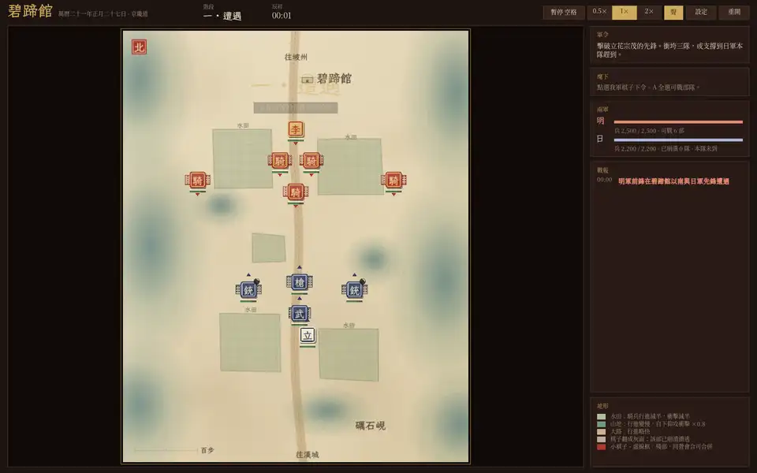

All at 3×, seed 1 with the scripted opening:

Charge (tick 45): ranks open and the middle bulges as the Liaodong Right closes.

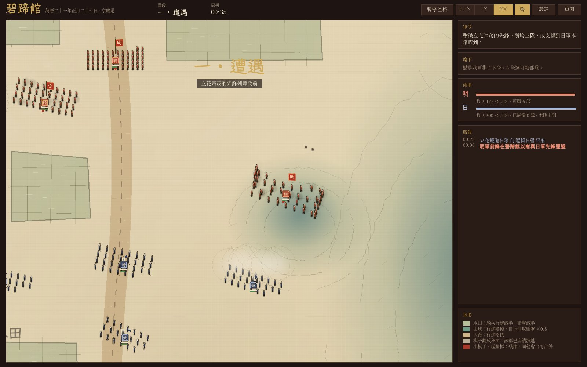

Impact (tick 60): the riders have driven into the arquebusiers, who are dented where they were struck.

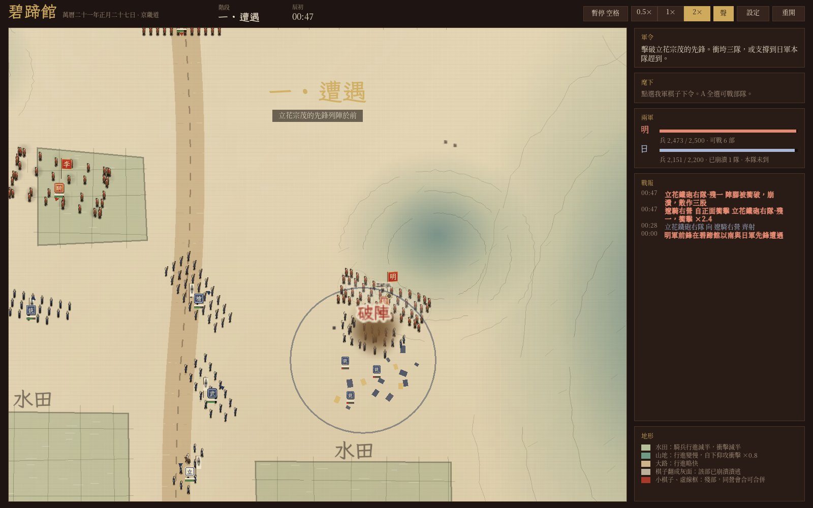

Shattering (tick 63): the broken arquebusiers' men run toward their three remnants.

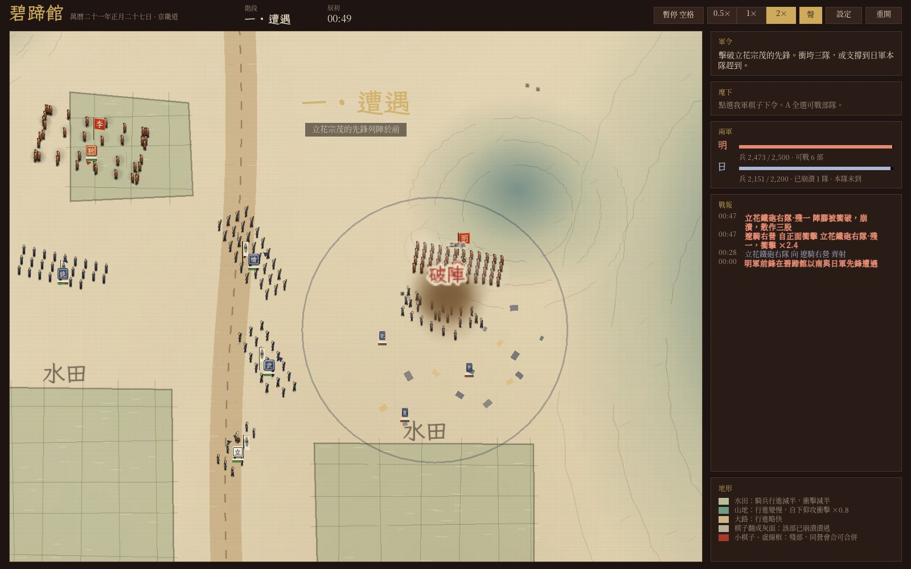

Rout (tick 82): the remnants stream away, stragglers behind.

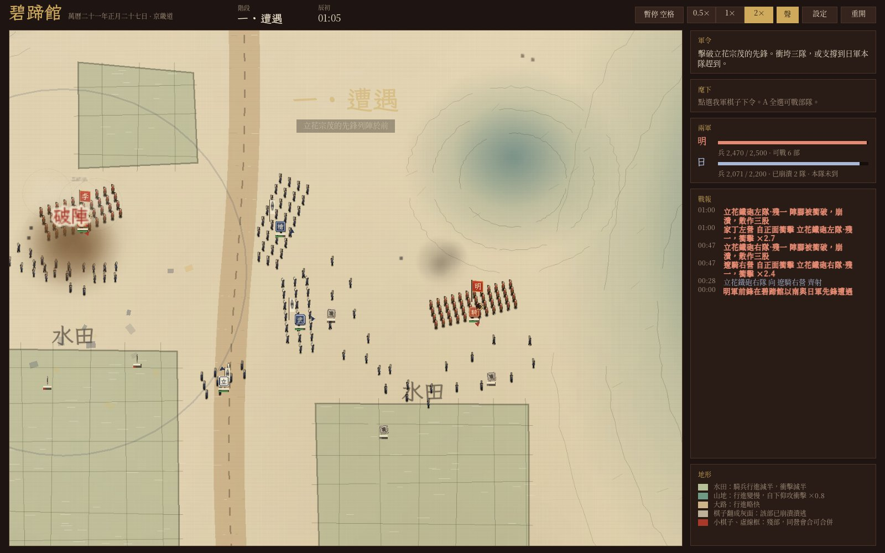

Melee (tick 345): the samurai and the Liaodong Right fight in a ragged band in the paddy.

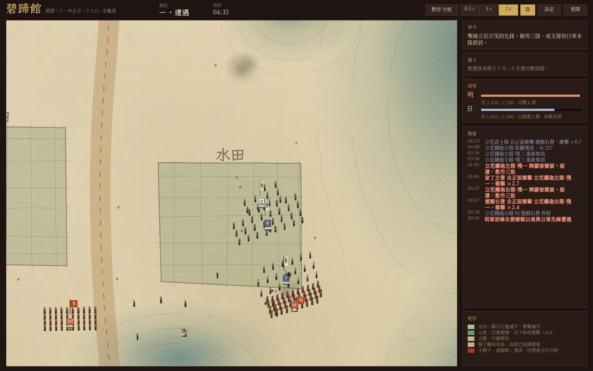

Breaking (tick 403): the Liaodong Right breaks, rear ranks leaving first.

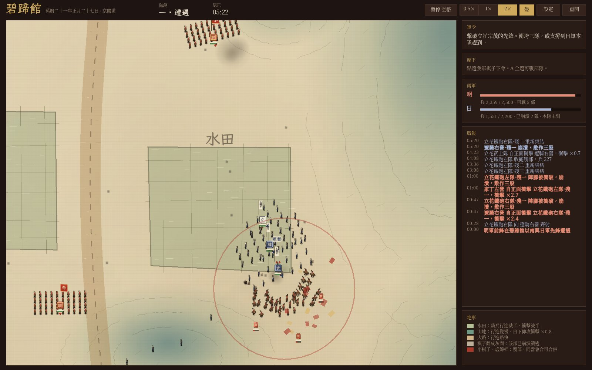

Rally and re-forming (ticks 566 and 574): a remnant gathers on its banner, then re-forms.

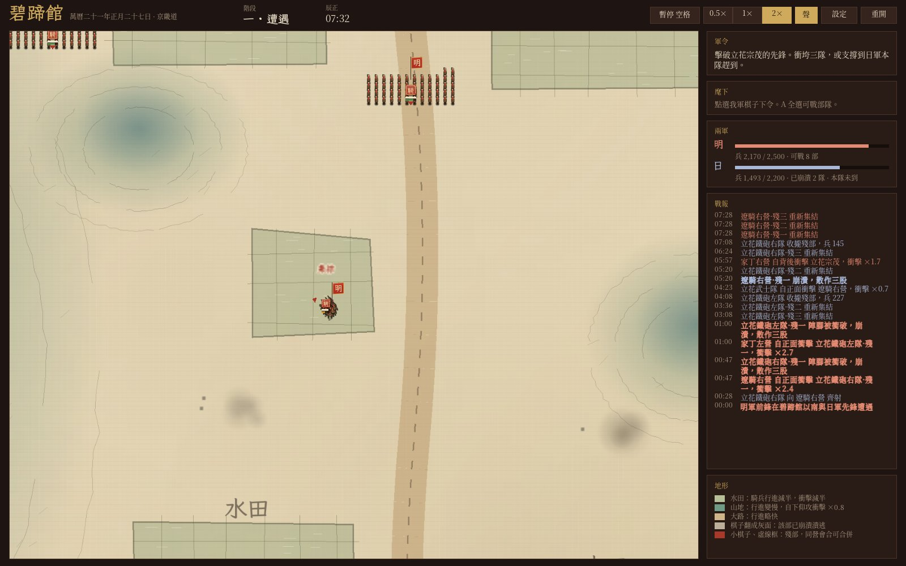

After the battle (tick 3050): bodies lie where the fighting was, faded to half opacity.

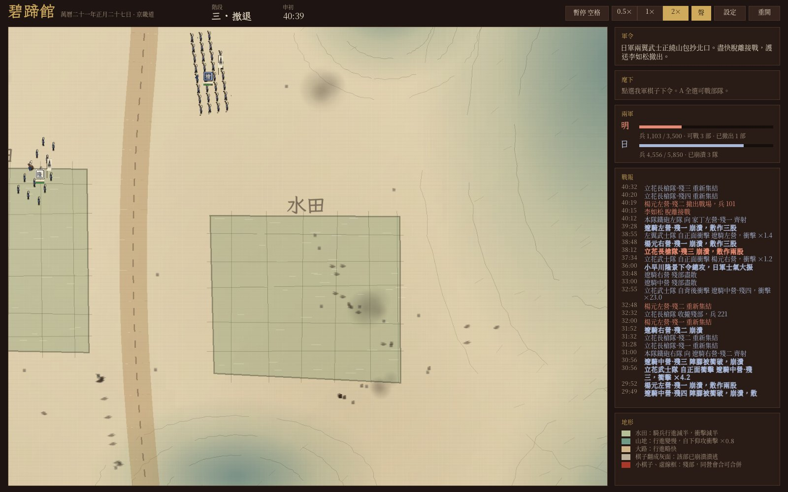

Notes for the review:

- All deformation parameters are sliders on the Formation tab of the dev panel (dev build, F1, then F2 to the last
  tab); defaults can be restored with one button.
- Bodies are the idle figure squashed flat and darkened; they read as dark marks at 3× and will need a proper fallen
  frame in the V6 atlas.
- Soldier speed is capped (cavalry 12 m/s, infantry 5 m/s); without it a fleeing unit that turns every tick swings
  its stream targets so far that soldiers would cover tens of metres in a tick.
- The rout stream is shorter than first planned (1.2 × depth for the farthest stragglers).

## M4 review and the art direction (accepted 2026-11-02)

Author's acceptance, also recorded in the decisions table of DEVELOPMENT.md:

- Every listed deviation is accepted: the right-drag rule, soldiers larger than life, Japanese generals mounted,
  read-only inspection of enemies, the Korean description draft.
- Art route: AI generation and artists combined. AI for now, every asset registered in AI_ASSETS.md; key images
  such as portraits may later be replaced by an artist. Style: gongbi or woodblock, flat colour, ink outlines,
  three-quarter view, matching the silk-scroll map. Soldier atlas: 3D models rendered in Blender with an ink-line
  style, assembled into the current atlas layout. Portraits: single AI images. Banners: code or vector drawings.
- Soldiers stay larger than life. The near view stays at 2×, cross-faded between 1.8× and 2.2× instead of a hard
  switch (done in the M4 fixes).
- Banner characters 帥, 李, 楊 adopted; 明 kept for now, pending the author. The eight unit descriptions in
  Traditional Chinese and English are accepted; Korean stays a draft.

The review material as it was shown:

M4 (V1–V4) is merged. As agreed, work stops here so the author can judge the effect and choose the art direction
before the art pipeline, the map, and the effects continue. Everything below is placeholder art drawn in code; the
rules core is untouched, and the 100-battle baseline and the tick-by-tick comparison are unchanged.

Recording, about 30 seconds of seed 1 with the scripted opening at 2× speed (animated WebP, 960 × 600, 10 frames per
second; screenshots taken by the game's own script, so the frame rate is lower than live play): far view, wheel to
3× over the vanguard as the charges land, pan, back out to 1×, select Li Rusong for the unit card, and zoom onto his
banner.

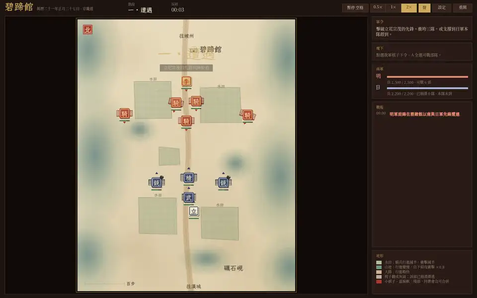

Far view, 1× (unchanged from M3):

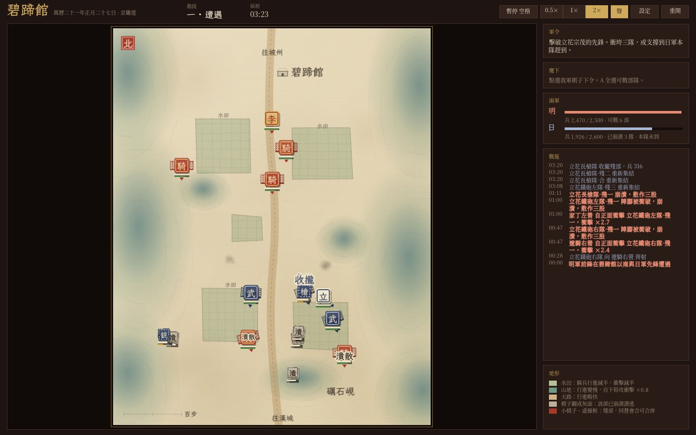

Near view, 3×, tick 255 (soldiers, sashimono, small counters):

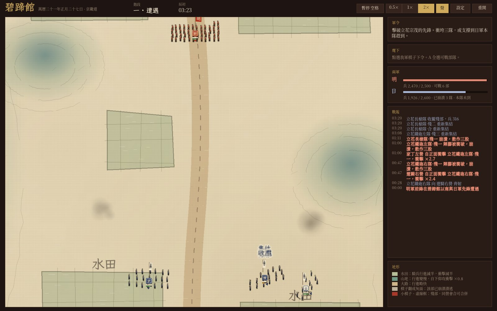

Near view, 3×, the opening (Ming banners 帥, 李, 明):

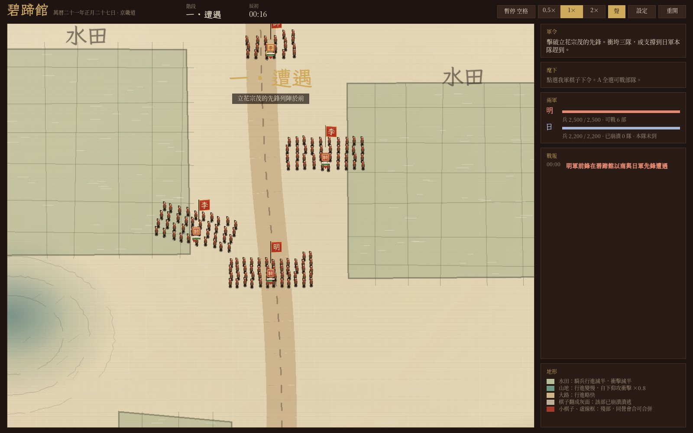

Near view, 3.8×, tick 59 (00:47), just after the breakthrough (recaptured in the M4 fixes; the first version
showed tick 52 drawn with V2):

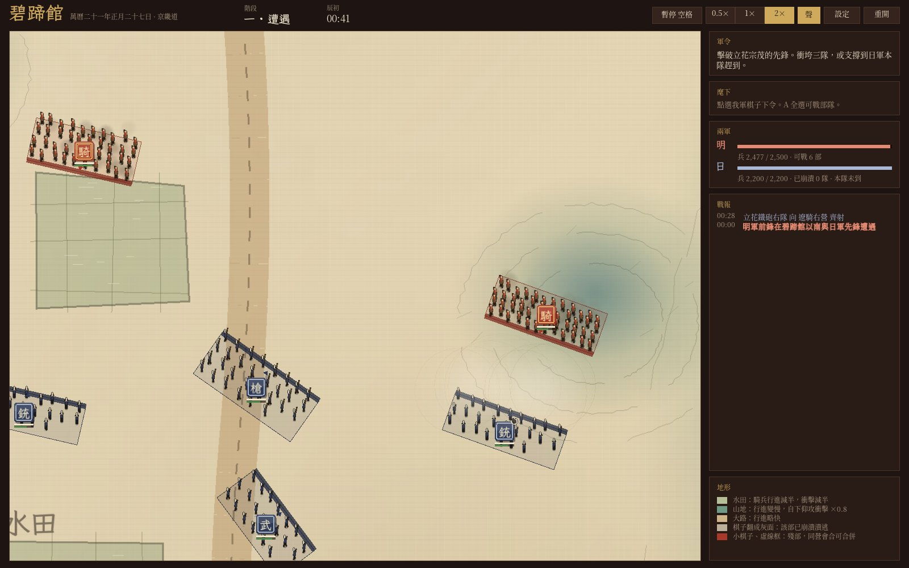

Unit cards (Traditional Chinese, English inspecting an enemy, Korean):

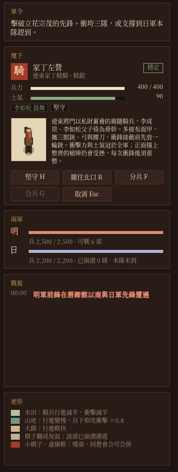 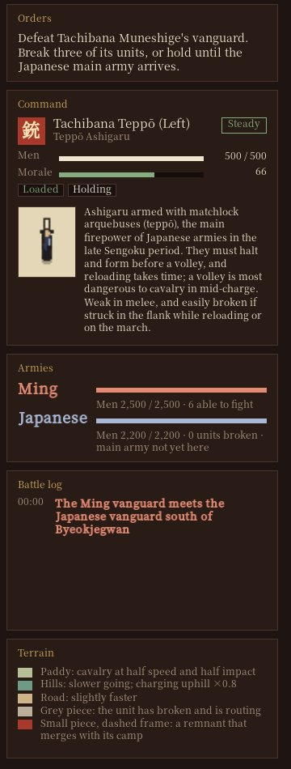 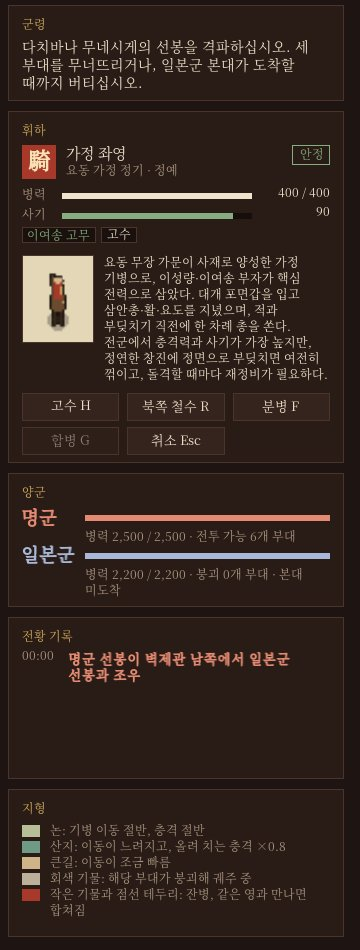

What works, in my view: units now read as bodies of men at 2× and above, losses visibly thin the rear ranks, routing
men scatter, and the two views switch cleanly; performance stays at p95 0.5 ms.

What the placeholders cannot show yet, and where I suggest the art goes:

- Figures. The code-drawn silhouettes are readable only as colour and posture. Suggested route: commission or
  generate a single sprite atlas in the fixed layout (`tieqi --dump-atlas` writes the template), in the same gongbi
  or woodblock register as the base map: flat colour, ink outline, three-quarter view. 32-pixel cells are enough at
  4×; if figures should carry more detail, the cell size is one constant and can become 48 or 64.
- Banners and crests. The Tachibana and Kobayakawa crests are stand-ins and need research before they are drawn
  properly; the Ming characters (帥, 李, 明, 楊) are listed for review below.
- Portraits. One portrait per unit type at `assets/textures/portraits/<type id>.png` replaces the placeholder with no
  code change; a 3:4 aspect fits the card.
- Map. At 3× and 4× the silk base map is sharp but empty; terrain texture, field furrows, and trees are the next
  visual gain, and the effects (dust, smoke, debris) are sized for the far view and look small up close.

Decisions needed from the author: the art style and source for figures, banners, and portraits (commissioned,
AI-generated and registered in AI_ASSETS.md, or both); whether figures stay larger than life (a cell spans 9 m now);
and whether the near view threshold of 2× feels right.

## Unit descriptions and banner characters (V4, V3)

Status after the M4 review: the zh-Hant and en descriptions are accepted; the Korean ones remain a draft; banner characters 帥, 李, 楊 are adopted and 明 is pending the author. As first written, all entries below were awaiting author review. The brief asked for Traditional Chinese and English descriptions; a Korean draft was added too, because the en and ko tables must own every zh-Hant key and a Korean card should not fall back to Chinese. Wording aims to be neutral and dignified for both sides; historical claims are limited to the common account (Li Rusong retook Pyongyang in the first month of 1593 and met the Japanese army at Byeokjegwan; Tachibana Muneshige led the vanguard; Kobayakawa Takakage directed the main body). Banner characters are the same in all three languages, like counter glyphs.

| Key | zh-Hant | en | ko |
| --- | --- | --- | --- |
| `desc.type.jiading` | 遼東將門以私財蓄養的親隨騎兵，李成梁、李如松父子倚為骨幹。多披布面甲，攜三眼銃、弓與腰刀，衝鋒接敵前先放一輪銃。衝擊力與士氣冠於全軍；正面撞上整齊的槍陣仍會受挫，每次衝鋒後須重整。 | Household cavalry kept at the Liaodong commanders' own expense; Li Chengliang and his son Li Rusong relied on them as the core of their forces. Most wore brigandine and carried three-eyed guns, bows, and sabres, firing a volley just before contact. The hardest-hitting and steadiest troops in the army, yet a charge into a steady pike front still fails, and they must re-form after every charge. | 요동 무장 가문이 사재로 양성한 가정 기병으로, 이성량·이여송 부자가 핵심 전력으로 삼았다. 대개 포면갑을 입고 삼안총·활·요도를 지녔으며, 적과 부딪치기 직전에 한 차례 총을 쏜다. 전군에서 충격력과 사기가 가장 높지만, 정연한 창진에 정면으로 부딪치면 여전히 꺾이고, 돌격할 때마다 재정비가 필요하다. |
| `desc.type.kobayakawa` | 小早川隆景及其旗本，統率日軍本隊。隆景是久經戰陣的宿將，碧蹄館一戰調度各部合圍明軍。鼓舞範圍廣，撤退階段可下令總攻；遠離戰線時鼓舞無從發揮。 | Kobayakawa Takakage and his hatamoto, commanding the Japanese main body. A veteran general, Takakage directed the converging attack on the Ming at Byeokjegwan. His inspiration reaches far, and in the withdrawal phase he can order a general assault; it does nothing when he is far from the line. | 고바야카와 다카카게와 그 하타모토로, 일본군 본대를 지휘한다. 노련한 장수인 다카카게는 벽제관에서 각 부대를 지휘해 명군을 포위했다. 고무 범위가 넓고 철수 단계에서 총공격을 명할 수 있으나, 전선에서 멀어지면 고무 효과를 발휘하지 못한다. |
| `desc.type.liaodong` | 明朝遼東鎮的邊軍騎兵，久經北方邊地征戰，隨李如松東援朝鮮。裝備三眼銃、弓與腰刀，行動迅捷，適合包抄與追擊。衝擊力不及家丁，遇長槍與武士宜避其正面，轉攻側背。 | Frontier cavalry of the Ming garrison in Liaodong, seasoned by long service on the northern frontier, who came to the aid of Joseon with Li Rusong. Armed with three-eyed guns, bows, and sabres; fast, and best used to envelop and pursue. They hit less hard than the household cavalry, so against spears or samurai they should avoid the front and strike the flanks and rear. | 명 요동진의 변방 기병으로, 오랜 북방 변경 전투로 단련되었으며 이여송을 따라 조선을 도우러 왔다. 삼안총·활·요도를 갖추고 기동이 빨라 포위와 추격에 알맞다. 충격력은 가정 기병에 미치지 못하므로, 창병과 사무라이를 만나면 정면을 피하고 측면과 배후를 노려야 한다. |
| `desc.type.lirusong` | 東征提督李如松及其親兵。李如松出身遼東將門，萬曆二十一年正月收復平壤後南下，於碧蹄館與日軍遭遇。主帥所在，周圍部隊士氣得以維繫；主帥陣亡即告失敗，切勿陷入重圍。 | Li Rusong, commander of the Ming expedition, with his guard. Born into a Liaodong military family, he retook Pyongyang early in 1593, pushed south, and met the Japanese army at Byeokjegwan. His presence steadies the units around him; if he falls the battle is lost, so keep him out of encirclement. | 동정 제독 이여송과 그 친병. 요동 무장 가문 출신인 이여송은 1593년 정월 평양을 수복한 뒤 남하하다가 벽제관에서 일본군과 맞닥뜨렸다. 주장이 있는 곳에서는 주변 부대의 사기가 유지되며, 주장이 전사하면 전투에서 패하므로 포위되지 않도록 해야 한다. |
| `desc.type.samurai` | 身披具足的武士及其從者，是日本軍隊的近戰主力，常在鐵砲齊射後發起突擊。衝擊與近戰俱強，每擊潰一部氣勢愈盛。行動不及騎兵，接敵前若遭射擊或衝擊而損耗，威力大減。 | Armoured samurai and their retainers, the shock troops of the Japanese army, who usually charged in after the arquebusiers had fired. Strong in both impact and melee, and every enemy unit they rout raises their momentum. Slower than cavalry, and far less dangerous if worn down by fire or charges before they close. | 갑주를 갖춘 사무라이와 그 종자들로, 일본군의 근접 돌격 주력이며 대개 조총 사격 뒤에 돌격했다. 충격력과 근접전이 모두 강하고, 적 부대를 무너뜨릴 때마다 기세가 오른다. 기병보다 느리며, 접전 전에 사격이나 돌격으로 소모되면 위력이 크게 떨어진다. |
| `desc.type.tachibana` | 立花宗茂及其親兵，統率日軍先鋒。宗茂以勇武著稱，碧蹄館一戰率先鋒正面迎擊明軍。親兵近戰強悍，周圍武士積累氣勢更快；遭騎兵圍攻時須有援護。 | Tachibana Muneshige and his guard, leading the Japanese vanguard. Renowned for his courage, Muneshige met the Ming advance head-on at Byeokjegwan. His guard is formidable in melee, and the samurai around him build momentum faster; he needs support if cavalry surround him. | 다치바나 무네시게와 그 친병으로, 일본군 선봉을 이끈다. 용맹으로 이름난 무네시게는 벽제관에서 선봉을 이끌고 명군을 정면으로 맞았다. 친병은 근접전에 강하고 주변 사무라이가 기세를 더 빨리 쌓으며, 기병에게 포위되면 지원이 필요하다. |
| `desc.type.teppo` | 裝備火繩槍（鐵砲）的足輕，是戰國後期日本軍隊的主要火力。須停步列陣方能齊射，裝填費時；齊射對衝鋒途中的騎兵尤具威脅。近戰薄弱，裝填或行進時遭側擊容易潰散。 | Ashigaru armed with matchlock arquebuses (teppō), the main firepower of Japanese armies in the late Sengoku period. They must halt and form before a volley, and reloading takes time; a volley is most dangerous to cavalry in mid-charge. Weak in melee, and easily broken if struck in the flank while reloading or on the march. | 화승총(조총)을 든 아시가루로, 센고쿠 시대 후기 일본군의 주요 화력이었다. 멈춰 서서 대열을 갖춰야 일제 사격을 할 수 있고 장전에 시간이 걸린다. 사격은 돌격 중인 기병에게 특히 위협적이지만, 근접전에 약하고 장전 중이나 행군 중에 측면을 맞으면 쉽게 무너진다. |
| `desc.type.yari` | 手持長槍、列成密集槍陣的足輕，是日本軍隊陣線的骨幹。正面能有效抵禦騎兵衝擊，常護衛在鐵砲隊旁。轉向緩慢，側翼與背後是其弱點。 | Ashigaru with long spears in close ranks, the backbone of the Japanese battle line. From the front they hold off cavalry charges well, and they often guard the arquebusiers. They turn slowly, and their flanks and rear are vulnerable. | 긴 창을 들고 밀집한 창진을 이룬 아시가루로, 일본군 전열의 뼈대였다. 정면에서는 기병 돌격을 잘 막아 내며, 흔히 조총대 곁을 호위한다. 방향 전환이 느려 측면과 배후가 약점이다. |

## Translations awaiting author review (L1)

Korean review: **on hold** (Korean is not shipped for now). English review: still awaiting the author.

The table below lists every translation written in L1, all **awaiting author review**: 259 en entries, 259 ko entries, plus 7 new zh-Hant terms for the settings card (marked "(new)"). Proper nouns already in the original table (place names, Li Rusong, Yang Yuan, Tachibana Muneshige, Kobayakawa Takakage, unit type names, counter glyphs) were kept and are not listed. Terminology: the Japanese side is Japanese army / Japanese forces in English (adjective Japanese) and 일본군 in Korean; the Ming army is 명군; in Korean a counter is 기물, to avoid confusion with 말 (horse); derogatory terms such as 왜, 倭, and 오랑캐 are not used, and `tests/app/l10n.cpp` checks that they never appear. After review, edit `data/strings/` only; no code changes are needed.

| Key | zh-Hant | en | ko |
| --- | --- | --- | --- |
| `scn.byeokjegwan` | 碧蹄館之戰 | Battle of Byeokjegwan | 벽제관 전투 |
| `scn.duel_flat` | 平地對決 | Duel on Open Ground | 평지 대결 |
| `fx.pike` | 槍陣 | Pike wall | 창진 |
| `fx.break` | 破陣 | Breakthrough | 진 돌파 |
| `fx.charge` | 衝入 | Charge home | 돌입 |
| `fx.blocked` | 受阻 | Stopped | 저지 |
| `fx.volley` | 三眼銃 | Three-eyed guns | 삼안총 |
| `fx.rally` | 集結 | Rallied | 재집결 |
| `fx.momentum` | 氣勢 | Momentum | 기세 |
| `fx.merge` | 收攏 | Regrouped | 수습 |
| `fx.split` | 分兵 | Split | 분병 |
| `fx.disperse` | 潰散 | Dispersed | 궤산 |
| `fx.withdraw` | 撤出 | Withdrew | 철수 |
| `fx.general_down` | 陣亡 | Fallen | 전사 |
| `fx.assault` | 總攻 | General assault | 총공격 |
| `unit.jiading_left` | 家丁左營 | Left Retainers | 가정 좌영 |
| `unit.jiading_right` | 家丁右營 | Right Retainers | 가정 우영 |
| `unit.liaodong_left` | 遼騎左營 | Liaodong Left | 요동 기병 좌영 |
| `unit.liaodong_center` | 遼騎中營 | Liaodong Center | 요동 기병 중영 |
| `unit.liaodong_right` | 遼騎右營 | Liaodong Right | 요동 기병 우영 |
| `unit.van_yari` | 立花長槍隊 | Tachibana Yari | 다치바나 장창대 |
| `unit.van_teppo_left` | 立花鐵砲左隊 | Tachibana Teppō (Left) | 다치바나 조총 좌대 |
| `unit.van_teppo_right` | 立花鐵砲右隊 | Tachibana Teppō (Right) | 다치바나 조총 우대 |
| `unit.van_samurai` | 立花武士隊 | Tachibana Samurai | 다치바나 사무라이대 |
| `unit.main_teppo_left` | 本隊鐵砲左隊 | Main Army Teppō (Left) | 본대 조총 좌대 |
| `unit.main_teppo_right` | 本隊鐵砲右隊 | Main Army Teppō (Right) | 본대 조총 우대 |
| `unit.main_yari_left` | 本隊長槍左隊 | Main Army Yari (Left) | 본대 장창 좌대 |
| `unit.main_yari_right` | 本隊長槍右隊 | Main Army Yari (Right) | 본대 장창 우대 |
| `unit.main_samurai` | 本隊武士隊 | Main Army Samurai | 본대 사무라이대 |
| `unit.wing_samurai_left` | 左翼武士隊 | Left Wing Samurai | 좌익 사무라이대 |
| `unit.wing_samurai_right` | 右翼武士隊 | Right Wing Samurai | 우익 사무라이대 |
| `terrain.paddy` | 水田 | Paddy | 논 |
| `phase.0` | 未開戰 | Not begun | 개전 전 |
| `phase.1` | 一 · 遭遇 | I · Encounter | 1 · 조우 |
| `phase.2` | 二 · 主力壓上 | II · Main army | 2 · 주력 진격 |
| `phase.3` | 三 · 撤退 | III · Withdrawal | 3 · 철수 |
| `obj.briefing` | 讀完戰前要訣後點擊“開戰”。 | Read the briefing, then click "Begin". | 전투 요령을 읽은 뒤 “개전”을 누르십시오. |
| `obj.phase1` | 擊破立花宗茂的先鋒。衝垮三隊，或支撐到日軍本隊趕到。 | Defeat Tachibana Muneshige's vanguard. Break three of its units, or hold until the Japanese main army arrives. | 다치바나 무네시게의 선봉을 격파하십시오. 세 부대를 무너뜨리거나, 일본군 본대가 도착할 때까지 버티십시오. |
| `obj.warning` | 日軍本隊即將趕到。收攏追擊的騎兵，讓衝過陣的部隊完成重整。 | The Japanese main army is about to arrive. Recall your pursuing cavalry and let units that charged through finish re-forming. | 일본군 본대가 곧 도착합니다. 추격 중인 기병을 거두고, 적진을 뚫고 나간 부대가 정비를 마치게 하십시오. |
| `obj.phase2` | 日軍本隊已越過礪石峴。可隨時經北口撤往坡州：李如松撤出即結束戰鬥，北口附近未接戰的部隊會隨他一同撤出。 | The Japanese main army has crossed Yeoseok Pass. You may withdraw toward Paju through the north exit at any time: the battle ends when Li Rusong leaves, and units near the exit that are not engaged leave with him. | 일본군 본대가 여석현을 넘었습니다. 언제든 북쪽 출구로 파주 방면 철수가 가능합니다. 이여송이 빠져나가면 전투가 끝나며, 출구 근처에서 교전 중이 아닌 부대는 함께 철수합니다. |
| `obj.phase3` | 日軍兩翼武士正繞山包抄北口。盡快脫離接戰，護送李如松撤出。 | Samurai on both Japanese wings are circling the hills toward the north exit. Break off quickly and escort Li Rusong out. | 일본군 양익의 사무라이가 산을 돌아 북쪽 출구로 다가옵니다. 서둘러 교전에서 벗어나 이여송을 호위해 철수하십시오. |
| `banner.phase1` | 一 · 遭遇 | I · Encounter | 1 · 조우 |
| `banner.phase1_sub` | 立花宗茂的先鋒列陣於前 | Tachibana Muneshige's vanguard is drawn up ahead | 다치바나 무네시게의 선봉이 앞에 진을 쳤다 |
| `banner.scout` | 斥候來報 | Scouts report | 척후 보고 |
| `banner.scout_sub` | 小早川隆景本隊即將越過礪石峴 | Kobayakawa Takakage's main army will soon cross Yeoseok Pass | 고바야카와 다카카게의 본대가 곧 여석현을 넘는다 |
| `banner.phase2` | 二 · 主力壓上 | II · Main army | 2 · 주력 진격 |
| `banner.phase2_sub` | 小早川隆景本隊越過礪石峴 | Kobayakawa Takakage's main army crosses Yeoseok Pass | 고바야카와 다카카게의 본대가 여석현을 넘었다 |
| `banner.phase3` | 三 · 撤退 | III · Withdrawal | 3 · 철수 |
| `banner.phase3_sub` | 日軍兩翼包抄北口，護送李如松撤往坡州 | The Japanese wings close on the north exit — escort Li Rusong to Paju | 일본군 양익이 북쪽 출구를 에워싼다. 이여송을 호위해 파주로 철수하라 |
| `banner.reinforcement` | 援軍 · 楊元 | Reinforcements · Yang Yuan | 원군 · 양원 |
| `banner.reinforcement_sub` | 楊元率押後的騎兵自北馳援 | Yang Yuan rides in from the north with the rearguard cavalry | 양원이 후위 기병을 이끌고 북쪽에서 달려온다 |
| `log.impact` | {a} 自{side}衝擊 {b}，衝擊 ×{r} | {a} charges {b} from the {side}, impact ×{r} | {a}, {side}에서 {b} 충격 ×{r} |
| `log.impact_pike` | {a} 自{side}衝擊 {b}，衝擊 ×{r}，撞上槍陣 | {a} charges {b} from the {side}, impact ×{r}, into a pike wall | {a}, {side}에서 {b} 충격 ×{r}, 창진에 부딪힘 |
| `log.breakaway` | {a} 脫離接戰 | {a} breaks off | {a} 교전 이탈 |
| `log.volley` | {a} 向 {b} 齊射 | {a} fires a volley at {b} | {a}, {b}에 일제 사격 |
| `log.broken` | {a} 崩潰 | {a} breaks | {a} 붕괴 |
| `log.broken_scatter` | {a} 崩潰，散作{parts}股 | {a} breaks and scatters into {parts} bands | {a} 붕괴, {parts}갈래로 흩어짐 |
| `log.broken_impact` | {a} 陣腳被衝破，崩潰 | {a} is broken by the charge | {a} 진형이 뚫려 붕괴 |
| `log.broken_impact_scatter` | {a} 陣腳被衝破，崩潰，散作{parts}股 | {a} is broken by the charge and scatters into {parts} bands | {a} 진형이 뚫려 붕괴, {parts}갈래로 흩어짐 |
| `log.rallied` | {a} 重新集結 | {a} rallies | {a} 재집결 |
| `log.merged_frag` | {name} 收攏殘部，兵 {n} | {name} gathers its remnants, {n} men | {name} 잔병 수습, 병력 {n} |
| `log.merged_join` | {name} 合兵，兵 {n} | {name} rejoins, {n} men | {name} 합류, 병력 {n} |
| `log.split` | {name} 分為兩隊，各 {n} 人 | {name} splits into two companies of {n} | {name} 두 부대로 나뉨, 각 {n}명 |
| `log.dispersed` | {a} 潰散 | {a} disperses | {a} 궤산 |
| `log.dispersed_remnant` | {name} 殘部盡散 | The last of {name} disperses | {name} 잔병 모두 흩어짐 |
| `log.fled` | {a} 逃離戰場 | {a} flees the field | {a} 전장 이탈 |
| `log.fled_remnant` | {name} 殘部 逃離戰場 | The remnants of {name} flee the field | {name} 잔병 전장 이탈 |
| `log.withdrawn` | {a} 撤出戰場，兵 {n} | {a} withdraws from the field, {n} men | {a} 전장에서 철수, 병력 {n} |
| `log.general_down` | {a} 陣亡 | {a} has fallen | {a} 전사 |
| `log.phase1` | 明軍前鋒在碧蹄館以南與日軍先鋒遭遇 | The Ming vanguard meets the Japanese vanguard south of Byeokjegwan | 명군 선봉이 벽제관 남쪽에서 일본군 선봉과 조우 |
| `log.scout` | 斥候來報：日軍本隊將至，宜趁早整隊 | Scouts report: the Japanese main army is coming — re-form while you can | 척후 보고: 일본군 본대가 다가온다. 서둘러 대오를 정비하라 |
| `log.phase2` | 日軍本隊自礪石峴壓上，北口撤退路線已開 | The Japanese main army advances from Yeoseok Pass; the north exit is open for withdrawal | 일본군 본대가 여석현에서 밀려오고, 북쪽 출구 철수로가 열렸다 |
| `log.assault` | 小早川隆景下令總攻，日軍士氣大振 | Kobayakawa Takakage orders a general assault; Japanese morale surges | 고바야카와 다카카게가 총공격을 명령, 일본군 사기 고조 |
| `log.assault_failed` | 日軍本隊失去主將，總攻未能發動 | The Japanese main army has lost its general; the general assault never comes | 일본군 본대가 주장을 잃어 총공격이 무산됨 |
| `log.reinforcement` | 楊元率押後的一千騎趕到，可聽調遣 | Yang Yuan arrives with a thousand rearguard horse, ready for orders | 양원이 후위 기병 1,000기를 이끌고 도착, 지휘 가능 |
| `float.pike` | 槍陣 | Pike wall | 창진 |
| `float.break` | 破陣 | Breakthrough | 진 돌파 |
| `float.charge_in` | 衝入 | Charge home | 돌입 |
| `float.blocked` | 受阻 | Stopped | 저지 |
| `float.volley` | 三眼銃 | Three-eyed guns | 삼안총 |
| `float.rally` | 集結 | Rallied | 재집결 |
| `float.merge` | 收攏 | Regrouped | 수습 |
| `float.dead` | 陣亡 | Fallen | 전사 |
| `float.disperse` | 潰散 | Dispersed | 궤산 |
| `float.withdraw` | 撤出 | Withdrew | 철수 |
| `float.assault` | 總攻 | General assault | 총공격 |
| `float.momentum` | 氣勢 | Momentum | 기세 |
| `float.split` | 分兵 | Split | 분병 |
| `state.steady` | 穩定 | Steady | 안정 |
| `state.wavering` | 動搖 | Wavering | 동요 |
| `state.broken` | 崩潰 | Broken | 붕괴 |
| `state.routing` | 潰逃 | Routing | 궤주 |
| `side.front` | 正面 | front | 정면 |
| `side.flank` | 側翼 | flank | 측면 |
| `side.rear` | 背後 | rear | 후방 |
| `side.ming` | 明 | Ming | 명군 |
| `side.jp` | 日 | Japanese | 일본군 |
| `mod.impact` | {name} 衝擊 | {name} impact | {name} 충격 |
| `mod.melee` | {name} 近戰 | {name} melee | {name} 근접전 |
| `mod.defense` | {name} 抗衝 | {name} vs. charge | {name} 충격 저항 |
| `mod.speed` | 衝速不足 | Not enough speed | 돌격 속도 부족 |
| `mod.flank` | 側擊 | Flank attack | 측면 공격 |
| `mod.rear` | 背擊 | Rear attack | 후방 공격 |
| `mod.wavering` | 敵軍動搖 | Enemy wavering | 적 동요 |
| `mod.routing` | 敵軍潰亂 | Enemy in rout | 적 궤주 |
| `mod.reloading` | 敵鐵砲裝填中 | Enemy teppō reloading | 적 조총 장전 중 |
| `mod.unformed` | 敵鐵砲未列陣 | Enemy teppō not deployed | 적 조총 미배치 |
| `mod.paddy` | 水田泥濘 | Muddy paddy | 논 진창 |
| `mod.uphill` | 仰攻 | Attacking uphill | 오르막 공격 |
| `mod.pike` | 正面槍陣 | Pikes to the front | 정면 창진 |
| `mod.pike_wall` | 正面硬撼槍陣 | Head-on into pikes | 창진 정면 돌격 |
| `mod.momentum` | 氣勢 | Momentum | 기세 |
| `mod.own_wavering` | 我軍動搖 | Our troops wavering | 아군 동요 |
| `mod.strength` | 兵力折損 | Losses | 병력 손실 |
| `mod.cavalry_grind` | 騎兵纏鬥乏力 | Cavalry worn down in melee | 기병 난전 약화 |
| `mod.pursuit` | 追擊潰兵 | Pursuing routers | 궤주병 추격 |
| `verdict.pike` | 正面衝槍陣，必受重創 | Head-on into pikes — heavy losses certain | 창진 정면 돌격, 큰 피해 필연 |
| `verdict.pursuit` | 追擊潰兵，可大量殺傷 | Pursuing routers — heavy casualties | 궤주병 추격, 큰 살상 가능 |
| `verdict.breaks` | 衝擊足以破陣 | Enough to break them | 충격으로 적진 돌파 가능 |
| `verdict.favored_charge` | 佔優，可衝入敵陣 | Favorable — will drive in | 우세, 적진 돌입 가능 |
| `verdict.even_charge` | 勢均力敵，將陷入纏鬥 | Even — expect a grinding melee | 호각, 난전에 빠짐 |
| `verdict.unfavored_charge` | 不利，衝擊會被擋住 | Unfavorable — will be stopped | 불리, 충격이 저지됨 |
| `verdict.favored_melee` | 近戰佔優 | Favorable in melee | 근접전 우세 |
| `verdict.even_melee` | 勢均力敵 | Evenly matched | 호각 |
| `verdict.unfavored_melee` | 近戰不利 | Unfavorable in melee | 근접전 불리 |
| `note.recovering` | 重整中，{sec} 秒內無法衝鋒，只能接戰 | Re-forming: no charge for {sec} s, melee only | 정비 중: {sec}초 동안 돌격 불가, 교전만 가능 |
| `note.too_close` | 距離太近，衝不起速度 | Too close to build up speed | 거리가 너무 가까워 속도를 낼 수 없음 |
| `note.volley` | {name} 已裝填，衝鋒途中可能遭齊射 | {name} is loaded; the charge may draw a volley | {name} 장전 완료, 돌격 중 일제 사격을 받을 수 있음 |
| `note.wavering` | 本部士氣動搖，戰力打折 | Our morale is wavering; fighting strength reduced | 아군 사기 동요, 전투력 저하 |
| `tag.charging` | 衝鋒中 | Charging | 돌격 중 |
| `tag.breaking` | 脫離接戰 | Breaking off | 교전 이탈 |
| `tag.contact` | 接戰 | Engaged | 교전 |
| `tag.flanked` | 側背受擊 | Hit in flank or rear | 측후방 피격 |
| `tag.recover` | 重整 {sec} 秒 | Re-forming {sec} s | 정비 {sec}초 |
| `tag.reload` | 裝填 {sec} 秒 | Reloading {sec} s | 장전 {sec}초 |
| `tag.loaded` | 已裝填 | Loaded | 장전 완료 |
| `tag.moving_no_fire` | 行進中，不能齊射 | Moving, cannot fire | 행군 중 사격 불가 |
| `tag.momentum` | 氣勢 ×{n} | Momentum ×{n} | 기세 ×{n} |
| `tag.fragment` | 殘部：與同營殘部會合即合併 | Remnant: merges on meeting its camp's remnants | 잔병: 같은 영의 잔병과 만나면 합쳐짐 |
| `tag.rejoin` | 正在合兵 | Rejoining | 합류 중 |
| `tag.split` | 分隊：同營分隊一起選中按“合兵”收回 | Detachment: select with its sibling and press "Join" | 분대: 같은 영의 분대와 함께 선택해 “합병” |
| `tag.aura` | {name} 鼓舞 | Inspired by {name} | {name} 고무 |
| `tag.paddy` | 身陷水田 | In a paddy | 논에 빠짐 |
| `tag.hill` | 山地 | Hills | 산지 |
| `tag.road` | 大路 | Road | 큰길 |
| `tag.target` | 目標：{name} | Target: {name} | 목표: {name} |
| `tag.moving` | 行進中 | On the move | 행군 중 |
| `tag.hold` | 堅守 | Holding | 고수 |
| `tag.elite` | 精銳 | Elite | 정예 |
| `ui.subtitle` | 萬曆二十一年正月二十七日 · 京畿道 | Wanli 21, 1st month, 27th day · Gyeonggi | 만력 21년 정월 27일 · 경기도 |
| `ui.phase` | 階段 | Phase | 단계 |
| `ui.speed` | 速度 | Speed | 속도 |
| `ui.sound` | 聲 | Sound | 소리 |
| `ui.restart` | 重開 | Restart | 재시작 |
| `ui.start` | 開戰 | Begin | 개전 |
| `ui.pause` | 暫停 | Pause | 일시정지 |
| `ui.resume` | 繼續 | Resume | 계속 |
| `ui.paused` | 暫停中 | Paused | 일시정지 중 |
| `ui.canvas` | 碧蹄館戰場 | Byeokjegwan battlefield | 벽제관 전장 |
| `ui.battle` | 碧蹄館 | Byeokjegwan | 벽제관 |
| `ui.key.space` | 空格 | Space | 스페이스 |
| `ui.intro_eyebrow` | 萬曆二十一年正月 · 明軍東征 | Wanli 21 (1593), 1st month · The Ming army's eastern campaign | 만력 21년 정월 · 명군의 동정 |
| `ui.intro_body` | 平壤收復後，提督李如松率以遼東騎兵為主的前鋒南下漢城，在碧蹄館一帶與日軍遭遇。立花宗茂的先鋒已在前方列陣，小早川隆景的本隊隨後就到。李如松只帶了一半親兵先行，另一半由楊元押後。 | After retaking Pyongyang, Commander Li Rusong led a vanguard of mostly Liaodong cavalry south toward Hanseong and met the Japanese army near Byeokjegwan. Tachibana Muneshige's vanguard is already drawn up ahead, and Kobayakawa Takakage's main army is close behind. Li Rusong rode ahead with only half his guard; Yang Yuan follows with the other half. | 평양을 되찾은 뒤, 제독 이여송은 요동 기병을 주력으로 한 선봉을 이끌고 한성으로 남하하다가 벽제관 일대에서 일본군과 조우했다. 다치바나 무네시게의 선봉이 이미 앞에 진을 쳤고, 고바야카와 다카카게의 본대가 뒤따르고 있다. 이여송은 친병의 절반만 데리고 먼저 나섰고, 나머지 절반은 양원이 후위로 이끌고 온다. |
| `ui.tips_title` | 騎兵要訣 | Cavalry essentials | 기병 요령 |
| `ui.tip.1` | 衝鋒要有助跑，速度越快衝擊越大，接敵前先放一輪三眼銃。 | A charge needs a run-up: the faster you hit, the harder the impact. Fire the three-eyed guns before contact. | 돌격에는 도움닫기가 필요하다. 속도가 빠를수록 충격이 크며, 접적 전에 삼안총을 한 차례 쏜다. |
| `ui.tip.2` | 側擊 ×1.8，背擊 ×2.4，打已動搖的敵人再加成。衝擊夠大即破陣。 | Flank ×1.8, rear ×2.4, and more against a wavering enemy. A big enough impact breaks the line. | 측면 ×1.8, 후방 ×2.4, 동요한 적에게는 더 커진다. 충격이 충분하면 적진을 돌파한다. |
| `ui.tip.3` | 正面衝長槍陣必吃大虧。鐵砲要停下列陣才能齊射，趁它裝填或行進時衝最好。 | Charging pikes head-on is costly. Teppō must halt and deploy to fire; hit them while they reload or march. | 장창 진에 정면으로 돌격하면 크게 당한다. 조총은 멈춰서 진을 쳐야 일제 사격을 하므로, 장전 중이거나 행군 중일 때 치는 것이 가장 좋다. |
| `ui.tip.4` | 衝完要重整約 48 秒，陷入纏鬥越久越吃虧，宜脫離再衝。破陣後騎兵會繼續追擊，記得收攏。 | Re-forming after a charge takes about 48 s, and a long melee wears you down: break off and charge again. Cavalry pursue after a breakthrough, so recall them. | 돌격 후에는 약 48초간 정비해야 하며, 난전이 길어질수록 불리하니 이탈했다가 다시 돌격하라. 적진을 돌파한 기병은 계속 추격하니 잊지 말고 거두어라. |
| `ui.tip.5` | 部隊崩潰會散作兩三股各自逃散，可以分頭追殺；集結後的同營殘部碰到一起會自動合併。 | A broken unit scatters into two or three bands that flee apart, so you can hunt them separately; rallied remnants of the same camp merge when they meet. | 부대가 붕괴하면 두세 갈래로 흩어져 달아나므로 나누어 추격할 수 있다. 재집결한 같은 영의 잔병은 서로 만나면 자동으로 합쳐진다. |
| `ui.tip.6` | 分兵：一隊拆成兩隊各領一半，一隊牽制、一隊包抄。分隊衝擊力和士氣上限都更低，用合兵收回。 | Split: divide a unit into two halves, one to pin and one to flank. Detachments hit softer and cap lower in morale; Join them back together. | 분병: 한 부대를 절반씩 둘로 나눠 하나는 견제하고 하나는 우회한다. 분대는 충격력과 사기 상한이 낮으며, 합병으로 다시 거둔다. |
| `ui.tip.7` | 李如松陣亡即敗。本隊到來後，從北口撤往坡州；危急時楊元的援騎會趕到。 | If Li Rusong falls, the battle is lost. Once the main army arrives, withdraw to Paju through the north exit; in a crisis Yang Yuan's horsemen will come. | 이여송이 전사하면 패배한다. 본대가 도착하면 북쪽 출구로 파주를 향해 철수하라. 위급할 때는 양원의 원군 기병이 달려온다. |
| `ui.help_title` | 操作 | Controls | 조작 |
| `ui.help.pick` | 點選棋子 | Click a piece | 기물 클릭 |
| `ui.help.pick_body` | 選中我軍；Shift 多選，拖動框選，A 全選 | Select your units; Shift to add, drag to box-select, A for all | 아군 선택. Shift로 추가, 드래그로 범위 선택, A로 전체 선택 |
| `ui.help.ground` | 點地面 | Click ground | 지면 클릭 |
| `ui.help.ground_body` | 移動；點敵軍即進攻，距離夠會自動衝鋒 | Move; click an enemy to attack (charges when close enough) | 이동. 적을 클릭하면 공격하며, 거리가 되면 자동으로 돌격 |
| `ui.help.hover` | 懸停敵軍 | Hover an enemy | 적 위에 올리기 |
| `ui.help.hover_body` | 右側顯示衝擊預估和全部修正項 | The right panel shows the charge estimate and every modifier | 오른쪽에 충격 예측과 모든 보정 항목 표시 |
| `ui.help.keys` | 快捷鍵 | Keys | 단축키 |
| `ui.help.keys_body` | 空格 暫停，1 2 3 變速，H 堅守，R 撤退，F 分兵，G 合兵，Esc 取消 | Space pause, 1 2 3 speed, H hold, R retreat, F split, G join, Esc cancel | 스페이스 일시정지, 1 2 3 속도, H 고수, R 철수, F 분병, G 합병, Esc 취소 |
| `ui.help.touch` | 手機 | Touch | 터치 |
| `ui.help.touch_body` | 點選後點地面移動；點敵軍先看預估，再點一次確認 | Tap a unit, then tap ground to move; tap an enemy to see the estimate, then tap again to confirm | 선택 후 지면을 눌러 이동. 적을 누르면 먼저 예측을 보여 주고, 한 번 더 누르면 확정 |
| `ui.intro_fine` | 原型演示：數值為暫定，地形與兵力尚待對照史料核實。暫停時也可以下令。 | Prototype: values are provisional; terrain and troop numbers are still to be checked against sources. You can give orders while paused. | 프로토타입: 수치는 잠정적이며, 지형과 병력은 사료와 대조해 확인해야 한다. 일시정지 중에도 명령할 수 있다. |
| `ui.orders` | 軍令 | Orders | 군령 |
| `ui.roster` | 麾下 | Command | 휘하 |
| `ui.roster_empty` | 點選我軍棋子下令。A 全選可戰部隊。 | Click one of your pieces to give orders. A selects every unit able to fight. | 아군 기물을 클릭해 명령하십시오. A로 싸울 수 있는 부대를 모두 선택합니다. |
| `ui.men` | 兵力 | Men | 병력 |
| `ui.morale` | 士氣 | Morale | 사기 |
| `ui.hold` | 堅守 | Hold | 고수 |
| `ui.retreat` | 撤往北口 | Retreat | 북쪽 철수 |
| `ui.split` | 分兵 | Split | 분병 |
| `ui.join` | 合兵 | Join | 합병 |
| `ui.cancel` | 取消 | Cancel | 취소 |
| `ui.confirm_attack` | 確認進攻 | Confirm attack | 공격 확정 |
| `ui.armies` | 兩軍 | Armies | 양군 |
| `ui.log` | 戰報 | Battle log | 전황 기록 |
| `ui.terrain` | 地形 | Terrain | 지형 |
| `ui.legend.paddy` | 水田：騎兵行進減半，衝擊減半 | Paddy: cavalry at half speed and half impact | 논: 기병 이동 절반, 충격 절반 |
| `ui.legend.hill` | 山地：行進變慢，自下仰攻衝擊 ×0.8 | Hills: slower going; charging uphill ×0.8 | 산지: 이동이 느려지고, 올려 치는 충격 ×0.8 |
| `ui.legend.road` | 大路：行進略快 | Road: slightly faster | 큰길: 이동이 조금 빠름 |
| `ui.legend.rout` | 棋子翻成灰面：該部已崩潰潰逃 | Grey piece: the unit has broken and is routing | 회색 기물: 해당 부대가 붕괴해 궤주 중 |
| `ui.legend.frag` | 小棋子、虛線框：殘部，同營會合可合併 | Small piece, dashed frame: a remnant that merges with its camp | 작은 기물과 점선 테두리: 잔병, 같은 영과 만나면 합쳐짐 |
| `ui.selected` | 已選 {n} 部，兵 {men} | {n} selected, {men} men | {n}개 부대 선택, 병력 {men} |
| `ui.north` | 北 | N | 북 |
| `ui.exit` | 北口 | North exit | 북쪽 출구 |
| `ui.scale` | 百步 | 100 paces | 백 보 |
| `ui.preview_charge` | 衝擊預估 · {side} | Charge estimate · {side} | 충격 예측 · {side} |
| `ui.preview_melee` | 接戰預估 · {side} | Melee estimate · {side} | 교전 예측 · {side} |
| `ui.preview_by` | （按{name}） |  (as {name}) |  ({name} 기준) |
| `ui.army.ming` | 兵 {men} / {max} · 可戰 {n} 部 | Men {men} / {max} · {n} able to fight | 병력 {men} / {max} · 전투 가능 {n}개 부대 |
| `ui.army.ming_exited` | 兵 {men} / {max} · 可戰 {n} 部 · 已撤出 {k} 部 | Men {men} / {max} · {n} able to fight · {k} withdrawn | 병력 {men} / {max} · 전투 가능 {n}개 부대 · 철수 {k}개 부대 |
| `ui.army.jp` | 兵 {men} / {max} · 已崩潰 {n} 隊 | Men {men} / {max} · {n} units broken | 병력 {men} / {max} · 붕괴 {n}개 부대 |
| `ui.army.jp_waiting` | 兵 {men} / {max} · 已崩潰 {n} 隊 · 本隊未到 | Men {men} / {max} · {n} units broken · main army not yet here | 병력 {men} / {max} · 붕괴 {n}개 부대 · 본대 미도착 |
| `ui.list_sep` | 、 | ,  | ,  |
| `ui.shichen_names` | 子丑寅卯辰巳午未申酉戌亥 | Rat\|Ox\|Tiger\|Rabbit\|Dragon\|Snake\|Horse\|Goat\|Monkey\|Rooster\|Dog\|Pig | 자축인묘진사오미신유술해 |
| `ui.shichen_early` | 初 |  hour, early | 시 초 |
| `ui.shichen_late` | 正 |  hour, late | 시 정 |
| `ui.stat.withdrawn` | 撤出兵力 | Withdrawn | 철수 병력 |
| `ui.stat.ming_lost` | 明軍傷亡 | Ming losses | 명군 사상 |
| `ui.stat.jp_lost` | 日軍傷亡 | Japanese losses | 일본군 사상 |
| `ui.stat.jp_broken` | 日軍崩潰 | Units broken | 일본군 붕괴 |
| `ui.stat.best_impact` | 最大衝擊 | Best impact | 최대 충격 |
| `ui.stat.teams` | {n} 隊 | {n} | {n}개 부대 |
| `ui.settings` | 設定 (new) | Settings | 설정 |
| `ui.language` | 語言 (new) | Language | 언어 |
| `ui.reduced_motion` | 減少動態 (new) | Reduce motion | 움직임 줄이기 |
| `ui.on` | 開 (new) | On | 켬 |
| `ui.off` | 關 (new) | Off | 끔 |
| `ui.close` | 關閉 (new) | Close | 닫기 |
| `lang.self` | 繁體中文 (new) | English | 한국어 |
| `grade.decisive` | 大勝 | Decisive victory | 대승 |
| `grade.minor` | 小勝 | Minor victory | 소승 |
| `grade.pyrrhic` | 慘勝 | Pyrrhic victory | 참승 |
| `grade.defeat` | 敗 | Defeat | 패배 |
| `end.report` | 戰報 · 歷時 {time} | Battle report · {time} | 전황 · 경과 {time} |
| `end.events` | 戰況 | Key events | 주요 전황 |
| `end.none` | 無要事記錄 | No key events recorded | 주요 사건 기록 없음 |
| `end.again` | 再戰 | Fight again | 다시 싸우기 |
| `end.sweep` | 日軍盡數潰退，碧蹄館一線肅清。 | The Japanese army has been driven off; the road at Byeokjegwan is clear. | 일본군이 모두 물러나 벽제관 일대가 평정되었다. |
| `end.withdraw` | 李如松撤往坡州。 | Li Rusong withdraws to Paju. | 이여송이 파주로 철수했다. |
| `end.follow` | {names} 隨行撤出。 |  Withdrawing with him: {names}. |  함께 철수한 부대: {names}. |
| `end.dead` | 李如松陣亡，東征前鋒群龍無首。 | Li Rusong has fallen, and the Ming vanguard is leaderless. | 이여송이 전사하여 명군 선봉은 지휘관을 잃었다. |
| `end.fled` | 李如松隨潰兵逃散，前鋒失去節制。 | Li Rusong is swept away with the routers, and the vanguard falls apart. | 이여송이 궤주병에 휩쓸려 선봉이 통제를 잃었다. |
| `end.rout` | 明軍前鋒全軍潰散。 | The whole Ming vanguard has routed. | 명군 선봉이 모두 궤산했다. |
| `end.history` | 史實中，李如松陷入包圍、坐騎被射倒，親兵李有升捨身相護；楊元帶押後的騎兵趕到夾擊，明軍才得以退回坡州，此後轉向議和。各方記載的兵力與傷亡出入很大。 | Historically, Li Rusong was surrounded and his horse shot from under him; his guardsman Li Yousheng gave his life shielding him. Only when Yang Yuan arrived with the rearguard cavalry to strike the attackers could the Ming fall back to Paju, after which they turned toward negotiation. Accounts of the numbers and losses on each side differ widely. | 역사에서 이여송은 포위되어 타고 있던 말이 총에 맞아 쓰러졌고, 친병 이유승이 몸을 던져 그를 지켰다. 양원이 후위 기병을 이끌고 도착해 협공한 뒤에야 명군은 파주로 물러날 수 있었고, 이후 강화로 방향을 돌렸다. 양측의 병력과 사상자에 대한 기록은 서로 크게 다르다. |
| `suffix.remnant` | {name}·殘{n} | {name} · Remnant {n} | {name}·잔{n} |
| `suffix.detachment` | {name}·分{n} | {name} · Det. {n} | {name}·분{n} |
| `suffix.combined` | {name}·合 | {name} (Rejoined) | {name}·합 |
| `num.1` | 一 | 1 | 1 |
| `num.2` | 二 | 2 | 2 |
| `num.3` | 三 | 3 | 3 |
| `num.4` | 四 | 4 | 4 |
| `num.5` | 五 | 5 | 5 |
| `num.6` | 六 | 6 | 6 |
| `num.7` | 七 | 7 | 7 |
| `num.8` | 八 | 8 | 8 |
| `num.9` | 九 | 9 | 9 |
| `num.10` | 十 | 10 | 10 |
| `num.liang` | 兩 | 2 | 2 |
